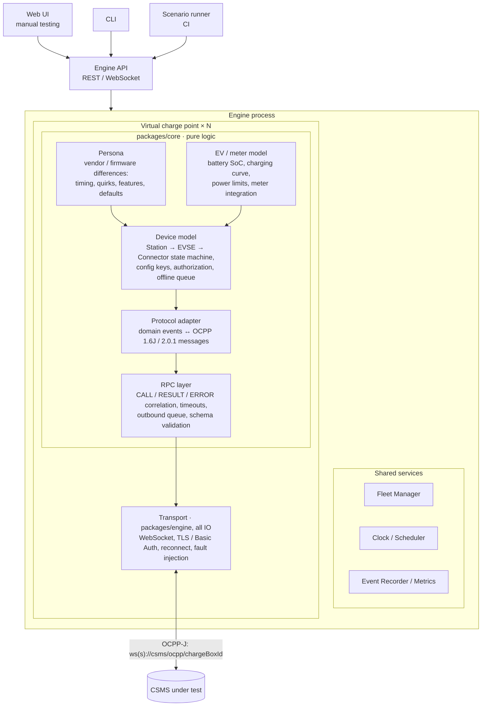

# ocpp-mimic design

Updated 2026-11-17 · Chinese version: [design.zh-CN.md](design.zh-CN.md). This English version is the source of truth.

## Overview

ocpp-mimic is a standalone OCPP charge point simulation platform: an engine runs many virtual charge points in one server process. Each charge point implements the OCPP specification, and persona files reproduce the timing and quirks of real hardware. OCPP 1.6J came first (M1 to M4); M5 added OCPP 2.0.1 and M7 OCPP 2.1 on the same engine, whose data model was shaped after 2.0.1 from the start. M8 makes it a release others can install. How to use it is in the [user guide](guide.md).

**Positioning**: the engine is built to the standard of automated regression and load testing. The Web UI, the CLI and CI scripts are all remote controls for the engine. Manual QA is one way to use the UI layer, not the starting point of the design.

**Design principles**

- Separate the spec from the differences: the engine implements only the OCPP specification; everything vendor- or firmware-specific goes into personas.
- Pure core: the protocol, state machines and persona interpreter do no IO and receive time from outside, so they are unit-testable, replay deterministically and can run in a browser.
- Separate physics from protocol: plugging in, unplugging and so on are input events; OCPP messages are outputs of the state machine.
- Safe by default: connect only to allow-listed CSMS addresses, so a simulator never reaches production by mistake.

## Lessons from a browser-based simulator

A simulator written as a web page component works in the short term and gets stuck in the places below. The ocpp-mimic design answers each of them.

| Browser-based approach | Problem it causes | ocpp-mimic approach |
| --- | --- | --- |
| Virtual charge points run inside a page component | Closing the page takes the charge point offline; timers keep sending heartbeats after the component unmounts, which needs a lot of cleanup code | The engine is its own process with explicitly managed lifecycles |
| The station list is read straight from the CSMS database, with an exclusion list to avoid production stations | The simulator is coupled to the system under test | The simulator owns its station configuration and needs only a CSMS URL + chargeBoxId; CSMS addresses are allow-listed |
| Timing is fixed delays scattered through the code | Real hardware behaviour cannot be reused or switched | Extracted into persona files |
| Responses are matched to requests by guessing from the payload shape | Mismatches under concurrency | Strict uniqueId correlation with timeouts |
| Unsupported messages get `[4, id, {}]` | The CallError format is not spec-compliant | `[4, id, "NotImplemented", "description", {}]` |
| One connector, a handful of messages | Multiple connectors and other features cannot be tested | Full Core profile, multiple connectors, connectorId 0 |
| Scattered boolean flags guard against races | State is implicit and hard to test | Explicit state machine |
| Real time only, meter sampled every 300 s | A full charging session takes hours to test | Adjustable sampling interval + energy multiplier |
| "Simulate offline" just closes the socket cleanly | Real outages are mostly half-open connections (TCP stays up, no data flows) | Support both a clean disconnect and a half-open connection |

## Architecture



The Web UI, the CLI and the scenario runner only call the engine API. Each virtual charge point has six layers: the top five belong to the pure-logic core package (no IO, time injected through `Clock`, unit-testable and replayable), and only the transport layer does network IO.

## Services and runtime

M1 deploys a single service, the engine process; the Web UI and the CLI are its clients. It is not split into microservices: thousands of virtual charge points share one clock and scheduler and the modules call each other constantly, so a single process keeps timing consistent and is easier to deploy and debug.

**Runtime processes**

| Process | Count | Responsibility |
| --- | --- | --- |
| Engine (core service) | 1 | Runs all virtual charge points, serves the API, and hosts the Web UI's static files |
| CLI / scenario runner | On demand | Runs scenario YAML, drives the engine through the API, asserts and writes a JUnit report; can also embed an engine in its own process so CI needs no separate deployment |
| Web UI | In the browser | A pure client: every action goes through the engine API, no simulation logic |

**Engine modules**

| Module | Responsibility |
| --- | --- |
| API Server | REST for commands (create stations, plug in, swipe a card, trigger faults or outages); WebSocket push of message logs and state changes |
| Fleet Manager | Creates and destroys virtual charge points in bulk from templates (persona + configuration); manages start, stop and restart; controls ramp-up during load tests |
| Virtual charge point (× N) | The main workload: core logic (persona, device model, meter, protocol adapter, RPC) plus one WebSocket to the CSMS |
| Clock / Scheduler | One timer scheduler shared by all charge points instead of a timer per charge point; injects time into core and applies the energy multiplier |
| Persona Registry | Loads and validates persona YAML and resolves `extends` inheritance |
| State Store | Persists station configuration, config keys, meter readings and offline queues in SQLite, so stations keep their state across engine restarts |
| Event Recorder | Records every OCPP message and state change; supports queries and export, and is the source for replays |
| Metrics | Aggregates CSMS response latency, timeout rate, error rate and schema violations; exposes a Prometheus endpoint |
| Fault Injector | Hooks into the transport and RPC layers; injects delays, disconnects, half-open connections and malformed messages under API control |

The architecture diagram shows only the main modules.

**How a command flows** (clicking "Plug in" in the UI)

1. The Web UI calls the REST API; the API Server asks the Fleet Manager for the charge point (for example SIM-001).
2. The device model's state machine moves from Available to Preparing.
3. The protocol adapter produces a StatusNotification and sends it to the CSMS through the RPC and transport layers.
4. The CSMS response comes back the same way, and the RPC layer matches it by uniqueId.
5. The Event Recorder logs the exchange, and the API Server pushes it to the UI over WebSocket.

**Scaling out** (after M4, when needed): when one machine is not enough, run several engine instances, each owning a share of the charge points, assigned by the CLI or a lightweight coordinator. Each instance stays a single-process model, so the architecture does not change.

## Transport and RPC layers

The transport layer makes sure connections work and fail realistically; the RPC layer makes sure every message is matched and compliant.

**Transport layer**

- Subprotocol negotiation: `ocpp1.6` or `ocpp2.0.1`, the version of the station's persona (M5).
- Security: no authentication, plus Security Profiles 1–3 (Basic Auth / TLS + Basic / mutual TLS).
- WebSocket ping/pong keepalive.
- Reconnect: exponential backoff with random jitter. Many charge points reconnecting at once can overwhelm a CSMS, which is a test scenario in itself.
- Fault injection hooks: delay, packet loss, half-open connections, forced disconnects (see fault injection).

**RPC layer**

- Requests and responses are correlated by uniqueId; every CALL has a timeout.
- The spec says (SHOULD) a party does not send the next CALL until the previous one is answered or times out, so the charge point needs an outbound queue.
- Messages in both directions are validated against core's 1.6 message definitions, written from the specification with a small dependency-free schema module that also yields the TypeScript types: what we send is guaranteed compliant, and non-compliant messages from the CSMS are flagged, which doubles as a CSMS compliance checker. As a second check, the engine validates every frame against OCA's official OCPP 1.6 JSON Schemas, shipped unchanged with attribution under their CC BY-ND 4.0 licence in `packages/engine/oca-schemas/` and read by a generic draft-04 validator (Ajv); nothing is generated from them. Problems show up on the frame's record and in the Web UI's message log. A test cross-checks core's definitions against the official schemas with generated payloads; the only differences are the 1..* array cardinalities from the specification text, which the schemas leave out and core enforces (#18). 2.0.1 stations are checked the same way, against core's 2.0.1 definitions and OCA's 2.0.1 schemas (draft-06).
- CallError strictly follows `[4, uniqueId, errorCode, errorDescription, errorDetails]`; unsupported actions get `NotImplemented`.

## Device model and EV / meter model

The device model decides which state a charge point is in and which messages it sends; the EV / meter model decides how energy and power change.

**Device model**

- The hierarchy follows 2.0.1: Station → EVSE → Connector. 1.6 just maps connectorId onto EVSE / Connector, so moving to 2.0.1 needs no rewrite (see "M5 OCPP 2.0.1").
- The connector state machine covers the 1.6 statuses: Available, Preparing, Charging, SuspendedEV, SuspendedEVSE, Finishing, Reserved, Unavailable, Faulted. A pure reducer derives each status from the connector's physical and logical state (cable, transaction, EV / EVSE suspension, fault, availability) instead of storing it, so only transitions the 1.6 status table allows can happen, and it emits a StatusNotification whenever a status changes. No state-machine library: core stays dependency-free.
- Input events: plug in, unplug, lock / unlock, EV ready, EV paused, fault raised / cleared.
- Config key store: typed and read-only aware, supports `RebootRequired`, survives restarts.
- Authorization: Authorize, local authorization list, authorization cache, `AuthorizationRequired`.
- Offline queue: transaction messages are persisted, retried per `TransactionMessageAttempts` / `TransactionMessageRetryInterval`, and resent with their original timestamps after reconnecting.
- Restart semantics: the cumulative meter reading survives; when a power loss interrupts a transaction, StopTransaction (reason=PowerLoss) is sent after the restart.

**EV / meter model**

- EV profile: battery capacity (kWh), initial SoC, maximum AC power, number of phases.
- Charging curve: power tapers once SoC passes about 80% and the session naturally reaches SuspendedEV at 100%. "Fully charged" comes out of the model; no dedicated button is needed.
- Actual power = min(charge point rating, cable limit, charging profile limit, what the EV accepts), so SetChargingProfile has a verifiable effect.
- Meter energy is the integral of power and only increases; measurands follow `MeterValuesSampledData`, with Transaction.Begin / End and clock-aligned sampling (`ClockAlignedDataInterval`).
- Implemented in M2 (`packages/core/src/ev.ts`): above `taperSoc` (default 80 %) the accepted power falls linearly to 10 % of the maximum at `targetSoc` (default 100 %), where the EV stops and the connector reports SuspendedEV. Charging is solved in closed form, so the moment the EV is full is scheduled exactly. A cable is plugged in with an EV profile (a persona `evs` name or an inline profile, through the API, the Web UI or a scenario's `plugIn: { ev }`); without one the M1 fixed power applies. `SoC` is sampled with location EV, and currents are per phase of the EV (three-phase EVs report `Current.Import` / `Current.Offered` for L1, L2 and L3). Charging-profile limits join the minimum in M3.

## Personas

A persona is a declarative configuration describing how a vendor or firmware behaves within what the spec allows: message order, delays, supported features, default configuration, fault codes and known quirks. Engine code implements only the spec; when a real charge point shows new behaviour, only the persona changes, not the engine.

```yaml
persona: vendorX-fw2.5 # example values, not real vendor data
extends: generic-1.6 # built-in persona; only the differences are listed
boot:
  chargePointVendor: VendorX
  chargePointModel: AC-7
  firmwareVersion: "2.5.0"
connectors: 2
power: { offeredW: 11000 }
features: [Core, RemoteTrigger]
config:
  HeartbeatInterval: 60
  MeterValueSampleInterval: 300
  StopTransactionOnEVSideDisconnect: true
timing:
  startTransactionDelay: 2s
  commandDelays: { RemoteStopTransaction: 800ms }
  resetDowntime: { soft: 30s, hard: 3m }
evs: # EV profiles a cable can be plugged in with
  compact-40kwh: { capacityKWh: 40, initialSoc: 20, maxPowerW: 7400, phases: 1 }
faults:
  - { name: Ground fault, errorCode: GroundFailure, info: GND_FAULT, vendorErrorCode: E101 }
```

Persona v1 (implemented in `packages/core/src/persona.ts`, loaded by the engine's Persona Registry) covers BootNotification fields, connectors, power, advertised feature profiles, configuration defaults, timing (durations in milliseconds or with `ms` / `s` / `m` / `h`), named EV profiles (`evs`: `capacityKWh`, `initialSoc`, `maxPowerW`, `phases`, optional `taperSoc` and `targetSoc`) and a fault catalogue. `extends` merges objects key by key and replaces arrays and scalars. Scripted message flows (for example sending StatusNotification Finishing before answering RemoteStop) and vendor quirks such as a minimum firmware version for UpdateFirmware are planned for a later version.

Personas come from three sources: written by hand; generated from statistics over real logs (see record & replay); or inherited from an existing persona and overridden (`extends: vendorX-fw2.5`).

## Scenario engine, fault injection, and record & replay

These three turn ocpp-mimic from a simulator you click by hand into a test tool that runs in CI.

**Scenario engine**

Scenarios are actions plus assertions, written in YAML, run by the CLI, and reported as JUnit for CI. An `http` step can call the business system under test, so app-side actions join the same scenario. The format is specified in "Scenario format v1" below.

```yaml
name: Unplug while charging; the CSMS should end the session and send no RemoteStop
csms: wss://csms.example.com/ocpp # the CSMS under test (example address)
station: { id: SIM-001, persona: vendorX-fw2.5 }
steps:
  - plugIn: { connector: 1 }
  - http: { method: POST, url: "{{APP_API}}/charges/start", json: { station: SIM-001 } }
  - expect: { received: RemoteStartTransaction, within: 10s }
  - charge: { connector: 1, duration: 20m }
  - unplug: { connector: 1 }
  - expect: { sent: StopTransaction, payload: { reason: EVDisconnected } }
  - expectNo: { received: RemoteStopTransaction, within: 30s }
```

**Fault injection**

| Layer | Faults that can be injected |
| --- | --- |
| Network | Delay, packet loss, clean disconnect, half-open connection, flapping, reconnect storms |
| Protocol | Malformed JSON, wrong or duplicate uniqueId, out-of-order messages, no response, CallError responses, schema-violating messages |
| Device | Faulted (errorCode / info / vendorErrorCode combinations), meter rollback or reset to zero, clock drift, malformed timestamps |
| Power | Power loss and restart, resending after an interrupted transaction |

**Record & replay**

- Import real charge point logs (direction, action, payload, timestamp) and replay them as scenarios to reproduce production issues.
- Derive the intervals between messages from logs to generate or calibrate personas.
- Mask idTags, serial numbers and other identifiers on import.

Designed in "M4 scale" below (log format, import mappings, masking rules, replay and calibration).

## Scenario format v1

Decided for M2 (#38). A scenario file is YAML; each YAML document in it (documents are separated by `---`) is one scenario. The runner executes scenarios one at a time, each on a fresh embedded engine, and reports a test suite per file and a test case per scenario. The files in `scenarios/examples/` are the reference examples.

```yaml
name: Card session with periodic meter values
station:
  id: SIM-001
  persona: generic-1.6
  config: { MeterValueSampleInterval: 10 }
vars:
  TAG: TAG-001
steps:
  - presentCard: { connector: 1, idTag: "{{TAG}}", result: authorized }
  - plugIn: { connector: 1 }
  - expect: { sent: StartTransaction, payload: { connectorId: 1, idTag: "{{TAG}}" } }
  - expectConnector: { connector: 1, status: Charging }
  - expect: { sent: MeterValues, within: 15s }
  - presentCard: { connector: 1, idTag: "{{TAG}}", result: stopping }
  - expect: { sent: StopTransaction, payload: { reason: Local } }
  - unplug: { connector: 1 }
  - expectConnector: { connector: 1, status: Available }
```

**Scenario fields**

| Field | Required | Meaning |
| --- | --- | --- |
| `name` | yes | Test case name |
| `description` | no | Free text, shown in reports |
| `csms` | no | `builtin` (the default) or the WebSocket URL of a CSMS; the station id is appended as for any station. `--csms` on the command line overrides it |
| `station` or `stations` | yes | One station, or a list of them. Fields: `id`, `persona`, and optionally `password` (the initial `AuthorizationKey`), `config` (configuration key overrides; 1.6), `deviceModel` (Device Model values, component → variable → value; 2.0.1), `behaviour` (test switches), `energyMultiplier`, `security` (`profile` and the PEM files `ca`, `cert`, `key`, `manufacturerRoot`, relative to the scenario file; `test-pki:<file>` names a file of the committed test PKI), `waitForBoot` |
| `vars` | no | Default values for templates |
| `csmsOptions` | no | Settings of the built-in CSMS: `tls` (`true`, or `{ clientCertificates: none \| optional \| required }`) serves wss:// with the test PKI's server certificate; `passwords` (station id → password) makes it check Basic Auth. It takes an AuthorizationKey it changed and saw Accepted as the station's new password |
| `timeout` | no | Limit for the whole scenario; default 5 minutes |
| `checkSchemas` | no | Default `true`: the scenario fails if any frame broke the official OCA schema |

Setup creates and starts every station; with `waitForBoot` (the default) it also waits until the station's BootNotification is Accepted. Set `waitForBoot: false` to test registration itself.

**Steps**

A step is a map with one step key whose value is the step's arguments. Steps that act on a station take `station` (its id; default the first station), and connector steps take `connector` (default 1), or `evse` on a 2.0.1 station, whose EVSE `n` has connector `n` as its only connector. Any step may carry `name` next to the step key (`- name: Card in` above `presentCard: ...`), which reports show instead of the generated label. Steps without arguments can be written `online:` or `online: {}`.

Charge point actions, the same operations the API offers:

| Step | Arguments | Effect |
| --- | --- | --- |
| `plugIn` | `connector`, `ev` | Cable in; `ev` names an EV profile |
| `unplug` | `connector` | Cable out |
| `presentCard` | `connector`, `idTag` (or `idToken`), `type`, `result` | A card at the connector; `result` optionally asserts `authorized`, `rejected`, `stopping` or `busy`. On a 2.0.1 station the card is an IdToken of `type` (default ISO14443) |
| `presentPaymentCard` | `connector`, `brand`, `recognition`, `readingMethod`, `cardBin`, `last4`, `expiry`, `decline`, `settlement`, `declineIncrement`, `result` | 2.1: a card at the EVSE's payment terminal, and how its PSP answers; `result` optionally asserts `authorized`, `declined`, `rejected` or `busy` |
| `stopPayment` | `connector`, `result` | 2.1: the driver stops at the terminal; `canceled` before the transaction, `stopping` after |
| `changeEvNeeds` | `connector`, `targetSoc`, `departureMinutes`, `minimumSoc`, `result` | 2.x: the plugged-in EV's needs change; an ISO 15118-20 EV on 2.1 reports them again (`reported`, K20), others only charge to the new target (`changed`) |
| `validateVat` | `vatNumber`, `evse`, `result` | 2.1: a VAT number for the CSMS to check (`Accepted` or `Rejected`) |
| `evSuspend`, `evResume` | `connector` | The EV pauses or resumes |
| `fault` | `connector` (0 = the whole charge point), `errorCode`, `info`, `vendorErrorCode` | Raise a fault |
| `clearFault` | `connector` | Clear it |
| `offline` | `mode`: `clean` or `half-open` | Simulated outage |
| `online` | — | End the outage |
| `stopStation`, `startStation` | — | Disconnect or reconnect the station |
| `setBehaviour` | `refuseRemoteStart`, `cableLock` | Test switches |
| `wait` | a duration | Pause |
| `inject` | `type` and its parameters, `for` | Starts a fault injection (see "Fault injection" under M3); a `reconnectStorm` hits every station |
| `clearInjections` | — | Ends the station's fault injections |
| `charge` | `connector`, `duration` | Wait for `duration`; fails unless the connector has a running transaction at the start and at the end |

An action the engine refuses (for example unplugging a locked cable) fails the step. With `expectError: <text>` the step instead requires a refusal whose message contains the text.

Expectations:

| Step | Arguments | Passes when |
| --- | --- | --- |
| `expect` | `sent` or `received` (an action), `payload`, `answer`, `within`, `from` | A matching CALL is recorded in time. `sent` means charge point → CSMS, `received` CSMS → charge point. `payload` must match the CALL and `answer` the CALLRESULT to it |
| `expectNo` | `sent` or `received`, `payload`, `within` | No matching CALL is recorded during `within` |
| `expectConnector` | `connector` plus connector snapshot fields (`status`, `errorCode`, `plugged`, `locked`, `transactionId`, `ev`, ...), `within` | The connector snapshot matches in time. `connector: 0` is the whole charge point (`status`, `errorCode`) |
| `expectStation` | station snapshot fields (`registration`, `transport`, `queuedMessages`, `behaviour`, ...), `within` | The station snapshot matches in time |

`within` defaults to 10 s. Message expectations are ordered: a search starts after the message the previous `expect` matched (`from: last`, the default), so consecutive `expect` steps also assert the order of the messages. `from: step` ignores messages recorded before the step began, and `from: start` searches from the start of the scenario.

CSMS steps, available only with the built-in CSMS:

| Step | Arguments | Effect |
| --- | --- | --- |
| `csmsCall` | `action`, `payload`, `answer`, `error`, `noAnswer`, `resultError` | The built-in CSMS sends a CALL to the station. `answer` must match the CALLRESULT; `error` instead names the expected CALLERROR code; `noAnswer: <duration>` passes only if no answer arrives that long. `resultError: <code>` (2.1) answers the station's CALLRESULT with a CALLRESULTERROR of that code |
| `csmsReply` | `action`, then `payload`, `error` or `ignore: true`, and `times` | How the built-in CSMS answers the station's next `times` calls of `action` (default: all of them) |

HTTP, for the system under test:

| Step | Arguments | Effect |
| --- | --- | --- |
| `http` | `method` (default GET), `url`, `headers`, `basicAuth` (`user`, `password`), `json`, `expect` (`status`, `json`), `within`, `save` | Sends a request (10 s timeout) and checks the response. Without `expect.status` any 2xx passes; `expect.json` matches the parsed body. With `within`, the request is repeated every 250 ms until it matches or the time is up |

`save: { NAME: <path> }` stores a value as a variable for later steps. It works on `expect` (path root `{ payload, answer }`), `expectConnector` and `expectStation` (the snapshot), `csmsCall` (`{ answer }`) and `http` (`{ status, json, text }`). Paths look like `$.answer.transactionId`.

**Matching**

`payload`, `answer`, the snapshot steps and `http` `expect.json` match partially: every field given must be present and equal, and fields not given are ignored. Arrays match element by element and must have the same length. Instead of a value, a field can hold operators, all of which must hold: `$exists`, `$regex`, `$ne`, `$gt`, `$gte`, `$lt`, `$lte`, and for arrays `$contains` (some item matches, partially) and `$size` (a number, or comparisons such as `{ $gte: 20 }`).

**Templates and variables**

`{{NAME}}` in a string is replaced before the step runs. Values come from, lowest priority first: `vars`, `--var NAME=value` on the command line, and variables saved by earlier steps. `{{env.NAME}}` reads an environment variable; those values are shown as `***` in output and reports. A string that is exactly one template keeps the value's type, so `"{{tx}}"` can stand for a number. `{{csmsUrl}}` is the address the scenario's stations connect to, `{{engineUrl}}` the engine the scenario runs on (its API: sessions, tariff, remote starts), and `{{csmsApiUrl}}` the built-in CSMS's control API (only with the built-in CSMS), unless `vars` or `--var` define them. `{{now}}`, `{{now+30m}}` and `{{now-1h}}` give the current time, shifted by a duration, as an ISO 8601 timestamp (for example the future times a CSMS API wants). Unknown names are errors found before the scenario starts; a saved variable counts only after the step that saves it.

**Durations** use the persona syntax: milliseconds as a number, or a string ending in `ms`, `s`, `m` or `h`.

**Where the code lives**

| Package | Part |
| --- | --- |
| core | Scenario model and validation (with the schema module), templates, matching, step labels. Pure, like personas |
| engine | The runner: a fresh embedded engine (and the built-in CSMS, `src/csms/builtin-csms.ts`) per scenario, steps executed in-process against the fleet and the recorder, teardown even after failures; the result model; console and JUnit reporters |
| cli | `ocpp-mimic run`: arguments, reading the YAML files, calling the runner, the exit code |

A remote engine over the HTTP API is not needed in M2: the CLI embeds its own engine, so CI needs no separate deployment.

**Running and reporting**

`ocpp-mimic run <file|dir>...` runs every `.yaml` / `.yml` file given, searching directories recursively in sorted order, one scenario at a time. Options: `--csms <url>`, `--var NAME=value` (repeatable), `--timeout <duration>` (the default scenario timeout), `--bail` (stop after the first scenario that does not pass), `--junit <file>`, `--allow-csms` and `--personas` as for `serve`.

- A scenario passes, fails (a step failed; the remaining steps are reported as skipped) or errors (invalid file, engine failure, timeout). Teardown always runs.
- The console shows one line per scenario with its duration and, for a failure, the failing step with expected and actual values.
- JUnit: one `testsuite` per file and one `testcase` per scenario (classname = the file), `failure` or `error` with the failing step, durations, and `properties` such as persona, CSMS and energy multiplier.
- Exit code 0 when every scenario passed, 1 when any failed or errored, 2 for usage errors and files that do not validate.

## M3 feature coverage

Decided for M3 (#65). M3 adds the remaining OCPP 1.6 feature profiles, the Security Whitepaper and fault injection. Its exit criterion is that every 1.6 feature has scenarios that pass against SteVe.

**Feature profiles**

- A persona's `features` decides which profiles a station advertises in `SupportedFeatureProfiles`. A message of a profile the station does not advertise is answered with CALLERROR NotSupported, so a persona can drop a profile to test how a CSMS copes. `generic-1.6` advertises every profile once it is implemented.
- Each feature task adds its profile's messages to core's definitions; the cross-check against OCA's schemas then covers them automatically.
- Configuration keys per profile, with the specification's names (defaults shown; personas can override them):

| Profile | Keys |
| --- | --- |
| Local Auth List Management | `LocalAuthListEnabled` (true), `LocalAuthListMaxLength` (100, read-only), `SendLocalListMaxLength` (100, read-only) |
| Reservation | `ReserveConnectorZeroSupported` (true, read-only) |
| Smart Charging | `ChargeProfileMaxStackLevel` (10), `ChargingScheduleAllowedChargingRateUnit` (Current,Power), `ChargingScheduleMaxPeriods` (24), `MaxChargingProfilesInstalled` (20), `ConnectorSwitch3to1PhaseSupported` (false); all read-only |
| Firmware Management | `SupportedFileTransferProtocols` (HTTP,HTTPS,FTP, read-only) |
| Security (whitepaper) | `SecurityProfile` (0), `AuthorizationKey` (write-only, 16 to 40 characters when set by the CSMS), `AllowSecurityProfileDowngrade` (false), `CpoName` (empty), `CertificateStoreMaxLength` (10, read-only), `CertificateSignedMaxChainSize` (10000, read-only), `AdditionalRootCertificateCheck` (false, read-only) |

**Local Auth List and Reservation**

- The local list sits next to the authorization cache: with `LocalAuthListEnabled` a card on the list is decided locally (online with `LocalPreAuthorize`, offline with `LocalAuthorizeOffline`), as the specification describes. The list and its version are kept across engine restarts.
- A reservation is part of the device model: the connector reports Reserved, only the reserved idTag or its parentIdTag can start, the reservation ends at `expiryDate` or when its transaction starts, and StartTransaction carries the `reservationId`. connectorId 0 reserves any free connector when `ReserveConnectorZeroSupported` is true.

**Smart Charging**

- A pure model in core (`charging-profile.ts`) holds the installed profiles per connector (connectorId 0 for the whole station) and answers two questions: the limit in force at a moment, and the composite schedule over a duration.
- Stacking: the highest `stackLevel` valid at the moment wins within a purpose; a TxProfile (only during a transaction) overrides the TxDefaultProfile; a ChargePointMaxProfile on connectorId 0 caps the station, shared equally between the connectors that are charging.
- Absolute, Recurring (Daily / Weekly, from `startSchedule`) and Relative (from the transaction start) schedules; `validFrom` / `validTo`; limits in A or W, converted with the connector's voltage and `numberPhases` (default 3).
- The power delivered is min(charge point rating, EV acceptance, limit in force). A timer fires at the next period boundary, so power, MeterValues and SoC follow the schedule. Profiles are kept across engine restarts.

**Firmware and diagnostics**

- By default nothing is transferred: the station walks through the statuses with timings from the persona (`firmware: { downloadTime, installTime, uploadTime }`) and outcomes from the persona or from fault injection (DownloadFailed, InstallationFailed, UploadFailed).
- UpdateFirmware waits for `retrieveDate`, sends Downloading → Downloaded → Installing → Installed, then reboots. The new `firmwareVersion` in BootNotification is the version in the location's file name (`fw-2.5.1.bin` → 2.5.1), otherwise the old version with `-updated`; it is kept across restarts.
- GetDiagnostics answers with a `fileName` and sends Uploading → Uploaded. With `firmware: { transfer: real }` in the persona, an HTTP(S) location really receives the diagnostics file (a text summary of the station's state and configuration) by PUT into the location directory, and UpdateFirmware really downloads an HTTP(S) location. FTP is never really transferred.
- TriggerMessage can request both status notifications.

**Fault injection**

- An engine Fault Injector per station, sitting in the transport and RPC layers. API: `POST /api/stations/:id/injections` with `{ type, ...parameters, for? }`, `DELETE` to clear. Scenario steps: `inject: { type, ..., for }` and `clearInjections: {}`.

| Layer | Types |
| --- | --- |
| Network | `latency` (ms, each direction), `drop` (frames in a direction, a count or a probability), `flap` (down / up times, repeats), `reconnectStorm` (every station at once; fleet-wide) |
| Protocol | `malformedJson` (next N frames sent), `duplicateId`, `unknownId` (answers with a uniqueId the CSMS never sent), `outOfOrder` (swaps the next two CALLs), `noAnswer` (ignores CSMS CALLs of an action), `callError` (answers them with a CALLERROR code), `schemaViolation` (an extra property in the next CALL of an action) |
| Device | `meterRollback` (Wh), `meterReset`, `clockDrift` (ms added to every timestamp), `badTimestamp` (next N timestamps malformed) |
| Power | `powerLoss` (`off`: dark that long, then restart from the saved state: transactions end with PowerLoss, queued messages keep their timestamps), repeated `times`, `on` apart |

- Injected frames are recorded with the injection's type, shown in the Web UI's message log and excluded from the OCA schema check, since they are wrong on purpose.

Implemented for the network and protocol layers (T30):

- The Fault Injector sits on the wire between the charge point and its transport, and frames are recorded there, after it: the message log shows what really went over the connection. A frame an injection changed or made carries `injected` (the type); one that never reached the other side (dropped, or a CALL left unanswered) also carries `dropped`, and `expect` steps ignore it.
- Parameters: `latency { ms, direction: sent | received | both }`; `drop { direction, count?, probability?, action? }`; `flap { down, up, times? }`; `malformedJson`, `duplicateId`, `unknownId`, `schemaViolation` take `count` (default 1), `schemaViolation` and `noAnswer` / `callError` an `action`, `callError` an `errorCode` (default InternalError). Each takes `for` to end it after a time; counted ones end when used up; `outOfOrder` swaps the next two frames sent (a lone one goes after 1 s). A duplicated uniqueId's answer is renamed back, so the station itself is not confused.
- `GET`, `POST` and `DELETE /api/stations/:id/injections`; a `reconnectStorm` posted to any station hits the whole fleet. Snapshots list the active injections, and the Web UI shows them with a Clear button.
- `csmsCall` takes `noAnswer: <duration>` to assert a CSMS-side timeout.

Implemented for the device and power layers (T31):

- `meterRollback { wh, connector? }` and `meterReset { connector? }` set the connector's energy register in the charge point; meter values and meterStop continue from there, so meterStop can fall below meterStart as with a real faulty meter (it is no longer clamped).
- `clockDrift { ms }` (negative: behind) shifts every `timestamp` the station sends, and `badTimestamp { count? }` replaces them with `not-a-timestamp`; both work on the wire, after the charge point's own validation.
- `powerLoss { off, on?, times? }`: the fleet saves the station's state, drops its connection (the snapshot shows `running: false`), and after `off` builds the station again from that state, as after a power cut: running transactions end with PowerLoss, queued messages keep their timestamps, and StartupOfTheDevice is reported. `on` (default 5 s) separates repeated cuts.
- The faults of a persona's catalogue (errorCode, info, vendorErrorCode) are raised with the `fault` step and the Web UI as before.
- The Web UI's station detail has an Inject row: a fault type and `key=value` parameters, e.g. `off=10s` for a power loss.
- Comparison operators (`$lt` and the like) take a template, so a saved reading can be compared with a later one.

**Security (OCPP 1.6 Security Whitepaper)**

- Stations take `security: { profile, ca?, cert?, key? }` (PEM file paths). Profile 1: Basic Auth over ws or wss with `AuthorizationKey` as the password (the station's `password`). Profile 2: wss with the server certificate checked against `ca`, plus Basic Auth. Profile 3: wss with the client certificate `cert` / `key`, no Basic Auth.
- ChangeConfiguration of `AuthorizationKey` reconnects with the new key (A01). `SecurityProfile` can only go up, except from 3 to 2 with `AllowSecurityProfileDowngrade`; the station reconnects with the new profile and falls back to the previous one when that fails (A05).
- The built-in CSMS can serve TLS, require client certificates and check Basic Auth passwords (`csmsOptions` in a scenario). Tests use a fixed test PKI committed under `packages/engine/test-pki/` (CA, server and client certificates valid for 20 years, test only) with a script that regenerates it with openssl.
- All whitepaper messages are in M3: certificate management (SignCertificate / CertificateSigned, InstallCertificate, GetInstalledCertificateIds, DeleteCertificate), SecurityEventNotification, ExtendedTriggerMessage, GetLog / LogStatusNotification and SignedUpdateFirmware / SignedFirmwareStatusNotification. CSRs and signing need X.509 work Node does not expose; the engine does it with node:crypto plus a small DER module (`x509.ts`, checked against openssl in its tests), so no library was added, and core gets it as an injected `CertificateTools`. OCA's whitepaper download (edition 4) contains JSON schemas (draft-06); they ship unchanged in `packages/engine/oca-schemas/ocpp16-security/` and check frames like the 1.6 ones.

**SteVe**

- Scenarios make SteVe send commands through its REST API (`POST /steve/api/v1/operations/<Action>`, HTTP Basic with the admin user's API password) using `http` steps (#63). `scenarios/steve/` holds these SteVe variants and the SteVe workflow runs them.
- Data SteVe needs before a command (charging profiles to reference by id, OCPP tags for the local list and reservations) is created through its API or `tools/steve/register.sh`.
- Implemented (T39): `scenarios/steve/features.yaml` drives the local list, reservations, Smart Charging, firmware and diagnostics, and the Security Whitepaper messages from SteVe 3.14.1's REST API, which offers all of them. `register.sh --charging-profile` adds charging profile 1001 (TxDefaultProfile, Relative, 3680 W) for SetChargingProfile. The SteVe workflow runs these with the other SteVe scenarios.

**Scenarios**

Each feature task adds regression scenarios for the built-in CSMS (`scenarios/regression/`) and, where SteVe can send the command, a SteVe variant (`scenarios/steve/`). For example, a TxProfile capping a running session:

```yaml
name: A TxProfile caps the power of a running session
station: { id: REG-SC-TX, persona: regression-1.6 }
steps:
  - presentCard: { idTag: TAG-REG, result: authorized }
  - plugIn: { ev: compact-40kwh }
  - expect: { sent: StartTransaction, save: { tx: $.answer.transactionId } }
  - expectConnector: { status: Charging, powerW: { $gt: 7000 } }
  - csmsCall:
      action: SetChargingProfile
      payload:
        connectorId: 1
        csChargingProfiles:
          chargingProfileId: 1
          transactionId: "{{tx}}"
          stackLevel: 0
          chargingProfilePurpose: TxProfile
          chargingProfileKind: Relative
          chargingSchedule:
            chargingRateUnit: W
            chargingSchedulePeriod: [{ startPeriod: 0, limit: 3680 }]
      answer: { status: Accepted }
  - expectConnector: { powerW: 3680 }
```

And a fault injected by a scenario:

```yaml
name: The CSMS copes with a slow, lossy connection
station: { id: REG-FI-NET, persona: regression-1.6 }
steps:
  - inject: { type: latency, ms: 2000, for: 30s }
  - presentCard: { idTag: TAG-REG, result: authorized }
  - plugIn: {}
  - expect: { sent: StartTransaction, within: 15s }
  - inject: { type: drop, direction: received, count: 1 }
  - expect: { sent: StatusNotification, payload: { status: Charging }, within: 15s }
```

## M4 scale

Decided for M4 (#97). M4 makes ocpp-mimic a load-test tool: stations created in bulk that charge on their own, a load-test command with a pass / fail report, metrics for Prometheus and OpenTelemetry, and record & replay (log import with masking, replay as a scenario, persona calibration). Scaling out to several machines stays after M4.

**Exit criterion**

1,000 virtual charge points run stably for an hour on one machine. Concretely, `scenarios/load/m4-exit.yaml` passes on a GitHub-hosted `ubuntu-latest` runner of a private repository (2 vCPUs, 8 GB RAM), with the engine and `ocpp-mimic csms` as two processes on that runner:

- 1,000 stations of `load-ac-1.6` (two connectors, HeartbeatInterval 60 s, MeterValueSampleInterval 60 s), started at 10 stations a second.
- Sessions arrive at each free connector once an hour on average and last 10 to 40 minutes (the usage model below), with 5 % unknown cards. The CSMS answers after a random 20 to 100 ms.
- A reconnect storm at minute 30 (every connection dropped at once), and a 30-second power loss on 5 % of the stations at minute 45.

It passes when all of these hold:

| Threshold | Value |
| --- | --- |
| BootNotification Accepted for every station | within 60 s after the ramp-up ends |
| Disconnects other than the injected ones | none |
| Back online after each fleet event | every station within 120 s |
| Scheduled work late (heartbeats, meter samples, usage events, retries) | p99 under 1 s, never over 5 s |
| Engine event-loop delay | p99 under 100 ms |
| Engine memory | RSS under 2 GB; the heap floor of the last 5 minutes at most 10 % above the floor of minutes 10 to 15 |
| CALL timeouts, CALLERRORs and schema violations, either side | none |
| Sessions | at least 80 % of the expected number; every started transaction stopped or still running at the end |

CPU use is reported, not judged. The same plan runs longer locally with `--duration 8h`. These numbers are the M4 target; they can change if real needs differ.

**Fleet templates**

- `POST /api/stations/bulk` creates stations from a template: `{ count, id, persona, csmsUrl, password?, security?, config?, energyMultiplier?, tags?, group?, usage?, start?, rampUp? }`. The `id` holds one counter in braces whose digits give the start and the width: `SIM-{0001}` makes SIM-0001, SIM-0002, ...; `SIM-{1001}` starts at SIM-1001. It creates all of them or none (409 when an id exists), in one State Store transaction.
- `tags` (up to 10 names of letters, digits, `.`, `_` and `-`) are for selecting; `group` (one name) also labels metrics and report lines. Stations created one by one take both too.
- Ramp-up: `rampUp: { rate, jitter }` starts `rate` stations a second (default 20), each at a random point within `jitter` (0 to 1, default 0.5) of its slot; `rampUp: false` starts them all at once.
- Selections: `POST /api/stations/bulk/start`, `/stop`, `/offline`, `/online` and `DELETE /api/stations/bulk` take `{ ids?, tag?, group? }` (start also `rampUp`). `GET /api/stations` filters by `tag`, `group` and `state`, and `?view=summary` returns only id, persona, group, tags, connection state and connector statuses.

**Usage model**

A station can charge on its own, driven by core's clock and a seeded random generator, so scenarios and manual use stay deterministic when it is off (the default). It is set in the persona (`usage`), in a template or load-plan group, or per station through the API, and `PATCH /api/stations/:id/usage` with `{ enabled }` switches it.

```yaml
usage:
  sessionsPerHour: 1 # per connector, while it is free (Poisson arrivals)
  stay: { min: 20m, max: 2h } # how long the driver stays, uniform
  evs: { compact-40kwh: 3, suv-77kwh: 1 } # weights over the persona's evs (default: all equal)
  idTags: { prefix: LOAD-, count: 500, unknownShare: 0.05, unknownPrefix: UNKNOWN- }
  cardFirst: 0.3 # share of drivers who present the card before plugging in
  stopBy: { card: 0.7, unplug: 0.3 } # how the driver ends the session when leaving
  steps: { min: 5s, max: 30s } # waits between card and plug, and before unplugging
```

- A session: an arrival picks an EV, a card, the order and the stay; card and plug follow each other a step apart (`steps`, 5 to 30 s by default). A refused card makes the driver unplug a step later. At the end of the stay the driver presents the card again (StopTransaction reason Local) and unplugs a step later, or just unplugs (EVDisconnected); an EV that is full first waits in SuspendedEV.
- A connector that is not free (Unavailable, Faulted, Reserved, or still occupied) turns arrivals away; they are counted. Remote starts are not part of the model: they need the CSMS to begin them.
- Each station's generator is seeded from the run's `seed` and the station id, so a station repeats its sessions when the CSMS answers the same way, whatever the other stations do. After a restart the driver of a plugged-in connector picks a new stay.
- The built-in CSMS answers Invalid for idTags starting with the unknown prefix (`UNKNOWN-` by default) when asked to, so the unknown share is visible to it.

**Load plan and report**

`ocpp-mimic load <plan.yaml>` runs a load plan. Example (`scenarios/load/example.yaml`):

```yaml
name: Two groups for an hour, with a reconnect storm
csms: ws://127.0.0.1:9100/ocpp # or builtin: in-process, for small plans
seed: 1
duration: 60m
rampUp: { rate: 10, jitter: 0.5 }
groups:
  - name: ac
    count: 900
    id: LOAD-AC-{0001}
    persona: load-ac-1.6
    tags: [ac]
  - name: busy
    count: 100
    id: LOAD-BUSY-{0001}
    persona: load-ac-1.6
    usage: { sessionsPerHour: 4, stay: { min: 5m, max: 20m } }
events:
  - at: 30m
    reconnectStorm: {}
  - at: 45m
    inject: { type: powerLoss, off: 30s }
    stations: { share: 0.05, group: ac } # or count; or tag
thresholds:
  bootAcceptedWithin: 60s
  recoverWithin: 120s
  unexpectedDisconnects: 0
  lateWork: { p99: 1s, max: 5s }
  csmsLatency: { p95: 1s } # per action and overall
  timeouts: 0
  callErrors: 0
  schemaViolations: 0
  eventLoopDelay: { p99: 100ms }
  memory: { rss: 2GB, heapGrowth: 10% }
  sessions: { min: 0.8 } # share of the expected number
```

- Options: `--csms`, `--duration`, `--report-dir` (writes `report.json` and `report.md`), `--junit` (one test case per threshold), `--log-dir` (frames per station as JSONL), `--port` (also serves the API and Web UI to watch the run), `--metrics` and `--otlp-endpoint`, `--personas`, `--allow-csms`. The exit code is 1 when a threshold fails.
- A progress line every 10 s: stations online, sessions running, CSMS latency p95, errors. The report has every threshold with its measured value, per-group lines, CSMS latency per action, and the fleet events with their recovery times.
- The allow list applies as for scenarios (loopback unless `--allow-csms`). Only load-test a CSMS you operate or have permission to test.

**Metrics**

Collected in the engine from the wire and the transport, so they work with the Event Recorder off. Labels stay at `action`, `persona` and `group` (plus `direction`, `outcome`, `code` where listed); there is no station label, so 1,000 stations cost no more series than one.

| Metric | Type | Labels |
| --- | --- | --- |
| `ocpp_mimic_stations` | gauge | `state` (connected, connecting, offline, stopped), persona, group |
| `ocpp_mimic_connectors` | gauge | `status` (the 1.6 statuses, or the 2.0.1 connector statuses of an EVSE), persona, group |
| `ocpp_mimic_csms_response_seconds` | histogram | action, persona, group: socket send of the station's CALL to socket receive of the answer |
| `ocpp_mimic_csms_answers_total` | counter | action, `outcome` (result, error, timeout) |
| `ocpp_mimic_calls_received_total` | counter | action: CALLs from the CSMS |
| `ocpp_mimic_callerrors_total` | counter | `direction`, action, `code` |
| `ocpp_mimic_schema_violations_total` | counter | `direction`, action |
| `ocpp_mimic_frames_total`, `ocpp_mimic_frame_bytes_total` | counter | `direction`, `ocpp` (1.6, 2.0.1) |
| `ocpp_mimic_connections_total` | counter | `outcome` (opened, failed), `ocpp` |
| `ocpp_mimic_disconnects_total` | counter | `cause` (local, remote, error) |
| `ocpp_mimic_transactions_total` | counter | `outcome` (started, stopped, refused): 1.6 Start/StopTransaction, 2.0.1 TransactionEvent Started and Ended |
| `ocpp_mimic_sessions_turned_away_total` | counter | persona, group |
| `ocpp_mimic_energy_wh_total` | counter | persona, group |
| `ocpp_mimic_offline_queue_messages` | gauge | — |
| `ocpp_mimic_work_lateness_seconds` | histogram | — : scheduled work run time minus its due time |
| `ocpp_mimic_eventloop_delay_seconds` | summary | `quantile` (0.5, 0.99, and 1 for the maximum), over the last 10 s |
| `process_cpu_seconds_total`, `process_resident_memory_bytes`, `nodejs_heap_size_used_bytes` | — | — (the usual names, so existing dashboards fit) |

- Histogram buckets (seconds): 0.005, 0.01, 0.025, 0.05, 0.1, 0.25, 0.5, 1, 2.5, 5, 10, 30. Internally latencies go into log-scaled buckets with about 2 % error, so reports give real p50 / p95 / p99; the Prometheus buckets are folded from them.
- `GET /metrics` serves the Prometheus text format (no new dependency); `GET /api/metrics` the same numbers as JSON, with percentiles, for the Web UI and the CLI.
- OpenTelemetry: the same instruments pushed over OTLP/HTTP with JSON encoding to `<endpoint>/v1/metrics`, cumulative, every 10 s. The encoding is the engine's own, not the official SDK, which would add many packages for a small protocol. `--otlp-endpoint` and `--otlp-header`, or the standard `OTEL_EXPORTER_OTLP_ENDPOINT`, `OTEL_EXPORTER_OTLP_HEADERS`, `OTEL_METRIC_EXPORT_INTERVAL`, `OTEL_SERVICE_NAME` and `OTEL_RESOURCE_ATTRIBUTES`; resource attributes `service.name`, `service.version` and `ocpp_mimic.run`. No traces in M4: a span per frame at 1,000 stations costs more than the latency histograms tell.

**Engine at scale**

- **Benchmark first.** `pnpm bench --stations N --duration D` runs the engine in-process against `ocpp-mimic csms` in a child process and samples every 5 s: event-loop delay, CPU, RSS and heap, frames a second, connect times and late work. The baseline at 100, 500 and 1,000 stations, with CPU profiles and heap snapshots, decides what T45 changes; the numbers go into this document.
- **Candidates**, each kept only if the baseline shows it matters: one shared scheduler (a heap of due times behind one Node timer) instead of a Node timer per timer; frames parsed once on the wire instead of by the Fault Injector, the recorder and core separately; state saves batched into one SQLite transaction a second; snapshots built only when asked for.
- **Event Recorder.** A per-station limit: 1,000 entries for `serve`, 10 for `load`, 0 to keep none (`--record-limit`). A load station records about 3 entries a minute, so a limit of 10 fills during the warm-up and the heap-growth threshold measures leaks rather than a buffer still filling; `--log-dir` keeps the whole log. Schema checks keep counting into metrics when nothing is kept.
- **Events WebSocket.** A client subscribes to the stations it shows (`{ type: subscribe, stations: [...] }`): records and full snapshots go only to their subscribers, and so does the 2-second push of charging stations. Everyone gets fleet summaries (the `?view=summary` fields of changed stations), batched at most once a second.

**Record & replay**

- **Log format.** ocpp-mimic's log is JSONL: an optional header line `{ "format": "ocpp-mimic-log", "version": 1, "masked": false }`, then one frame per line: `{ "at": "2026-11-15T09:00:00.000Z", "station": "SIM-001", "direction": "cp-to-csms", "frame": [2, "19223201", "BootNotification", { ... }] }`. A frame that is not JSON keeps its `text` instead of `frame`; injected and dropped frames keep their marks.
- **Export.** `GET /api/stations/:id/messages?format=jsonl`, an Export button in the Web UI's message log, and `--log-dir` on `run` and `load` (one file per station). Logs of the repository's own scenarios are the sample logs.
- **Import.** `ocpp-mimic import <file>... --map <mapping.yaml> [--mask] [--salt <s> | --salt-file <f>] [-o <out.jsonl>]` turns other logs into this format. A mapping reads JSONL (field paths), CSV (columns) or plain log lines (a regular expression with named groups), with the time format (ISO 8601, epoch seconds or milliseconds, a time zone for times without one) and the direction values. Example in `scenarios/import/csv-mapping.yaml`.
- **Masking**, on by default for imports and with `--mask` for ocpp-mimic's own logs. Stable pseudonyms (HMAC-SHA-256 of kind and value with the salt, shortened to fit the field) for chargeBoxIds, `idTag` and `parentIdTag` wherever they occur, `chargePointSerialNumber`, `chargeBoxSerialNumber`, `meterSerialNumber`, `iccid` and `imsi`: one value always gets the same pseudonym under one salt, so sessions still line up. Removed: DataTransfer `data`, passwords in URLs, `AuthorizationKey` values, certificates and CSRs. Kept: `info` and `vendorErrorCode`, which calibration needs. A mapping can add paths to mask or keep. Without a salt a random one is used and not stored, so two imports cannot be linked. The header records `masked: true`.
- **Replay.** A `replay` scenario step drives a station's connection directly: its charge point logic is detached for the step. It sends the log's charge-point frames in order, with the recorded gaps divided by `speed` and capped at `maxGap`, and checks the CSMS's answers with `compare: status` (default: result or error, error code, and every `status` field), `strict` (the whole payload except volatile fields such as `currentTime`, `transactionId` and timestamps) or `none`. CALLs from the CSMS are matched to the next recorded CALL of the same action and answered with its recorded answer; unmatched ones and recorded ones that never come are reported. Timestamps move to the present (the time-acceleration decision), uniqueIds are fresh, and `transactionId`s map to the ones the CSMS assigns. A log that starts mid-session gets a BootNotification first.
- `ocpp-mimic replay <log> [--station <id>] [--csms <url>] [--speed <n>] [--max-gap <d>] [--compare <mode>]` runs it and reports like `run`; `--write <scenario.yaml>` writes the scenario instead, with the frames inline so they can be edited.
- **Calibration.** `ocpp-mimic calibrate <log>... [--station <id>] [--extends <persona>] [-o persona.yaml] [--report report.md]` derives a persona from one or more stations of the same model: BootNotification fields, connector count, configuration from the latest GetConfiguration answer, HeartbeatInterval and MeterValueSampleInterval (median gaps), measurands, phases and locations, offered power, `timing` (start-transaction delay, answer delay per CSMS action, reset downtime), the fault catalogue (errorCode, info, vendorErrorCode), EV profiles where SoC is reported, and the usage model (arrivals, stays, how sessions end, unknown cards). Every value lists its sample count and spread; a value with fewer than 3 samples is reported as not derived.
- **Sample logs.** Tests use synthetic logs recorded from the repository's own personas and scenarios, kept small under `scenarios/logs/`. Real logs come only from the user's own sources, are masked, and are not committed. The calibration test records a log from a persona with distinctive values and checks that calibration gives those values back.

**Implemented: the test CSMS on its own (T42)**

- `ocpp-mimic csms` runs the built-in CSMS on port 9100 (`--port`, `--host`) and keeps no frames, so a long run stays flat in memory. `--delay 50ms` or `--delay 20ms-100ms` delays every answer (a random time in the range); `--heartbeat-interval` sets the BootNotification interval (default 60 s); idTags starting with `--unknown-prefix` (default `UNKNOWN-`, empty for none) are Invalid in Authorize and StartTransaction; `--password` is a Basic Auth password for every station; `--tls-cert`, `--tls-key`, `--tls-ca` and `--client-certificates` serve wss://.
- It prints a status line every `--status` (default 60 s; 0 never): connections opened, closed and refused, requests and answers; on SIGINT or SIGTERM it prints a summary with requests by action.
- Measured on a laptop: 1,000 connections sending a heartbeat a second each (about 50 times the exit plan's traffic) used about 4 % of a core and 119 MB.

**Measured: the benchmark baseline (T43)**

`pnpm bench` before any M4 change, on a laptop (Apple M1 Pro): stations of `load-ac-1.6` started 10 a second, 30 % of them charging, against `ocpp-mimic csms --delay 20ms-100ms`, for 5, 8 and 10 minutes. The reference runner's numbers come with T45, from the `bench` workflow.

| Stations | 100 | 500 | 1,000 |
| --- | --- | --- | --- |
| Engine CPU after the ramp-up, mean / max (% of a core) | 1.0 / 2.7 | 2.6 / 4.3 | 6.1 / 10.2 |
| Event-loop delay, worst 5-second p99 / max (ms) | 11 / 56 | 17 / 40 | 12 / 38 |
| Heartbeats late, p99 / max (ms) | 11 / 14 | 9 / 23 | 16 / 37 |
| Meter values late, p99 / max (ms) | 7 / 7 | 6 / 11 | 8 / 25 |
| WebSocket connect, p99 (ms) | 12 | 9 | 9 |
| RSS peak (MB) | 98 | 158 | 241 |
| Heap floor, first quarter → last quarter (MB) | 17 → 18 | 21 → 31 | 22 → 52 |
| `ocpp-mimic csms` process: CPU s / RSS MB | 1.1 / 55 | 5.8 / 63 | 9.3 / 66 |

Bottlenecks, most important first:

1. **Snapshots and pushes nobody reads**, about a quarter of the engine's busy time at 1,000 stations (CPU profile: `readableConfigValues`, `snapshot`, `broadcast`). The engine builds a full snapshot, with a copy of every configuration value, after each change and every 2 s for each charging station, and serializes every record for the events WebSocket, even with no client connected.
2. **Event Recorder memory grows with the run**: the heap floor rose 30 MB in 10 minutes at 1,000 stations, about 0.9 KB a record, and keeps rising until every station holds 1,000 records, about 850 MB at 1,000 stations.
3. **Not bottlenecks** at this size: timers (late work stays under 40 ms with a Node timer per timer, so the shared scheduler is not needed), frame parsing (under 1 % of busy time) and the CSMS process.
4. **Not measured yet**: state saves with `--store`, each its own SQLite transaction; T45 measures with a store.

**Implemented: fleet templates (T44)**

- `POST /api/stations/bulk` answers `201 { created, ids }`. The id counter, tags and group are checked in core (`fleet-template.ts`), which load plans will share; ids must be 1 to 48 visible characters without `/ ? # %`, and one template makes at most 10,000 stations. Every station is built before any is saved, so an unknown persona, a refused CSMS address or a taken id adds nothing.
- The fleet's `addMany`, `startMany`, `stopMany` and `removeMany` back the bulk routes; a station stopped or removed before its ramp-up turn stays stopped. Definitions are saved and deleted in one SQLite transaction.
- Snapshots carry `tags` and `group`. `GET /api/stations?view=summary` returns `{ id, persona, group?, tags, state, registration, connectors: [{ connectorId, status }] }`, where `state` is connected, connecting (also while waiting to reconnect), offline (taken offline, cleanly or half-open) or stopped.
- Bulk actions refuse an empty selector; `{ all: true }` selects every station. The bulk routes sit at `/api/stations/bulk...`, so a station cannot be called `bulk`.

**Implemented: metrics (T46)**

- `engine/src/metrics.ts` gets each frame from the Event Recorder's record (parsed once, schema-checked once), transport events and RPC timeouts; the system clock reports how late each timer ran. `GET /metrics` serves the Prometheus text format on the engine's port; `GET /api/metrics` the summary as JSON (counts, CSMS latency p50 / p95 / p99 per action and overall in milliseconds, event-loop delay, process CPU and memory).
- CSMS latency is measured between the frames as recorded: from the station's CALL leaving through the Fault Injector to the answer coming out of it, so an injected `latency` counts in.
- Disconnects are `local` (the station dropped the connection itself: stopped, taken offline, an injection, a reset or reconnect), `remote` (the CSMS closed it) or `error` (it broke without a close frame); the exit criterion's unexpected disconnects are `remote` plus `error`. Connection attempts that never opened count as `failed`.
- Transactions count as `started` or `refused` from the StartTransaction answer and `stopped` from the StopTransaction answer; `ocpp_mimic_energy_wh_total` adds meterStop − meterStart of finished transactions. Connector gauges use the last StatusNotification of each connector (not connector 0).
- `ocpp_mimic_info{version}` names the version. `ocpp_mimic_sessions_turned_away_total` comes with the usage model (T48).
- CI checks the output of a running engine with `promtool check metrics` (prom/prometheus v3.5.0).

**Implemented: the usage model (T48)**

- `core/src/usage.ts`: the model, its validation, a seeded generator (mulberry32) and the driver. A persona's `usage` is a complete model; a station's `usage` (API, template, scenario) is `true` (the persona's), an object of changes merged onto it (`evs` is replaced), or `false` / absent (off). `seed` on a station is the run's seed; the station's generator is seeded with it and the station id (FNV-1a), 0 when absent, and kept across power losses, so sessions continue rather than repeat.
- `steps: { min, max }` (default 5 s to 30 s) is how long a driver waits between card and plug, before giving up after a refused card, and before unplugging after stopping with the card. Short steps and stays make a session fit in a regression scenario.
- The driver acts through the charge point's inputs: a connector is free when it is Available with no cable in; the card ends the session only while a transaction runs (Charging, SuspendedEV or SuspendedEVSE), otherwise the driver unplugs, since a card would start a new one. EV names must exist in the persona.
- It runs while its station runs (stopped with it, and during a power loss); `PATCH /api/stations/:id/usage { enabled }` switches it (409 without a model), and a switch carries over a power loss but not a restart of the engine. Snapshots carry `usage: true | false` when the station has a model.
- Driver events go into the station's log (`usage: a driver arrives at connector 1 with LOAD-0042 and EV compact-40kwh`) and `ocpp_mimic_sessions_turned_away_total`.
- `load-ac-1.6` carries a usage model; `scenarios/regression/usage.yaml` runs sessions that end with the card and by unplugging.

**Implemented: log export, import and masking (T51)**

- The log format lives in core (`log-format.ts`: `logLine`, `formatLog`, `parseLog`). `GET /api/stations/:id/messages?format=jsonl` downloads a station's frames (what the recorder holds); the Web UI's message log has an Export JSONL link; `run --log-dir <dir>` writes each scenario's frames to `<dir>/<file>-<n>.jsonl`. `load --log-dir` comes with the load command (T49).
- `ocpp-mimic import <file>... [--map <mapping.yaml>] [--mask | --no-mask] [--salt <s> | --salt-file <f>] [-o <out>]` writes ocpp-mimic's format to standard output or a file, in time order. Without `--map` the input is ocpp-mimic's own format. Exit code 1 when some lines could not be read (they are listed and the rest is written), 2 for an unreadable file or mapping.
- Mappings (`engine/src/logs/import.ts`): `format: jsonl | csv | lines`; `fields.at | station | direction | frame` each name a `column` (CSV, by header name or index), a `path` (JSONL, dotted) or a `group` (lines; by default the field's own name); `fields.at.time` is `iso`, `epoch-s` or `epoch-ms`, and `timeZone` (IANA, default UTC) applies to ISO times without an offset, daylight saving included; `fields.direction.values` maps the log's words. A `frame` may be the OCPP-J text or an array. CSV fields may be quoted, with doubled quotes and line breaks.
- Masking (`core/src/mask.ts`, HMAC-SHA-256 in the engine): pseudonyms are a prefix and 10 base-32 characters: `CP-` for stations, `T` for `idTag` and `parentIdTag` (wherever they occur, local lists included), `S` for serial numbers, `SIM` for `iccid` and `imsi`, `X` for paths added by the mapping. Answers are matched to their CALL, so a DataTransfer answer's `data` goes too. Text that is not a message is removed, since it may hold anything. The salt comes from `--salt`, `--salt-file` or `OCPP_MIMIC_MASK_SALT`; without one a random salt is used and a warning printed. A log already marked masked is not masked again.
- `scenarios/logs/` holds synthetic sample logs recorded from the repository's scenarios (1.6, 2.0.1 and, since M7, 2.1).

**Implemented: the engine at 1,000 stations (T45)**

The baseline's two bottlenecks, plus one the baseline did not cover:

- **Nothing is built for nobody.** Without a client on the events WebSocket the engine builds no snapshot and serializes no record for it, and the 2-second push of charging stations is skipped.
- **Recorder limit.** `serve --record-limit <n>` (default 1000, 0 keeps none); load runs keep 10 per station (T49).
- **State saves.** With `--store`, each station's state was saved in its own SQLite transaction: 50 ms after every change, and every station every 10 s. At 1,000 stations the 10-second save held the event loop for about 300 ms. Changes are now collected for a second and written in one transaction, and the periodic save writes a tenth of the stations every second, so every station is still saved every 10 s but no transaction holds the loop for long. The store uses WAL with `synchronous=NORMAL`: on the CI runner a single commit's fsync once held the loop for 2.5 s; now commits do not wait for the disk (a crash can lose the last ones).
- **Not changed**, as the baseline showed no need: the shared scheduler, and parsing each frame once.

Measured with `pnpm bench`, 1,000 stations of `load-ac-1.6` with `--store`, 20 started a second, 30 % charging, 5 minutes, on the same laptop as the baseline:

| | Before | After |
| --- | --- | --- |
| Engine CPU after the ramp-up, mean / max (% of a core) | 9.8 / 13.9 | 4.0 / 6.2 |
| Event-loop delay, worst 5-second p99 / max (ms) | 14 / 372 | 15 / 46 |
| Heartbeats late, p99 / max (ms) | 19 / 45 | 10 / 42 |
| Meter values late, p99 / max (ms) | 7 / 24 | 8 / 20 |
| RSS peak (MB) | 249 | 183 |

On the reference machine (the `bench` workflow: a GitHub-hosted runner, 2 vCPUs, 8 GB), 1,000 stations for 10 minutes, 10 started a second, 30 % charging:

| | Baseline (no store, 1,000 records per station) | After (`--store`, 10 records per station) |
| --- | --- | --- |
| Engine CPU after the ramp-up, mean / max (% of a core) | 4.1 / 6.6 | 5.0 / 7.7 |
| Event-loop delay, worst 5-second p99 / max (ms) | 1.7 / 29 | 2.4 / 20 |
| Heartbeats late, p99 / max (ms) | 1.2 / 16 | 1.3 / 13 |
| WebSocket connect, p99 / max (ms) | 3.8 / 33 | 4.8 / 19 |
| BootNotification accepted, p99 / max (ms) | 101 / 121 | 101 / 111 |
| RSS peak (MB) | 269 | 249 |
| Heap floor after the ramp-up, first quarter → last (MB) | 21 → 54 | 46.8 → 47.1 |

Every number is within the exit thresholds; the heap no longer grows. The exit run itself (T54) uses `load`, which keeps no store.

**Measured: 1,000 OCPP 2.0.1 stations (T73)**

`pnpm bench`, 1,000 stations with `--store`, 20 started a second, 30 % charging, 5 minutes, on the same laptop, one run of each persona one after the other:

| | `load-ac-1.6` | `load-ac-2.0.1` |
| --- | --- | --- |
| Engine CPU after the ramp-up, mean / max (% of a core) | 3.1 / 5.1 | 3.8 / 8.0 |
| Event-loop delay, worst 5-second p99 / max (ms) | 8.4 / 43 | 11.6 / 42 |
| Heartbeats late, p99 / max (ms) | 5.5 / 44 | 6.8 / 31 |
| Meter values late, p99 / max (ms) | 4.9 / 23 | 17.6 / 24 |
| WebSocket connect, p99 / max (ms) | 32 / 236 | 20 / 73 |
| BootNotification accepted, p99 / max (ms) | 118 / 318 | 110 / 240 |
| RSS peak (MB) | 156 | 265 |
| Heap floor after the ramp-up, first quarter → last (MB) | 57.8 → 55.5 | 126.4 → 124.4 |

A 2.0.1 station holds its Device Model (102 variables with their attributes for two EVSEs), which is most of the extra 70 KB of heap per station; the heap does not grow. Everything is well within the exit thresholds. On the reference machine (the `bench` workflow, 1,000 stations for 10 minutes, 10 started a second, 30 % charging, `--store`, 10 records per station), run the same day for both personas:

| | `load-ac-1.6` ([43686586649](https://github.com/JasonKong/ocpp-mimic/actions/runs/43686586649)) | `load-ac-2.0.1` ([43686584412](https://github.com/JasonKong/ocpp-mimic/actions/runs/43686584412)) |
| --- | --- | --- |
| Engine CPU after the ramp-up, mean / max (% of a core) | 4.7 / 7.6 | 4.3 / 8.9 |
| Event-loop delay, worst 5-second p99 / max (ms) | 1.8 / 25 | 3.6 / 225 |
| Heartbeats late, p99 / max (ms) | 1.4 / 12 | 1.7 / 154 |
| WebSocket connect, p99 / max (ms) | 4.5 / 18 | 9.7 / 58 |
| BootNotification accepted, p99 / max (ms) | 101 / 273 | 101 / 496 |
| RSS peak (MB) | 257 | 335 |
| Heap floor after the ramp-up, first quarter → last (MB) | 52.6 → 52.5 | 121.5 → 122.4 |

Both are within the exit thresholds. The 2.0.1 run has one spike of 225 ms that the 1.6 run does not, which #180 looks into.

**Implemented: OpenTelemetry export (T47)**

- `engine/src/otlp.ts` writes the same metric families as `/metrics` into an OTLP/HTTP JSON `ExportMetricsServiceRequest`: gauges, cumulative monotonic sums for counters (named without `_total`, as OpenTelemetry does; a Prometheus exporter adds it back), explicit-bucket histograms (the Prometheus buckets turned into per-bucket counts, plus the maximum), and the event-loop summary. Units `s` and `By` follow the name.
- `serve --otlp-endpoint <url>` (`/v1/metrics` is added unless the URL ends with it) and `--otlp-header name=value`, or the standard variables `OTEL_EXPORTER_OTLP_ENDPOINT` / `OTEL_EXPORTER_OTLP_METRICS_ENDPOINT`, `OTEL_EXPORTER_OTLP_HEADERS`, `OTEL_METRIC_EXPORT_INTERVAL` (default 10 s), `OTEL_SERVICE_NAME` and `OTEL_RESOURCE_ATTRIBUTES`. Resource attributes: `service.name` (default `ocpp-mimic`), `service.version`, `ocpp_mimic.run` (random per engine run unless given). It pushes on the interval and once more when the engine stops; a failing collector is reported once until it works again.
- CI sends to an OpenTelemetry Collector (otel/opentelemetry-collector 0.120.0, debug exporter) and checks that the metrics arrive.

**Implemented: the Web UI at scale (T50)**

- The events WebSocket sends every client the fleet as summaries when it connects (`{ type: fleet, full: true, stations, removed: [] }`), then the changed and removed stations at most once a second. A client sends `{ type: subscribe, stations: [...] }` (up to 100 ids) and gets records and full snapshots, including the 2-second push while charging, only for those. Nothing is built for the socket while no client is connected.
- The Web UI keeps summaries for the list and subscribes to the selected station only. The list renders just the rows in view (36 px each), with a search box and filters by connection state and group; the Add form takes a count and a group and then uses the bulk API with an id counter. A fleet panel counts stations online, offline and stopped and connectors charging and faulted, by persona or group, and shows the main numbers from `/api/metrics` every 5 s.
- Checked in a browser with 1,000 stations (900 running the usage model): 25 rows rendered, filtering applied within a millisecond, no long tasks (over 50 ms) in 10 s of updates, 13 MB of page heap; the counts matched `/api/metrics` up to the one-second batching.

**Implemented: the load command (T49)**

- Load plans are validated in core (`load-plan.ts`); the engine runs them (`engine/src/load/runner.ts`) and the CLI writes the reports. Groups run their usage model unless `usage: false`; all groups share one ramp-up in plan order; `selectStations` picks an event's share or count with the run's seeded generator, so the same seed hits the same stations.
- The run measures what the metrics do not: BootNotification acceptance per station, recovery after each fleet event (from the event's end, so a power loss's dark time is not counted), a run-long event-loop delay histogram, memory every 5 s (heap floors after the warm-up, at most 10 minutes or a quarter of the run, and in the last window), and sessions per group against the expected number (each connector cycles through a wait of 1 / rate, the steps and the stay).
- `ocpp-mimic load <plan> [--csms <url>] [--duration <d>] [--report-dir <dir>] [--junit <file>] [--port <n>] [--record-limit <n>] [--log-dir <dir>]`: `--log-dir` streams every frame to `frames.jsonl`; the recorder keeps 10 records per station by default. Exit code 0 when every threshold passes, 1 when one fails, 2 when the plan cannot run. `--port` serves the API, the Web UI and `/metrics` while it runs.
- CI runs `scenarios/load/smoke-100.yaml` (100 stations for two minutes with a reconnect storm; since M7 of all three versions) against `ocpp-mimic csms` on every change and adds its report to the job summary.

**Implemented: replay (T52)**

- A station with `replay: true` (scenario, API definition) keeps its charge point off the wire: it never sees the connection open, so it sends nothing, and setup does not wait for its BootNotification. The `replay` step drives the connection instead: `replay: { log: <file> | frames: [{ at, sent | received }], logStation?, speed?, maxGap?, compare? }`, with a log path relative to the scenario file.
- `engine/src/replay/replay.ts` sends the charge point's CALLs in order, waiting the recorded gap divided by `speed` (at most `maxGap`, default 30 s) and for each answer (30 s); the station's recorded answers to the CSMS's CALLs go out when those CALLs come, matched by action in log order. uniqueIds are `replay-<n>`; `transactionId` in later frames follows the one the CSMS gave in the StartTransaction answer; every `timestamp` moves by the time between the log's first frame and now.
- `compare: status` (default) checks result against error, the error code, and every `status` field; `strict` checks whole payloads except `currentTime`, `transactionId`, `timestamp` and `expiryDate`, also of the CSMS's CALLs, and fails on recorded CALLs that never came or CALLs not in the log; `none` only replays. A CSMS CALL with nothing to answer from gets a CALLERROR NotImplemented. Differences fail the step and are listed by action and log line.
- `ocpp-mimic replay <log> [--station] [--csms] [--persona] [--speed] [--max-gap] [--compare] [--write <file>]` runs it (against the built-in CSMS by default) and reports like `run`, exit code 0, 1 or 2; `--write` writes the scenario with the frames inline instead, to edit and keep.
- A BootNotification is not added when the log starts mid-session: the log is replayed as it is, and a CSMS that needs a boot first shows it in the differences.

**Implemented: calibration (T53)**

- `core/src/calibrate.ts` derives, from one or more stations' logs: the most common BootNotification fields (vendor, model, firmware, meter type; no serial numbers); the connector count; configuration from the latest GetConfiguration answer (known keys with values the simulator accepts, without AuthorizationKey); HeartbeatInterval and MeterValueSampleInterval as median gaps (periodic meter values inside transactions; gaps over three times the median, such as outages, are left out); the measurands sampled; `power.offeredW` as the p95 of Power.Offered, else Power.Active.Import; `timing.commandDelays` and `timing.actionDelay` from TriggerMessage, RemoteStopTransaction and ChangeAvailability to the message each asks for (the persona's delays apply there, not to the answer); `timing.startTransactionDelay` from the Authorize answer to StartTransaction; reset downtimes from a Reset to the next BootNotification; the fault catalogue; and the usage model's arrival rate (sessions per free connector-hour), stay (p10 to p90), how sessions end and the share of refused cards.
- Every value lists its sample count and p10 to p90 spread; under 3 samples it is not derived and the report says why. EV profiles are not derived yet: logs rarely carry SoC, and the persona's EVs stay as they are.
- `ocpp-mimic calibrate <log>... [--station <id>]... [--name <id>] [--extends <persona>] [-o <persona.yaml>] [--report <report.md>]` writes the persona (extending generic-1.6 by default) with a header saying where it came from.
- The test records a log from a persona with distinctive values (two connectors, 2-second intervals, 11 kW, 300 ms action delay, 800 ms start delay, a fault, a usage model) through the scenario runner, and calibration gives those values back within 10 % or 150 ms; the result loads as a persona.

**Implemented: the exit run (T54)**

- `.github/workflows/soak.yml` runs `scenarios/load/m4-exit.yaml` against `ocpp-mimic csms --delay 20ms-100ms` on the reference runner, weekly (Sunday 18:00 UTC) and by hand, and uploads the report, the JUnit file and the CSMS's summary.
- The first run (43640951674) passed every threshold: every station accepted 0.1 s after the ramp-up, back online 0.9 s after the reconnect storm and 0.3 s after the power loss, no disconnects but the injected ones, late work p99 2 ms (max 446 ms, during the storm), event-loop delay p99 1.4 ms, RSS at most 239 MB, no timeouts, CALLERRORs or schema violations, 1,501 sessions against 1,383 expected, and CSMS latency p50 / p95 / p99 of 62 / 100 / 174 ms over 101,780 answers. The engine used 1.6 % of a core on average.
- The heap floor grew 9.7 % (46.7 → 51.3 MB), close to the 10 % limit, while the charging sessions grew from about 300 to 540 as the fleet filled up. A 25-minute run with short sessions (steady occupancy, 12,000 sessions, a storm and a power loss) still grew 12.5 %, so something leaked; it found four things, now fixed:
  - **csmsIds**: each charge point kept the CSMS id of every transaction it ever had, in memory and in its saved state. Ids are now forgotten once a transaction is over and has nothing left to send.
  - **Replaced charge points**: after a power loss (and on remove) the old charge point kept its meter and EV timers running, so it was never freed and kept queuing meter values. The fleet now calls the new `chargePoint.halt()`, which clears every timer the charge point set.
  - **The authorization cache** had no size; it now holds the 100 cards seen most recently, as a dictionary object so a fleet's different card sets do not each create a V8 hidden class.
  - **CALLs in flight when a connection goes**: metrics and the recorder kept them waiting for answers that cannot come; they are dropped on disconnect.

  With the fixes the same 25-minute run grows 1.3 % (52.3 → 53.0 MB over 12,000 sessions).

**Accepted (T55)**

M4's exit criterion is met. The second run of the soak workflow on main ([43655940937](https://github.com/JasonKong/ocpp-mimic/actions/runs/43655940937)) passed every threshold:

- every station accepted 0.1 s after the ramp-up, and back online 0.9 s after the reconnect storm and 0.3 s after the power loss
- no unexpected disconnects, timeouts, CALLERRORs or schema violations
- late work p99 7 ms, event-loop delay p99 1.4 ms
- RSS at most 243 MB, heap growth 9.0 %
- 1,501 sessions against 1,383 expected

The heap growth follows the number of active sessions while the fleet fills up; #133 makes that check start once occupancy is steady.

**Where the files go**

Load plans go in `scenarios/load/`, import mappings in `scenarios/import/`, sample logs in `scenarios/logs/`, and load personas in `scenarios/personas/`. The tests validate every other file under `scenarios/` as a scenario, so `scenarios/examples/` stays scenario-only.

## M5 OCPP 2.0.1

Decided for M5 (#135). M5 adds OCPP 2.0.1 next to 1.6J on the same engine. A station speaks one version, the one its persona names; everything around the charge point (fleet, scenarios, the built-in CSMS, load tests, replay, the Web UI) works with both. The specification is OCPP 2.0.1 Edition 3 (2024-05-06) with the errata of 2025-09, and the test target is CitrineOS.

**Scope**

By certification profile (Part 5):

| Profile | In M5 |
| --- | --- |
| Core | Yes |
| Advanced Security | Yes |
| Local Authorization List Management | Yes |
| Smart Charging | Yes |
| Reservation | Yes |
| Advanced Device Management (monitoring) | No; NotifyEvent is used only to report faults |
| Advanced User Interface (display messages, tariff and cost) | No |
| ISO 15118 support | No |

44 of the 64 actions are in scope; "OCPP 2.0.1 coverage" lists them. A 2.0.1 station answers the other 20 with CALLERROR NotSupported, since it knows them, and actions that are not 2.0.1 at all with NotImplemented.

**Exit criterion**

Every 2.0.1 scenario for the covered profiles passes against CitrineOS in CI, every frame of those runs is valid against OCA's 2.0.1 JSON schemas, and the 1.6 regression and SteVe suites stay green.

**Choosing the version**

- A persona declares `ocpp: "2.0.1"` (default `"1.6"`), and a station takes its persona's version. A real firmware speaks one version, and the two device models differ too much for one persona to describe both. `generic-2.0.1`, `regression-2.0.1` and `load-ac-2.0.1` join the 1.6 personas.
- The station offers only its version's subprotocol (`ocpp2.0.1` or `ocpp1.6`) and fails the connection if the CSMS selects another. The built-in CSMS accepts both and takes the one the station offers.
- Snapshots, the station list, the State Store, logs and metrics carry the version as `ocpp`.

**Protocol seam**

`charge-point.ts` is one closure that mixes physical behaviour with 1.6 messages. M5 splits it without changing anything a 1.6 station does:

- **RPC over a message set.** `createRpc` takes a `MessageSet`: the action names by sender, request and response validators, and the error codes (`FormationViolation` in 1.6, `FormatViolation` in 2.0.1, which also adds `MessageTypeNotSupported`, `RpcFrameworkError`, `GenericError` and others). There is one set per version.
- **Shared station parts.** What both versions do the same way moves out of the closure into pure modules: timers with `halt()`, the guaranteed-delivery outbox (attempts, retry interval, original timestamps, ids filled in on sending), power and energy (EV model, meter register, energy multiplier, the limit in force, the full-battery timer), the certificate store and security log, file transfers (firmware downloads, log uploads, retries), and reservation expiry. Each takes callbacks for what differs by version.
- **Two adapters.** `charge-point.ts` stays the 1.6 charge point, built on the shared parts. `ocpp201/charge-point.ts` is the 2.0.1 one, built on the same parts plus the 2.0.1 modules (Device Model, transactions, status). Both implement the `ChargePoint` interface the engine uses.
- **The `ChargePoint` interface** gains `ocpp`. Connector actions address a connector as `{ evse?, connector }`; without `evse`, `connector: n` means EVSE n's first connector, the usual one-connector-per-EVSE layout, so 1.6-style calls keep working. A card is an IdToken: `presentIdTag(target, idTag, type?)`, with type ISO14443 by default on 2.0.1. Snapshots get optional 2.0.1 fields (EVSE id, `chargingState`, a string `transactionId`).
- The device reducer stays the one source of connector facts (cable, lock, authorization, transaction, EV or EVSE suspension, fault, availability, reservation). The 1.6 status and the 2.0.1 connector status and charging state are pure views of the same facts.
- Layout: 2.0.1 modules in `packages/core/src/ocpp201/`, shared parts at the top of `src/`, the 1.6 files where they are.

Implemented (T59):

- `message-set.ts` in core: `OCPP16_MESSAGE_SET` and `OCPP201_MESSAGE_SET` with the subprotocol, the actions by sender, the validators and the error-code spelling. `createRpc` takes `messages` and is typed by `RpcTypes` (`Ocpp16RpcTypes`, `Ocpp201RpcTypes`). A 2.0.1 station answers an unknown message type with MessageTypeNotSupported when the uniqueId is readable; a 1.6 station ignores it as before.
- Moved out of the 1.6 closure so far: `station-timers.ts` (timers and `halt()`), `outbox.ts` (guaranteed delivery; `prepare`, `final` and `answered` hooks carry what differs by version, for 1.6 the CSMS's transactionId and the SecurityEventNotification rule) and `energy.ts` (meters, EVs, multiplier, limit, full-battery timer). The certificate store, file transfers and reservation expiry move with the 2.0.1 tasks that reuse them (T69, T71).
- `ChargePoint.ocpp` names the version. The transport offers and requires the station's subprotocol, and the recorder checks each frame against the OCA schemas of its station's version, loading a version's set when first needed.

Implemented (T60):

- A persona with `ocpp: "2.0.1"` is validated by its own schema: `boot` is BootNotification's chargingStation block, `features` lists certification profiles, `timing.commandDelays` uses 2.0.1 action names, and `connectors` gives EVSEs with one connector each. `ResolvedPersona` carries `ocpp`. `generic-2.0.1` is built in.
- The fleet builds a 2.0.1 station (`createChargePoint201` in `core/src/ocpp201/charge-point.ts`) for a 2.0.1 persona, with the `ocpp2.0.1` subprotocol. Station `config` is refused for 2.0.1 stations, which take `deviceModel`; `password` and `security` set SecurityCtrlr variables and certificates (T69). A saved state records its version, and a state of the other version is not restored.
- The station boots with a reason (PowerUp) and its chargingStation block, retries Pending and Rejected after the interval without reporting meanwhile, sends heartbeats on the boot interval, reports every connector's 2.0.1 status after an accepted boot and each change afterwards, and handles ChangeAvailability for the station, an EVSE or a connector (answered first, applied after the action delay; Rejected for an unknown EVSE or connector). Availability set by the CSMS is kept across restarts. CALLs it does not handle yet get NotSupported. Snapshots carry `ocpp` and each connector's `evseId`.

**Device Model**

- A store of components (name, instance, EVSE id, connector id) and their variables (name, instance). A variable has an Actual attribute and optionally Target, MinSet and MaxSet, each with a mutability (ReadOnly, WriteOnly, ReadWrite) and persistent and constant flags, plus characteristics (dataType, unit, valuesList, maxLimit; supportsMonitoring is false, since monitoring is out of scope).
- Core defines the standard variables the station uses, with the data types of the Part 2 appendix (v1.4): the controller components Part 5 requires for the covered profiles (OCPPCommCtrlr, TxCtrlr, DeviceDataCtrlr, ClockCtrlr, SecurityCtrlr, SampledDataCtrlr, AlignedDataCtrlr, AuthCtrlr; LocalAuthListCtrlr, SmartChargingCtrlr and ReservationCtrlr with their profiles), AuthCacheCtrlr, and ChargingStation, EVSE and Connector (AvailabilityState, Available, SupplyPhases, Power, ConnectorType). A profile the persona leaves out leaves its controller out of reports, and its CALLs get NotSupported.
- The station reads its behaviour from the model when it needs it (heartbeat interval, Tx start and stop points, measurands and intervals, message attempts, authorization options), so SetVariables takes effect the way ChangeConfiguration does in 1.6. Persistent values survive restarts. WriteOnly values (BasicAuthPassword) are never reported.
- GetVariables and SetVariables answer per item with the specification's statuses (Accepted, Rejected, UnknownComponent, UnknownVariable, NotSupportedAttributeType, RebootRequired), check values against the characteristics, and refuse requests beyond `DeviceDataCtrlr.ItemsPerMessage` and `BytesPerMessage`.
- GetBaseReport (ConfigurationInventory, FullInventory, SummaryInventory) and GetReport (a componentVariable list and the criteria Active, Available, Enabled, Problem) answer Accepted, EmptyResultSet or NotSupported, then send NotifyReport pages of `ItemsPerMessage[GetReport]` entries numbered by `seqNo`, with `tbc` on all but the last.
- Persona format:

```yaml
persona: generic-2.0.1
ocpp: "2.0.1"
boot: { vendorName: ocpp-mimic, model: Generic-AC-2.0.1, firmwareVersion: "1.0.0", serialNumber: SIM-SN-1 }
evses: # or `connectors: 2`: two EVSEs with one cType2 connector each
  - { connectors: [{ type: cType2 }] }
  - { connectors: [{ type: cType2 }] }
features: [Core, AdvancedSecurity, LocalAuthListManagement, SmartCharging, Reservation]
deviceModel:
  OCPPCommCtrlr:
    HeartbeatInterval: 300
    "MessageAttempts:TransactionEvent": 3
  TxCtrlr: { TxStartPoint: PowerPathClosed, TxStopPoint: PowerPathClosed }
  SampledDataCtrlr: { TxUpdatedInterval: 60, TxUpdatedMeasurands: "Energy.Active.Import.Register,Power.Active.Import" }
  "EVSE@1": { Power: 11000 }
  VendorCtrlr: { Mode: { actual: eco, mutability: ReadWrite, dataType: OptionList, valuesList: "eco,boost" } }
faults:
  - { name: Ground fault, errorCode: GroundFailure, info: GND_FAULT, vendorErrorCode: E101 }
```

  A component key is `Name`, `Name:instance`, `Name@evse` or `Name@evse.connector`; a variable key is `Name` or `Name:instance`. A scalar sets the Actual value of a standard variable; an object defines a vendor variable. `power`, `timing`, `evs`, `usage` and `firmware` mean what they mean for 1.6. Scenario stations and the API take `deviceModel` overrides the way they take `config` for 1.6.

Implemented (T62):

- `core/src/ocpp201/device-model.ts` is the store and the CSMS operations; `standard-variables.ts` lists the standard variables with spec defaults: ChargingStation, EVSE and Connector (AvailabilityState, Available, SupplyPhases, Power, ConnectorType), OCPPCommCtrlr, TxCtrlr, AuthCtrlr, AuthCacheCtrlr, SampledDataCtrlr, AlignedDataCtrlr, DeviceDataCtrlr (ItemsPerMessage and BytesPerMessage 20 and 8192 for GetReport, GetVariables and SetVariables), ClockCtrlr and SecurityCtrlr. AvailabilityState, Power and DateTime are read from the station when asked. The controllers of the other certification profiles arrive with their tasks.
- GetVariables and SetVariables follow B05 and B06: per item UnknownComponent, UnknownVariable, NotSupportedAttributeType, Rejected (WriteOnly on Get; ReadOnly, constant or an invalid value on Set, with `attributeStatusInfo.reasonCode` ReadOnly or InvalidValue), an empty string for an unset attribute; more items than ItemsPerMessage get CALLERROR OccurrenceConstraintViolation, a longer request than BytesPerMessage FormatViolation.
- GetBaseReport supports all three bases and GetReport the component-variable selection and criteria of B08; reports go out as NotifyReport pages, also while the boot is Pending, since a CSMS may ask for one before accepting the station.
- The boot interval becomes OCPPCommCtrlr.HeartbeatInterval, and changing it with SetVariables restarts the heartbeat timer. Values the CSMS sets are saved; saved values win over the persona's after a restart, as 1.6 configuration does.
- Personas and stations take `deviceModel` (checked when the persona loads and when the station is created); the API accepts it for 2.0.1 stations, and a 1.6 station refuses it. WebSocketPingInterval comes from it. Snapshots show the readable Actual values under `config`, keyed `component/variable`.
- Checked by hand against CitrineOS v2.1.0: GetBaseReport FullInventory (four NotifyReport pages), SetVariables and GetVariables through its REST API, every frame valid.

1.6 keys and their 2.0.1 counterparts, for porting personas and scenarios by hand (nothing is converted automatically):

| 1.6 key | 2.0.1 variable |
| --- | --- |
| HeartbeatInterval | OCPPCommCtrlr.HeartbeatInterval |
| MeterValueSampleInterval, MeterValuesSampledData | SampledDataCtrlr.TxUpdatedInterval, TxUpdatedMeasurands |
| StopTxnSampledData | SampledDataCtrlr.TxEndedMeasurands |
| ClockAlignedDataInterval, MeterValuesAlignedData, StopTxnAlignedData | AlignedDataCtrlr.Interval, Measurands, TxEndedMeasurands |
| TransactionMessageAttempts, TransactionMessageRetryInterval | OCPPCommCtrlr.MessageAttempts, MessageAttemptInterval (instance TransactionEvent) |
| ConnectionTimeOut | TxCtrlr.EVConnectionTimeOut |
| StopTransactionOnEVSideDisconnect, StopTransactionOnInvalidId | TxCtrlr.StopTxOnEVSideDisconnect, StopTxOnInvalidId |
| UnlockConnectorOnEVSideDisconnect | OCPPCommCtrlr.UnlockOnEVSideDisconnect |
| AuthorizeRemoteTxRequests | AuthCtrlr.AuthorizeRemoteStart |
| LocalAuthorizeOffline, LocalPreAuthorize, AllowOfflineTxForUnknownId | AuthCtrlr.LocalAuthorizeOffline, LocalPreAuthorize, OfflineTxForUnknownIdEnabled |
| AuthorizationCacheEnabled | AuthCacheCtrlr.Enabled |
| LocalAuthListEnabled, LocalAuthListMaxLength, SendLocalListMaxLength | LocalAuthListCtrlr.Enabled, Entries, ItemsPerMessage |
| WebSocketPingInterval, ResetRetries | OCPPCommCtrlr.WebSocketPingInterval, ResetRetries |
| SecurityProfile, AuthorizationKey, CpoName | SecurityCtrlr.SecurityProfile, BasicAuthPassword, OrganizationName |
| ChargeProfileMaxStackLevel, ChargingScheduleMaxPeriods, MaxChargingProfilesInstalled, ChargingScheduleAllowedChargingRateUnit | SmartChargingCtrlr.ProfileStackLevel, PeriodsPerSchedule, Entries (instance ChargingProfiles), RateUnit |

**Status, availability and faults**

- StatusNotification carries `evseId`, `connectorId`, `connectorStatus` and `timestamp`. The status is a view of the connector facts: Faulted (a fault on the connector, its EVSE or the station), Unavailable (Inoperative at any level), Reserved (reserved and no cable), Occupied (a cable plugged in, or a transaction running), otherwise Available. Authorization alone does not occupy a connector; 2.0.1 has no Preparing.
- What 1.6 puts in the status (charging, suspended, finishing) is the transaction's `chargingState` in 2.0.1: EVConnected, Charging, SuspendedEV, SuspendedEVSE or Idle, sent in a TransactionEvent with triggerReason ChargingStateChanged when it changes.
- After an accepted boot the station reports every connector, then each change. There is no station-level status.
- ChangeAvailability addresses the station (no `evse`), an EVSE or a connector. It answers Accepted, or Scheduled while a transaction runs on the target and applies the change when the transaction ends. The AvailabilityState variables follow.
- A fault makes its connector, EVSE or the station Faulted and sends NotifyEvent for the component's `Problem` variable (trigger Alerting, actualValue `true`, techCode and techInfo from the persona's catalogue); clearing it sends `false`. The catalogue keeps 1.6's fields so the API, scenarios and the Web UI raise faults the same way for both versions: techCode is `vendorErrorCode`, or `errorCode` without one, and techInfo is `info`.
- Implemented (T66): ChargingStation, EVSE and Connector have a dynamic `Problem` variable, so GetVariables, SummaryInventory and GetReport with the Problem criterion show faults. NotifyEvent (eventNotificationType HardWiredNotification, one eventId per event) goes out when online and queues with QueueAllMessages; a fault on a connector with a transaction ends it with AbnormalCondition. `scenarios/regression/ocpp201-faults.yaml` covers the fault and its end, the transaction it stops, and the fault injector on a 2.0.1 station: latency, an injected CALLERROR, a dropped CSMS CALL, a power cut that ends the transaction with PowerLoss, a meter rollback and clock drift.

**Transactions**

- The station starts and names transactions: `transactionId` is a string the station generates, unique per station and at most 36 characters. Each TransactionEvent carries `eventType` (Started, Updated, Ended), `seqNo` (0 for a transaction's first event, then +1), `triggerReason` (what happened: Authorized, CablePluggedIn, ChargingStateChanged, MeterValuePeriodic, MeterValueClock, RemoteStart, RemoteStop, StopAuthorized, Deauthorized, EVCommunicationLost, EVConnectTimeout, Trigger, ResetCommand, UnlockCommand, AbnormalCondition, EnergyLimitReached), `transactionInfo` (id, chargingState, stoppedReason, remoteStartId), and the `evse`, `idToken` and `meterValue` where they apply.
- TxCtrlr.TxStartPoint and TxStopPoint list conditions from EVConnected, Authorized, PowerPathClosed (connected and authorized) and EnergyTransfer; ParkingBayOccupancy and DataSigned are out of scope (no bay sensor, no signed meter values). A transaction starts when any listed start condition becomes true and ends when any listed stop condition stops being true. `generic-2.0.1` uses PowerPathClosed for both, which behaves like 1.6: it starts once a card is accepted and the cable is in, and ends on a card stop, a remote stop or unplugging.
- Meter values: the Started event carries SampledDataCtrlr.TxStartedMeasurands (context Transaction.Begin); Updated events carry TxUpdatedMeasurands every TxUpdatedInterval (Sample.Periodic) and AlignedDataCtrlr.Measurands on the aligned interval (Sample.Clock); the Ended event carries the TxEnded samples gathered every SampledDataCtrlr.TxEndedInterval and AlignedDataCtrlr.TxEndedInterval, plus the final reading (Transaction.End). Outside transactions, aligned data goes in MeterValues when AlignedDataCtrlr.SendDuringIdle is true. The EV model and the energy multiplier work as in 1.6.
- The CSMS's idTokenInfo, in the Authorize or the TransactionEvent answer: not Accepted ends the transaction (stoppedReason DeAuthorized) when TxCtrlr.StopTxOnInvalidId is true, otherwise charging stops at TxCtrlr.MaxEnergyOnInvalidId.
- The cable pulled on the EV side ends the transaction (EVDisconnected) when StopTxOnEVSideDisconnect is true; otherwise the transaction stays and charging stops until the cable is back. UnlockOnEVSideDisconnect releases the cable lock. An authorization without a cable expires after EVConnectionTimeOut (triggerReason EVConnectTimeout when it had started a transaction).
- Offline: TransactionEvents queue in the outbox in order and carry `offline: true` when they were made while offline. Each is sent up to `MessageAttempts` times, waiting `MessageAttemptInterval` times the attempt number between tries, and then dropped. With OCPPCommCtrlr.QueueAllMessages, StatusNotification and NotifyEvent queue too. GetTransactionStatus answers `messagesInQueue` and `ongoingIndicator`.
- Transactions running when the station loses power end after the restart with stoppedReason PowerLoss, with the events still queued sent first.

Implemented (T64):

- `core/src/ocpp201/transaction.ts` decides the start and stop points and the charging state; `meter-values.ts` turns the shared meter's samples into 2.0.1 MeterValues. A connector may draw power once it has a cable and an authorized token and is not suspended, faulted, Inoperative or past an energy limit.
- Triggers and reasons as in Part 2's sequences: a card stop is StopAuthorized (Local), unplugging EVCommunicationLost (EVDisconnected, or the earlier Local when a card had already stopped charging), an invalid token Deauthorized (DeAuthorized), the cable timeout EVConnectTimeout (Timeout), a fault AbnormalCondition (Other). StopTxOnEVSideDisconnect ends the transaction on unplugging whatever the stop points say.
- Every event carries the EVSE and the current charging state, the token where it applies, and `offline` when it was made offline. Events go through the outbox with MessageAttempts and MessageAttemptInterval (instance TransactionEvent); StatusNotification queues too with QueueAllMessages. A token the CSMS answers with anything but Accepted ends the transaction, or with StopTxOnInvalidId false stops charging at MaxEnergyOnInvalidId (EnergyLimitReached).
- Basic authorization until T67: Authorize online, accepted offline only with OfflineTxForUnknownIdEnabled; AuthCtrlr.Enabled false accepts every token. The same token stops the session, another one is refused (`busy`).
- Snapshots carry each connector's `chargingState`, the string `transactionId` and the token as `idTag`.
- `scenarios/regression/ocpp201-transactions.yaml` covers the start points PowerPathClosed, EVConnected and Authorized, the local, CSMS, timeout and EV-side stops, GetTransactionStatus, a transaction while offline, a retried event and the periodic, clock-aligned and TxEnded samples.

**Authorization**

- A card is an IdToken `{ idToken, type }` with the types Central, eMAID, ISO14443, ISO15693, KeyCode, Local, MacAddress and NoAuthorization; an answer's idTokenInfo carries status, groupIdToken and cacheExpiryDateTime.
- AuthCtrlr options (LocalAuthorizeOffline, LocalPreAuthorize, OfflineTxForUnknownIdEnabled, AuthorizeRemoteStart, DisableRemoteAuthorization, MasterPassGroupId), the authorization cache (AuthCacheCtrlr.Enabled, LifeTime, Policy, DisablePostAuthorize; ClearCache) and the local list (LocalAuthListCtrlr, SendLocalList full and differential, GetLocalListVersion) follow use cases C01 to C16. The 1.6 cache and local-list modules are reused where the rules agree; the cache keeps its 100-entry cap.
- A transaction started by one token can be stopped by another token with the same groupIdToken. A token of the MasterPassGroupId group stops every transaction and starts none.
- Implemented (T67): `core/src/ocpp201/authorization.ts` holds the cache (keyed by type and value, expiring at cacheExpiryDateTime or LifeTime after last use, 100 entries dropping non-Accepted ones first), the Local Authorization List and the decision. Online: a listed Accepted token starts without Authorize (C14.FR.02), a listed other status or an unknown one asks the CSMS, a cached Accepted one starts with LocalPreAuthorize, a cached other status asks unless DisablePostAuthorize, and DisableRemoteAuthorization never asks. Offline: listed Accepted, cached Accepted with LocalAuthorizeOffline, unknown with OfflineTxForUnknownIdEnabled. Answers to Authorize and TransactionEvent update the cache; an Authorize that gets no answer is decided as offline. The list and cache survive restarts. LocalAuthListCtrlr (Enabled, Entries with a maxLimit of 100, ItemsPerMessage 50, BytesPerMessage 8192) exists only with the profile; without it SendLocalList and GetLocalListVersion answer NotSupported. `generic-2.0.1` now supports LocalAuthListManagement.
- Against CitrineOS, `tools/citrineos/register.sh` adds the scenarios' tokens to its database first, since CitrineOS answers Authorize and builds local lists from its own Authorizations and has no REST endpoint for them. CitrineOS takes ISO14443 tokens of 8 or 14 hexadecimal characters, the UID format the specification describes, so the scenarios use such tokens.

**Remote control and operations**

- RequestStartTransaction (optional evseId; with AuthorizeRemoteStart the station authorizes the token first; an optional TxProfile), RequestStopTransaction by transactionId, UnlockConnector (Unlocked, UnlockFailed, OngoingAuthorizedTransaction, UnknownConnector), TriggerMessage (BootNotification, Heartbeat, StatusNotification, MeterValues, TransactionEvent, FirmwareStatusNotification, LogStatusNotification, SignChargingStationCertificate), Reset Immediate or OnIdle for the station or one EVSE (boot reason RemoteReset), DataTransfer, and CustomerInformation (report or clear what the station holds for an idToken, sent as NotifyCustomerInformation pages).
- Persona `timing` keeps its 1.6 meaning; `commandDelays` use the 2.0.1 action names.
- Implemented (T68): RequestStartTransaction picks a free EVSE when none is given, refuses a busy, Unavailable or Faulted one (and while `refuseRemoteStart` is on), authorizes the token first with AuthorizeRemoteStart, and returns the transactionId of a transaction that started without a token, which then gets an Updated RemoteStart event (F01.FR.13). A remote start completes the start with RemoteStart when the start point is Authorized (F02.FR.21); with PowerPathClosed the cable completes it (CablePluggedIn, carrying remoteStartId). RequestStopTransaction deauthorizes (RemoteStop, Remote). Reset OnIdle waits for the transactions it concerns (Scheduled), Immediate ends them (ResetCommand, ImmediateReset); a station reset reboots with reason RemoteReset, an EVSE reset (EVSE.AllowReset) ends that EVSE's transaction and reports its status again. TriggerMessage sends BootNotification (only before the boot is accepted), Heartbeat, StatusNotification, MeterValues (AlignedDataCtrlr measurands, context Trigger) and TransactionEvent (triggerReason Trigger) after its answer, NotImplemented for the rest. CustomerInformation reports, or clears from the cache, what the station holds for an idToken (cache, local list, transactions) in NotifyCustomerInformation pages of 512 characters, "No information available" when nothing; Invalid unless exactly one reference, Rejected when neither report nor clear. DataTransfer from the CSMS answers UnknownVendorId.

**Security, certificates, firmware and logs**

- Security Profiles 1 to 3 connect as in 1.6. SecurityCtrlr.BasicAuthPassword is write-only; SetVariables changes it, and the next connection uses it (A01 asks for no reconnect). SecurityCtrlr.SecurityProfile is read-only in 2.0.1: an upgrade follows A05, with SetNetworkProfile into a configuration slot, OCPPCommCtrlr.NetworkConfigurationPriority set by SetVariables, and a Reset. The station then tries the first priority and falls back to the next after NetworkProfileConnectionAttempts failures. A lower profile is refused.
- Certificates: InstallCertificate (CSMSRootCertificate and ManufacturerRootCertificate; V2G and MO roots belong to ISO 15118 and are only stored), GetInstalledCertificateIds, DeleteCertificate, SignCertificate and CertificateSigned for the ChargingStationCertificate (CertSigningWaitMinimum, CertSigningRepeatTimes), AdditionalRootCertificateCheck, and SecurityEventNotification with the appendix's security events. The 1.6 Security Whitepaper code is reused; the whitepaper was taken from these same use cases.
- UpdateFirmware checks a signed update (signingCertificate and signature, L01) and also takes an unsigned one (L02); it reports the statuses of 1.6's SignedUpdateFirmware with the requestId. GetLog and LogStatusNotification work as in 1.6.
- Implemented (T69): `core/src/ocpp201/security.ts` holds the security part of a 2.0.1 station and reuses `certificates.ts`, `security-events.ts` and `firmware.ts`; the 1.6 charge point keeps its own copy of these flows for now. A station's `password` and `security` (profile and PEM files) set SecurityCtrlr.BasicAuthPassword and SecurityProfile and the certificates a new station starts with.
  - Network profiles: slots 0 to 2, where slot 0 is the station's own address and Security Profile. SetNetworkProfile refuses another slot, a lower Security Profile (B09.FR.04), a transport other than JSON, and profile 2 or 3 without wss://. NetworkConfigurationPriority answers RebootRequired and applies at the next reboot; it is refused while a listed slot is unset or its profile lacks a password, a CSMS root or a ChargingStationCertificate (A05.FR.02, .03). The station connects with each slot's address (an allowed CSMS) and Security Profile, makes NetworkProfileConnectionAttempts attempts per slot, then falls back to the slot of the last connection that worked (B10.FR.07). Once a higher profile connects, it becomes SecurityProfile and lower slots leave NetworkConfigurationPriority (A05.FR.06). ActiveNetworkProfile shows the slot in use.
  - Certificates: CertificateEntries counts them (at most 20). The station's own certificate cannot be deleted (M04.FR.06), nor the last CSMS root while a profile 2 or 3 slot is in use. A certificate renewed on profile 3 reconnects, and the old one comes back if the new one does not connect. With AdditionalRootCertificateCheck the replaced CSMS root stays as a fallback until a connection works (M05.FR.12 to .14). Security events use the 2.0.1 names and criticality; the 1.6 names the transport reports are translated.
  - Firmware: DownloadScheduled and InstallScheduled for future times, installation after the transactions end, InstallRebooting, then a reboot with reason FirmwareUpdate. Installed and FirmwareUpdated follow the next accepted boot, also after an engine restart. TriggerMessage sends the last FirmwareStatusNotification (Idle after Installed), LogStatusNotification Idle or the upload in progress, and SignChargingStationCertificate a new CSR (AdvancedSecurity only, like CertificateSigned). `generic-2.0.1` supports AdvancedSecurity.
  - Not done: EVSEs are not set Unavailable while an installation waits for transactions (L01.FR.07, AllowNewSessionsPendingFirmwareUpdate), and an unsigned update is accepted (L02), although TC_L_18_CS expects a station with secure firmware updates to refuse it.
  - `scenarios/regression/ocpp201-security.yaml` covers Security Profiles 1 to 3, a wrong password, an unknown server certificate, certificate renewal, the upgrade to profile 2 and its fallback, CA certificates, signed firmware, GetLog and the startup and reset events. `scenarios/citrineos/security.yaml` covers certificates, GetLog, a firmware update and SetNetworkProfile through CitrineOS.

**Smart Charging and Reservation**

- The composite schedule model of M3 serves both versions. In 2.0.1 a profile has an `evseId` (0 for the station) and the purposes ChargingStationMaxProfile, TxDefaultProfile or TxProfile; ChargingStationExternalConstraints is refused, since it only comes from an external system. A profile carries one charging schedule; more are refused, since they are for ISO 15118. GetChargingProfiles answers with ReportChargingProfiles pages; ClearChargingProfile works by id or criteria; GetCompositeSchedule answers per EVSE. SmartChargingCtrlr sets the limits.
- Implemented (T70): `core/src/ocpp201/smart-charging.ts` holds the 2.0.1 rules and converts a profile to the 1.6 model (`charging-profile.ts`) to evaluate it, so composite schedules match 1.6 for equivalent profiles (a test compares them). SetChargingProfile refuses an unknown EVSE (K01.FR.28), ChargingStationExternalConstraints, a ChargingStationMaxProfile on an EVSE or Relative, a TxProfile on evseId 0, without a transaction on the EVSE or for another transactionId (K01.FR.09, .16, .33), more than one schedule, a unit outside RateUnit, more periods than PeriodsPerSchedule, a stackLevel above ProfileStackLevel, and a profile with the same stackLevel and purpose on the same EVSE whose validity overlaps (K01.FR.06; for TxProfiles the same transaction, K01.FR.39). The same id replaces a profile (K01.FR.05). Limits apply to the energy model as in 1.6: the EVSE's TxProfile or TxDefaultProfile, and its share of the ChargingStationMaxProfile among the EVSEs with a transaction; a limit of 0 reports SuspendedEVSE with ChargingStateChanged. TxProfiles go when their transaction ends; the others survive restarts (K01.FR.27). GetChargingProfiles sends one ReportChargingProfiles per EVSE (chargingLimitSource CSO), GetCompositeSchedule computes an EVSE without a transaction as if one started now (K08.FR.06) and refuses an unknown EVSE or unit, and ClearChargingProfile clears by id or criteria. RequestStartTransaction's TxProfile is checked (Rejected with reasonCode InvalidProfile) and installed with the transactionId once its transaction starts (K05). SmartChargingCtrlr (Available, Enabled, Entries:ChargingProfiles with a maxLimit of 20, LimitChangeSignificance, PeriodsPerSchedule 24, ProfileStackLevel 10, RateUnit A,W, Phases3to1) exists only with the profile; without it the four messages answer NotSupported (K01.FR.29) and a remote start's profile is ignored (K05.FR.04). `generic-2.0.1` supports SmartCharging. `scenarios/regression/ocpp201-smart-charging.yaml` and `scenarios/citrineos/smart-charging.yaml` cover the messages.
- ReserveNow reserves an EVSE, any EVSE (ReservationCtrlr.NonEvseSpecific) or a connector type, optionally with a groupIdToken; CancelReservation; ReservationStatusUpdate reports Expired and Removed. A reserved connector reports Reserved; for reservations of any EVSE the station keeps enough EVSEs free.
- Implemented (T71): `core/src/ocpp201/reservation.ts` holds the rules; the device reducer's Reserved state follows them, and the station keeps the reservations. EVSEs count as free when Available and not held by a reservation for that EVSE. A reservation without evseId (with ReservationCtrlr.NonEvseSpecific, else Rejected) needs one free EVSE of its connector type, those with a type taken first; a free EVSE shows Reserved when the others alone could not serve those reservations (H01.FR.20, .24). ReserveNow answers Occupied, Faulted or Unavailable from the EVSE's status without reservations (H01.FR.11, .12, .14), Occupied for an EVSE another reservation holds or the others need, Rejected for an unknown EVSE, a connector type the station lacks, a past expiryDateTime or ReservationCtrlr.Enabled false (H01.FR.01); the same id replaces a reservation (H01.FR.02), and StatusNotification Reserved follows the answer. A held EVSE takes only the reservation's idToken or a token whose Authorize answer names its groupIdToken (H03); a matching token uses the reservation, which ends without a report (H03.FR.09), and the first TransactionEvent with the token carries reservationId (H01.FR.15). Other tokens are refused there, and a remote start for another token on a held EVSE is Rejected. Expiry sends ReservationStatusUpdate Expired (H04.FR.01); a reservation whose EVSEs all become Faulted or Unavailable sends Removed (H01.FR.16, .17). Reservations survive restarts. ReservationCtrlr (Available, Enabled, NonEvseSpecific, default true) exists only with the profile; without it ReserveNow and CancelReservation answer NotSupported. `generic-2.0.1` supports Reservation, so every M5 certification profile is implemented. `scenarios/regression/ocpp201-reservation.yaml` and `scenarios/citrineos/reservation.yaml` cover the messages; CitrineOS stores a reservation only for an EVSE it knows from a base report, so its scenarios ask for a FullInventory report first.

**Built-in CSMS**

- It accepts both subprotocols and runs a 2.0.1 session on `ocpp2.0.1` connections: it answers BootNotification (Accepted with its interval), Heartbeat, StatusNotification, Authorize and TransactionEvent (idTokenInfo Accepted, Invalid for the unknown prefix), MeterValues, NotifyReport, NotifyEvent, SecurityEventNotification, the status notifications, SignCertificate (signed with the test CA), ReportChargingProfiles, ReservationStatusUpdate and NotifyCustomerInformation.
- `csmsCall` and `csmsReply` work with 2.0.1 actions, validated against the station's message set, and the compliance report checks 2.0.1 answers.
- Implemented (T63): scenario files take the action names and error codes of both versions, and the runner checks each `expect`, `expectNo`, `csmsCall` and `csmsReply` against the version of its station's persona before anything starts; a mismatch is a scenario error naming the step. A scenario station takes `deviceModel` (component → variable → value) like `config` for 1.6, `presentCard` takes `idToken` (an alias of `idTag`) and `type`, and connector steps take `evse`. `regression-2.0.1` (two EVSEs, short downtimes) is in `scenarios/personas/`, and `scenarios/regression/ocpp201-provisioning.yaml` and `ocpp201-availability.yaml` cover boot (Accepted, Pending), GetVariables, SetVariables, base and custom reports, connector status and ChangeAvailability for an EVSE, the station and a connector; CI runs them with the other regression scenarios.
- Implemented (T61): the CSMS takes the first subprotocol the station offers that it speaks, so `connection.ocpp` is `1.6` or `2.0.1`, and answers with that version's defaults; custom `handlers` apply to both versions. A 2.0.1 station's CALL of an action the CSMS knows but has no handler for gets NotSupported, an unknown one NotImplemented (1.6 keeps NotImplemented for both). SignCertificate's CertificateSigned carries the `certificateType` the request named. As for 1.6, `csmsCall` and `csmsReply` payloads are not validated by the CSMS: the station's RPC layer validates what it receives, and the recorder checks every frame against the schemas of the station's version.

**Scenarios**

- A scenario station takes its version from its persona. Steps keep their names: for a 2.0.1 station `presentCard` takes `idToken` (an alias of `idTag`) and `type`, connector steps take `evse` next to `connector`, and `fault` takes the 2.0.1 fault fields. `expect`, `expectNo`, `csmsCall` and `csmsReply` check action names against the station's message set, so a 1.6 action in a 2.0.1 scenario is an error before the run. `expectConnector` matches the 2.0.1 snapshot fields (`status`, `chargingState`, `transactionId`, `evse`).
- Traceability: ocpp-mimic plays the Charging Station. Scenarios against CitrineOS follow the Part 6 test cases for a CSMS (`TC_…_CSMS`), in which the test tool takes the station's role; regression scenarios against the built-in CSMS follow those for a Charging Station (`TC_…_CS`) and check ocpp-mimic itself. A scenario's name starts with its test case id, e.g. `TC_B_01_CS Cold boot, Accepted`. Only the ids go into the repo, never the specification's text.

**CitrineOS**

- CitrineOS v2.1.0 (Apache-2.0) from `tools/citrineos/docker-compose.yml`, with images pinned by digest: `ghcr.io/citrineos/citrineos-server`, `postgis/postgis:16-3.5` and `rabbitmq:3-management`. No CitrineOS code is copied into the repo.
- Stations connect to the security profile 0 port (`ws://localhost:8081/<id>`), which accepts unknown stations and answers BootNotification with Accepted. Profile 1 to 3 scenarios use ports 8082, 8443 and 8444, with the station's password set through CitrineOS's API and the test PKI's server certificate mounted in place of CitrineOS's own.
- Scenarios drive CitrineOS through its REST API with `http` steps: a local-dev token from `POST /dev/token`, saved as a variable, then `POST /ocpp/2.0.1/<module>/<action>?identifier=<station>&tenantId=1`. The answer only says the CALL was sent, so the scenario then expects the CALL at the station and checks the station's answer.
- `.github/workflows/citrineos.yml` starts the stack, waits until the server is healthy, runs `scenarios/citrineos/`, and keeps the JUnit report and the stack's logs. It runs on pull requests that touch 2.0.1 code or these scenarios, on main, and by hand.
- Known CitrineOS deviations are recorded in `scenarios/citrineos/README.md` with how the scenarios handle them. Nothing is reported upstream without asking first.
- Implemented (T65): `tools/citrineos/docker-compose.yml` pins the three images by digest and lets `CITRINE_HTTP_PORT` and `CITRINE_WS_PORT` move the ports on a busy machine. The first scenarios cover cold boot (TC_B_01_CSMS), the full and summary reports (TC_B_13, 14), get and set variables (TC_B_07, 10), availability of an EVSE and of the station (TC_G_03 to 06) and a transaction without a token (TC_E_09, 14). They set `csms: ws://localhost:8081` and `vars: { CITRINE: http://localhost:8080 }`, so `--csms` and `--var` point them elsewhere. No deviation found so far.
- Implemented (T75): `scenarios/citrineos/` has 53 scenarios covering the Part 6 CSMS test cases of the five profiles that CitrineOS's REST API can start; `scenarios/citrineos/README.md` lists them per file, the ones left out and why (security profiles above 0, which the test stack does not serve, failures ocpp-mimic does not simulate, replies CitrineOS gives no API for), and the CitrineOS behaviour the scenarios allow for (tokens in its database and one per transaction, a base report before reservations, unique schedule ids, criteria for GetChargingProfiles); no deviation from OCPP 2.0.1 was found. The tokens are in `scenarios/citrineos/tokens.txt`. Every frame is checked against OCA's 2.0.1 schemas as the scenarios run. Two station fixes came out of it: a reset waits until the queued messages (the Ended events, the ResetOrReboot event) are delivered before it reboots, capped at MessageTimeout, as the 1.6 station waits for StopTransaction; and a firmware image with an invalid signature reports InvalidSignature before the security event. New personas: `firmware-fails-2.0.1`, `firmware-bad-signature-2.0.1` and `core-only-2.0.1`.

**Fleet, load, logs and the Web UI**

- Templates and load plans take personas of either version, so a fleet can mix them. The usage model drives 2.0.1 sessions, presenting its cards as ISO14443 tokens. Connection and frame metrics carry an `ocpp` label (two values).
- Implemented (T73): bulk templates, groups and tags take personas of either version, so a fleet mixes them; load-plan groups take `deviceModel` for 2.0.1 stations as they take `config` for 1.6. The usage model runs 2.0.1 sessions: its cards are ISO14443 tokens, and it knows a running transaction by its transactionId, since 2.0.1 reports Occupied instead of Charging. Metrics count 2.0.1 transactions from TransactionEvent Started (refused when idTokenInfo is not Accepted) and Ended, energy from their Energy.Active.Import.Register readings, and EVSE statuses from 2.0.1 StatusNotifications; frames and connections carry the `ocpp` label. `scenarios/personas/load-ac-2.0.1.yaml` is the 2.0.1 counterpart of `load-ac-1.6`, and the CI smoke plan (`scenarios/load/smoke-100.yaml`) now runs 50 stations of each. The `bench` workflow takes a `persona` input.
- Log lines carry the station's version; import detects it from the subprotocol or the action names when a log lacks it. Replay sends a 2.0.1 log's transactions under fresh transactionIds, keeps their seqNo, moves timestamps, and compares the CSMS's answers (`status`, `idTokenInfo.status`). Calibration reads 2.0.1 logs like 1.6 ones and takes Device Model values from NotifyReport frames when the log has them.
- Implemented (T74): frame records and log lines carry the station's version (`ocpp: 1.6 | 2.0.1`), so exports, `run --log-dir` and `load --log-dir` write it. Readers fill it in when a line lacks it: from a mapping's optional `subprotocol` field (`ocpp1.6`, `ocpp2.0.1`), else from actions only one version has (TransactionEvent, NotifyReport, StartTransaction, ChangeConfiguration and the like), per station. Replay picks `generic-2.0.1` for a 2.0.1 log (`--persona` still overrides), gives 2.0.1 transactionIds fresh UUIDs (the same one for every event of a recorded transaction, and in the station's answers), keeps seqNo, maps a recorded remoteStartId to the one the CSMS sends in RequestStartTransaction, and leaves remoteStartId, expiryDateTime and cacheExpiryDateTime out of strict comparisons. Calibration of a 2.0.1 log extends `generic-2.0.1`: boot from the chargingStation block, EVSEs from StatusNotification, Device Model values from the station's latest NotifyReport where an operator can set them and they differ from the defaults, HeartbeatInterval and SampledDataCtrlr.TxUpdatedInterval from the gaps between heartbeats and MeterValuePeriodic events, TxUpdatedMeasurands and offered power from their sampled values, command delays from TriggerMessage, RequestStopTransaction and ChangeAvailability, reset downtimes from OnIdle (soft) and Immediate (hard) resets, faults from NotifyEvent's Problem (a techCode that is no 1.6 error code becomes OtherError with that vendorErrorCode), and sessions from TransactionEvent Started to Ended. `scenarios/logs/ocpp201-sessions.yaml-1.jsonl` is the synthetic 2.0.1 sample, recorded from `scenarios/examples/ocpp201-sessions.yaml`; it replays against the built-in CSMS without differences, and calibrating it gives back the generic persona's values.
- The Web UI shows the version, an EVSE and connector tree with the 2.0.1 statuses and charging state, the token type when presenting a card, and a Device Model browser where writable variables can be changed as a local operator would.
- Implemented (T72): the station list marks 2.0.1 stations and the add form names each persona's version. A 2.0.1 station's view shows `OCPP 2.0.1`, each EVSE with its connector status, charging state and transactionId, and a token type picker for presenting a card (`POST …/id-tag` takes `type`, one of IdTokenEnumType). Below it, the transaction events (time, EVSE, transactionId, seqNo, eventType, triggerReason, chargingState, stoppedReason) come from the station's records, and the Device Model browser groups variables by component (each EVSE followed by its connectors), filters them, shows the Actual value with its mutability, the other attributes and the characteristics, never a WriteOnly value, and sets a ReadWrite value as a local operator (`PATCH /api/stations/:id/device-model` with `component`, `variable` and `value`, checked like SetVariables; `GET` lists the variables). The message log summarizes 2.0.1 messages and shows their schema problems as for 1.6. `/api/health` lists both subprotocols, `/api/personas` gives each persona's `ocpp` (and a 2.0.1 persona's `features`), and fleet summaries carry `ocpp`. The views are tested by rendering them with Vue's server renderer (a `web` vitest project with the Vue plugin).

**Accepted (T76)**

M5's exit criterion is met: the CitrineOS workflow passed the full 2.0.1 suite on main ([43688861535](https://github.com/JasonKong/ocpp-mimic/actions/runs/43688861535)).
- **The suite:** 53 scenarios for the Part 6 CSMS test cases of Core, Advanced Security, Local Authorization List Management, Smart Charging and Reservation. Every frame is valid against OCA's 2.0.1 schemas.
- **The rest, with both versions:**
  - The 1.6 regression suite and the SteVe suite ([43687960751](https://github.com/JasonKong/ocpp-mimic/actions/runs/43687960751)) are still green.
  - The CI smoke plan runs a mixed 1.6 / 2.0.1 fleet with the usage model.
  - 1,000 2.0.1 stations stay within the M4 thresholds on the reference machine.
  - A recorded 2.0.1 session replays against the built-in CSMS without differences, and calibrating it gives back the generic persona's values.
  - A 2.0.1 station can be added, charged and inspected from the Web UI.

Follow-ups, outside any milestone:
- #176: shared modules for both versions' certificate, firmware and log flows.
- #177: Unavailable EVSEs while a 2.0.1 installation waits, and refusing unsigned updates.
- #178: the security-profile test cases against CitrineOS.
- #179: behaviour switches for the failures some CSMS tests need.
- #180: the 2.0.1 event-loop spike on the reference machine.

## M6 charging sessions

Decided for M6 (#183). M6 adds a Sessions view that follows one charging session from start to end. The requirements, with their ids (R-START-1 and so on), are in [session-ui.md](session-ui.md); this section decides how to build them. M6 covers OCPP 1.6 and 2.0.1; OCPP 2.1 comes later and only gets room in the data model.

**Exit criterion (G6)**

- Local, remote and rejected remote starts show the right start source, idTag / idToken, remoteStartId and start timeline in the session API and the Sessions view, for 1.6 and 2.0.1. Regression scenarios check this against the built-in CSMS in CI; the SteVe (1.6) and CitrineOS (2.0.1) workflows check a remote start sent from the CSMS's own API.
- For the reference EV profiles under a constant limit, once the reported SoC has risen 5 points, the estimated time to the target is never highlighted as off: it stays within 5 minutes or 10 % of the truth, whichever is larger.
- The reference price of a recorded session matches, to the cent, a calculation made separately from the session's exported frames.
- The reference bench (1,000 stations, 10 minutes, `--store`, both versions) with session tracking on stays within the M4 thresholds.
- The 1.6 regression, SteVe and CitrineOS suites stay green.

**Session model**

A pure tracker in core (`packages/core/src/session.ts`) builds session records from two inputs: the station's frames (as the recorder sees them, after the Fault Injector) and session hints from the station adapters. Frames give the timeline, samples and costs, which is what a CSMS sees; hints give what only the station knows, so nothing has to be inferred from frames (R-START-1).

```ts
interface SessionRecord {
  stationId: string;
  n: number; // per station, counting up
  ocpp: '1.6' | '2.0.1';
  evseId: number; // the connectorId in 1.6
  connectorId: number;
  state: 'running' | 'finished' | 'not-started';
  source: 'local' | 'remote' | 'noAuth'; // reserved: 'payment' | 'vehicle' | 'plugAndCharge'
  idToken?: { idToken: string; type?: string }; // 1.6: the idTag, no type
  remoteStartId?: number; // 2.0.1
  transactionId?: number | string;
  requestedAt: string; // the first frame or hint of the session
  startedAt?: string; // the transaction started
  endedAt?: string;
  failure?: { reason: 'Rejected' | 'NotAuthorized' | 'ConnectionTimeout' | 'StartFailed'; detail?: string };
  timeline: TimelineStep[]; // start frames in order: seq, at, action, direction, status, ms since the previous step
  samples: ReportedSample[]; // at, seq, energy register Wh, power W, offered W, SoC %, per-phase A and V
  truth: TrueSample[]; // at, SoC % (fraction), energy Wh, power W, ms until the EV's target
  states: { at: string; state: 'charging' | 'suspendedEV' | 'suspendedEVSE' | 'idle' }[];
  meterStartWh?: number;
  meterStopWh?: number;
  chargingNeeds?: object; // the NotifyEVChargingNeeds payload, 2.0.1
  costs: { at: string; seq: number; totalCost: number; from: 'TransactionEventResponse' | 'CostUpdated' }[];
  stopReason?: string;
  framesTruncated?: true;
}
```

- **Hints.** `ChargePointEvent` gets `{ type: 'session'; hint }`. The adapters emit `authorized` (evseId, idToken, source, remoteStartId) when they decide who may charge and why, and `start-failed` (evseId, source, idToken, reason) when an accepted start never becomes a transaction: not authorized (AuthorizeRemoteTxRequests or AuthorizeRemoteStart), no cable within ConnectionTimeOut / EVConnectionTimeOut, StartTransaction refused. A rejected RemoteStartTransaction / RequestStartTransaction needs no hint: its CALLRESULT says Rejected and the tracker records a not-started session.
- **Start source.** 1.6: remote when the authorization came from RemoteStartTransaction, otherwise local. 2.0.1: remote for RequestStartTransaction, noAuth for an idToken of type NoAuthorization, otherwise local. The simulator has no free-vend mode, so 1.6 sessions are local or remote. 2.1's payment and vehicle starts are reserved.
- **Begin and end.** 1.6: a session begins with Authorize, a RemoteStartTransaction or a card accepted from the local list or cache, and ends when StopTransaction is answered. 2.0.1: it begins with the first of RequestStartTransaction, Authorize or TransactionEvent Started (a transaction that starts at EVConnected gets its source once Authorized follows), and ends when TransactionEvent Ended is answered. A failed start ends the session as not-started.
- **Timeline.** The frames from the beginning until the transaction runs with an accepted idToken: in 1.6 the StartTransaction answer, in 2.0.1 the answer to the first TransactionEvent carrying the accepted idToken. Each step keeps its recorder seq, so the UI can open the frame.
- **Samples and states.** Reported samples come from MeterValues and TransactionEvent meter values (Energy.Active.Import.Register, Power.Active.Import, Power.Offered, SoC, Current.Import and Voltage per phase). States come from 1.6 StatusNotification (Charging, SuspendedEV, SuspendedEVSE, Finishing as idle) and 2.0.1 chargingState (Charging, SuspendedEV, SuspendedEVSE, EVConnected or Idle as idle). True samples are added by the engine at every reported sample and status change, from the EV model: the fractional SoC, the energy, the power and `msUntilFull` under the current offered power.
- **Costs.** 2.0.1 totalCost from TransactionEventResponse and CostUpdated, with their seq.
- **Limits.** At most 2,000 samples per session (older ones are thinned to every other one when full) and 2,000 frames; past that, periodic meter frames are no longer kept and the record says `framesTruncated`.
- Implemented (T78): `createSessionTracker` in `packages/core/src/session.ts`, with the hints from both adapters (`{ type: 'session', hint }`). Next to the design: a session is `starting` until its transaction runs, so the states are `starting | running | finished | not-started`; `evseId` is absent while unknown (a remote start for any EVSE that was rejected); an Authorize waits for the station's hint before it joins a session, because it names no EVSE (a refused card becomes a not-started local session right away); a remote start whose token goes to a transaction that already runs is merged into that session, and the touch says `mergedInto` so the engine moves its frames (numbers can then have gaps); an answer joins the timeline only when its request did. Each frame or hint returns the sessions it touched with the frame seqs that belong to them, for the engine to store.

**Storage and API**

- The engine runs the tracker for every station in `serve` and `run`. `load` and `bench` keep no store; they track only when `--store` is given, so the bench measures the cost.
- SQLite tables in the existing state store: `sessions (station_id, n, record, updated_at)` and `session_frames (station_id, n, seq, record)`, both deleted with the station. A running session is saved at most every 30 seconds, and at its start and end. Each station keeps its latest 20 sessions (`--sessions-per-station`); older ones are pruned with their frames.
- `GET /api/stations/:id/sessions` lists summaries, newest first. `GET /api/stations/:id/sessions/:n` returns the record with its estimates and reference price. `GET /api/stations/:id/sessions/:n/frames` returns its frames, as JSON or (`?format=jsonl`) as the recorder's JSONL for replay and scenarios (R-LOG-6).
- `/api/events` pushes `{ type: 'session', stationId, session }` summaries for subscribed stations, at most once a second per session (R-UI-2).
- The reference tariff is one per engine: `GET` and `PUT /api/tariff`, kept in a `settings` table. Prices are computed when a session is read, so a new tariff reprices old sessions.
- Implemented (T83): `createSessionService` in `packages/engine/src/sessions.ts` feeds each station's tracker from the recorder's frames and the charge points' hints, adds a true sample whenever a running session gets a new reported sample or state, and keeps records in the State Store (tables `sessions`, `session_frames`, `settings`) or in memory without one. New and ended sessions are written at once, running ones every 30 seconds and when the engine stops. Pruning keeps the newest N and every open session. After a restart a running session goes on; one that was still starting ends as not-started (`StartFailed`, the engine restarted). Connector snapshots carry `offeredW` for the truth. `serve --sessions-per-station`; `load` tracks no sessions, `bench` only with `--store`.

**Estimates and truth**

`packages/core/src/session-estimate.ts`, pure:

- Capacity: chargingNeeds evEnergyCapacity when present; otherwise Δenergy ÷ ΔSoC between the first and the latest sample with SoC, once SoC has risen at least 5 points.
- Target: chargingNeeds fullSoC when present, otherwise 100 %. The taper starts at bulkSoC when present, otherwise 80 %, and falls linearly to 10 % of the power at the target.
- Time to target: the energy left at the average power of the last 5 minutes up to the taper start, then the taper. With departureTime, whether the target is reached before it.
- Without SoC: no estimate, with the reason (`no SoC reported`, `SoC has not risen enough`).
- Truth: `msUntilFull` from `ev.ts`, which solves the EV model exactly under the current offered power.
- The UI highlights an estimate that differs from the truth by more than 5 minutes or 10 %, whichever is larger (R-SRC-2).
- Implemented (T79): `estimateSession`, `sessionTruth` and `estimateGap` in `packages/core/src/session-estimate.ts`. The capacity is a line through the readings where the integer SoC just went up (their rounding is about the same, so it cancels out in the slope); the SoC now adds the energy delivered since the last such reading to that integer; the power is the latest reported one (a falling taper makes an average lag), and the 5-minute average only when no power is reported. Estimate and truth are compared by their ETAs. For the reference profiles (11 kW and 50 kW into 60 kWh, 7.4 kW into 10 kWh) with the EV drawing its full power, every minute after SoC has risen 5 points stays within the gap. A session limited by the station is estimated conservatively in the taper, since the EV's own maximum is unknown.

**Reference tariff**

The reference tariff is a 2.1 TariffType without conditions, so the same JSON can later be sent to a 2.1 station (since M7 its energy may also have prices by time of day, see T107):

```json
{
  "tariffId": "reference",
  "currency": "NZD",
  "fixedFee": { "prices": [{ "priceFixed": 1.0 }] },
  "energy": { "prices": [{ "priceKwh": 0.35 }], "taxRates": [{ "type": "GST", "tax": 15 }] },
  "chargingTime": { "prices": [{ "priceMinute": 0.02 }] },
  "idleTime": { "prices": [{ "priceMinute": 0.5 }] },
  "minCost": { "exclTax": 2.0 },
  "maxCost": { "exclTax": 80.0 }
}
```

- `packages/core/src/tariff.ts` checks a tariff (one price per part, no conditions in M6) and prices a session from its reported values only: the fixed fee once the transaction started; energy from meterStop (or the last register) minus meterStart; charging and idle minutes from the states; minCost and maxCost on the total; tax per part. Each item lists the seqs of the frames it used (R-PRICE-3).
- Implemented (T80): `tariffProblems`, `priceSession`, `taxOn` and `deliveredWh` in `packages/core/src/tariff.ts`. Idle time is SuspendedEV plus the idle states (Finishing, EVConnected, Idle); time the station suspends (SuspendedEVSE) is not billed. Each item is rounded to cents; taxes of a higher stack also tax the lower ones; when minCost or maxCost bounds the total, its tax follows in proportion. Session records now keep the frames behind meterStartWh / meterStopWh (`meterStartSeq`, `meterStopSeq`) and each state change (`seq`), so every item names its frames. Fields a reference tariff cannot have yet (conditions, reservationTime, reservationFixed, validFrom) are refused.
- Time-of-use conditions (R-PRICE-4) and pricing on the station itself for 2.1 (R-PRICE-5) come later.
- The built-in CSMS can take the same tariff (`ocpp-mimic csms --tariff <file>`); it then answers 2.0.1 TransactionEvents with totalCost and sends CostUpdated every minute, so the price card can be shown without an external CSMS.

**EV communication**

- EV profiles get `communication: basic | dc | iso15118`, optional. `basic` reports no SoC, `dc` and `iso15118` do. Without it the behaviour stays as it is: an EV reports SoC when the SoC measurand is configured, so existing personas and scenarios do not change (R-EV-2).
- Implemented (T81): `communication` on EV profiles (personas, inline profiles in the API and scenarios), checked by `evProfileProblems`; `reportsSoc` decides whether the meter samples SoC.
- `departureMinutes` (optional) gives an `iso15118` EV a departure time, counted from plugging in.
- M7: `communication: iso15118-20` is an ISO 15118-20 EV, with `controlMode` (ScheduledControl, the default, or DynamicControl) and `minimumSoc` (optional); see "ISO 15118-20 vehicle data" under M7.
- A 2.0.1 station with an `iso15118` EV sends NotifyEVChargingNeeds once per session, right after the transaction is authorized with the cable in (R-EV-3). DC parameters when the EVSE's connector type is a DC one (cCCS1, cCCS2, cG105, cChaoJi), AC otherwise: capacityKWh → evEnergyCapacity, targetSoc → fullSoC, taperSoc → bulkSoC, maxPowerW → evMaxPower, energyAmount from the SoC and capacity, evMaxCurrent and evMaxVoltage from the power and phases, and requestedEnergyTransfer from the phases (AC_single_phase, AC_three_phase or DC).
- Implemented (T82): `chargingNeeds` in `packages/core/src/ocpp201/charging-needs.ts` builds the payload; the 2.0.1 station sends it once per plug-in, as soon as the EV is plugged in and authorized (whatever the transaction start point), and logs the CSMS's status. The built-in CSMS answers Accepted. `regression-iso15118-2.0.1` (scenarios/personas) has an AC and a DC ISO 15118 EV for `scenarios/regression/ocpp201-charging-needs.yaml` and a CitrineOS scenario; a station's connector type comes from its Device Model (`Connector@1.1.ConnectorType`).

**Remote start from the UI**

- The built-in CSMS runs as its own process (`ocpp-mimic csms`) and serves WebSocket connections on one port. It gets a control API on the same port: `GET /api/health` answers `{ service: "ocpp-mimic-csms" }`, and `POST /api/stations/:id/remote-start` with `{ evseId?, idToken: { idToken, type? } }` sends RemoteStartTransaction (1.6) or RequestStartTransaction (2.0.1, a counting remoteStartId, type Central by default) to that station and returns its answer. Like the CSMS itself, it is a test tool without authentication.
- The engine checks a station's CSMS once per connection (`GET` on the CSMS URL's origin, ws → http, wss → https) and shows `csms: builtin | external` in the snapshot. `POST /api/stations/:id/remote-start` forwards to the built-in CSMS and answers 409 for an external one: against an external CSMS a remote start must come from that CSMS (R-START-5, R-START-6).

- Implemented (T84): the control API is on by default (`controlApi: false` turns it off) and answers a remote start with the station's answer plus the `action` sent and, for 2.0.1, the `remoteStartId`; `ocpp-mimic csms` prints its address. The engine only probes CSMS URLs on this machine (localhost, 127.0.0.1, ::1), so an external CSMS never gets a request it did not expect; its snapshot says `csms: external`, and `POST /api/stations/:id/remote-start` answers 409.

**Web UI**

- No router dependency: when a station is selected, tabs switch between Station and Sessions, and the hash (`#/stations/<id>/sessions/<n>`) links to a session.
- Components: SessionList, SessionHeader (start source badge, idToken, remoteStartId, timeline), EnergyPanel with EnergyChart, VehicleCard, PriceCard with TariffEditor, and SessionLog, which reuses the message log's rows and summaries. A shared toggle switches between the CSMS's view and "show truth" (R-SRC-1).
- `apps/web/src/versions.ts` holds the version capability table (R-VER-3): terms, the vehicle fields of each version (section 6 of session-ui.md), and whether a version has remoteStartId, totalCost and tariffs. Adding 2.1 adds a row.
- Implemented (T91): `scenarios/regression/sessions.yaml` checks sessions through the engine's API against the built-in CSMS: a 1.6 card session from start to stop, a remote start sent from the engine API by the built-in CSMS, a rejected 1.6 remote start, a 2.0.1 RequestStartTransaction with its remoteStartId and a rejected one, and a NoAuthorization start. The SteVe and CitrineOS remote start scenarios now also check that the engine recorded a finished remote session with the CSMS's idToken (and remoteStartId) and the remote start first in its timeline. Scenarios gained the built-in variable `{{engineUrl}}` and `http.within`.
- Implemented (T90): SessionLog (`apps/web/src/session-log.ts`) shows the open session's frames, loaded with the session and refreshed in the background, or the whole station's records; each CALL carries its answer and response time, answers without their CALL stay rows of their own, and the station's log lines within the session join the timeline. Filters: actions, direction, errors only (CALLERROR, OCA schema problems, fault injections), log lines. The list collapses and can be made taller; each row opens its JSON; Export JSONL downloads the session's frames. Picking a MeterValues or TransactionEvent row marks its moment on the energy chart, and a click on the chart selects the nearest such row.
- Implemented (T89): `GET` / `PUT /api/tariff` keep the reference tariff (checked by `tariffProblems`, stored in `settings`; an example tariff until one is set), and a session's detail carries its `price`. PriceCard shows the CSMS's latest cost (TransactionEventResponse or CostUpdated, or that OCPP 1.6 has no cost messages) next to the reference price, says whether they match to the cent, lists the items with the frames they used and the cost updates, and edits the tariff as a form (one price per part, one tax rate). `ocpp-mimic csms --tariff <file>` makes the built-in CSMS follow each 2.0.1 session with the same session tracker and price it with the same calculation: TransactionEvent answers carry totalCost (tax included) and running transactions get CostUpdated every minute; its final cost equals the reference price of the session. A 2.0.1 station accepts CostUpdated and logs the running cost (I03).
- Energy multiplier (#216): under a multiplier the estimate and the truth are simulated time (the reported power stays real while energy and SoC run that many times faster), so session details carry the station's `energyMultiplier` and the energy panel and the vehicle card show ETAs and times left in wall-clock time, marked with the multiplier. The gap check still compares the simulated times, which are scaled alike.
- Implemented (T88): VehicleCard lists the twelve items of section 6 of session-ui.md (`apps/web/src/vehicle.ts`), each with what the station reported (ChargingNeeds, meter values, states, token), what a third party estimates (capacity from the readings, energy and time left, target assumed, phases from the per-phase currents), a reported / estimate tag, the version's note when it cannot carry the item (or that this station or EV did not report it), and with show-truth the EV model's value (capacity, SoC, target and taper, departure, maximum power, phases) from the plugged-in EV. Reported values that came from a meter value or a state change open their frame. The ETA gap warning is in the energy panel.
- Implemented (T87): EnergyPanel shows the delivered energy, power and SoC (labelled reported, with the truth beside them when asked), charging and suspended time, the time to the target as estimated (with the target's source, or why there is no estimate), the true ETA and a warning when the estimate is off, the departure check, per-phase current and voltage, and a finished session's total, peak power, SoC range and stop reason. EnergyChart is SVG drawn from `apps/web/src/chart.ts` (scales, round ticks, time ticks, paths, the series of a session): reported power and offered power on the kW axis, SoC on the % axis, and the EV model's power and SoC dashed with show-truth. A not-started session shows no energy panel.
- Implemented (T86): a Station / Sessions tab pair above the station view; `#/stations/<id>/sessions/<n>` opens a session and follows the browser's back and forward. SessionsView holds the session list (two-line rows: number, source, energy or failure; EVSE, token, time), SessionHeader (source badge, token and type, remoteStartId, transaction, start and duration, failure in words, stop reason) and the start timeline, whose steps open their frame and answer. Session summaries from `/api/events` update the list, and the open session reloads at most once in flight. With the built-in CSMS the view offers a remote start form; with any other CSMS it says remote starts come from that CSMS. The CSMS view / show-truth switch is in place for the panels of T87 and T88. The fleet overview's table now scrolls inside its card instead of widening the page.
- Implemented (T85): `apps/web/src/versions.ts` (terms, token types, remoteStartId, totalCost, tariffs, the twelve vehicle fields of session-ui.md with their availability, and which statuses or charging states count as charging) and a `VersionBadge` with one colour per version on stations, the station view and every frame of the message log. The station list and the fleet overview count charging by the table, so a 2.0.1 EVSE counts while its chargingState is Charging, SuspendedEV or SuspendedEVSE; fleet summaries carry each connector's chargingState.
- EnergyChart is hand-written SVG: power (kW) and the offered power on the left axis, SoC on the right, time below. It needs no new dependency, and its scales are pure functions that tests can check.
- Tests: the pure helpers (formatting, scales, the capability table) with unit tests, the components with Vue's server renderer as in M5, and each view checked by hand against a running engine.

**Tasks**

T78 tracker, T79 estimates, T80 tariff, T81 EV communication (wave 2); T82 NotifyEVChargingNeeds, T83 store and API, T84 remote start through the built-in CSMS, T85 version table (wave 3); T86 Sessions view (wave 4); T87 energy, T88 vehicle, T89 price, T90 log, T91 scenarios (wave 5); T92 acceptance. The critical path is T77 → T78 → T83 → T86 → T87 → T92.

**Accepted (T92)**

M6's exit criterion is met on main (b317bbe):

- **Start source and timeline.** `scenarios/regression/sessions.yaml` passes in CI: 1.6 card, 1.6 remote start from the engine API through the built-in CSMS, rejected 1.6 remote start, 2.0.1 RequestStartTransaction with its remoteStartId and a rejected one, NoAuthorization. The SteVe workflow ([43726086019](https://github.com/JasonKong/ocpp-mimic/actions/runs/43726086019)) and the CitrineOS workflow ([43726034214](https://github.com/JasonKong/ocpp-mimic/actions/runs/43726034214)) pass with a remote start from the CSMS's own API recorded as a finished remote session, with the CSMS's idToken (and remoteStartId) and the remote start first in its timeline.
- **Estimates.** The core tests check every minute of simulated sessions (11 kW and 50 kW into 60 kWh, 7.4 kW into 10 kWh) after SoC rose 5 points. A live run on a local engine (a 1.6 card session and a 2.0.1 remote start, 40 kWh EVs at 7.4 kW, SoC sampled every 5 s, energy ×60) checked the estimate against the truth 69 times per session: never off, worst gap 17.4 minutes with about 300 minutes left (6 %). The estimated capacity was 41.2 kWh for a 40 kWh battery.
- **Price.** For both finished live sessions, under a tariff with a session fee, energy with 15 % tax and charging time, the engine's reference price (12.41 NZD), a calculation written separately in Python from the exported JSONL frames, and, for the 2.0.1 session, the built-in CSMS's final totalCost were the same to the cent. `packages/engine/src/csms/pricing.test.ts` checks the CSMS's final cost against the reference price in CI.
- **Suites.** CI (regression scenarios included) and the CitrineOS and SteVe workflows are green on main.
- **Scale.** The reference bench with session tracking on (1,000 stations, 10 minutes, `--store`, 10 records per station) stays within the M4 thresholds:

| | `load-ac-1.6` ([43726040081](https://github.com/JasonKong/ocpp-mimic/actions/runs/43726040081)) | `load-ac-2.0.1` ([43726043810](https://github.com/JasonKong/ocpp-mimic/actions/runs/43726043810)) |
| --- | --- | --- |
| Engine CPU after the ramp-up, mean / max (% of a core) | 3.4 / 6.1 | 4.7 / 10 |
| Event-loop delay, worst 5-second p99 / max (ms) | 1.7 / 153 | 2.5 / 365 |
| Heartbeats late, p99 / max (ms) | 1.9 / 147 | 67 / 311 |
| Meter values late, p99 / max (ms) | 1.2 / 2 | 84 / 343 |
| BootNotification accepted, p99 / max (ms) | 106 / 355 | 118 / 546 |
| RSS peak (MB) | 298 | 370 |
| Heap floor after the ramp-up, first quarter → last (MB) | 63 → 68.7 | 135 → 142.2 |

Next to M5 the tail grew (the 30-second session saves are the likely cause) and the heap floor rises while sessions collect samples; both stay within the thresholds and are followed up in #217.

Follow-ups, outside any milestone:
- #216: show ETAs in wall-clock time when the energy multiplier is on.
- #217: the event loop's tail and heap floor with session saves on the 1,000-station bench. Done: running sessions are saved a slice at a time (at most 50 a second, each once its changes waited 30 s), a touched session is no longer read back from SQLite, and only Authorize frames are kept for later touches. On the reference bench ([1.6](https://github.com/JasonKong/ocpp-mimic/actions/runs/43739632631), [2.0.1](https://github.com/JasonKong/ocpp-mimic/actions/runs/43739635880)): heartbeats late p99 / max 1.7 / 53 ms and 5.9 / 188 ms (were 1.9 / 147 and 67 / 311), meter values late 1.3 / 24 and 27 / 188 ms (were 1.2 / 2 and 84 / 343), event-loop max 60 and 241 ms (were 153 and 365), and the heap floor no longer rises (61.8 → 59 and 130.6 → 129.6 MB). The remaining 2.0.1 spikes are the ones of #180.

## M7 OCPP 2.1

Decided for M7 (#221). M7 adds OCPP 2.1 next to 1.6J and 2.0.1 on the same engine. As in M5, a station speaks one version, the one its persona names, and everything around the charge point works with all three. The specification is OCPP 2.1 Edition 1 (2025-01-23) with the errata of 2025-09; the test targets are the built-in CSMS and CitrineOS v2.1.0, which accepts `ocpp2.1` and handles 2.1's tariff and payment messages.

**What 2.1 is, for a simulator**

- 2.1 keeps 2.0.1's application logic and extends it (Part 0, chapter 2). On the wire it is a superset for every action 2.0.1 has, with one exception: comparing OCA's 2.0.1 and 2.1 schemas finds no removed field and no narrowed enumeration or length, and only one newly required field, VariableMonitoringType.eventNotificationType in NotifyMonitoringReport (monitoring, which M7 leaves out). Three enumerations became open strings (IdTokenEnumType, ConnectorEnumType, ChargingLimitSourceEnumType). 27 actions are new, for 91 in all.
- The largest additions are bidirectional power transfer (V2X), DER control and ISO 15118-20; next come local cost calculation from tariffs, ad hoc payment, transactions with limits, resuming transactions after a reboot, dynamic and priority charging profiles, and periodic event streams over the new unconfirmed SEND message.
- 2.1 has no Part 5 (certification profiles) and no Part 6 (test cases) yet. Scope is therefore set by functional block and use case, and scenarios are named after Part 2 use cases and requirement ids.

**Scope**

By functional block of Part 2 (2.1 has no certification profiles yet):

| Block | In M7 | Notes |
| --- | --- | --- |
| A Security | Yes | As in M5, with A02/A03's requestId and A05's downgrade; no ISO 15118-20 certificates |
| B Provisioning | Yes | B09's new connection data; B13 resuming a transaction after a reset |
| C Authorization | Yes | Open idToken types; C17 prepaid cards; C18–C25 ad hoc payment; not C07/C08 (ISO 15118 contract certificates) |
| D Local Authorization List | Yes | Unchanged apart from open idToken types |
| E Transactions | Yes | E16 transaction limits; E17 resuming after a forced reboot; new trigger and stop reasons; not E15 (ISO 15118 end of charging) |
| F Remote Control | Yes | F06's customTrigger; F07 remote start with limits |
| G Availability | Yes | Connector availability also through NotifyEvent |
| H Reservation | Yes | Unchanged apart from open types and NoTransaction |
| I Tariff and Cost | Yes | Local cost calculation (I07–I12); I01–I06 on a virtual display |
| J Metering | Yes | Upstream location; the ISO 15118-20 measurands from the EV model |
| K Smart Charging | Yes | Dynamic profiles (K28, K29), priority charging (K21, K22), the LocalGeneration purpose, the 2.1 period fields; ISO 15118-20 charging needs (K18, K20) without discharge; not external limits (K11–K14, as in M5) or EMS topologies (K23–K26) |
| L Firmware Management | Yes | statusInfo; not the local controller |
| M Certificate Management | Partly | As in M5: CA certificates; not ISO 15118 certificates or chain status |
| N Diagnostics | Partly | As in M5: logs (with DataCollectorLog) and customer information; not monitoring or periodic event streams |
| O Display Message | No | |
| P DataTransfer | Yes | Unchanged |
| Q Bidirectional Power Transfer | No | V2X discharge |
| R DER Control | No | |
| S Battery Swapping | No | |

58 of the 91 actions are in scope; "OCPP 2.1 coverage" lists them.

**Exit criterion G7**

Every 2.1 scenario for the covered blocks passes against the built-in CSMS in CI, and those CitrineOS v2.1.0 can drive pass against it; every frame of those runs is valid against OCA's 2.1 JSON schemas; the bench with a 2.1 load persona stays within the M4 thresholds; the 1.6 and 2.0.1 suites (regression, SteVe, CitrineOS) stay green.

**Test targets**

- The built-in CSMS, for every covered block; it learns the 2.1 messages in T106.
- CitrineOS v2.1.0, the version the 2.0.1 suite already pins. Its version number is CitrineOS's own, not OCPP's, and it speaks OCPP 2.1 as well: its WebSocket servers accept `ocpp2.1`, its REST API serves the 2.x actions under `/ocpp/2.1/<module>/<action>`, and it has 2.1 handlers for Authorize, GetCompositeSchedule, SetDefaultTariff, GetTariffs, NotifySettlement, VatNumberValidation and NotifyWebPaymentStarted. T111 finds out which 2.1 scenarios it can drive, and the 2.1 suite runs in the existing CitrineOS workflow.
- Implemented (T111): `scenarios/citrineos/ocpp21.yaml` holds seven 2.1 scenarios against CitrineOS v2.1.0, driven through its 2.1 REST API: boot and NotifyEvent availability, a local session, a default tariff with the station's own cost and CostUpdated, a remote start and stop, a payment terminal session with its NotifySettlement, a charging profile, and a 2.1 variable. They run in the CitrineOS workflow with the 2.0.1 suite. Two CitrineOS v2.1.0 behaviours are recorded in `scenarios/citrineos/README.md` and left to the built-in CSMS: it does not answer VatNumberValidation, and its 2.1 REST API takes only 2.0.1's idToken types, so no web payment (DirectPayment) remote start.

**Choosing the version**

- A persona declares `ocpp: "2.1"`; `generic-2.1`, `regression-2.1` and `load-ac-2.1` join the 1.6 and 2.0.1 personas.
- The station offers only `ocpp2.1`. Part 4 lets a station offer several subprotocols (`ocpp2.1, ocpp2.0.1, ocpp1.6`), but a simulated station models one firmware, as decided in M5. The built-in CSMS accepts all three and takes the first the station offers that it speaks.
- `OcppVersion` becomes `'1.6' | '2.0.1' | '2.1'` in core, the engine (fleet, API, State Store, recorder, metrics labels, logs, replay, calibration), scenarios and the Web UI. Where code asks "is this 2.0.1?" to mean "is this a 2.x station", it asks a helper `isOcpp2(version)` instead.

**Protocol seam: 2.1 as a delta on the 2.0.1 adapter**

- **Messages.** `core/src/ocpp21/messages.ts` holds the 2.1 definitions, transcribed from Part 2's "Messages, Datatypes and Enumerations" like the 2.0.1 ones. Classes that did not change are the 2.0.1 schemas, re-exported; changed classes extend the 2.0.1 shapes with the new fields and enumeration values; the 27 new actions are new classes. Because 2.1 is a wire superset, a 2.0.1 payload type is assignable to its 2.1 type (apart from NotifyMonitoringReport). A test in the engine cross-checks the definitions against OCA's 2.1 schemas, as for 2.0.1 (T95).
- **Message set.** `OCPP21_MESSAGE_SET`: subprotocol `ocpp2.1`, the 91 actions by sender, the 2.0.1 error codes, and two new properties: `sendsCallResultError` (true) and `unconfirmedActions` (the actions carried by SEND, which is NotifyPeriodicEventStream).
- **One adapter for 2.0.1 and 2.1.** `createChargePoint201` becomes the 2.x charge point: it takes `ocpp: '2.0.1' | '2.1'` from the persona, uses that version's message set, and is typed by the 2.1 message types. What 2.1 adds lives in new modules under `core/src/ocpp21/` (transaction limits and resumption, tariffs and cost, payment, dynamic and priority charging), wired in only on a 2.1 station; a 2.0.1 station never sends a 2.1-only field or action. The 2.0.1 regression and CitrineOS suites guard that, and the recorder's schema check runs on every frame of them.
- Implemented (T94): `core/src/ocpp21/messages.ts` defines every 2.1 class in full rather than re-exporting unchanged 2.0.1 ones, which keeps the two versions independent. The field tables were transcribed with a script over the text of Part 2, using the PDF's word boxes to rejoin cell text that wraps (`ChargingRateChang` + `ed`), and the result agrees with OCA's 2.1 schemas on every field, required flag, type, length, bound, cardinality and enumeration value. A type-level test checks that every 2.0.1 request and response type is assignable to its 2.1 type, NotifyMonitoringReport's request being the one exception. `number()` gained the bounds 2.1 puts on some decimals (a discharge limit is never positive). `core/src/ocpp21/constants.ts` has the subprotocol, the OCPP-J 2.1 message type numbers and the predefined values of the three open enumerations. Core exports them as the `ocpp21` namespace plus the action lists and validators.
- Implemented (T95): OCA's 181 OCPP 2.1 schema files ship unchanged in `packages/engine/oca-schemas/ocpp21/` with `SHA256SUMS-ocpp21`, the source and licence in the folder's README, and `OCA_SCHEMA_DIRS['2.1']`. The engine already loads a station's schema set by its version, so every frame of a 2.1 station is checked once stations can be 2.1 (T97). The cross-check test generates over 6,000 payloads from the 2.1 schemas, valid ones and one mutation per constraint (now including decimal bounds), and core's 2.1 definitions agree with OCA on every one.
- Rejected: a separate 2.1 adapter copied from the 2.0.1 one. It would duplicate about 2,400 lines that 2.1 leaves unchanged, and every fix would have to land twice.
- The device reducer stays the one source of connector facts, and the shared parts (timers, outbox, energy, certificates, file transfers) are used as they are.

**OCPP-J 2.1**

Part 4 of 2.1 adds two message types to the RPC framework:

- **SEND (6)**, an unconfirmed message: `[6, messageId, action, payload]`, never answered, and allowed while a CALL is outstanding. The frame parser and the RPC layer accept it on a 2.1 connection; a received SEND goes to its handler without an answer, and an unknown action in a SEND is logged and dropped. `rpc.send(action, payload)` sends one. In M7 only the built-in CSMS and tests use it: the one action carried by SEND, NotifyPeriodicEventStream, belongs to periodic event streams, which are out of scope.
- **CALLRESULTERROR (5)**, an error answer to a CALLRESULT that cannot be processed, with the CALLRESULT's message id and the five CALLERROR elements. A 2.1 station answers a CALLRESULT that fails validation with a CALLRESULTERROR (FormatViolation, OccurrenceConstraintViolation and so on, as for a CALL) and then treats its CALL as failed, as 2.0.1 does; a received CALLRESULTERROR is logged and recorded. The built-in CSMS does the same for the stations' answers, and fault injection can make it send one.
- An unknown message type number is handled as on 2.0.1: answered with MessageTypeNotSupported when the message id can be read.
- The recorder, log export and import, replay and the Web UI's frame view know message types 5 and 6. SEND payloads are checked against the action's request schema.
- Implemented (T96): `parseFrame(text, { ocppj21: true })` and `serializeFrame` handle CALLRESULTERROR and SEND (`Frame21`); without the option they stay unknown message types, so 1.6 and 2.0.1 behave as before. `OCPP21_MESSAGE_SET` (`ocppj21`, `unconfirmedActions`) joins `MESSAGE_SETS`, and `OcppVersion` includes `'2.1'` with an `isOcpp2()` helper. `createRpc` answers an invalid CALLRESULT with a CALLRESULTERROR, reports a received one (`call-result-error`), hands a received SEND to its handler without answering (or reports it as `send-dropped`), and has `send()`. The built-in CSMS accepts `ocpp2.1`, answers a 2.1 station like a 2.0.1 one plus the 2.1 answers of T101 to T106, keeps its SENDs and CALLRESULTERRORs in `connection.unconfirmed`, and sends a CALLRESULTERROR when a 2.1 station's answer is invalid. The recorder parses a 2.1 station's frames with OCPP-J 2.1 (message types 5 and 6, a CALLRESULTERROR named after the action it concerns), sessions and metrics look only at CALLs and their answers, logs accept `ocpp: 2.1`, and the message log labels the new types. The built-in CSMS sends a CALLRESULTERROR on purpose with `csmsCall`'s `resultError` (T106).

**Personas and the Device Model**

- A 2.1 persona has the 2.0.1 persona format. `features` names the M5 profiles a 2.1 station keeps (Core, AdvancedSecurity, LocalAuthListManagement, SmartCharging, Reservation) plus three 2.1 groups: `TariffAndCost` (TariffCostCtrlr and block I), `Payment` (PaymentCtrlr, C18–C23, VatNumberValidation) and `WebPayments` (WebPaymentsCtrlr, C25). Finer switches are the Device Model variables 2.1 defines for them (TxCtrlr.SupportedLimits, TxCtrlr.ResumptionTimeout, SmartChargingCtrlr.SupportsFeature[...] and SupportedAdditionalPurposes), which personas set like any other variable.
- The standard variables come from the 2.1 appendix (Appendices CSV v2.0) for the covered blocks: the M5 controllers with their 2.1 additions, and TariffCostCtrlr, PaymentCtrlr, WebPaymentsCtrlr, CustomizationCtrlr.CustomTriggers, the NetworkConfiguration component (B09) and the 2.1 SampledDataCtrlr and AlignedDataCtrlr Upstream variables. V2XChargingCtrlr, the DER controllers and BatterySwapCtrlr stay out with their blocks.
- Implemented (T98): `standardVariables` takes the station's version. As in M5, a controller arrives with the task that gives it behaviour: TxCtrlr's limit and resumption variables with T99, the NetworkConfiguration component and SecurityCtrlr.AllowSecurityProfileDowngrade with T100, SmartChargingCtrlr's 2.1 variables with T101, CustomizationCtrlr.CustomTriggers with T102, TariffCostCtrlr with T103, PaymentCtrlr and WebPaymentsCtrlr with T104, ISO15118Ctrlr with T105. T98 adds AuthCtrlr.SupportedIdTokenTypes (the 11 predefined types, ReadOnly) to 2.1 stations. Compared with appendix v2.0 every variable a 2.1 station has keeps its name and data type except two, kept deliberately: OCPPCommCtrlr.NetworkConfigurationPriority stays a SequenceList (v2.0 says string) so SetVariables still checks the slots, and ActiveNetworkProfile stays an integer (v2.0: string). BasicAuthPassword is reported as a string; the appendix's passwordString is not a DataEnumType value.
- Connector availability: 2.1 prefers NotifyEvent on Connector.AvailabilityState to StatusNotification, which is deprecated but still allowed (G01, B01.FR.05, E02.FR.05). A 2.1 station reports availability with NotifyEvent (trigger Delta, HardWiredNotification); a persona can choose StatusNotification instead (`connectorStatus: StatusNotification`), for CSMSs that still expect it. Never both, which would report every change twice.
- Implemented (T97): `createChargePoint201` takes `ocpp: '2.0.1' | '2.1'` and is typed by the 2.1 messages; its helper modules (authorization, reservations, smart charging, security) take the 2.1 types, which 2.0.1's widen into. A 2.1 station uses `OCPP21_MESSAGE_SET`, reports availability as above (one NotifyEvent per change, an event per connector), takes any idToken type, refuses Reset ImmediateAndResume until resuming exists (B13.FR.01), and refuses the 2.1 profile purposes, the Dynamic kind, periods without a limit and operation modes other than ChargingOnly until T101. Personas take `ocpp: "2.1"`, the feature groups (warned about until built) and `connectorStatus`; a 2.0.1 persona that names them is refused. `generic-2.1` is built in (generic-2.0.1 with the 2.1 version); `regression-2.1`, `statusnotification-2.1` and `load-ac-2.1` are in `scenarios/personas`. The fleet builds 2.1 stations and restores only a state of the same version; the API, replay and metrics (NotifyEvent availability) handle 2.1; the Web UI has the 2.1 row of the version table, its own badge colour and 2.1's token types. `scenarios/regression/ocpp21-core.yaml` runs a 2.1 station against the built-in CSMS.

**Transactions (blocks E, F, B13)**

- **Limits (E16, F07, C17, C24).** TransactionLimitType carries maxEnergy, maxTime, maxSoC and maxCost. The CSMS sends a limit in a TransactionEventResponse (RequestStartTransaction has no limit field: F07 sends it in the response to Started); the station echoes the limits it supports once with triggerReason LimitSet, never exceeds them, and when one is reached suspends energy (SuspendedEVSE) or, when TxStopPoint includes EnergyTransfer, ends the transaction, with CostLimitReached, EnergyLimitReached, TimeLimitReached or SoCLimitReached. A raised limit resumes charging. maxSoC uses the EV model's SoC; maxCost uses the station's own cost when it has a tariff, otherwise the CSMS's totalCost and CostUpdated. TxCtrlr.SupportedLimits lists what a persona supports (default all four). LimitSet and limit events are never dropped from the offline queue (E12.FR.04).
- **Resuming (B13, E17).** Reset ImmediateAndResume and a simulated power loss (the existing reboot and power-cut actions) keep each transaction's state when TxCtrlr.ResumptionTimeout is above 0. After the reboot the station resumes the transactions with TxResumed, in their previous state or SuspendedEVSE when AllowEnergyTransferResumption is false; after more than the timeout it ends them with PowerLoss or Reboot. Reset with an evseId resets only that EVSE.
- Implemented (T99): TxCtrlr.SupportedLimits (all four by default), ResumptionTimeout (0: no resuming) and AllowEnergyTransferResumption (false) on 2.1 stations. A limit in a TransactionEventResponse is filtered to the supported ones, echoed with LimitSet, and watched: the time limit at its deadline, maxEnergy at the present power, SoC and the CSMS's cost every second, and in any case every five seconds as power changes. A reached limit suspends the transfer (SuspendedEVSE) or, with EnergyTransfer in TxStopPoint, ends the transaction with stoppedReason Local, since the reasons named after limits are deprecated in 2.1. A Reset ImmediateAndResume with transactions sends ResetCommand, stops the energy and reboots (or, for one EVSE, pauses it for the soft reset time), then sends TxResumed once the boot is accepted. A saved 2.1 station keeps each transaction's charging state, limits and EV; started again within ResumptionTimeout of the save it plugs the EV back in and resumes, later it ends the transactions with PowerLoss as before. Without AllowEnergyTransferResumption a resumed Charging transaction stays SuspendedEVSE until it ends: B13.FR.14 and E17.FR.12 give it no way back. E05.FR.09 (a refused token leaves the transaction EVConnected) and the 2.1 cache rules (C10, C17) needed no change. `scenarios/regression/ocpp21-transactions.yaml` covers limits, the reset and the power loss.
- **Other changes.** TriggerMessage's CustomTrigger (answered NotImplemented unless the persona lists the trigger in CustomizationCtrlr.CustomTriggers, and then sending a DataTransfer the persona defines); idTokens of up to 255 characters and any type; a refused idToken during a transaction goes to EVConnected rather than SuspendedEVSE (E05.FR.09); cacheExpiryDateTime and C10's 2.1 cache rules; preconditioningStatus is not sent (no requirement uses it), evseSleep is not sent (V2X).

- Implemented (T102): 2.1 stations keep 2.0.1's local list, authorization cache, reservations, remote control, provisioning, availability and faults. The 2.0.1 regression scenarios for those blocks, and for transactions and smart charging, run on a 2.1 station in `scenarios/regression/ocpp21-*.yaml` (with `statusnotification-2.1`, since they expect StatusNotification), every frame checked against OCA's 2.1 schemas. New in 2.1: TriggerMessage CustomTrigger answers a trigger named in CustomizationCtrlr.CustomTriggers (empty by default; a MemberList without a values list takes any names) with a DataTransfer named after it, and any other with NotImplemented (F06.FR.18, .19); a reservation used by a token that starts no transaction within EVConnectionTimeOut is reported with ReservationStatusUpdate NoTransaction (H03.FR.11).

**Tariffs and local cost calculation (block I)**

A 2.1 station can price its own sessions from tariffs the CSMS sends (I07–I12), which is the largest new behaviour M7 builds. It also covers R-PRICE-4 and R-PRICE-5 of `docs/session-ui.md`.

- **Tariff store.** Per EVSE, the default tariffs from SetDefaultTariff (evseId 0 installs on every EVSE), kept persistently with their validFrom: the active one is the latest whose validFrom has passed, and a running transaction keeps the tariff it started with (I07.FR.17–24). Driver tariffs come with AuthorizeResponse, live with the authorization cache entry, and are dropped when their transaction ends or EVConnectionTimeOut expires (I08). ChangeTransactionTariff replaces a running transaction's tariff from that moment, with TariffChanged (I11). GetTariffs and ClearTariffs report and remove them (I09, I10). The statuses follow the spec: TooManyElements (per dimension, against TariffCostCtrlr.MaxElements), ConditionNotSupported, DuplicateTariffId, UnknownEVSE, TxNotFound, NoCurrencyChange.
- **Calculation.** `core/src/tariff.ts` grows from the M6 subset to the full TariffType: conditions (time of day across midnight, day of week, valid dates, EVSE kind, energy, current, power, total, charging and idle time; payment brand and recognition for fixed fees), the first applicable price per dimension, fixed fees evaluated once at the start, reservation time and fee, stacked tax rates, minCost at the end and maxCost as a ceiling. Time and energy are pro-rated per second and per Wh; the specification has no billing increments or rounding, so none are applied and amounts are rounded only when shown. Times of day and dates are local to the station's time zone, ClockCtrlr.TimeZone (an IANA name such as Pacific/Auckland; UTC when unset). The same function prices the M6 reference price, so a station given the reference tariff reports the reference price.
- **costDetails.** A charging period starts whenever the set of applicable prices changes or the tariff changes; each carries its tariffId and its Energy, ChargingTime, IdleTime and power or current dimensions. Started and every Interval[Cost] seconds carry the running cost (without charging periods, per the 2025-09 errata), with triggerReason RunningCost when nothing else is reported; Ended carries the final cost with all periods. A tariff the station cannot use sets TariffCostCtrlr.Problem, sends a NotifyEvent, and follows HandleFailedTariff (Deauthorize, UseDefaultTariff, CentralCost).
- **Device Model.** TariffCostCtrlr with the 2.1 variables. A persona with the TariffAndCost feature has Available and Enabled true for Tariff and Cost, RunningCost on with Interval[Cost] 60 s, Interval[Tariff] 0, MaxElements 10, ConditionsSupported true, HandleFailedTariff UseDefaultTariff; personas can change any of them.
- **Driver acceptance.** A real station may ask the driver to accept a tariff. The simulated driver accepts implicitly when plugging in (the station then sends the tariffId once, I07.FR.31); a behaviour switch makes the driver refuse, which deauthorizes the token and, during a transaction, sends TariffNotAccepted (I07.FR.30).
- **Display (I01–I06).** The station has no screen, but it keeps what it would show: the personal message, the fallback messages, the running and the final cost. These go in the snapshot as `display`, so scenarios and the Web UI can check them.
- **Choices where the specification is silent or contradicts itself**, recorded so tests are deterministic: MaxElements counts the prices of one dimension; maxCost caps the total at maxCost exactly instead of freezing it one evaluation late; idle time is cumulative over the transaction; without tax rates inclTax equals exclTax; HandleFailedTariff uses the member list's spelling UseDefaultTariff. The worked examples in Part 2, I 1.3 do not add up, so they are not used as test vectors; tests use hand-checked cases instead.

- Implemented (T103): `core/src/ocpp21/tariff-cost.ts` checks tariffs (`checkTariff`), evaluates conditions in the station's time zone (`Intl`, so DST follows the zone), and prices a transaction as it runs (`createCostMeter`), with hand-checked tests. A 2.1 station with the TariffAndCost feature keeps default tariffs per EVSE across restarts, takes driver tariffs from AuthorizeResponse (dropped with their transaction), answers SetDefaultTariff, GetTariffs, ClearTariffs and ChangeTransactionTariff (NotSupported without Enabled[Tariff]), names the tariff once in the Started event, sends running costs with Started and as RunningCost events every Interval[Cost] seconds, the full cost with charging periods in Ended, and measures maxCost limits with its own cost (unrounded; cents are for reports). It prices every Interval[Tariff] seconds (10 when 0) and at each change of a time-of-day or date condition. A driver tariff the station cannot use raises TariffCostCtrlr.Problem with a NotifyEvent and follows HandleFailedTariff. Not yet: the simulated driver always accepts the tariff (no TariffNotAccepted switch), the station does not price reservation time and fees (the meter can, but reservations do not record when they were made), the virtual display (I01–I06) came with #235 (see T107), and the M6 reference price keeps its own calculation from reported values, so that the Web UI can compare the two. `scenarios/regression/ocpp21-tariffs.yaml` (persona `tariffs-2.1`) covers I07 to I12.

**Payment (block C)**

The station simulates an integrated payment terminal (C18–C23) and a dynamic QR code (C25); stand-alone terminals and static QR codes (C24, C25) need nothing on the station beyond remote starts with limits.

- **Terminal.** `presentPaymentCard` (API, scenario step and Web UI) presents a card to an EVSE's terminal: brand and recognition (for example Visa, Contactless), which become a DirectPayment idToken whose id is a generated PspRef and whose additionalInfo carries the PaymentDetails the persona lists. The terminal reserves PaymentCtrlr.AuthorizationAmount; with AuthorizeDirectPayment the station sends Authorize, otherwise it authorizes locally. The transaction carries maxCost = the authorized amount (E16), the driver can cancel before or after the start (C19, C20), and at the end the terminal settles the station's final cost and the station sends NotifySettlement (C21) unless SettlementByCSMS. The card says how its PSP answers: it can be declined, its settlement can be rejected or fail (C22), and its PSP can refuse to raise the amount; the terminal raises it (C23) when PaymentCtrlr.IncrementalAuthorizationAmount is above 0.
- **VAT number.** A driver may enter a VAT number before settlement: the station sends VatNumberValidation and puts the number and company on NotifySettlement.
- **Web payment (C25).** With WebPaymentsCtrlr, each EVSE's virtual display shows the payment URL built from URLTemplate with a TOTP code (v1: HMAC-SHA256 over the ValidityTime interval, base62, Length characters), renewed every ValidityTime. NotifyWebPaymentStarted blocks local starts on the EVSE for its timeout; the CSMS then starts the transaction with RequestStartTransaction and a limit. The built-in CSMS can check the TOTP code like a payment back end.
- The session tracker's `payment` start source (R-START-1) is set for terminal and web payments, and the session keeps the settlement.
- Implemented (T104): `core/src/ocpp21/payment.ts` has TOTP v1 (checked against an independent implementation of the spec's pseudocode), the CSMS's check of a code (the interval before and after count too), the payment URL and its parsing, and the card details for additionalInfo. core has no crypto, so the engine passes HMAC-SHA256 from node:crypto as it passes the X.509 tools. A 2.1 station with the Payment feature gets PaymentCtrlr (test defaults: AuthorizationAmount 50, PaymentDetails PaymentBrand and PaymentRecognition, receipts at receipts.example.com) and a terminal per EVSE: `presentPaymentCard` (API `POST /api/stations/:id/connectors/:n/payment`, scenario step), `stopPayment` (`POST .../payment/stop`, step) and `validateVatNumber` (`POST /api/stations/:id/vat-number`, step `validateVat`). The first event with the card's token carries maxCost = the amount held; at the end the terminal settles the station's cost, else the CSMS's totalCost, and nothing spent is Canceled; a card whose transaction a restart ended settles the cost saved with it. A station with WebPayments gets WebPaymentsCtrlr (a random SharedSecret at first boot) and `webPaymentUrl` (`GET .../payment-url?maxenergy=&maxtime=&maxcost=`); the limits in the URL go to the transaction the web payment's RequestStartTransaction starts on that EVSE, and NotifyWebPaymentStarted makes cards wait (busy) for its timeout or that RequestStartTransaction. The built-in CSMS acknowledges NotifySettlement and accepts a VAT number of two letters and 2 to 18 letters or digits, with a test company. Not yet: RoamingEvseId and the `{roamingevseid}` placeholder, the QR code as an image (the Web UI shows the URL, T107), and NotifySettlement goes only while online (it is not queued); after a resumed transaction (E17) the station prices only the time before the restart. `scenarios/regression/ocpp21-payment.yaml` (persona `payments-2.1`) covers C18 to C23 and C25.

**Smart charging (block K)**

- The M5 composite schedule model gains the 2.1 purposes and kinds: PriorityCharging replaces TxProfile and TxDefaultProfile while active (K21 from the CSMS with UsePriorityCharging, K22 from a button in the API and Web UI; NotifyPriorityCharging either way); LocalGeneration adds its capacity on top of the composite; Dynamic profiles hold one period that UpdateDynamicSchedule replaces or the station fetches with PullDynamicScheduleUpdate every dynUpdateInterval, and that goes stale after its duration (K28, with the errata). Each is gated by its SmartChargingCtrlr variable (SupportedAdditionalPurposes, SupportsDynamicProfiles) and refused with the reason codes K01.FR.120–126 give when a persona switches it off. randomizedDelay, useLocalTime, limitAtSoC, evseSleep and maxOfflineDuration are optional and not supported: their Supports\* variables are false and profiles that use them are refused (K01.FR.123–126).
- Implemented (T101): `profileProblem21` checks 2.1 profiles with K01's reasonCodes (UnsupportedPurpose, UnsupportedKind, InvalidProfile, InvalidSchedule, InvalidOperationMode, PhaseConflict). An active PriorityCharging profile becomes the EVSE's TxProfile above all stack levels, so the ChargingStationMaxProfile still caps it; UsePriorityCharging (NoProfile, TxNotFound) and the driver's button (`priorityCharging()`, `POST /api/stations/:id/connectors/:n/priority`) switch it and send NotifyPriorityCharging through the outbox, and it ends with the transaction. LocalGeneration profiles add their capacity to an EVSE's limit when it has one; GetCompositeSchedule shows priority charging but not that addition. A Dynamic profile gets dynUpdateTime when installed, takes UpdateDynamicSchedule and pulled updates, asks again every dynUpdateInterval when a pull brings nothing, and stops applying once its duration has passed since the last update. The built-in CSMS acknowledges NotifyPriorityCharging and answers PullDynamicScheduleUpdate with the values it last set (T106). `scenarios/regression/ocpp21-smart-charging.yaml` covers K21, K22, K28 and a refusal.
- Operation modes other than ChargingOnly, setpoints, discharge limits and EVSE sleep are V2X and are refused with InvalidOperationMode; ExternalLimits and ExternalSetpoint for LocalGeneration from an external system (K27, K29) come with external limits, which stay out as in M5.

**ISO 15118-20 vehicle data (block K, J), charging only**

- The EV model's `communication` gains `iso15118-20`. Such an EV makes the station send NotifyEVChargingNeeds with the 2.1 fields: controlMode (ScheduledControl by default, DynamicControl as an EV setting), mobilityNeedsMode, v2xChargingParameters with the charging values (power, current, voltage, energy requests, target SoC), departure time and a timestamp when the needs were received offline. NoChargingProfile means no profile is coming; Rejected ends the transaction with ReqEnergyTransferRejected (K18, K19). Changed needs are sent again (K20).
- The Display.\* and EnergyRequest.\* measurands are sampled from the EV model for ISO 15118-20 EVs when listed in the measurand variables (R-EV-4); the session estimate uses Display.RemainingTimeToTargetSOC and Display.BatteryEnergyCapacity when present.
- NotifyAllowedEnergyTransfer is accepted and recorded; with charging only there is nothing to switch.
- Out: ISO 15118 certificates and Plug & Charge (as in M5), NotifyEVChargingSchedule and price schedules to the EV, discharge.
- Implemented (T105): EV profiles take `communication: iso15118-20`, `controlMode` (ScheduledControl or DynamicControl) and `minimumSoc`. `core/src/ocpp21/iso15118-20.ts` builds -20 needs: availableEnergyTransfer, controlMode, mobilityNeedsMode EVCC, and v2xChargingParameters with min/max charge power (current and voltage too for DC) and the target, maximum and minimum energy requests and targetSoC. It also builds the EV's Display.\* and EnergyRequest.\* values; the maximum SoC is the target, because the model's EV stops there, and remaining times use `msUntilSoc` in simulated time. A 2.1 station sends the -20 needs once the EV is in and authorized. Offline they wait and go with the time the EV gave them. Rejected ends the transaction (AbnormalCondition, ReqEnergyTransferRejected) and NoChargingProfile is logged. A TxProfile for the transaction before the needs are sent is refused with InvalidMessageSeq, the appendix's code, because K18's longer InvalidMessageSequence does not fit the 20 characters. NotifyAllowedEnergyTransfer is Accepted for a known transaction (a charging-only station) and Rejected with TxNotFound otherwise. `changeEvNeeds` (API `POST /api/stations/:id/connectors/:n/ev-needs`, scenario step) changes the target, departure or minimum SoC and sends the needs again (K20). The vehicle measurands are listed in the 2.1 measurand variables and sampled only for -20 EVs. A 2.0.1 station reports a -20 EV as ISO 15118-2. Sessions keep the reported values; the estimate takes Display.BatteryEnergyCapacity, Display.TargetSOC and Display.RemainingTimeToTargetSOC (`etaFrom: display`), and the vehicle card shows them as reported. Not yet: the ISO15118Ctrlr 2.1 variables, and the station does not wait for a profile after Accepted or Processing. `scenarios/regression/ocpp21-vehicle.yaml` (persona `iso15118-20-2.1`) covers K18, K19, K20 and the measurands.

**Security, provisioning and diagnostics (blocks A, B, L, N)**

- SignCertificate carries a requestId that CertificateSigned must echo (an unknown one is rejected), and the CSR back-off stops after CertSigningRepeatTimes until the CSMS triggers a new CSR (A02, A03). SecurityCtrlr.AllowSecurityProfileDowngrade allows going from profile 3 to 2 (A05).
- SetNetworkProfile's identity and basicAuthPassword, and the NetworkConfiguration component for each slot with the errata's validation rules (B09, B10).
- statusInfo on firmware and log status notifications; GetLog's DataCollectorLog type; NotifyEvent's severity.
- Implemented (T100): on 2.1 stations the CSR carries a requestId (persisted, kept on resends) and a CertificateSigned with another requestId is rejected; the built-in CSMS echoes it. SecurityCtrlr.AllowSecurityProfileDowngrade lets a slot of profile 2 be set and used when the station is on 3, and the profile becomes 2 once it connects; profile 1 stays refused. SetNetworkProfile no longer needs ocppVersion, and a slot's identity and basicAuthPassword are used with it and become SecurityCtrlr.Identity and BasicAuthPassword once it connects (B09.FR.28). Each slot is a ReadOnly NetworkConfiguration component (B09.FR.08, .10); its password is left out, since a ReadOnly copy would report it. GetLog takes DataCollectorLog. The optional statusInfo of firmware and log notifications is not sent, and NotifyEvent's severity is left out, as both are optional. `scenarios/regression/ocpp21-security.yaml` runs the 2.0.1 security scenarios on a 2.1 station.

**Built-in CSMS, Web UI and tools**

- The built-in CSMS accepts `ocpp2.1` and answers the new station messages (NotifySettlement, VatNumberValidation with a test company, NotifyPriorityCharging, PullDynamicScheduleUpdate with the current value of the profile). Its control API and scenario steps send tariffs (the reference tariff as a 2.1 tariff), transaction limits in TransactionEventResponse, dynamic schedule updates, UsePriorityCharging and NotifyWebPaymentStarted, and it can answer Authorize with a driver tariff.
- Implemented (T106): for 2.1 stations the built-in CSMS keeps what it set and answers with it. PullDynamicScheduleUpdate gets the values of the Dynamic profile from the last accepted SetChargingProfile or UpdateDynamicSchedule, else Rejected (NotFound). An Authorize for an accepted token carries the driver tariff set for the station. The next TransactionEventResponse (not Ended) carries a queued transaction limit. WebPaymentsCtrlr values it set (SharedSecret, ValidityTime, URLTemplate) check payment URLs. Its control API, beside `remote-start`, takes `POST /api/stations/:id/` plus a command: `call` (any CSMS command of the station's version: `{action, payload}`), and for 2.1 `default-tariff` (the CSMS's reference tariff, or `tariff`, on `evseId`, default 0), `transaction-limit` (`{transactionLimit, transactionId?}`), `driver-tariff` (`{tariff}`, null removes it) and `web-payment`. `web-payment` is the payment page behind the QR code: given `{url}` it checks the TOTP (the interval before and after count), queues the URL's limits for the transaction's answer and sends NotifyWebPaymentStarted (`timeout`, default 60 s). Scenarios reach it as `{{csmsApiUrl}}`. `csmsCall` takes `resultError` to answer a CALLRESULT with a CALLRESULTERROR. The engine's HMAC moved to `engine/src/hmac.ts`. `scenarios/regression/ocpp21-csms.yaml` drives the commands through the control API; the other CSMS commands of the covered 2.1 blocks are driven with `csmsCall` in the T99 to T105 scenarios.
- The Web UI gets the 2.1 row of the version table (badge, terms, capabilities), the payment terminal and priority button on a 2.1 station, the station's own cost (costDetails) next to the CSMS's cost and the reference price, the limits of a session, the virtual display, and Display.\* values in the vehicle card.
- Implemented (T107): sessions keep the station's own cost (the latest costDetails: total, currency, typeOfCost, whether final) and the transaction's limits as the station last reported them. The price card shows the station cost next to the CSMS cost and the reference price; the session header shows the limits and the settlement (with the receipt link) and the Payment source. On a 2.1 station each EVSE gets the driver's priority buttons (on and off). With Payment it gets the payment terminal (a card brand, Pay by card, Stop payment). With WebPayments it gets the payment URL with its expiry, as a link rather than a QR image. The vehicle card shows Display.\* values (T105). Component tests render the 2.1 station, price card and session header; the views were checked by hand against an engine and the built-in CSMS. Tariff conditions and the virtual display followed in a second PR for #235:
  - **Time-of-day energy prices.** The reference tariff's energy may have prices with 2.1 calendar conditions (time of day, weekday, dates) before a last price without conditions; other parts keep one price. The reference price splits the energy between readings: each stretch gets the first price whose conditions hold at its start, in the station's ClockCtrlr.TimeZone (UTC for 1.6 and when unset), with one item per price used. The built-in CSMS's `--tariff` prices in UTC. The tariff editor has an off-peak price with its hours, and the price card names an item's hours.
  - **Virtual display (I01–I06).** A 2.1 station keeps what each EVSE's display shows in its snapshot (`display`), and the station view shows it: the driver's tariff text from Authorize's personalMessage (I01), else TariffFallbackMessage (I04); running costs from CostUpdated and TransactionEventResponse (I02); the total cost answering Ended (I03), else TotalCostFallbackMessage when it got no answer (I05); and updatedPersonalMessage (I06).
  - Not done: unifying the reference price with the station's own cost calculation.
- Logs, export and import, replay, calibration and metrics carry `ocpp: 2.1`; replay maps tariffIds and pspRefs like transaction ids; a synthetic 2.1 sample log is recorded from ocpp-mimic.
- Implemented (T108):
  - Log lines and exports already carried `ocpp: 2.1` (T96).
  - A log without versions is read as 2.1 for a station that sends a 2.1-only action or an OCPP-J 2.1 SEND or CALLRESULTERROR, since a 2.1 station also uses 2.0.1's actions.
  - Replay maps the tariffIds of tariffs the CSMS installs (SetDefaultTariff, ChangeTransactionTariff) and the DirectPayment tokens it starts web payments with, as it maps remoteStartIds. A pspRef the station's own terminal made stays as recorded. tariffId is left out of strict comparisons.
  - Calibration takes the log's most common version: a 2.1 log extends `generic-2.1`. It counts EVSEs from StatusNotification and from NotifyEvent on Connector.AvailabilityState, and gives `connectorStatus: StatusNotification` when the station used StatusNotification only. It compares NotifyReport values with the 2.1 standard variables.
  - Metrics already label 2.1 stations by their version.
  - `scenarios/logs/ocpp21-sessions.yaml-1.jsonl` is the synthetic 2.1 sample, recorded from `scenarios/examples/ocpp21-sessions.yaml`. It replays against the built-in CSMS without differences (strict mode lists only the CSMS's scripted limit and its own commands, as with the 2.0.1 sample), and calibrating it gives back `generic-2.1`'s values.
- Load and bench: `load-ac-2.1` with tariffs on, and the bench workflow's persona choice.
- Implemented (T109):
  - `load-ac-2.1` keeps the generic features and adds TariffAndCost.
  - `ocpp-mimic csms --tariff <file> --install-tariff` sends the reference tariff to 2.1 stations as their default tariff (SetDefaultTariff on EVSE 0) after each accepted boot, past any answer delay. 2.1 stations then price their sessions themselves; 1.6 and 2.0.1 stations are unaffected apart from the 2.0.1 costs `--tariff` already gave.
  - `scenarios/load/tariff.json` is that tariff for load runs.
  - CI's smoke plan is mixed: 34 1.6, 33 2.0.1 and 33 2.1 stations, against a CSMS that installs the tariff. Locally it passed every threshold: no CALLERRORs, no schema violations, event loop p99 6.5 ms, 217 MB.
  - The bench takes `--tariff` (the workflow's `tariff` input), and its persona input names `load-ac-2.1`.
  - `scenarios/load/m7-exit-21.yaml` is M4's exit plan with 1,000 `load-ac-2.1` stations. The soak workflow takes a `plan` input to run it, against a CSMS that installs the tariff. The M7 runs on the reference machine are recorded with the acceptance (T112).

**Tests**

- Core tests per module, with requirement ids in their names where a requirement drives them.
- `scenarios/regression/ocpp21-*.yaml`, one file per block, named after Part 2 use cases and requirement ids, against the built-in CSMS with every frame checked against OCA's 2.1 schemas.
- Implemented (T110): the 2.1 suite is 91 scenarios in 15 files, run in CI's regression job with the 1.6 and 2.0.1 suites (218 scenarios in all):
  - core, availability, authorization (with the local list), transactions, remote control, reservation, provisioning, faults, security (with firmware, certificates and logs), smart charging, tariffs, payment, vehicle (ISO 15118-20), metering, and the built-in CSMS's 2.1 commands.
  - The suite turned up gaps, filled here: the upstream meter of block J was not built. SampledDataCtrlr and AlignedDataCtrlr now have UpstreamInterval and UpstreamMeasurands, off by default. Transactions carry the upstream reading in Started and every UpstreamInterval. The whole station's goes in MeterValues on EVSE 0, clock-aligned. All with location Upstream, and the simulated upstream meter adds 2 % losses to energy, power and current.
  - New scenarios also cover GetLog's DataCollectorLog, DataTransfer, and maxCost measured with the CSMS's CostUpdated (E16.FR.15).
  - Display messages (block O) stay out; I01–I06 came with #235.
- `scenarios/citrineos/ocpp21-*.yaml` for what CitrineOS v2.1.0 can drive, in the existing CitrineOS workflow.

**Tasks**

| Task | Issue | Wave | Depends on |
| --- | --- | --- | --- |
| T93 Design (this section) | #221 | 1 | |
| T94 2.1 message set in core | #222 | 2 | T93 |
| T95 OCA 2.1 schemas and frame checks | #223 | 2 | T94 |
| T96 OCPP-J 2.1: SEND, CALLRESULTERROR, ocpp2.1 | #224 | 2 | T94 |
| T97 2.1 station and OcppVersion 2.1 end to end | #225 | 3 | T96 |
| T98 Device Model 2.1 | #226 | 3 | T97 |
| T99 Transactions 2.1: limits, resumption | #227 | 4 | T98 |
| T100 Security and network configuration on 2.1 | #228 | 4 | T97 |
| T101 Smart charging 2.1 | #229 | 4 | T98 |
| T102 Local list, reservations, remote control, provisioning on 2.1 | #230 | 4 | T98 |
| T103 Tariffs and local cost calculation | #231 | 5 | T99 |
| T104 Payment | #232 | 5 | T99 |
| T105 ISO 15118-20 vehicle data | #233 | 5 | T99 |
| T106 Built-in CSMS for 2.1 | #234 | 5 | T99 |
| T107 Web UI for 2.1 | #235 | 6 | T103, T104, T105 |
| T108 Logs, replay, calibration, metrics | #236 | 6 | T99 |
| T109 Load and bench | #237 | 6 | T97 |
| T110 2.1 regression suite | #238 | 7 | T100–T106 |
| T111 CitrineOS 2.1 suite | #239 | 7 | T110 |
| T112 Acceptance | #240 | 8 | all |

The critical path is T93 → T94 → T96 → T97 → T98 → T99 → T103 → T110 → T112.

**Accepted (T112)**

M7's exit criterion G7 is met on main (664cb3a):

- **2.1 against the built-in CSMS.** The 2.1 suite passes in CI's regression job ([43862739852](https://github.com/JasonKong/ocpp-mimic/actions/runs/43862739852)): 91 scenarios in 15 files, one per covered block. It runs with the 1.6 and 2.0.1 suites, 218 scenarios in all, and every frame is checked against OCA's 2.1 schemas.
- **2.1 against CitrineOS.** The seven 2.1 scenarios CitrineOS v2.1.0 can drive pass in the CitrineOS workflow ([43862739722](https://github.com/JasonKong/ocpp-mimic/actions/runs/43862739722)), with the 2.0.1 suite: 61 in all. Its two 2.1 gaps are recorded in `scenarios/citrineos/README.md` and [#265](https://github.com/JasonKong/ocpp-mimic/issues/265).
- **1.6 and 2.0.1 stay green.** CI (796 unit tests), the CitrineOS workflow and the SteVe workflow ([43862777345](https://github.com/JasonKong/ocpp-mimic/actions/runs/43862777345), 18 scenarios) pass on main.
- **Scale.** 1,000 `load-ac-2.1` stations stay within the M4 thresholds on the reference machine (a 2-vCPU GitHub-hosted runner). Tariffs are on: the CSMS installs `scenarios/load/tariff.json` and the stations price their sessions themselves.

| | Soak: `scenarios/load/m7-exit-21.yaml`, 1 h ([43862882430](https://github.com/JasonKong/ocpp-mimic/actions/runs/43862882430)) | Bench: 10 min, `--store` (session tracking on) ([43862887288](https://github.com/JasonKong/ocpp-mimic/actions/runs/43862887288)) |
| --- | --- | --- |
| Stations accepted | 1,000, the last 0.7 s after the ramp-up | 1,000 |
| Event-loop delay p99 | 1.5 ms (limit 100 ms) | worst 5-second p99 7.5 ms, max 68.6 ms |
| Late work | p99 2 ms, max 499 ms | heartbeats p99 1.9 ms, meter values p99 44.6 ms |
| Memory | RSS 476 MB (limit 2 GB), heap floor +1.7 % (limit 10 %) | RSS 463 MB, heap floor 188 → 210 MB |
| Timeouts, CALLERRORs, schema violations, unexpected disconnects | 0 | — |
| Sessions | 1,518, 110 % of the expected 1,383 | 30 % of the stations charging |
| Reconnect storm, power loss of 5 % | slowest recovery 1 s | — |

- **By hand.** The 2.1 views were checked against an engine and the built-in CSMS:
  - the payment terminal (pay by card, stop payment), the Payment source, limit, settlement and receipt of the session;
  - the station's own cost next to the CSMS cost and the reference price;
  - the payment URL, and the virtual display after a CostUpdated;
  - an off-peak price priced in the station's time zone;
  - the vehicle card of an ISO 15118-20 EV, with its Display values and ETA as reported.
- **Follow-ups** (no milestone):
  - [#261](https://github.com/JasonKong/ocpp-mimic/issues/261): one cost calculation for the reference price and the station.
  - [#262](https://github.com/JasonKong/ocpp-mimic/issues/262): ISO 15118-20 waiting for a profile, and the ISO15118Ctrlr 2.1 variables.
  - [#263](https://github.com/JasonKong/ocpp-mimic/issues/263): NotifySettlement queued while offline, RoamingEvseId, and the prices of resumed transactions.
  - [#264](https://github.com/JasonKong/ocpp-mimic/issues/264): a failing scenario against CitrineOS takes about 15 minutes to end.
  - [#265](https://github.com/JasonKong/ocpp-mimic/issues/265): CitrineOS v2.1.0's 2.1 gaps.

## M8 Release

Decided for M8 (#267). M1 to M7 built the simulator; M8 turns it into a release that others can install and evaluate: a version, a changelog, one npm package and a Docker image built by a release workflow, an access token for engines that listen beyond loopback, a license with third-party notices, and a user guide whose examples are checked. M8 adds no OCPP behaviour.

**Who it is for**

- A CSMS team that wants to point ocpp-mimic at its own CSMS without cloning and building the monorepo.
- A CI pipeline that runs scenarios against a CSMS under test from a pinned version.
- Someone deciding whether a company may use it: the license, the notices and the guide must answer that without reading code.

**Exit criterion G8**

v0.1.0 is released from a tag by the release workflow. From the release's artifacts alone, on clean GitHub-hosted runners, the npm package (ubuntu-latest and macos-latest) and the Docker image (linux/amd64 and linux/arm64) each run the guide's quick start (the built-in CSMS, `serve`, a station charging through the API), `scenarios/examples` and the 100-station smoke plan, and pass. Every runnable example in the user guide is checked in CI. The repository has a license, third-party notices and a changelog.

**Versioning**

- One version for the whole tool, starting at 0.1.0. `--version`, the engine's and the built-in CSMS's `/api/health`, and OTLP's `service.version` read it from one place.
- Semantic versioning over what users write or call: CLI commands and options; the scenario, persona, load plan and log formats; the engine HTTP API and the built-in CSMS's control API. Internal TypeScript APIs are not part of it. While the major version is 0, a minor release may change these, and the changelog says how to migrate.
- `CHANGELOG.md` in the Keep a Changelog layout; 0.1.0 summarises M1 to M7. A user-visible change adds a line under Unreleased in the same pull request as its guide update.
- Implemented (T115): `VERSION` in `packages/core/src/version.ts` is 0.1.0, and a test fails when a package manifest (the root, core, engine, cli, web) says otherwise. The built-in CSMS's `/api/health` now reports the version too. `CHANGELOG.md` collects M1 to M8 under Unreleased, which becomes the 0.1.0 section when the release is tagged (T122). The guide's "Versions and compatibility" section states the policy, and `CLAUDE.md` adds the changelog to the workflow.

**npm package**

- One package, `ocpp-mimic` (the name is free on npm), with the `ocpp-mimic` command. It bundles core, engine and cli into one ESM entry and ships the built Web UI, the built-in personas, the OCA schemas and the samples (personas, example scenarios, load plans, import mappings). The runtime dependencies (ws, yaml, ajv) stay npm dependencies; there are no native modules, since SQLite is `node:sqlite`. The workspace packages stay private.
- `engines.node` is `>=24`, and the command checks the Node version before anything else and names the version it needs, instead of failing on a missing export.
- Built-in files resolve from the package, never from the working directory. `ocpp-mimic samples <dir>` copies the samples into a directory to read, edit and pass to `--personas`, `run` and `load`.
- The release workflow publishes it with npm provenance when an `NPM_TOKEN` secret exists; the npm account is the owner's. Until then, every release attaches the tarball, which `npm install -g <url>` installs.
- Implemented (T116): `tools/pack.mjs` (`pnpm pack:release`) bundles `packages/cli/dist/bin.js` with rolldown (already in the lockfile through Vite) into `dist/ocpp-mimic.js` plus one chunk, keeps npm dependencies and Node built-ins as imports, copies the Web UI to `web/`, the engine's `personas/`, `oca-schemas/` and `test-pki/` next to `dist/` (where the engine already looks, relative to its code), the samples to `samples/`, and LICENSE, THIRD_PARTY_NOTICES.md, CHANGELOG.md and README.md, writes the manifest (version from `VERSION`, `license: BUSL-1.1`, `engines.node >=24`, the engine's dependencies) and runs `npm pack`: about 450 files and 485 kB. The entry checks the Node.js version and only then imports the rest, so Node 16 prints what it needs instead of an import error. The CLI finds the Web UI and the samples in the package first and in the monorepo otherwise (`paths.ts`). `ocpp-mimic samples <dir>` copies personas, examples, load plans, import mappings and logs without overwriting. `tools/smoke-package.sh` installs a tarball into a temporary prefix and checks the version, the samples, an example scenario, the CSMS and the engine with its Web UI, a session through the API and 30 s of the smoke plan; CI runs it in a `package` job and keeps the tarball as an artifact.

**Docker image**

- `ghcr.io/jasonkong/ocpp-mimic:<version>` and `:latest`, for linux/amd64 and linux/arm64: a multi-stage build from `node:24-slim` that installs the npm tarball, so the image and the package are the same build. A non-root user, entrypoint `ocpp-mimic`, default command `serve --host 0.0.0.0`, and `/data` for `--store`.
- A CSMS is rarely on a container's loopback, but the image does not widen the allow list by itself: users pass `--allow-csms`. The guide shows a CSMS on the host (`host.docker.internal`) and `docs/examples/docker-compose.yml` with the engine and the built-in CSMS as two services.
- Implemented (T117): the `Dockerfile` packs on the build platform (`--platform=$BUILDPLATFORM`), since the package is plain JavaScript, and the final `node:24-slim` stage per target platform only installs the tarball, so arm64 needs no emulated build. The image is 256 MB, runs as `node`, and keeps `/data` as a volume. In the compose example the CSMS shares the engine's network namespace (`network_mode: service:engine`) and listens on 127.0.0.1 there: the engine reaches it on loopback, so stations need no allow list entry and the engine's CSMS probe (loopback only) still finds the built-in CSMS for remote starts; only the Web UI's port is published, on the host's 127.0.0.1, and the compose file refuses to start without `OCPP_MIMIC_API_TOKEN`. `tools/smoke-image.sh` runs an image that way and checks the version, the Web UI, a 401 without the token, a remote start and session through the CSMS, and that stations survive a restart. `.dockerignore` keeps local builds out of the context, including `*.tsbuildinfo`, which would make `tsc -b` skip the build.

**Access to the engine API**

- The engine API and the built-in CSMS's control API have no authentication, which is fine on 127.0.0.1 but not once a container publishes the port. `--api-token <token>` (or `OCPP_MIMIC_API_TOKEN`) on `serve`, `load --port` and `csms` requires `Authorization: Bearer <token>` on `/api/*`, `/metrics` and the events WebSocket; the Web UI asks for the token once and keeps it for the browser session. The comparison is constant-time, and the token never appears in logs, errors or snapshots.
- Binding to an address other than loopback without a token prints a warning. Without a token, nothing changes on loopback.
- Implemented (T118): `packages/engine/src/api-token.ts` checks `Authorization: Bearer` against SHA-256 digests with `timingSafeEqual`. `GET /api/health` stays open on the engine and the CSMS, so the engine's CSMS probe and container health checks need no token. Browsers cannot give a WebSocket headers, so the events WebSocket also takes the token as a subprotocol `ocpp-mimic.token.<base64url>` offered next to `ocpp-mimic`, which the server selects; the token never appears in a URL. The engine sends `--csms-api-token` (or `OCPP_MIMIC_CSMS_API_TOKEN`) to the built-in CSMS on remote starts. The Web UI keeps the token in `sessionStorage`, adds it to every request, offers the subprotocols, downloads exports with it, and asks for it when an answer is 401. `serve`, `load --port` and `csms` read `OCPP_MIMIC_API_TOKEN` when `--api-token` is not given.

**Release workflow**

- `.github/workflows/release.yml` runs on `v*` tags. It checks that the tag matches the version and that the changelog has its section; runs the CI jobs; builds the tarball and the images; creates the GitHub Release with the changelog section and the tarball; pushes the images to GHCR with provenance attestations; and publishes to npm when the token exists.
- A `release-check` job on pull requests that touch packaging builds the tarball and the image and runs the smoke test from them, so packaging breaks before a tag does.

**User guide**

- `docs/guide.md` and `docs/guide.zh-CN.md` are kept with every user-visible change (the workflow rule in `CLAUDE.md`).
- A test reads the English guide: its YAML and JSON blocks that are personas, scenarios, load plans, usage models or tariffs are validated with core's validators, and every `--option` it names exists for its command.
- The install section leads with the npm package and the image; building from source moves to a section for contributors. Screenshots of the station list, the station view and the Sessions view come from a demo with synthetic stations.

**License and notices**

- The license is the Business Source License 1.1 (decided 2026-11-17, see "Open questions"). Its parameters: the Additional Use Grant allows production use for personal, educational and other non-commercial purposes; the Change Date is four years after each version is published; the Change License is the Apache License 2.0. BUSL already allows any non-production use, so evaluating ocpp-mimic is free; commercial production use needs a commercial license from the licensor. T114 applies it: `LICENSE`, the `license` field of the published package (`BUSL-1.1`), and a README section.
- `THIRD_PARTY_NOTICES.md` lists what the package and the image ship: the runtime dependencies with their licenses (MIT, ISC, BSD at present) and OCA's OCPP JSON schemas (CC BY-ND 4.0, unchanged, as today). A check fails the build when a shipped dependency's license is not on an allow list.
- `CONTRIBUTING.md` (building, testing, the workflow, the terms for contributions under the chosen license) and `SECURITY.md` (reporting a vulnerability privately).
- Implemented (T114): `LICENSE` holds the BUSL 1.1 text with these parameters; the licensor is the repository's owner, and the OCA schemas are left out of the Licensed Work. Every package's `license` is `BUSL-1.1`. `tools/notices.mjs` (`pnpm notices`) writes `THIRD_PARTY_NOTICES.md` from the installed packages: the engine's npm dependencies with theirs (9 packages) and the Vue runtime the Web UI bundles (5), each with its license text, plus the OCA schemas. `pnpm notices:check` runs first in CI and fails when the file is out of date or a shipped license is not MIT, ISC, BSD-2-Clause, BSD-3-Clause, 0BSD or Apache-2.0. Contributions are accepted under the Apache License 2.0, so the licensor can release them under BUSL, commercial licenses and the Change License. The README and both guides explain the license.

**Also in M8**

- #264: a scenario that fails against CitrineOS waits about 15 minutes before it ends. Bound what the runner waits for after a failure, so a failing run ends in seconds.
- Implemented (T121): the runner was not waiting for anything. A failing scenario waits out its `within` (10 s), and on the laptop the runs came from, the system log shows clamshell sleeps of 900 to 1,000 s starting during exactly those waits; passing scenarios end within a second and never met one. CI runners do not sleep. The runner now measures deadlines (`within`, the boot wait, the scenario timeout) in awake time (`performance.now()`, which stops while the host is suspended, as Node's timers do) and durations in wall-clock time; a scenario whose two differ by a second or more reports `hostAsleepMs`, the console line says `host asleep 15m`, and JUnit gets a `hostAsleep` property. The guide says to keep the machine awake for long runs.

**Out of M8**

- A hosted service, accounts and multi-tenancy; Windows packaging beyond Docker and WSL; new OCPP features. The M7 follow-ups (#261–#263, #265) and the older open issues stay without a milestone.

**Tasks**

| Task | Issue | Wave | Depends on |
| --- | --- | --- | --- |
| T113 Design (this section) | #267 | 1 | |
| T114 License, notices, CONTRIBUTING, SECURITY | #268 | 2 | T113 |
| T115 Version 0.1.0, changelog, versioning policy | #269 | 2 | T113 |
| T116 npm package | #270 | 3 | T115 |
| T117 Docker image and compose example | #271 | 3 | T116 |
| T118 API token for the engine and the CSMS | #272 | 3 | T113 |
| T119 Release workflow and release check | #273 | 4 | T116, T117 |
| T120 Guide: checked examples, install from a release, screenshots | #274 | 4 | T116, T117, T118 |
| T121 Failing CitrineOS scenarios end fast | #264 | 2 | |
| T122 Acceptance | #275 | 5 | all |

The critical path is T113 → T115 → T116 → T117 → T119 → T122. The release cannot be tagged without T114.

## Observability and UI

The UI is one client of the engine API; everything it does can also be done through the REST / WebSocket API and the CLI.

- Message log: direction icons, include / exclude by action, raw payload view, JSON export.
- Sequence view: messages between charge point and CSMS over time, with timeouts and errors marked.
- State machine view: the current state of each connector, highlighted live.
- Fleet overview: online / offline / faulted counts, grouped by persona or tag.
- Charging session view: one session from start to end, with how it started, the OCPP version, its log, the energy delivered, what is known about the EV and a reference price. Requirements in [session-ui.md](session-ui.md).
- Metrics: CSMS response latency (p50 / p95), timeout rate, error rate and schema violations, exported via Prometheus or OpenTelemetry (catalogue in "M4 scale").

## Time acceleration

Decision: timestamps always use real time. Acceleration comes from shorter sampling intervals plus an energy multiplier, never from speeding up the clock itself. OCPP messages carry timestamps that the CSMS uses for durations and billing; accelerated timestamps would reach the CSMS as "future" times and break a lot of logic.

| Approach | How | Effect | Limitation |
| --- | --- | --- | --- |
| Shorter sampling interval | Set `MeterValueSampleInterval` to 10 s | Meter and status changes show up sooner | A full charge still takes real time |
| Energy multiplier | Add N× the energy per sampling period | A full session in minutes; kWh-based billing tests stay accurate | Time-based billing and power plausibility checks are not accurate |
| Fully virtual clock | Timestamps accelerated too | Compresses time completely | Only for integration tests where the CSMS clock is also controlled |

The UI and test reports must clearly show whether the energy multiplier is on, so results are not misread.

Implemented in M2: each station has an `energyMultiplier` (default 1), set when it is created (API, or `energyMultiplier` on a scenario station) and changed at run time (`PATCH /api/stations/:id/energy-multiplier`, or the Web UI). It is kept across engine restarts. The meter and the EV model advance energy and SoC that many times faster, and the full-battery moment comes that much sooner, while every timestamp and the reported power stay real. The Web UI shows an "energy ×N" badge, and scenario reports carry an `energyMultiplier` property, whenever it is not 1.

## Tech stack and repository layout

Recommended: TypeScript / Node. The engine and UI share a language, core runs directly in a browser, and a single process can hold thousands of WebSocket connections.

| Option | Pros | Cons |
| --- | --- | --- |
| TypeScript / Node (recommended) | Engine and UI share code; ajv for schema validation; the existing ocpp-rpc library; Vue experience carries over | CPU gets tight at tens of thousands of connections |
| Go | Best load-testing performance, single-binary deployment | The UI is a separate codebase with no shared code |
| Python | mobilityhouse/ocpp is mature and pleasant for tests | Weaker at large-scale concurrency |

The repository is a monorepo (pnpm workspaces):

- `packages/core`: protocol, state machines, persona interpreter; pure logic, no IO.
- `packages/engine`: runtime, persistence (SQLite first), REST / WebSocket API.
- `packages/cli`: scenario runner; the command is `ocpp-mimic` (a bare `mimic` is taken by a text-to-speech tool on Homebrew).
- `apps/web`: Vue 3 UI.

## Open-source references and differentiation

ocpp-mimic differs in four ways: personas grounded in real charge point experience, scenarios and CI as core features, a built-in CSMS compliance checker, and log replay. Study these projects before building (all confirmed actively maintained on 2026-11-14).

| Project | Type | Use |
| --- | --- | --- |
| [SAP/e-mobility-charging-stations-simulator](https://github.com/SAP/e-mobility-charging-stations-simulator) | OCPP-J charging station simulator (TypeScript) | Main reference; start by finding what it lacks |
| [mikuso/ocpp-rpc](https://github.com/mikuso/ocpp-rpc) | OCPP-J RPC library for Node | Could serve as the RPC layer directly |
| [mobilityhouse/ocpp](https://github.com/mobilityhouse/ocpp) | Python OCPP library | Reference for the message model and validation |
| [steve-community/steve](https://github.com/steve-community/steve) | Open-source CSMS (Java, 1.6) | A second test target, so we do not tune against one CSMS into false compatibility |
| [citrineos/citrineos-core](https://github.com/citrineos/citrineos-core) | Open-source CSMS (2.0.1) | Test target for 2.0.1 (M5) |
| OCTT | OCA's official compliance test tool (paid) | Reference for test cases |

## OCPP 1.6J coverage

The protocol follows OCPP 1.6J throughout; personas, the EV model, the scenario engine and so on are this project's own design and not part of the spec. M1 covers the 1.6J Core profile plus TriggerMessage.

**Spec vs. project design**

| Module | Implemented per the 1.6J spec | The project's own design |
| --- | --- | --- |
| Transport | OCPP-J: WebSocket, `ocpp1.6` subprotocol, chargeBoxId at the end of the URL, keepalive via `WebSocketPingInterval` | Reconnect backoff, fault injection |
| RPC | Message types 2/3/4, uniqueId, CallError format and error codes, a single unanswered CALL at a time, the field definitions of every 1.6 message | Timeout lengths, CSMS compliance report |
| Protocol adapter | All 1.6J messages | — |
| Device model | The 9 connector statuses and their transitions, connectorId 0 meaning the whole charge point, config key semantics, authorization (Authorize / cache / local list), transaction message retries, StopTransaction reasons | The Station → EVSE → Connector hierarchy, borrowed from 2.0.1 to prepare for the upgrade |
| Meter | Measurands, ReadingContext, `MeterValuesSampledData`, clock-aligned sampling, transactionData | — |
| EV model | SetChargingProfile power-limit semantics | Battery, SoC, charging curve (OCPP does not model the vehicle) |
| Persona | `features` maps to 1.6 feature profiles, `config` to 1.6 standard config keys, fault codes use ChargePointErrorCode | Timing between messages and vendor quirks (the spec says what to send, not how long to wait) |
| Security | Security Profiles 1–3 from the OCPP 1.6 Security Whitepaper, an extension document | — |
| Scenarios, replay, fleet, metrics, UI, time acceleration | — | All the project's own |

**M1: charge point → CSMS messages**

| Message | Simulator behaviour |
| --- | --- |
| BootNotification | Sent after connecting; handles Accepted / Pending / Rejected, then starts heartbeats or retries later according to the returned interval |
| Heartbeat | Sent on the interval |
| StatusNotification | Once accepted at boot, reported once for connectorId 0 and each connector; afterwards on every status change, with errorCode / info / vendorErrorCode |
| Authorize | Sent on a local card swipe; the result goes into the authorization cache |
| StartTransaction | Sent once authorized and plugged in, with meterStart; the returned idTagInfo decides whether to continue or stop |
| MeterValues | Sent every `MeterValueSampleInterval`, with configurable measurands and clock-aligned sampling |
| StopTransaction | Sent on remote stop, card stop, unplug, restart or unlock, with reason and transactionData |
| DataTransfer | Vendor-specific data sent from the UI or a persona |

**M1: CSMS → charge point messages**

| Message | Simulator behaviour |
| --- | --- |
| RemoteStartTransaction | Checks connector state and idTag, then starts a transaction; with `AuthorizeRemoteTxRequests=true` it sends Authorize first. Answers Rejected while the station's refuse-remote-start switch is on |
| RemoteStopTransaction | Accepted when the transactionId matches; ends the transaction (reason=Remote) |
| Reset | Soft / Hard: end the transaction, disconnect, reconnect after the persona's delay and send BootNotification again |
| UnlockConnector | Answers Unlocked / UnlockFailed / NotSupported; ends a running transaction first (reason=UnlockCommand) and releases the cable lock |
| ChangeAvailability | Operative / Inoperative; answers first and reports the new status after the persona's command delay; answers Scheduled during a transaction and applies the change when it ends. connectorId 0 changes only through a request for connectorId 0, not when every connector has been changed one by one |
| GetConfiguration | Returns config keys with their read-only flag; unknown keys go into unknownKey |
| ChangeConfiguration | Answers Accepted / Rejected / RebootRequired / NotSupported, and the change takes effect |
| ClearCache | Clears the authorization cache |
| DataTransfer | Answers UnknownVendorId by default; personas can define custom replies |
| TriggerMessage | Supports BootNotification, Heartbeat, StatusNotification and MeterValues; after Accepted, sends the requested message. FirmwareStatusNotification and DiagnosticsStatusNotification since M3 |

TriggerMessage belongs to the Remote Trigger profile. It moves into M1 because many CSMSs use it to make a charge point re-report status or heartbeats, and it is cheap to implement.

**Other M1 capabilities**

- A 9-state connector state machine with multiple connectors.
- 1.6 standard config keys: `HeartbeatInterval`, `MeterValueSampleInterval`, `MeterValuesSampledData`, `StopTransactionOnEVSideDisconnect`, `StopTransactionOnInvalidId`, `AuthorizeRemoteTxRequests`, `AuthorizationCacheEnabled`, `TransactionMessageAttempts`, `TransactionMessageRetryInterval`, `NumberOfConnectors`, `SupportedFeatureProfiles` and more.
- RPC correctness: schema validation in both directions, a single-CALL outbound queue, timeouts; unsupported messages get NotImplemented and disabled profiles get NotSupported.
- Offline: transaction messages are queued and resent after reconnecting; both clean disconnects and half-open connections can be simulated.
- Faults: report a Faulted status (using ChargePointErrorCode) and recover from it.
- Meter: fixed power at first, with "pause" and "fully charged" triggered by hand; M2 replaces this with the EV model.
- One persona; the UI and API can create stations, plug in and unplug, swipe cards, and trigger faults or outages; the message log can be filtered and shows raw payloads.
- Test switches per station, in the UI and API and kept across restarts: refuse remote starts, and a cable lock that holds the cable while a transaction runs. A locked cable cannot be unplugged until UnlockConnector or the end of the transaction releases it.

**M3: feature profiles** (implemented so far; the rest follows the design in "M3 feature coverage")

| Message | Simulator behaviour |
| --- | --- |
| SendLocalList | Full and Differential updates with versions; Failed beyond `SendLocalListMaxLength` / `LocalAuthListMaxLength`, VersionMismatch for an old Differential version; NotSupported without the profile |
| GetLocalListVersion | The list's version, 0 when empty, -1 without the profile |
| ReserveNow | Accepted (the connector reports Reserved; only the idTag or its parentIdTag, asked from the CSMS if unknown, may start), Occupied, Faulted, Unavailable or Rejected; the same reservationId replaces; connectorId 0 keeps one connector free; the reservation ends at `expiryDate`, when its transaction starts (StartTransaction carries `reservationId`), or when the connector faults or becomes Unavailable |
| CancelReservation | Accepted for a known reservationId, else Rejected |
| SetChargingProfile | Installs the profile per the Smart Charging model (Rejected for a TxProfile without a matching transaction, a ChargePointMaxProfile off connectorId 0, or beyond the configured limits); the limit takes effect at once |
| ClearChargingProfile | By id, or by every criterion given; Unknown when nothing matched |
| GetCompositeSchedule | The composite schedule from now for the duration, in A or W (default W); connectorId 0 for the whole station; Rejected for an unknown connector |
| UpdateFirmware | Answers at once; at `retrieveDate` sends Downloading → Downloaded (or DownloadFailed after `retries`, `retryInterval` apart), waits for running transactions to end, Installing → reboot → Installed after the next accepted BootNotification, which carries the new `firmwareVersion`; InstallationFailed keeps the old version |
| GetDiagnostics | Answers with `diagnostics-<UTC time>.log`, then Uploading → Uploaded or UploadFailed, with retries |
| SecurityEventNotification | Sent for every critical event of the whitepaper's list, queued while offline like transaction messages (dropped at once if the CSMS answers with a CALLERROR such as NotImplemented, so a CSMS without the whitepaper holds nothing up): StartupOfTheDevice when the station powers up, ResetOrReboot on a reset, FirmwareUpdated after an update, InvalidCentralSystemCertificate / InvalidTLSVersion for a failed TLS connection (once per run of failures), and any event raised over the API |
| ExtendedTriggerMessage | BootNotification, Heartbeat, StatusNotification, MeterValues, LogStatusNotification (Idle, or the running upload with its requestId) and FirmwareStatusNotification (answered with SignedFirmwareStatusNotification); Rejected for an unknown connector |
| InstallCertificate | Adds a CentralSystemRootCertificate or ManufacturerRootCertificate: Accepted, also replacing the same certificate; Rejected for an invalid or expired one or a full store (`CertificateStoreMaxLength`); with `AdditionalRootCertificateCheck` only one root, which must be signed by the old one; Failed without X.509 support |
| GetInstalledCertificateIds | The hash data (SHA256, issuer name and key hashes, serial number) of the installed certificates of the type, or NotFound |
| DeleteCertificate | Accepted for an installed ManufacturerRootCertificate; Failed for a CentralSystemRootCertificate or the station's own certificate; NotFound otherwise |
| SignCertificate / CertificateSigned | ExtendedTriggerMessage SignChargePointCertificate makes a new RSA 2048 key and sends its CSR (CN the serial number, O `CpoName`), resent with back-off (`CertSigningWaitMinimum`, `CertSigningRepeatTimes`) until CertificateSigned. A chain of the installed CentralSystemRootCertificates for the CSR's key is Accepted and becomes the station's certificate (on profile 3 the station reconnects with it, and goes back to the old one if that fails, with DiscardedRenewedClientCertificate); anything else is Rejected with InvalidChargePointCertificate. The built-in CSMS signs CSRs with the test CA |
| SignedUpdateFirmware | InvalidCertificate (and InvalidFirmwareSigningCertificate) unless the signing certificate chains to an installed ManufacturerRootCertificate. Accepted, it reports SignedFirmwareStatusNotification with the requestId: DownloadScheduled until `retrieveDateTime`, Downloading → Downloaded (or DownloadFailed), SignatureVerified or InvalidSignature (a real download is checked with the signing certificate, RSA-PSS, PKCS #1 or ECDSA with SHA256; a simulated one per the persona's `firmware.signature`), InstallScheduled until `installDateTime`, Installing once no transaction runs, InstallRebooting, and Installed after the reboot. A newer request cancels the running one (AcceptedCanceled) |
| GetLog | Answers with `security-` or `diagnostics-<UTC time>.log` and uploads the security log (entries in the requested time window) or the diagnostics file; LogStatusNotification Uploading → Uploaded or UploadFailure, each with the requestId; a newer GetLog cancels a running upload (AcceptedCanceled). The file name is appended only when the location ends with `/` |

The Smart Charging limit in force becomes the power a connector offers: it caps the power drawn (with or without an EV), shows in Power.Offered / Current.Offered and in the snapshot's `limitW`, and changes at each period boundary. A ChargePointMaxProfile is split equally between the connectors with a transaction. A RemoteStartTransaction may carry a TxProfile, installed when the transaction starts; TxProfiles are deleted when their transaction ends and are not kept across restarts, other profiles are.

**Security Profiles** (OCPP 1.6 Security Whitepaper, edition 4)

- Stations take `security: { profile, ca, cert, key }` (PEM files) in the API, the State Store and scenarios; `password` is the initial `AuthorizationKey`. Before every connection attempt the station picks its credentials by `SecurityProfile`: 0 sends Basic Auth only if a key is set; 1 needs a key, over ws or wss; 2 needs wss, checks the server certificate against `ca` only, sends Basic Auth and uses TLS 1.2 or above; 3 needs wss and the client certificate, without Basic Auth. A missing prerequisite fails the attempt with a reason.
- `AuthorizationKey` is write-only: GetConfiguration lists it without a value, and it stays out of snapshots and the diagnostics file (A01.FR.12). Set by ChangeConfiguration (16 to 40 characters), it is Accepted and the station reconnects with it, except on profile 3.
- ChangeConfiguration of `SecurityProfile` follows A05: Rejected unless higher than the current value (3 to 2 only with `AllowSecurityProfileDowngrade`), Rejected without a key for 1 and 2, without `ca` for 2 and 3, without `cert` / `key` for 3. Accepted, the station reconnects; if that first attempt fails it falls back to the previous profile and reconnects. Changed values are kept across restarts.
- Every security event, critical or not (such as ReconfigurationOfSecurityParameters when the key or profile changes, FailedToAuthenticateAtCentralSystem for a refused password), goes into a rolling security log of 500 entries, kept across restarts; snapshots show the latest 20 as `securityEvents`. `POST /api/stations/:id/security-events` with `{ type, techInfo? }` raises one, e.g. TamperDetectionActivated.
- The station's certificates (installed CA certificates, its own certificate and key) are kept across restarts; `security.ca`, `cert`, `key` and `manufacturerRoot` only seed a new station. Snapshots show how many are installed (`certificates`).
- Deliberate differences from the whitepaper: the plain UpdateFirmware keeps working for CSMSs without the whitepaper (L01.FR.20 would answer it NotSupported), and connectors are not set Unavailable while an update waits for transactions to end (L01.FR.07).
- Station snapshots carry `connectionError`, why the last attempt failed (e.g. `Unexpected server response: 401`, a certificate error), until a connection opens.

Actions of a profile the station does not advertise in `SupportedFeatureProfiles` are answered with CALLERROR NotSupported, except the local list's own answers. Reservations are kept across restarts.

A card on the local list is decided locally before the cache (`LocalAuthListEnabled`, `LocalPreAuthorize`, `LocalAuthorizeOffline`), and the list is kept across restarts. A transaction starts charging as soon as it starts, also offline; its StartTransaction is sent when possible, and a not-Accepted answer then stops or suspends it.

**1.6 features outside M1** (roadmap M3, designed in "M3 feature coverage"): Firmware Management (UpdateFirmware, GetDiagnostics and their status notifications), Local Auth List Management (SendLocalList, GetLocalListVersion), Reservation (ReserveNow, CancelReservation), Smart Charging (SetChargingProfile, ClearChargingProfile, GetCompositeSchedule), and the Security Whitepaper.

## OCPP 2.0.1 coverage

Implemented in M5 (see "M5 OCPP 2.0.1"); each row names the M5 task that implemented it. Functional blocks are those of Part 2.

**Charging station → CSMS** (16 of 25 in scope)

| Message | Block | Simulator behaviour | Task |
| --- | --- | --- | --- |
| BootNotification | B | After connecting, with a boot reason and the chargingStation block; handles Accepted, Pending and Rejected with the returned interval | T60 |
| Heartbeat | G | On OCPPCommCtrlr.HeartbeatInterval | T60 |
| StatusNotification | G | Every connector after an accepted boot, then each change of connectorStatus | T60 |
| NotifyReport | B | Pages answering GetBaseReport and GetReport | T62 |
| TransactionEvent | E | Started, Updated and Ended per the Tx start and stop points, with meter values; queued offline | T64 |
| MeterValues | J | Clock-aligned data outside transactions (AlignedDataCtrlr.SendDuringIdle) and on TriggerMessage | T64 |
| Authorize | C | For a presented token unless the cache or local list decides it | T64, T67 |
| NotifyEvent | N | Faults: the component's Problem variable raised and cleared | T66 |
| NotifyCustomerInformation | N | Pages answering CustomerInformation | T68 |
| DataTransfer | P | Vendor data from the API or a persona | T68 |
| SecurityEventNotification | A | Critical security events, queued while offline | T69 |
| SignCertificate | A | CSR for the ChargingStationCertificate, resent with back-off until CertificateSigned | T69 |
| FirmwareStatusNotification | L | The signed firmware statuses with the requestId | T69 |
| LogStatusNotification | N | Uploading, Uploaded, UploadFailure with the requestId | T69 |
| ReportChargingProfiles | K | Pages answering GetChargingProfiles | T70 |
| ReservationStatusUpdate | H | Expired and Removed | T71 |

**CSMS → charging station** (29 of 40 in scope)

| Message | Block | Simulator behaviour | Task |
| --- | --- | --- | --- |
| ChangeAvailability | G | Station, EVSE or connector; Scheduled while a transaction runs | T60 |
| GetVariables, SetVariables | B | Per item, with the specification's statuses and the message limits | T62 |
| GetBaseReport, GetReport | B | Accepted, EmptyResultSet or NotSupported, then NotifyReport | T62 |
| GetTransactionStatus | E | messagesInQueue and ongoingIndicator | T64 |
| ClearCache | C | Clears the authorization cache | T67 |
| SendLocalList, GetLocalListVersion | D | Full and differential updates with versions | T67 |
| RequestStartTransaction, RequestStopTransaction | F | Remote start (optionally with a TxProfile) and stop | T68 |
| UnlockConnector | F | Unlocked, UnlockFailed, OngoingAuthorizedTransaction, UnknownConnector | T68 |
| TriggerMessage | F | The messages listed under "Remote control and operations" | T68 |
| Reset | B | Immediate or OnIdle, station or EVSE | T68 |
| CustomerInformation | N | Report or clear the data held for an idToken | T68 |
| DataTransfer | P | UnknownVendorId by default; personas can define replies | T68 |
| SetNetworkProfile | B | Stores a connection profile in a slot | T69 |
| InstallCertificate, GetInstalledCertificateIds, DeleteCertificate | M | CSMS and manufacturer roots; V2G and MO roots are stored | T69 |
| CertificateSigned | A | Installs the ChargingStationCertificate, reconnecting on profile 3 | T69 |
| UpdateFirmware | L | Signed (L01) or unsigned (L02) firmware update | T69 |
| GetLog | N | Security or diagnostics log upload | T69 |
| SetChargingProfile, GetChargingProfiles, ClearChargingProfile, GetCompositeSchedule | K | Per the composite schedule model shared with 1.6 | T70 |
| ReserveNow, CancelReservation | H | EVSE, any EVSE or connector type; groupIdToken | T71 |

DataTransfer goes both ways, so the two tables count it twice: 44 distinct actions.

M6 adds two of the actions listed below: NotifyEVChargingNeeds, sent for ISO 15118 EVs (T82), and CostUpdated, which the station accepts and logs (T89).

**Out of scope**: the station never sends the charging station messages below and answers the CSMS ones with CALLERROR NotSupported: ClearedChargingLimit, NotifyChargingLimit (external limits); Get15118EVCertificate, GetCertificateStatus, NotifyEVChargingSchedule (ISO 15118); NotifyDisplayMessages, SetDisplayMessage, GetDisplayMessages, ClearDisplayMessage (Advanced User Interface); NotifyMonitoringReport, SetVariableMonitoring, ClearVariableMonitoring, SetMonitoringBase, SetMonitoringLevel, GetMonitoringReport (monitoring); PublishFirmware, UnpublishFirmware, PublishFirmwareStatusNotification (local controller).

## OCPP 2.1 coverage

Planned for M7 (see "M7 OCPP 2.1"); each row names the M7 task that implements it. Blocks are those of Part 2. A 2.1 station answers in-scope CSMS actions as listed, out-of-scope ones with CALLERROR NotSupported, and actions that are not 2.1 at all with NotImplemented.

**Charging station → CSMS** (21 of 37 in scope)

| Message | Block | New in 2.1 | In M7 | Task |
| --- | --- | --- | --- | --- |
| Authorize | C | Open idToken types, DirectPayment; tariff and allowedEnergyTransfer in the response | Yes | T97, T103, T104 |
| BootNotification | B | | Yes | T97 |
| DataTransfer | P | | Yes | T102 |
| FirmwareStatusNotification | L | statusInfo | Yes | T100 |
| Heartbeat | G | | Yes | T97 |
| LogStatusNotification | N | statusInfo | Yes | T100 |
| MeterValues | J | Upstream location, new measurands | Yes | T97, T105 |
| NotifyCustomerInformation | N | | Yes | T102 |
| NotifyEVChargingNeeds | K | 2.1 charging needs (ISO 15118-20) | Yes | T105 |
| NotifyEvent | N, G | severity; connector availability | Yes | T97 |
| NotifyPriorityCharging | K | New | Yes | T101 |
| NotifyReport | B | maxElements | Yes | T98 |
| NotifySettlement | C | New | Yes | T104 |
| PullDynamicScheduleUpdate | K | New | Yes | T101 |
| ReportChargingProfiles | K | 2.1 profile fields | Yes | T101 |
| ReservationStatusUpdate | H | NoTransaction | Yes | T102 |
| SecurityEventNotification | A | | Yes | T100 |
| SignCertificate | A | requestId, hashRootCertificate | Yes | T100 |
| StatusNotification | G | | Yes | T97 |
| TransactionEvent | E | costDetails, limits, new reasons, preconditioning, EVSE sleep | Yes | T99, T103 |
| VatNumberValidation | C | New | Yes | T104 |
| ClearedChargingLimit, NotifyChargingLimit | K | | No (external limits, as in M5) | |
| Get15118EVCertificate, GetCertificateStatus, GetCertificateChainStatus | M | GetCertificateChainStatus new | No (ISO 15118 certificates) | |
| NotifyEVChargingSchedule | K | | No (ISO 15118) | |
| NotifyDisplayMessages | O | | No | |
| NotifyMonitoringReport, OpenPeriodicEventStream, ClosePeriodicEventStream, NotifyPeriodicEventStream | N | Event streams new | No (monitoring) | |
| PublishFirmwareStatusNotification | L | | No (local controller) | |
| NotifyDERAlarm, NotifyDERStartStop, ReportDERControl | R | New | No (DER control) | |
| BatterySwap | S | New | No (battery swapping) | |

**CSMS → charging station** (38 of 55 in scope)

| Message | Block | New in 2.1 | In M7 | Task |
| --- | --- | --- | --- | --- |
| CancelReservation, ReserveNow | H | Open idToken and connector types | Yes | T102 |
| CertificateSigned | A | requestId | Yes | T100 |
| ChangeAvailability | G | | Yes | T97 |
| ChangeTransactionTariff | I | New | Yes | T103 |
| ClearCache | C | | Yes | T102 |
| ClearChargingProfile, GetChargingProfiles, GetCompositeSchedule, SetChargingProfile | K | Dynamic kind, new purposes and period fields | Yes | T101 |
| ClearTariffs, GetTariffs, SetDefaultTariff | I | New | Yes | T103 |
| CostUpdated | I | | Yes | T103 |
| CustomerInformation | N | | Yes | T102 |
| DataTransfer | P | | Yes | T102 |
| DeleteCertificate, GetInstalledCertificateIds, InstallCertificate | M | New certificate types | Yes | T100 |
| GetBaseReport, GetReport, GetVariables, SetVariables | B | | Yes | T98 |
| GetLocalListVersion, SendLocalList | D | Open idToken types | Yes | T102 |
| GetLog | N | DataCollectorLog | Yes | T100 |
| GetTransactionStatus | E | | Yes | T99 |
| NotifyAllowedEnergyTransfer | Q | New | Yes: accepted and recorded (charging only) | T105 |
| NotifyWebPaymentStarted | C | New | Yes | T104 |
| RequestStartTransaction | F | Open idToken types; its limits come in the response to Started (F07) | Yes | T99, T102 |
| RequestStopTransaction | F | | Yes | T102 |
| Reset | B | ImmediateAndResume | Yes | T99 |
| SetNetworkProfile | B | basicAuthPassword, identity | Yes | T100 |
| TriggerMessage | F | customTrigger | Yes | T102 |
| UnlockConnector | F | | Yes | T102 |
| UpdateDynamicSchedule, UsePriorityCharging | K | New | Yes | T101 |
| UpdateFirmware | L | | Yes | T100 |
| ClearDisplayMessage, GetDisplayMessages, SetDisplayMessage | O | | No | |
| ClearVariableMonitoring, GetMonitoringReport, SetMonitoringBase, SetMonitoringLevel, SetVariableMonitoring, AdjustPeriodicEventStream, GetPeriodicEventStream | N | Event streams new | No (monitoring) | |
| PublishFirmware, UnpublishFirmware | L | | No (local controller) | |
| AFRRSignal | Q | New | No (V2X) | |
| ClearDERControl, GetDERControl, SetDERControl | R | New | No (DER control) | |
| RequestBatterySwap | S | New | No (battery swapping) | |

## Roadmap

```mermaid
flowchart TB
  M1["<b>M1 · MVP</b><br/>Single-process engine; all OCPP 1.6J Core messages; multiple connectors; spec-compliant CallError<br/>Reconnect + offline queue; TriggerMessage; one persona; basic Web UI"]
  G1{{"Exit: replaces the browser-based simulator; remote start/stop, unplug, fault and offline tests pass"}}
  M2["<b>M2 · Automation</b><br/>Scenario DSL + CLI runner + assertions + JUnit report<br/>EV model: SoC, charging curve; energy multiplier"]
  G2{{"Exit: the first regression suite passes reliably in CI"}}
  M3["<b>M3 · Feature coverage</b><br/>Fault injection; Firmware Management, Smart Charging<br/>Reservation, LocalAuthList; 1.6 Security Whitepaper: Security Profiles 1–3"]
  G3{{"Exit: all 1.6 feature scenarios pass against SteVe"}}
  M4["<b>M4 · Scale</b><br/>Fleet / load-test mode; metrics export: Prometheus / OpenTelemetry<br/>Log import, replay, persona calibration"]
  G4{{"Exit: 1,000 virtual charge points run stably for an hour on one 2-vCPU machine"}}
  M5["<b>M5 · OCPP 2.0.1</b><br/>OCPP 2.0.1 adapter: Device Model, TransactionEvent<br/>Core, Advanced Security, Local Auth List, Smart Charging, Reservation; CitrineOS as the test target"]
  G5{{"Exit: every 2.0.1 scenario for the covered profiles passes against CitrineOS in CI"}}
  M6["<b>M6 · Charging sessions</b><br/>Sessions view: start source and timeline, version, per-session log<br/>Energy and time to full (estimate vs truth), vehicle information by version, reference price"]
  G6{{"Exit: sessions show the right source and timeline on 1.6 and 2.0.1 against the built-in CSMS, SteVe and CitrineOS; estimates and prices check out"}}
  M7["<b>M7 · OCPP 2.1</b><br/>2.1 on the 2.0.1 adapter: SEND, CALLRESULTERROR, Device Model 2.1<br/>Tariffs and local cost, payment, transaction limits and resumption, dynamic and priority charging, ISO 15118-20 needs"]
  G7{{"Exit: every 2.1 scenario for the covered blocks passes against the built-in CSMS and CitrineOS in CI"}}
  M8["<b>M8 · Release</b><br/>Version 0.1.0 and a changelog; one npm package and a Docker image from a release workflow<br/>API token; license and third-party notices; a user guide with checked examples"]
  G8{{"Exit: v0.1.0 from a tag; the package and the image run the quick start, the examples and the smoke plan on clean runners"}}
  M1 --> G1 --> M2 --> G2 --> M3 --> G3 --> M4 --> G4 --> M5 --> G5 --> M6 --> G6 --> M7 --> G7 --> M8 --> G8
```



Each phase ends with an exit criterion; the next phase starts once it is met. The M4 thresholds are set in "M4 scale" and can be adjusted to real needs.

## Open questions

- [x] Deployment: a local tool. M8 ships an npm package and a Docker image; a hosted SaaS, which would connect to other people's CSMSs over the internet and bring multi-tenancy and abuse prevention, is not planned.
- [x] When to start OCPP 2.0.1: right after M4, with the Core, Advanced Security, Local Authorization List Management, Smart Charging and Reservation profiles (#135).
- [x] Open source or commercial: source-available under the Business Source License 1.1, keeping commercial use for the licensor; each version becomes Apache-2.0 four years after it is published (M8, T114).
- [x] Ship OCA's OCPP 1.6 JSON Schema files: yes, unchanged and with attribution, as a second check next to core's own definitions (#18).
- [ ] Whether the energy multiplier is on by default, and how reports mark it.
- [ ] Which real charge point the first persona is modelled on. Sample logs for tests are synthetic, recorded from ocpp-mimic itself (M4); real logs must be masked and must not use client project data.
