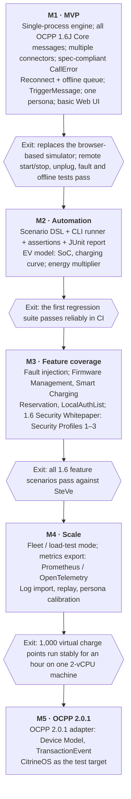

# ocpp-mimic design

Updated 2026-11-14 · Chinese version: [design.zh-CN.md](design.zh-CN.md). This English version is the source of truth.

## Overview

ocpp-mimic is a standalone OCPP charge point simulation platform: an engine runs many virtual charge points in one server process. Each charge point implements the OCPP specification, and persona files reproduce the timing and quirks of real hardware. The first release covers OCPP 1.6J Core only, with a data model shaped after 2.0.1.

**Positioning**: the engine is built to the standard of automated regression and load testing. The Web UI, the CLI and CI scripts are all remote controls for the engine. Manual QA is one way to use the UI layer, not the starting point of the design.

**Design principles**

- Separate the spec from the differences: the engine implements only the OCPP specification; everything vendor- or firmware-specific goes into personas.
- Pure core: the protocol, state machines and persona interpreter do no IO and receive time from outside, so they are unit-testable, replay deterministically and can run in a browser.
- Separate physics from protocol: plugging in, unplugging and so on are input events; OCPP messages are outputs of the state machine.
- Safe by default: connect only to allow-listed CSMS addresses, so a simulator never reaches production by mistake.

## Lessons from a browser-based simulator

A simulator written as a web page component works in the short term and gets stuck in the places below. The ocpp-mimic design answers each of them.

| Browser-based approach | Problem it causes | ocpp-mimic approach |
| --- | --- | --- |
| Virtual charge points run inside a page component | Closing the page takes the charge point offline; timers keep sending heartbeats after the component unmounts, which needs a lot of cleanup code | The engine is its own process with explicitly managed lifecycles |
| The station list is read straight from the CSMS database, with an exclusion list to avoid production stations | The simulator is coupled to the system under test | The simulator owns its station configuration and needs only a CSMS URL + chargeBoxId; CSMS addresses are allow-listed |
| Timing is fixed delays scattered through the code | Real hardware behaviour cannot be reused or switched | Extracted into persona files |
| Responses are matched to requests by guessing from the payload shape | Mismatches under concurrency | Strict uniqueId correlation with timeouts |
| Unsupported messages get `[4, id, {}]` | The CallError format is not spec-compliant | `[4, id, "NotImplemented", "description", {}]` |
| One connector, a handful of messages | Multiple connectors and other features cannot be tested | Full Core profile, multiple connectors, connectorId 0 |
| Scattered boolean flags guard against races | State is implicit and hard to test | Explicit state machine |
| Real time only, meter sampled every 300 s | A full charging session takes hours to test | Adjustable sampling interval + energy multiplier |
| "Simulate offline" just closes the socket cleanly | Real outages are mostly half-open connections (TCP stays up, no data flows) | Support both a clean disconnect and a half-open connection |

## Architecture


The Web UI, the CLI and the scenario runner only call the engine API. Each virtual charge point has six layers: the top five belong to the pure-logic core package (no IO, time injected through `Clock`, unit-testable and replayable), and only the transport layer does network IO.

## Services and runtime

M1 deploys a single service, the engine process; the Web UI and the CLI are its clients. It is not split into microservices: thousands of virtual charge points share one clock and scheduler and the modules call each other constantly, so a single process keeps timing consistent and is easier to deploy and debug.

**Runtime processes**

| Process | Count | Responsibility |
| --- | --- | --- |
| Engine (core service) | 1 | Runs all virtual charge points, serves the API, and hosts the Web UI's static files |
| CLI / scenario runner | On demand | Runs scenario YAML, drives the engine through the API, asserts and writes a JUnit report; can also embed an engine in its own process so CI needs no separate deployment |
| Web UI | In the browser | A pure client: every action goes through the engine API, no simulation logic |

**Engine modules**

| Module | Responsibility |
| --- | --- |
| API Server | REST for commands (create stations, plug in, swipe a card, trigger faults or outages); WebSocket push of message logs and state changes |
| Fleet Manager | Creates and destroys virtual charge points in bulk from templates (persona + configuration); manages start, stop and restart; controls ramp-up during load tests |
| Virtual charge point (× N) | The main workload: core logic (persona, device model, meter, protocol adapter, RPC) plus one WebSocket to the CSMS |
| Clock / Scheduler | One timer scheduler shared by all charge points instead of a timer per charge point; injects time into core and applies the energy multiplier |
| Persona Registry | Loads and validates persona YAML and resolves `extends` inheritance |
| State Store | Persists station configuration, config keys, meter readings and offline queues in SQLite, so stations keep their state across engine restarts |
| Event Recorder | Records every OCPP message and state change; supports queries and export, and is the source for replays |
| Metrics | Aggregates CSMS response latency, timeout rate, error rate and schema violations; exposes a Prometheus endpoint |
| Fault Injector | Hooks into the transport and RPC layers; injects delays, disconnects, half-open connections and malformed messages under API control |

The architecture diagram shows only the main modules.

**How a command flows** (clicking "Plug in" in the UI)

1. The Web UI calls the REST API; the API Server asks the Fleet Manager for the charge point (for example SIM-001).
2. The device model's state machine moves from Available to Preparing.
3. The protocol adapter produces a StatusNotification and sends it to the CSMS through the RPC and transport layers.
4. The CSMS response comes back the same way, and the RPC layer matches it by uniqueId.
5. The Event Recorder logs the exchange, and the API Server pushes it to the UI over WebSocket.

**Scaling out** (after M4, when needed): when one machine is not enough, run several engine instances, each owning a share of the charge points, assigned by the CLI or a lightweight coordinator. Each instance stays a single-process model, so the architecture does not change.

## Transport and RPC layers

The transport layer makes sure connections work and fail realistically; the RPC layer makes sure every message is matched and compliant.

**Transport layer**

- Subprotocol negotiation: `ocpp1.6`, with `ocpp2.0.1` reserved.
- Security: no authentication, plus Security Profiles 1–3 (Basic Auth / TLS + Basic / mutual TLS).
- WebSocket ping/pong keepalive.
- Reconnect: exponential backoff with random jitter. Many charge points reconnecting at once can overwhelm a CSMS, which is a test scenario in itself.
- Fault injection hooks: delay, packet loss, half-open connections, forced disconnects (see fault injection).

**RPC layer**

- Requests and responses are correlated by uniqueId; every CALL has a timeout.
- The spec says (SHOULD) a party does not send the next CALL until the previous one is answered or times out, so the charge point needs an outbound queue.
- Messages in both directions are validated against core's 1.6 message definitions, written from the specification with a small dependency-free schema module that also yields the TypeScript types: what we send is guaranteed compliant, and non-compliant messages from the CSMS are flagged, which doubles as a CSMS compliance checker. As a second check, the engine validates every frame against OCA's official OCPP 1.6 JSON Schemas, shipped unchanged with attribution under their CC BY-ND 4.0 licence in `packages/engine/oca-schemas/` and read by a generic draft-04 validator (Ajv); nothing is generated from them. Problems show up on the frame's record and in the Web UI's message log. A test cross-checks core's definitions against the official schemas with generated payloads; the only differences are the 1..* array cardinalities from the specification text, which the schemas leave out and core enforces (#18).
- CallError strictly follows `[4, uniqueId, errorCode, errorDescription, errorDetails]`; unsupported actions get `NotImplemented`.

## Device model and EV / meter model

The device model decides which state a charge point is in and which messages it sends; the EV / meter model decides how energy and power change.

**Device model**

- The hierarchy follows 2.0.1: Station → EVSE → Connector. 1.6 just maps connectorId onto EVSE / Connector, so moving to 2.0.1 needs no rewrite.
- The connector state machine covers the 1.6 statuses: Available, Preparing, Charging, SuspendedEV, SuspendedEVSE, Finishing, Reserved, Unavailable, Faulted. A pure reducer derives each status from the connector's physical and logical state (cable, transaction, EV / EVSE suspension, fault, availability) instead of storing it, so only transitions the 1.6 status table allows can happen, and it emits a StatusNotification whenever a status changes. No state-machine library: core stays dependency-free.
- Input events: plug in, unplug, lock / unlock, EV ready, EV paused, fault raised / cleared.
- Config key store: typed and read-only aware, supports `RebootRequired`, survives restarts.
- Authorization: Authorize, local authorization list, authorization cache, `AuthorizationRequired`.
- Offline queue: transaction messages are persisted, retried per `TransactionMessageAttempts` / `TransactionMessageRetryInterval`, and resent with their original timestamps after reconnecting.
- Restart semantics: the cumulative meter reading survives; when a power loss interrupts a transaction, StopTransaction (reason=PowerLoss) is sent after the restart.

**EV / meter model**

- EV profile: battery capacity (kWh), initial SoC, maximum AC power, number of phases.
- Charging curve: power tapers once SoC passes about 80% and the session naturally reaches SuspendedEV at 100%. "Fully charged" comes out of the model; no dedicated button is needed.
- Actual power = min(charge point rating, cable limit, charging profile limit, what the EV accepts), so SetChargingProfile has a verifiable effect.
- Meter energy is the integral of power and only increases; measurands follow `MeterValuesSampledData`, with Transaction.Begin / End and clock-aligned sampling (`ClockAlignedDataInterval`).
- Implemented in M2 (`packages/core/src/ev.ts`): above `taperSoc` (default 80 %) the accepted power falls linearly to 10 % of the maximum at `targetSoc` (default 100 %), where the EV stops and the connector reports SuspendedEV. Charging is solved in closed form, so the moment the EV is full is scheduled exactly. A cable is plugged in with an EV profile (a persona `evs` name or an inline profile, through the API, the Web UI or a scenario's `plugIn: { ev }`); without one the M1 fixed power applies. `SoC` is sampled with location EV, and currents are per phase of the EV (three-phase EVs report `Current.Import` / `Current.Offered` for L1, L2 and L3). Charging-profile limits join the minimum in M3.

## Personas

A persona is a declarative configuration describing how a vendor or firmware behaves within what the spec allows: message order, delays, supported features, default configuration, fault codes and known quirks. Engine code implements only the spec; when a real charge point shows new behaviour, only the persona changes, not the engine.

```yaml
persona: vendorX-fw2.5 # example values, not real vendor data
extends: generic-1.6 # built-in persona; only the differences are listed
boot:
  chargePointVendor: VendorX
  chargePointModel: AC-7
  firmwareVersion: "2.5.0"
connectors: 2
power: { offeredW: 11000 }
features: [Core, RemoteTrigger]
config:
  HeartbeatInterval: 60
  MeterValueSampleInterval: 300
  StopTransactionOnEVSideDisconnect: true
timing:
  startTransactionDelay: 2s
  commandDelays: { RemoteStopTransaction: 800ms }
  resetDowntime: { soft: 30s, hard: 3m }
evs: # EV profiles a cable can be plugged in with
  compact-40kwh: { capacityKWh: 40, initialSoc: 20, maxPowerW: 7400, phases: 1 }
faults:
  - { name: Ground fault, errorCode: GroundFailure, info: GND_FAULT, vendorErrorCode: E101 }
```

Persona v1 (implemented in `packages/core/src/persona.ts`, loaded by the engine's Persona Registry) covers BootNotification fields, connectors, power, advertised feature profiles, configuration defaults, timing (durations in milliseconds or with `ms` / `s` / `m` / `h`), named EV profiles (`evs`: `capacityKWh`, `initialSoc`, `maxPowerW`, `phases`, optional `taperSoc` and `targetSoc`) and a fault catalogue. `extends` merges objects key by key and replaces arrays and scalars. Scripted message flows (for example sending StatusNotification Finishing before answering RemoteStop) and vendor quirks such as a minimum firmware version for UpdateFirmware are planned for a later version.

Personas come from three sources: written by hand; generated from statistics over real logs (see record & replay); or inherited from an existing persona and overridden (`extends: vendorX-fw2.5`).

## Scenario engine, fault injection, and record & replay

These three turn ocpp-mimic from a simulator you click by hand into a test tool that runs in CI.

**Scenario engine**

Scenarios are actions plus assertions, written in YAML, run by the CLI, and reported as JUnit for CI. An `http` step can call the business system under test, so app-side actions join the same scenario. The format is specified in "Scenario format v1" below.

```yaml
name: Unplug while charging; the CSMS should end the session and send no RemoteStop
csms: wss://csms.example.com/ocpp # the CSMS under test (example address)
station: { id: SIM-001, persona: vendorX-fw2.5 }
steps:
  - plugIn: { connector: 1 }
  - http: { method: POST, url: "{{APP_API}}/charges/start", json: { station: SIM-001 } }
  - expect: { received: RemoteStartTransaction, within: 10s }
  - charge: { connector: 1, duration: 20m }
  - unplug: { connector: 1 }
  - expect: { sent: StopTransaction, payload: { reason: EVDisconnected } }
  - expectNo: { received: RemoteStopTransaction, within: 30s }
```

**Fault injection**

| Layer | Faults that can be injected |
| --- | --- |
| Network | Delay, packet loss, clean disconnect, half-open connection, flapping, reconnect storms |
| Protocol | Malformed JSON, wrong or duplicate uniqueId, out-of-order messages, no response, CallError responses, schema-violating messages |
| Device | Faulted (errorCode / info / vendorErrorCode combinations), meter rollback or reset to zero, clock drift, malformed timestamps |
| Power | Power loss and restart, resending after an interrupted transaction |

**Record & replay**

- Import real charge point logs (direction, action, payload, timestamp) and replay them as scenarios to reproduce production issues.
- Derive the intervals between messages from logs to generate or calibrate personas.
- Mask idTags, serial numbers and other identifiers on import.

Designed in "M4 scale" below (log format, import mappings, masking rules, replay and calibration).

## Scenario format v1

Decided for M2 (#38). A scenario file is YAML; each YAML document in it (documents are separated by `---`) is one scenario. The runner executes scenarios one at a time, each on a fresh embedded engine, and reports a test suite per file and a test case per scenario. The files in `scenarios/examples/` are the reference examples.

```yaml
name: Card session with periodic meter values
station:
  id: SIM-001
  persona: generic-1.6
  config: { MeterValueSampleInterval: 10 }
vars:
  TAG: TAG-001
steps:
  - presentCard: { connector: 1, idTag: "{{TAG}}", result: authorized }
  - plugIn: { connector: 1 }
  - expect: { sent: StartTransaction, payload: { connectorId: 1, idTag: "{{TAG}}" } }
  - expectConnector: { connector: 1, status: Charging }
  - expect: { sent: MeterValues, within: 15s }
  - presentCard: { connector: 1, idTag: "{{TAG}}", result: stopping }
  - expect: { sent: StopTransaction, payload: { reason: Local } }
  - unplug: { connector: 1 }
  - expectConnector: { connector: 1, status: Available }
```

**Scenario fields**

| Field | Required | Meaning |
| --- | --- | --- |
| `name` | yes | Test case name |
| `description` | no | Free text, shown in reports |
| `csms` | no | `builtin` (the default) or the WebSocket URL of a CSMS; the station id is appended as for any station. `--csms` on the command line overrides it |
| `station` or `stations` | yes | One station, or a list of them. Fields: `id`, `persona`, and optionally `password` (the initial `AuthorizationKey`), `config` (configuration key overrides), `behaviour` (test switches), `energyMultiplier`, `security` (`profile` and the PEM files `ca`, `cert`, `key`, `manufacturerRoot`, relative to the scenario file; `test-pki:<file>` names a file of the committed test PKI), `waitForBoot` |
| `vars` | no | Default values for templates |
| `csmsOptions` | no | Settings of the built-in CSMS: `tls` (`true`, or `{ clientCertificates: none \| optional \| required }`) serves wss:// with the test PKI's server certificate; `passwords` (station id → password) makes it check Basic Auth. It takes an AuthorizationKey it changed and saw Accepted as the station's new password |
| `timeout` | no | Limit for the whole scenario; default 5 minutes |
| `checkSchemas` | no | Default `true`: the scenario fails if any frame broke the official OCA schema |

Setup creates and starts every station; with `waitForBoot` (the default) it also waits until the station's BootNotification is Accepted. Set `waitForBoot: false` to test registration itself.

**Steps**

A step is a map with one step key whose value is the step's arguments. Steps that act on a station take `station` (its id; default the first station), and connector steps take `connector` (default 1). Any step may carry `name` next to the step key (`- name: Card in` above `presentCard: ...`), which reports show instead of the generated label. Steps without arguments can be written `online:` or `online: {}`.

Charge point actions, the same operations the API offers:

| Step | Arguments | Effect |
| --- | --- | --- |
| `plugIn` | `connector`, `ev` | Cable in; `ev` names an EV profile |
| `unplug` | `connector` | Cable out |
| `presentCard` | `connector`, `idTag`, `result` | A card at the connector; `result` optionally asserts `authorized`, `rejected`, `stopping` or `busy` |
| `evSuspend`, `evResume` | `connector` | The EV pauses or resumes |
| `fault` | `connector` (0 = the whole charge point), `errorCode`, `info`, `vendorErrorCode` | Raise a fault |
| `clearFault` | `connector` | Clear it |
| `offline` | `mode`: `clean` or `half-open` | Simulated outage |
| `online` | — | End the outage |
| `stopStation`, `startStation` | — | Disconnect or reconnect the station |
| `setBehaviour` | `refuseRemoteStart`, `cableLock` | Test switches |
| `wait` | a duration | Pause |
| `inject` | `type` and its parameters, `for` | Starts a fault injection (see "Fault injection" under M3); a `reconnectStorm` hits every station |
| `clearInjections` | — | Ends the station's fault injections |
| `charge` | `connector`, `duration` | Wait for `duration`; fails unless the connector has a running transaction at the start and at the end |

An action the engine refuses (for example unplugging a locked cable) fails the step. With `expectError: <text>` the step instead requires a refusal whose message contains the text.

Expectations:

| Step | Arguments | Passes when |
| --- | --- | --- |
| `expect` | `sent` or `received` (an action), `payload`, `answer`, `within`, `from` | A matching CALL is recorded in time. `sent` means charge point → CSMS, `received` CSMS → charge point. `payload` must match the CALL and `answer` the CALLRESULT to it |
| `expectNo` | `sent` or `received`, `payload`, `within` | No matching CALL is recorded during `within` |
| `expectConnector` | `connector` plus connector snapshot fields (`status`, `errorCode`, `plugged`, `locked`, `transactionId`, `ev`, ...), `within` | The connector snapshot matches in time. `connector: 0` is the whole charge point (`status`, `errorCode`) |
| `expectStation` | station snapshot fields (`registration`, `transport`, `queuedMessages`, `behaviour`, ...), `within` | The station snapshot matches in time |

`within` defaults to 10 s. Message expectations are ordered: a search starts after the message the previous `expect` matched (`from: last`, the default), so consecutive `expect` steps also assert the order of the messages. `from: step` ignores messages recorded before the step began, and `from: start` searches from the start of the scenario.

CSMS steps, available only with the built-in CSMS:

| Step | Arguments | Effect |
| --- | --- | --- |
| `csmsCall` | `action`, `payload`, `answer`, `error`, `noAnswer` | The built-in CSMS sends a CALL to the station. `answer` must match the CALLRESULT; `error` instead names the expected CALLERROR code; `noAnswer: <duration>` passes only if no answer arrives that long |
| `csmsReply` | `action`, then `payload`, `error` or `ignore: true`, and `times` | How the built-in CSMS answers the station's next `times` calls of `action` (default: all of them) |

HTTP, for the system under test:

| Step | Arguments | Effect |
| --- | --- | --- |
| `http` | `method` (default GET), `url`, `headers`, `basicAuth` (`user`, `password`), `json`, `expect` (`status`, `json`), `save` | Sends a request (10 s timeout) and checks the response. Without `expect.status` any 2xx passes; `expect.json` matches the parsed body |

`save: { NAME: <path> }` stores a value as a variable for later steps. It works on `expect` (path root `{ payload, answer }`), `expectConnector` and `expectStation` (the snapshot), `csmsCall` (`{ answer }`) and `http` (`{ status, json, text }`). Paths look like `$.answer.transactionId`.

**Matching**

`payload`, `answer`, the snapshot steps and `http` `expect.json` match partially: every field given must be present and equal, and fields not given are ignored. Arrays match element by element and must have the same length. Instead of a value, a field can hold operators, all of which must hold: `$exists`, `$regex`, `$ne`, `$gt`, `$gte`, `$lt`, `$lte`, and for arrays `$contains` (some item matches, partially) and `$size` (a number, or comparisons such as `{ $gte: 20 }`).

**Templates and variables**

`{{NAME}}` in a string is replaced before the step runs. Values come from, lowest priority first: `vars`, `--var NAME=value` on the command line, and variables saved by earlier steps. `{{env.NAME}}` reads an environment variable; those values are shown as `***` in output and reports. A string that is exactly one template keeps the value's type, so `"{{tx}}"` can stand for a number. `{{now}}`, `{{now+30m}}` and `{{now-1h}}` give the current time, shifted by a duration, as an ISO 8601 timestamp (for example the future times a CSMS API wants). Unknown names are errors found before the scenario starts; a saved variable counts only after the step that saves it.

**Durations** use the persona syntax: milliseconds as a number, or a string ending in `ms`, `s`, `m` or `h`.

**Where the code lives**

| Package | Part |
| --- | --- |
| core | Scenario model and validation (with the schema module), templates, matching, step labels. Pure, like personas |
| engine | The runner: a fresh embedded engine (and the built-in CSMS, `src/csms/builtin-csms.ts`) per scenario, steps executed in-process against the fleet and the recorder, teardown even after failures; the result model; console and JUnit reporters |
| cli | `ocpp-mimic run`: arguments, reading the YAML files, calling the runner, the exit code |

A remote engine over the HTTP API is not needed in M2: the CLI embeds its own engine, so CI needs no separate deployment.

**Running and reporting**

`ocpp-mimic run <file|dir>...` runs every `.yaml` / `.yml` file given, searching directories recursively in sorted order, one scenario at a time. Options: `--csms <url>`, `--var NAME=value` (repeatable), `--timeout <duration>` (the default scenario timeout), `--bail` (stop after the first scenario that does not pass), `--junit <file>`, `--allow-csms` and `--personas` as for `serve`.

- A scenario passes, fails (a step failed; the remaining steps are reported as skipped) or errors (invalid file, engine failure, timeout). Teardown always runs.
- The console shows one line per scenario with its duration and, for a failure, the failing step with expected and actual values.
- JUnit: one `testsuite` per file and one `testcase` per scenario (classname = the file), `failure` or `error` with the failing step, durations, and `properties` such as persona, CSMS and energy multiplier.
- Exit code 0 when every scenario passed, 1 when any failed or errored, 2 for usage errors and files that do not validate.

## M3 feature coverage

Decided for M3 (#65). M3 adds the remaining OCPP 1.6 feature profiles, the Security Whitepaper and fault injection. Its exit criterion is that every 1.6 feature has scenarios that pass against SteVe.

**Feature profiles**

- A persona's `features` decides which profiles a station advertises in `SupportedFeatureProfiles`. A message of a profile the station does not advertise is answered with CALLERROR NotSupported, so a persona can drop a profile to test how a CSMS copes. `generic-1.6` advertises every profile once it is implemented.
- Each feature task adds its profile's messages to core's definitions; the cross-check against OCA's schemas then covers them automatically.
- Configuration keys per profile, with the specification's names (defaults shown; personas can override them):

| Profile | Keys |
| --- | --- |
| Local Auth List Management | `LocalAuthListEnabled` (true), `LocalAuthListMaxLength` (100, read-only), `SendLocalListMaxLength` (100, read-only) |
| Reservation | `ReserveConnectorZeroSupported` (true, read-only) |
| Smart Charging | `ChargeProfileMaxStackLevel` (10), `ChargingScheduleAllowedChargingRateUnit` (Current,Power), `ChargingScheduleMaxPeriods` (24), `MaxChargingProfilesInstalled` (20), `ConnectorSwitch3to1PhaseSupported` (false); all read-only |
| Firmware Management | `SupportedFileTransferProtocols` (HTTP,HTTPS,FTP, read-only) |
| Security (whitepaper) | `SecurityProfile` (0), `AuthorizationKey` (write-only, 16 to 40 characters when set by the CSMS), `AllowSecurityProfileDowngrade` (false), `CpoName` (empty), `CertificateStoreMaxLength` (10, read-only), `CertificateSignedMaxChainSize` (10000, read-only), `AdditionalRootCertificateCheck` (false, read-only) |

**Local Auth List and Reservation**

- The local list sits next to the authorization cache: with `LocalAuthListEnabled` a card on the list is decided locally (online with `LocalPreAuthorize`, offline with `LocalAuthorizeOffline`), as the specification describes. The list and its version are kept across engine restarts.
- A reservation is part of the device model: the connector reports Reserved, only the reserved idTag or its parentIdTag can start, the reservation ends at `expiryDate` or when its transaction starts, and StartTransaction carries the `reservationId`. connectorId 0 reserves any free connector when `ReserveConnectorZeroSupported` is true.

**Smart Charging**

- A pure model in core (`charging-profile.ts`) holds the installed profiles per connector (connectorId 0 for the whole station) and answers two questions: the limit in force at a moment, and the composite schedule over a duration.
- Stacking: the highest `stackLevel` valid at the moment wins within a purpose; a TxProfile (only during a transaction) overrides the TxDefaultProfile; a ChargePointMaxProfile on connectorId 0 caps the station, shared equally between the connectors that are charging.
- Absolute, Recurring (Daily / Weekly, from `startSchedule`) and Relative (from the transaction start) schedules; `validFrom` / `validTo`; limits in A or W, converted with the connector's voltage and `numberPhases` (default 3).
- The power delivered is min(charge point rating, EV acceptance, limit in force). A timer fires at the next period boundary, so power, MeterValues and SoC follow the schedule. Profiles are kept across engine restarts.

**Firmware and diagnostics**

- By default nothing is transferred: the station walks through the statuses with timings from the persona (`firmware: { downloadTime, installTime, uploadTime }`) and outcomes from the persona or from fault injection (DownloadFailed, InstallationFailed, UploadFailed).
- UpdateFirmware waits for `retrieveDate`, sends Downloading → Downloaded → Installing → Installed, then reboots. The new `firmwareVersion` in BootNotification is the version in the location's file name (`fw-2.5.1.bin` → 2.5.1), otherwise the old version with `-updated`; it is kept across restarts.
- GetDiagnostics answers with a `fileName` and sends Uploading → Uploaded. With `firmware: { transfer: real }` in the persona, an HTTP(S) location really receives the diagnostics file (a text summary of the station's state and configuration) by PUT into the location directory, and UpdateFirmware really downloads an HTTP(S) location. FTP is never really transferred.
- TriggerMessage can request both status notifications.

**Fault injection**

- An engine Fault Injector per station, sitting in the transport and RPC layers. API: `POST /api/stations/:id/injections` with `{ type, ...parameters, for? }`, `DELETE` to clear. Scenario steps: `inject: { type, ..., for }` and `clearInjections: {}`.

| Layer | Types |
| --- | --- |
| Network | `latency` (ms, each direction), `drop` (frames in a direction, a count or a probability), `flap` (down / up times, repeats), `reconnectStorm` (every station at once; fleet-wide) |
| Protocol | `malformedJson` (next N frames sent), `duplicateId`, `unknownId` (answers with a uniqueId the CSMS never sent), `outOfOrder` (swaps the next two CALLs), `noAnswer` (ignores CSMS CALLs of an action), `callError` (answers them with a CALLERROR code), `schemaViolation` (an extra property in the next CALL of an action) |
| Device | `meterRollback` (Wh), `meterReset`, `clockDrift` (ms added to every timestamp), `badTimestamp` (next N timestamps malformed) |
| Power | `powerLoss` (`off`: dark that long, then restart from the saved state: transactions end with PowerLoss, queued messages keep their timestamps), repeated `times`, `on` apart |

- Injected frames are recorded with the injection's type, shown in the Web UI's message log and excluded from the OCA schema check, since they are wrong on purpose.

Implemented for the network and protocol layers (T30):

- The Fault Injector sits on the wire between the charge point and its transport, and frames are recorded there, after it: the message log shows what really went over the connection. A frame an injection changed or made carries `injected` (the type); one that never reached the other side (dropped, or a CALL left unanswered) also carries `dropped`, and `expect` steps ignore it.
- Parameters: `latency { ms, direction: sent | received | both }`; `drop { direction, count?, probability?, action? }`; `flap { down, up, times? }`; `malformedJson`, `duplicateId`, `unknownId`, `schemaViolation` take `count` (default 1), `schemaViolation` and `noAnswer` / `callError` an `action`, `callError` an `errorCode` (default InternalError). Each takes `for` to end it after a time; counted ones end when used up; `outOfOrder` swaps the next two frames sent (a lone one goes after 1 s). A duplicated uniqueId's answer is renamed back, so the station itself is not confused.
- `GET`, `POST` and `DELETE /api/stations/:id/injections`; a `reconnectStorm` posted to any station hits the whole fleet. Snapshots list the active injections, and the Web UI shows them with a Clear button.
- `csmsCall` takes `noAnswer: <duration>` to assert a CSMS-side timeout.

Implemented for the device and power layers (T31):

- `meterRollback { wh, connector? }` and `meterReset { connector? }` set the connector's energy register in the charge point; meter values and meterStop continue from there, so meterStop can fall below meterStart as with a real faulty meter (it is no longer clamped).
- `clockDrift { ms }` (negative: behind) shifts every `timestamp` the station sends, and `badTimestamp { count? }` replaces them with `not-a-timestamp`; both work on the wire, after the charge point's own validation.
- `powerLoss { off, on?, times? }`: the fleet saves the station's state, drops its connection (the snapshot shows `running: false`), and after `off` builds the station again from that state, as after a power cut: running transactions end with PowerLoss, queued messages keep their timestamps, and StartupOfTheDevice is reported. `on` (default 5 s) separates repeated cuts.
- The faults of a persona's catalogue (errorCode, info, vendorErrorCode) are raised with the `fault` step and the Web UI as before.
- The Web UI's station detail has an Inject row: a fault type and `key=value` parameters, e.g. `off=10s` for a power loss.
- Comparison operators (`$lt` and the like) take a template, so a saved reading can be compared with a later one.

**Security (OCPP 1.6 Security Whitepaper)**

- Stations take `security: { profile, ca?, cert?, key? }` (PEM file paths). Profile 1: Basic Auth over ws or wss with `AuthorizationKey` as the password (the station's `password`). Profile 2: wss with the server certificate checked against `ca`, plus Basic Auth. Profile 3: wss with the client certificate `cert` / `key`, no Basic Auth.
- ChangeConfiguration of `AuthorizationKey` reconnects with the new key (A01). `SecurityProfile` can only go up, except from 3 to 2 with `AllowSecurityProfileDowngrade`; the station reconnects with the new profile and falls back to the previous one when that fails (A05).
- The built-in CSMS can serve TLS, require client certificates and check Basic Auth passwords (`csmsOptions` in a scenario). Tests use a fixed test PKI committed under `packages/engine/test-pki/` (CA, server and client certificates valid for 20 years, test only) with a script that regenerates it with openssl.
- All whitepaper messages are in M3: certificate management (SignCertificate / CertificateSigned, InstallCertificate, GetInstalledCertificateIds, DeleteCertificate), SecurityEventNotification, ExtendedTriggerMessage, GetLog / LogStatusNotification and SignedUpdateFirmware / SignedFirmwareStatusNotification. CSRs and signing need X.509 work Node does not expose; the engine does it with node:crypto plus a small DER module (`x509.ts`, checked against openssl in its tests), so no library was added, and core gets it as an injected `CertificateTools`. OCA's whitepaper download (edition 4) contains JSON schemas (draft-06); they ship unchanged in `packages/engine/oca-schemas/ocpp16-security/` and check frames like the 1.6 ones.

**SteVe**

- Scenarios make SteVe send commands through its REST API (`POST /steve/api/v1/operations/<Action>`, HTTP Basic with the admin user's API password) using `http` steps (#63). `scenarios/steve/` holds these SteVe variants and the SteVe workflow runs them.
- Data SteVe needs before a command (charging profiles to reference by id, OCPP tags for the local list and reservations) is created through its API or `tools/steve/register.sh`.
- Implemented (T39): `scenarios/steve/features.yaml` drives the local list, reservations, Smart Charging, firmware and diagnostics, and the Security Whitepaper messages from SteVe 3.14.1's REST API, which offers all of them. `register.sh --charging-profile` adds charging profile 1001 (TxDefaultProfile, Relative, 3680 W) for SetChargingProfile. The SteVe workflow runs these with the other SteVe scenarios.

**Scenarios**

Each feature task adds regression scenarios for the built-in CSMS (`scenarios/regression/`) and, where SteVe can send the command, a SteVe variant (`scenarios/steve/`). For example, a TxProfile capping a running session:

```yaml
name: A TxProfile caps the power of a running session
station: { id: REG-SC-TX, persona: regression-1.6 }
steps:
  - presentCard: { idTag: TAG-REG, result: authorized }
  - plugIn: { ev: compact-40kwh }
  - expect: { sent: StartTransaction, save: { tx: $.answer.transactionId } }
  - expectConnector: { status: Charging, powerW: { $gt: 7000 } }
  - csmsCall:
      action: SetChargingProfile
      payload:
        connectorId: 1
        csChargingProfiles:
          chargingProfileId: 1
          transactionId: "{{tx}}"
          stackLevel: 0
          chargingProfilePurpose: TxProfile
          chargingProfileKind: Relative
          chargingSchedule:
            chargingRateUnit: W
            chargingSchedulePeriod: [{ startPeriod: 0, limit: 3680 }]
      answer: { status: Accepted }
  - expectConnector: { powerW: 3680 }
```

And a fault injected by a scenario:

```yaml
name: The CSMS copes with a slow, lossy connection
station: { id: REG-FI-NET, persona: regression-1.6 }
steps:
  - inject: { type: latency, ms: 2000, for: 30s }
  - presentCard: { idTag: TAG-REG, result: authorized }
  - plugIn: {}
  - expect: { sent: StartTransaction, within: 15s }
  - inject: { type: drop, direction: received, count: 1 }
  - expect: { sent: StatusNotification, payload: { status: Charging }, within: 15s }
```

## M4 scale

Decided for M4 (#97). M4 makes ocpp-mimic a load-test tool: stations created in bulk that charge on their own, a load-test command with a pass / fail report, metrics for Prometheus and OpenTelemetry, and record & replay (log import with masking, replay as a scenario, persona calibration). Scaling out to several machines stays after M4.

**Exit criterion**

1,000 virtual charge points run stably for an hour on one machine. Concretely, `scenarios/load/m4-exit.yaml` passes on a GitHub-hosted `ubuntu-latest` runner of a private repository (2 vCPUs, 8 GB RAM), with the engine and `ocpp-mimic csms` as two processes on that runner:

- 1,000 stations of `load-ac-1.6` (two connectors, HeartbeatInterval 60 s, MeterValueSampleInterval 60 s), started at 10 stations a second.
- Sessions arrive at each free connector once an hour on average and last 10 to 40 minutes (the usage model below), with 5 % unknown cards. The CSMS answers after a random 20 to 100 ms.
- A reconnect storm at minute 30 (every connection dropped at once), and a 30-second power loss on 5 % of the stations at minute 45.

It passes when all of these hold:

| Threshold | Value |
| --- | --- |
| BootNotification Accepted for every station | within 60 s after the ramp-up ends |
| Disconnects other than the injected ones | none |
| Back online after each fleet event | every station within 120 s |
| Scheduled work late (heartbeats, meter samples, usage events, retries) | p99 under 1 s, never over 5 s |
| Engine event-loop delay | p99 under 100 ms |
| Engine memory | RSS under 2 GB; the heap floor of the last 5 minutes at most 10 % above the floor of minutes 10 to 15 |
| CALL timeouts, CALLERRORs and schema violations, either side | none |
| Sessions | at least 80 % of the expected number; every started transaction stopped or still running at the end |

CPU use is reported, not judged. The same plan runs longer locally with `--duration 8h`. These numbers are the M4 target; they can change if real needs differ.

**Fleet templates**

- `POST /api/stations/bulk` creates stations from a template: `{ count, id, persona, csmsUrl, password?, security?, config?, energyMultiplier?, tags?, group?, usage?, start?, rampUp? }`. The `id` holds one counter in braces whose digits give the start and the width: `SIM-{0001}` makes SIM-0001, SIM-0002, ...; `SIM-{1001}` starts at SIM-1001. It creates all of them or none (409 when an id exists), in one State Store transaction.
- `tags` (up to 10 names of letters, digits, `.`, `_` and `-`) are for selecting; `group` (one name) also labels metrics and report lines. Stations created one by one take both too.
- Ramp-up: `rampUp: { rate, jitter }` starts `rate` stations a second (default 20), each at a random point within `jitter` (0 to 1, default 0.5) of its slot; `rampUp: false` starts them all at once.
- Selections: `POST /api/stations/bulk/start`, `/stop`, `/offline`, `/online` and `DELETE /api/stations/bulk` take `{ ids?, tag?, group? }` (start also `rampUp`). `GET /api/stations` filters by `tag`, `group` and `state`, and `?view=summary` returns only id, persona, group, tags, connection state and connector statuses.

**Usage model**

A station can charge on its own, driven by core's clock and a seeded random generator, so scenarios and manual use stay deterministic when it is off (the default). It is set in the persona (`usage`), in a template or load-plan group, or per station through the API, and `PATCH /api/stations/:id/usage` with `{ enabled }` switches it.

```yaml
usage:
  sessionsPerHour: 1 # per connector, while it is free (Poisson arrivals)
  stay: { min: 20m, max: 2h } # how long the driver stays, uniform
  evs: { compact-40kwh: 3, suv-77kwh: 1 } # weights over the persona's evs (default: all equal)
  idTags: { prefix: LOAD-, count: 500, unknownShare: 0.05, unknownPrefix: UNKNOWN- }
  cardFirst: 0.3 # share of drivers who present the card before plugging in
  stopBy: { card: 0.7, unplug: 0.3 } # how the driver ends the session when leaving
```

- A session: an arrival picks an EV, a card, the order and the stay; card and plug follow each other 5 to 30 s apart. A refused card makes the driver unplug 30 to 60 s later. At the end of the stay the driver presents the card again (StopTransaction reason Local) and unplugs 10 to 60 s later, or just unplugs (EVDisconnected); an EV that is full first waits in SuspendedEV.
- A connector that is not free (Unavailable, Faulted, Reserved, or still occupied) turns arrivals away; they are counted. Remote starts are not part of the model: they need the CSMS to begin them.
- Each station's generator is seeded from the run's `seed` and the station id, so a station repeats its sessions when the CSMS answers the same way, whatever the other stations do. After a restart the driver of a plugged-in connector picks a new stay.
- The built-in CSMS answers Invalid for idTags starting with the unknown prefix (`UNKNOWN-` by default) when asked to, so the unknown share is visible to it.

**Load plan and report**

`ocpp-mimic load <plan.yaml>` runs a load plan. Example (`scenarios/load/example.yaml`):

```yaml
name: Two groups for an hour, with a reconnect storm
csms: ws://127.0.0.1:9100/ocpp # or builtin: in-process, for small plans
seed: 1
duration: 60m
rampUp: { rate: 10, jitter: 0.5 }
groups:
  - name: ac
    count: 900
    id: LOAD-AC-{0001}
    persona: load-ac-1.6
    tags: [ac]
  - name: busy
    count: 100
    id: LOAD-BUSY-{0001}
    persona: load-ac-1.6
    usage: { sessionsPerHour: 4, stay: { min: 5m, max: 20m } }
events:
  - at: 30m
    reconnectStorm: {}
  - at: 45m
    inject: { type: powerLoss, off: 30s }
    stations: { share: 0.05, group: ac } # or count; or tag
thresholds:
  bootAcceptedWithin: 60s
  recoverWithin: 120s
  unexpectedDisconnects: 0
  lateWork: { p99: 1s, max: 5s }
  csmsLatency: { p95: 1s } # per action and overall
  timeouts: 0
  callErrors: 0
  schemaViolations: 0
  eventLoopDelay: { p99: 100ms }
  memory: { rss: 2GB, heapGrowth: 10% }
  sessions: { min: 0.8 } # share of the expected number
```

- Options: `--csms`, `--duration`, `--report-dir` (writes `report.json` and `report.md`), `--junit` (one test case per threshold), `--log-dir` (frames per station as JSONL), `--port` (also serves the API and Web UI to watch the run), `--metrics` and `--otlp-endpoint`, `--personas`, `--allow-csms`. The exit code is 1 when a threshold fails.
- A progress line every 10 s: stations online, sessions running, CSMS latency p95, errors. The report has every threshold with its measured value, per-group lines, CSMS latency per action, and the fleet events with their recovery times.
- The allow list applies as for scenarios (loopback unless `--allow-csms`). Only load-test a CSMS you operate or have permission to test.

**Metrics**

Collected in the engine from the wire and the transport, so they work with the Event Recorder off. Labels stay at `action`, `persona` and `group` (plus `direction`, `outcome`, `code` where listed); there is no station label, so 1,000 stations cost no more series than one.

| Metric | Type | Labels |
| --- | --- | --- |
| `ocpp_mimic_stations` | gauge | `state` (connected, connecting, offline, stopped), persona, group |
| `ocpp_mimic_connectors` | gauge | `status` (the 1.6 statuses), persona, group |
| `ocpp_mimic_csms_response_seconds` | histogram | action, persona, group: socket send of the station's CALL to socket receive of the answer |
| `ocpp_mimic_csms_answers_total` | counter | action, `outcome` (result, error, timeout) |
| `ocpp_mimic_calls_received_total` | counter | action: CALLs from the CSMS |
| `ocpp_mimic_callerrors_total` | counter | `direction`, action, `code` |
| `ocpp_mimic_schema_violations_total` | counter | `direction`, action |
| `ocpp_mimic_frames_total`, `ocpp_mimic_frame_bytes_total` | counter | `direction` |
| `ocpp_mimic_connections_total` | counter | `outcome` (opened, failed) |
| `ocpp_mimic_disconnects_total` | counter | `cause` (injected, stopped, remote, error) |
| `ocpp_mimic_transactions_total` | counter | `outcome` (started, stopped, refused) |
| `ocpp_mimic_sessions_turned_away_total` | counter | persona, group |
| `ocpp_mimic_energy_wh_total` | counter | persona, group |
| `ocpp_mimic_offline_queue_messages` | gauge | — |
| `ocpp_mimic_work_lateness_seconds` | histogram | — : scheduled work run time minus its due time |
| `ocpp_mimic_eventloop_delay_seconds` | gauge | `quantile` (0.5, 0.99, max) |
| `process_cpu_seconds_total`, `process_resident_memory_bytes`, `nodejs_heap_size_used_bytes` | — | — (the usual names, so existing dashboards fit) |

- Histogram buckets (seconds): 0.005, 0.01, 0.025, 0.05, 0.1, 0.25, 0.5, 1, 2.5, 5, 10, 30. Internally latencies go into log-scaled buckets with about 2 % error, so reports give real p50 / p95 / p99; the Prometheus buckets are folded from them.
- `GET /metrics` serves the Prometheus text format (no new dependency); `GET /api/metrics` the same numbers as JSON, with percentiles, for the Web UI and the CLI.
- OpenTelemetry: the same instruments pushed over OTLP/HTTP with JSON encoding to `<endpoint>/v1/metrics`, cumulative, every 10 s. The encoding is the engine's own, not the official SDK, which would add many packages for a small protocol. `--otlp-endpoint` and `--otlp-header`, or the standard `OTEL_EXPORTER_OTLP_ENDPOINT`, `OTEL_EXPORTER_OTLP_HEADERS`, `OTEL_METRIC_EXPORT_INTERVAL`, `OTEL_SERVICE_NAME` and `OTEL_RESOURCE_ATTRIBUTES`; resource attributes `service.name`, `service.version` and `ocpp_mimic.run`. No traces in M4: a span per frame at 1,000 stations costs more than the latency histograms tell.

**Engine at scale**

- **Benchmark first.** `pnpm bench --stations N --duration D` runs the engine in-process against `ocpp-mimic csms` in a child process and samples every 5 s: event-loop delay, CPU, RSS and heap, frames a second, connect times and late work. The baseline at 100, 500 and 1,000 stations, with CPU profiles and heap snapshots, decides what T45 changes; the numbers go into this document.
- **Candidates**, each kept only if the baseline shows it matters: one shared scheduler (a heap of due times behind one Node timer) instead of a Node timer per timer; frames parsed once on the wire instead of by the Fault Injector, the recorder and core separately; state saves batched into one SQLite transaction a second; snapshots built only when asked for.
- **Event Recorder.** A per-station limit: 1,000 entries for `serve`, 100 for `load`, 0 to keep none (`--record-limit`). Schema checks keep counting into metrics when nothing is kept.
- **Events WebSocket.** A client subscribes to the stations it shows (`{ type: subscribe, stations: [...] }`): records and full snapshots go only to their subscribers, and so does the 2-second push of charging stations. Everyone gets fleet summaries (the `?view=summary` fields of changed stations), batched at most once a second.

**Record & replay**

- **Log format.** ocpp-mimic's log is JSONL: an optional header line `{ "format": "ocpp-mimic-log", "version": 1, "masked": false }`, then one frame per line: `{ "at": "2026-11-15T09:00:00.000Z", "station": "SIM-001", "direction": "cp-to-csms", "frame": [2, "19223201", "BootNotification", { ... }] }`. A frame that is not JSON keeps its `text` instead of `frame`; injected and dropped frames keep their marks.
- **Export.** `GET /api/stations/:id/messages?format=jsonl`, an Export button in the Web UI's message log, and `--log-dir` on `run` and `load` (one file per station). Logs of the repository's own scenarios are the sample logs.
- **Import.** `ocpp-mimic import <file>... --map <mapping.yaml> [--mask] [--salt <s> | --salt-file <f>] [-o <out.jsonl>]` turns other logs into this format. A mapping reads JSONL (field paths), CSV (columns) or plain log lines (a regular expression with named groups), with the time format (ISO 8601, epoch seconds or milliseconds, a time zone for times without one) and the direction values. Example in `scenarios/import/csv-mapping.yaml`.
- **Masking**, on by default for imports and with `--mask` for ocpp-mimic's own logs. Stable pseudonyms (HMAC-SHA-256 of kind and value with the salt, shortened to fit the field) for chargeBoxIds, `idTag` and `parentIdTag` wherever they occur, `chargePointSerialNumber`, `chargeBoxSerialNumber`, `meterSerialNumber`, `iccid` and `imsi`: one value always gets the same pseudonym under one salt, so sessions still line up. Removed: DataTransfer `data`, passwords in URLs, `AuthorizationKey` values, certificates and CSRs. Kept: `info` and `vendorErrorCode`, which calibration needs. A mapping can add paths to mask or keep. Without a salt a random one is used and not stored, so two imports cannot be linked. The header records `masked: true`.
- **Replay.** A `replay` scenario step drives a station's connection directly: its charge point logic is detached for the step. It sends the log's charge-point frames in order, with the recorded gaps divided by `speed` and capped at `maxGap`, and checks the CSMS's answers with `compare: status` (default: result or error, error code, and every `status` field), `strict` (the whole payload except volatile fields such as `currentTime`, `transactionId` and timestamps) or `none`. CALLs from the CSMS are matched to the next recorded CALL of the same action and answered with its recorded answer; unmatched ones and recorded ones that never come are reported. Timestamps move to the present (the time-acceleration decision), uniqueIds are fresh, and `transactionId`s map to the ones the CSMS assigns. A log that starts mid-session gets a BootNotification first.
- `ocpp-mimic replay <log> [--station <id>] [--csms <url>] [--speed <n>] [--max-gap <d>] [--compare <mode>]` runs it and reports like `run`; `--write <scenario.yaml>` writes the scenario instead, with the frames inline so they can be edited.
- **Calibration.** `ocpp-mimic calibrate <log>... [--station <id>] [--extends <persona>] [-o persona.yaml] [--report report.md]` derives a persona from one or more stations of the same model: BootNotification fields, connector count, configuration from the latest GetConfiguration answer, HeartbeatInterval and MeterValueSampleInterval (median gaps), measurands, phases and locations, offered power, `timing` (start-transaction delay, answer delay per CSMS action, reset downtime), the fault catalogue (errorCode, info, vendorErrorCode), EV profiles where SoC is reported, and the usage model (arrivals, stays, how sessions end, unknown cards). Every value lists its sample count and spread; a value with fewer than 3 samples is reported as not derived.
- **Sample logs.** Tests use synthetic logs recorded from the repository's own personas and scenarios, kept small under `scenarios/logs/`. Real logs come only from the user's own sources, are masked, and are not committed. The calibration test records a log from a persona with distinctive values and checks that calibration gives those values back.

**Implemented: the test CSMS on its own (T42)**

- `ocpp-mimic csms` runs the built-in CSMS on port 9100 (`--port`, `--host`) and keeps no frames, so a long run stays flat in memory. `--delay 50ms` or `--delay 20ms-100ms` delays every answer (a random time in the range); `--heartbeat-interval` sets the BootNotification interval (default 60 s); idTags starting with `--unknown-prefix` (default `UNKNOWN-`, empty for none) are Invalid in Authorize and StartTransaction; `--password` is a Basic Auth password for every station; `--tls-cert`, `--tls-key`, `--tls-ca` and `--client-certificates` serve wss://.
- It prints a status line every `--status` (default 60 s; 0 never): connections opened, closed and refused, requests and answers; on SIGINT or SIGTERM it prints a summary with requests by action.
- Measured on a laptop: 1,000 connections sending a heartbeat a second each (about 50 times the exit plan's traffic) used about 4 % of a core and 119 MB.

**Measured: the benchmark baseline (T43)**

`pnpm bench` before any M4 change, on a laptop (Apple M1 Pro): stations of `load-ac-1.6` started 10 a second, 30 % of them charging, against `ocpp-mimic csms --delay 20ms-100ms`, for 5, 8 and 10 minutes. The reference runner's numbers come with T45, from the `bench` workflow.

| Stations | 100 | 500 | 1,000 |
| --- | --- | --- | --- |
| Engine CPU after the ramp-up, mean / max (% of a core) | 1.0 / 2.7 | 2.6 / 4.3 | 6.1 / 10.2 |
| Event-loop delay, worst 5-second p99 / max (ms) | 11 / 56 | 17 / 40 | 12 / 38 |
| Heartbeats late, p99 / max (ms) | 11 / 14 | 9 / 23 | 16 / 37 |
| Meter values late, p99 / max (ms) | 7 / 7 | 6 / 11 | 8 / 25 |
| WebSocket connect, p99 (ms) | 12 | 9 | 9 |
| RSS peak (MB) | 98 | 158 | 241 |
| Heap floor, first quarter → last quarter (MB) | 17 → 18 | 21 → 31 | 22 → 52 |
| `ocpp-mimic csms` process: CPU s / RSS MB | 1.1 / 55 | 5.8 / 63 | 9.3 / 66 |

Bottlenecks, most important first:

1. **Snapshots and pushes nobody reads**, about a quarter of the engine's busy time at 1,000 stations (CPU profile: `readableConfigValues`, `snapshot`, `broadcast`). The engine builds a full snapshot, with a copy of every configuration value, after each change and every 2 s for each charging station, and serializes every record for the events WebSocket, even with no client connected.
2. **Event Recorder memory grows with the run**: the heap floor rose 30 MB in 10 minutes at 1,000 stations, about 0.9 KB a record, and keeps rising until every station holds 1,000 records, about 850 MB at 1,000 stations.
3. **Not bottlenecks** at this size: timers (late work stays under 40 ms with a Node timer per timer, so the shared scheduler is not needed), frame parsing (under 1 % of busy time) and the CSMS process.
4. **Not measured yet**: state saves with `--store`, each its own SQLite transaction; T45 measures with a store.

**Implemented: fleet templates (T44)**

- `POST /api/stations/bulk` answers `201 { created, ids }`. The id counter, tags and group are checked in core (`fleet-template.ts`), which load plans will share; ids must be 1 to 48 visible characters without `/ ? # %`, and one template makes at most 10,000 stations. Every station is built before any is saved, so an unknown persona, a refused CSMS address or a taken id adds nothing.
- The fleet's `addMany`, `startMany`, `stopMany` and `removeMany` back the bulk routes; a station stopped or removed before its ramp-up turn stays stopped. Definitions are saved and deleted in one SQLite transaction.
- Snapshots carry `tags` and `group`. `GET /api/stations?view=summary` returns `{ id, persona, group?, tags, state, registration, connectors: [{ connectorId, status }] }`, where `state` is connected, connecting (also while waiting to reconnect), offline (taken offline, cleanly or half-open) or stopped.
- Bulk actions refuse an empty selector; `{ all: true }` selects every station. The bulk routes sit at `/api/stations/bulk...`, so a station cannot be called `bulk`.

**Where the files go**

Load plans go in `scenarios/load/`, import mappings in `scenarios/import/`, sample logs in `scenarios/logs/`, and load personas in `scenarios/personas/`. The tests validate every other file under `scenarios/` as a scenario, so `scenarios/examples/` stays scenario-only.

## Observability and UI

The UI is one client of the engine API; everything it does can also be done through the REST / WebSocket API and the CLI.

- Message log: direction icons, include / exclude by action, raw payload view, JSON export.
- Sequence view: messages between charge point and CSMS over time, with timeouts and errors marked.
- State machine view: the current state of each connector, highlighted live.
- Fleet overview: online / offline / faulted counts, grouped by persona or tag.
- Metrics: CSMS response latency (p50 / p95), timeout rate, error rate and schema violations, exported via Prometheus or OpenTelemetry (catalogue in "M4 scale").

## Time acceleration

Decision: timestamps always use real time. Acceleration comes from shorter sampling intervals plus an energy multiplier, never from speeding up the clock itself. OCPP messages carry timestamps that the CSMS uses for durations and billing; accelerated timestamps would reach the CSMS as "future" times and break a lot of logic.

| Approach | How | Effect | Limitation |
| --- | --- | --- | --- |
| Shorter sampling interval | Set `MeterValueSampleInterval` to 10 s | Meter and status changes show up sooner | A full charge still takes real time |
| Energy multiplier | Add N× the energy per sampling period | A full session in minutes; kWh-based billing tests stay accurate | Time-based billing and power plausibility checks are not accurate |
| Fully virtual clock | Timestamps accelerated too | Compresses time completely | Only for integration tests where the CSMS clock is also controlled |

The UI and test reports must clearly show whether the energy multiplier is on, so results are not misread.

Implemented in M2: each station has an `energyMultiplier` (default 1), set when it is created (API, or `energyMultiplier` on a scenario station) and changed at run time (`PATCH /api/stations/:id/energy-multiplier`, or the Web UI). It is kept across engine restarts. The meter and the EV model advance energy and SoC that many times faster, and the full-battery moment comes that much sooner, while every timestamp and the reported power stay real. The Web UI shows an "energy ×N" badge, and scenario reports carry an `energyMultiplier` property, whenever it is not 1.

## Tech stack and repository layout

Recommended: TypeScript / Node. The engine and UI share a language, core runs directly in a browser, and a single process can hold thousands of WebSocket connections.

| Option | Pros | Cons |
| --- | --- | --- |
| TypeScript / Node (recommended) | Engine and UI share code; ajv for schema validation; the existing ocpp-rpc library; Vue experience carries over | CPU gets tight at tens of thousands of connections |
| Go | Best load-testing performance, single-binary deployment | The UI is a separate codebase with no shared code |
| Python | mobilityhouse/ocpp is mature and pleasant for tests | Weaker at large-scale concurrency |

The repository is a monorepo (pnpm workspaces):

- `packages/core`: protocol, state machines, persona interpreter; pure logic, no IO.
- `packages/engine`: runtime, persistence (SQLite first), REST / WebSocket API.
- `packages/cli`: scenario runner; the command is `ocpp-mimic` (a bare `mimic` is taken by a text-to-speech tool on Homebrew).
- `apps/web`: Vue 3 UI.

## Open-source references and differentiation

ocpp-mimic differs in four ways: personas grounded in real charge point experience, scenarios and CI as core features, a built-in CSMS compliance checker, and log replay. Study these projects before building (all confirmed actively maintained on 2026-11-14).

| Project | Type | Use |
| --- | --- | --- |
| [SAP/e-mobility-charging-stations-simulator](https://github.com/SAP/e-mobility-charging-stations-simulator) | OCPP-J charging station simulator (TypeScript) | Main reference; start by finding what it lacks |
| [mikuso/ocpp-rpc](https://github.com/mikuso/ocpp-rpc) | OCPP-J RPC library for Node | Could serve as the RPC layer directly |
| [mobilityhouse/ocpp](https://github.com/mobilityhouse/ocpp) | Python OCPP library | Reference for the message model and validation |
| [steve-community/steve](https://github.com/steve-community/steve) | Open-source CSMS (Java, 1.6) | A second test target, so we do not tune against one CSMS into false compatibility |
| [citrineos/citrineos-core](https://github.com/citrineos/citrineos-core) | Open-source CSMS (2.0.1) | Test target for the 2.0.1 phase |
| OCTT | OCA's official compliance test tool (paid) | Reference for test cases |

## OCPP 1.6J coverage

The protocol follows OCPP 1.6J throughout; personas, the EV model, the scenario engine and so on are this project's own design and not part of the spec. M1 covers the 1.6J Core profile plus TriggerMessage.

**Spec vs. project design**

| Module | Implemented per the 1.6J spec | The project's own design |
| --- | --- | --- |
| Transport | OCPP-J: WebSocket, `ocpp1.6` subprotocol, chargeBoxId at the end of the URL, keepalive via `WebSocketPingInterval` | Reconnect backoff, fault injection |
| RPC | Message types 2/3/4, uniqueId, CallError format and error codes, a single unanswered CALL at a time, the field definitions of every 1.6 message | Timeout lengths, CSMS compliance report |
| Protocol adapter | All 1.6J messages | — |
| Device model | The 9 connector statuses and their transitions, connectorId 0 meaning the whole charge point, config key semantics, authorization (Authorize / cache / local list), transaction message retries, StopTransaction reasons | The Station → EVSE → Connector hierarchy, borrowed from 2.0.1 to prepare for the upgrade |
| Meter | Measurands, ReadingContext, `MeterValuesSampledData`, clock-aligned sampling, transactionData | — |
| EV model | SetChargingProfile power-limit semantics | Battery, SoC, charging curve (OCPP does not model the vehicle) |
| Persona | `features` maps to 1.6 feature profiles, `config` to 1.6 standard config keys, fault codes use ChargePointErrorCode | Timing between messages and vendor quirks (the spec says what to send, not how long to wait) |
| Security | Security Profiles 1–3 from the OCPP 1.6 Security Whitepaper, an extension document | — |
| Scenarios, replay, fleet, metrics, UI, time acceleration | — | All the project's own |

**M1: charge point → CSMS messages**

| Message | Simulator behaviour |
| --- | --- |
| BootNotification | Sent after connecting; handles Accepted / Pending / Rejected, then starts heartbeats or retries later according to the returned interval |
| Heartbeat | Sent on the interval |
| StatusNotification | Once accepted at boot, reported once for connectorId 0 and each connector; afterwards on every status change, with errorCode / info / vendorErrorCode |
| Authorize | Sent on a local card swipe; the result goes into the authorization cache |
| StartTransaction | Sent once authorized and plugged in, with meterStart; the returned idTagInfo decides whether to continue or stop |
| MeterValues | Sent every `MeterValueSampleInterval`, with configurable measurands and clock-aligned sampling |
| StopTransaction | Sent on remote stop, card stop, unplug, restart or unlock, with reason and transactionData |
| DataTransfer | Vendor-specific data sent from the UI or a persona |

**M1: CSMS → charge point messages**

| Message | Simulator behaviour |
| --- | --- |
| RemoteStartTransaction | Checks connector state and idTag, then starts a transaction; with `AuthorizeRemoteTxRequests=true` it sends Authorize first. Answers Rejected while the station's refuse-remote-start switch is on |
| RemoteStopTransaction | Accepted when the transactionId matches; ends the transaction (reason=Remote) |
| Reset | Soft / Hard: end the transaction, disconnect, reconnect after the persona's delay and send BootNotification again |
| UnlockConnector | Answers Unlocked / UnlockFailed / NotSupported; ends a running transaction first (reason=UnlockCommand) and releases the cable lock |
| ChangeAvailability | Operative / Inoperative; answers first and reports the new status after the persona's command delay; answers Scheduled during a transaction and applies the change when it ends. connectorId 0 changes only through a request for connectorId 0, not when every connector has been changed one by one |
| GetConfiguration | Returns config keys with their read-only flag; unknown keys go into unknownKey |
| ChangeConfiguration | Answers Accepted / Rejected / RebootRequired / NotSupported, and the change takes effect |
| ClearCache | Clears the authorization cache |
| DataTransfer | Answers UnknownVendorId by default; personas can define custom replies |
| TriggerMessage | Supports BootNotification, Heartbeat, StatusNotification and MeterValues; after Accepted, sends the requested message. FirmwareStatusNotification and DiagnosticsStatusNotification since M3 |

TriggerMessage belongs to the Remote Trigger profile. It moves into M1 because many CSMSs use it to make a charge point re-report status or heartbeats, and it is cheap to implement.

**Other M1 capabilities**

- A 9-state connector state machine with multiple connectors.
- 1.6 standard config keys: `HeartbeatInterval`, `MeterValueSampleInterval`, `MeterValuesSampledData`, `StopTransactionOnEVSideDisconnect`, `StopTransactionOnInvalidId`, `AuthorizeRemoteTxRequests`, `AuthorizationCacheEnabled`, `TransactionMessageAttempts`, `TransactionMessageRetryInterval`, `NumberOfConnectors`, `SupportedFeatureProfiles` and more.
- RPC correctness: schema validation in both directions, a single-CALL outbound queue, timeouts; unsupported messages get NotImplemented and disabled profiles get NotSupported.
- Offline: transaction messages are queued and resent after reconnecting; both clean disconnects and half-open connections can be simulated.
- Faults: report a Faulted status (using ChargePointErrorCode) and recover from it.
- Meter: fixed power at first, with "pause" and "fully charged" triggered by hand; M2 replaces this with the EV model.
- One persona; the UI and API can create stations, plug in and unplug, swipe cards, and trigger faults or outages; the message log can be filtered and shows raw payloads.
- Test switches per station, in the UI and API and kept across restarts: refuse remote starts, and a cable lock that holds the cable while a transaction runs. A locked cable cannot be unplugged until UnlockConnector or the end of the transaction releases it.

**M3: feature profiles** (implemented so far; the rest follows the design in "M3 feature coverage")

| Message | Simulator behaviour |
| --- | --- |
| SendLocalList | Full and Differential updates with versions; Failed beyond `SendLocalListMaxLength` / `LocalAuthListMaxLength`, VersionMismatch for an old Differential version; NotSupported without the profile |
| GetLocalListVersion | The list's version, 0 when empty, -1 without the profile |
| ReserveNow | Accepted (the connector reports Reserved; only the idTag or its parentIdTag, asked from the CSMS if unknown, may start), Occupied, Faulted, Unavailable or Rejected; the same reservationId replaces; connectorId 0 keeps one connector free; the reservation ends at `expiryDate`, when its transaction starts (StartTransaction carries `reservationId`), or when the connector faults or becomes Unavailable |
| CancelReservation | Accepted for a known reservationId, else Rejected |
| SetChargingProfile | Installs the profile per the Smart Charging model (Rejected for a TxProfile without a matching transaction, a ChargePointMaxProfile off connectorId 0, or beyond the configured limits); the limit takes effect at once |
| ClearChargingProfile | By id, or by every criterion given; Unknown when nothing matched |
| GetCompositeSchedule | The composite schedule from now for the duration, in A or W (default W); connectorId 0 for the whole station; Rejected for an unknown connector |
| UpdateFirmware | Answers at once; at `retrieveDate` sends Downloading → Downloaded (or DownloadFailed after `retries`, `retryInterval` apart), waits for running transactions to end, Installing → reboot → Installed after the next accepted BootNotification, which carries the new `firmwareVersion`; InstallationFailed keeps the old version |
| GetDiagnostics | Answers with `diagnostics-<UTC time>.log`, then Uploading → Uploaded or UploadFailed, with retries |
| SecurityEventNotification | Sent for every critical event of the whitepaper's list, queued while offline like transaction messages (dropped at once if the CSMS answers with a CALLERROR such as NotImplemented, so a CSMS without the whitepaper holds nothing up): StartupOfTheDevice when the station powers up, ResetOrReboot on a reset, FirmwareUpdated after an update, InvalidCentralSystemCertificate / InvalidTLSVersion for a failed TLS connection (once per run of failures), and any event raised over the API |
| ExtendedTriggerMessage | BootNotification, Heartbeat, StatusNotification, MeterValues, LogStatusNotification (Idle, or the running upload with its requestId) and FirmwareStatusNotification (answered with SignedFirmwareStatusNotification); Rejected for an unknown connector |
| InstallCertificate | Adds a CentralSystemRootCertificate or ManufacturerRootCertificate: Accepted, also replacing the same certificate; Rejected for an invalid or expired one or a full store (`CertificateStoreMaxLength`); with `AdditionalRootCertificateCheck` only one root, which must be signed by the old one; Failed without X.509 support |
| GetInstalledCertificateIds | The hash data (SHA256, issuer name and key hashes, serial number) of the installed certificates of the type, or NotFound |
| DeleteCertificate | Accepted for an installed ManufacturerRootCertificate; Failed for a CentralSystemRootCertificate or the station's own certificate; NotFound otherwise |
| SignCertificate / CertificateSigned | ExtendedTriggerMessage SignChargePointCertificate makes a new RSA 2048 key and sends its CSR (CN the serial number, O `CpoName`), resent with back-off (`CertSigningWaitMinimum`, `CertSigningRepeatTimes`) until CertificateSigned. A chain of the installed CentralSystemRootCertificates for the CSR's key is Accepted and becomes the station's certificate (on profile 3 the station reconnects with it, and goes back to the old one if that fails, with DiscardedRenewedClientCertificate); anything else is Rejected with InvalidChargePointCertificate. The built-in CSMS signs CSRs with the test CA |
| SignedUpdateFirmware | InvalidCertificate (and InvalidFirmwareSigningCertificate) unless the signing certificate chains to an installed ManufacturerRootCertificate. Accepted, it reports SignedFirmwareStatusNotification with the requestId: DownloadScheduled until `retrieveDateTime`, Downloading → Downloaded (or DownloadFailed), SignatureVerified or InvalidSignature (a real download is checked with the signing certificate, RSA-PSS, PKCS #1 or ECDSA with SHA256; a simulated one per the persona's `firmware.signature`), InstallScheduled until `installDateTime`, Installing once no transaction runs, InstallRebooting, and Installed after the reboot. A newer request cancels the running one (AcceptedCanceled) |
| GetLog | Answers with `security-` or `diagnostics-<UTC time>.log` and uploads the security log (entries in the requested time window) or the diagnostics file; LogStatusNotification Uploading → Uploaded or UploadFailure, each with the requestId; a newer GetLog cancels a running upload (AcceptedCanceled). The file name is appended only when the location ends with `/` |

The Smart Charging limit in force becomes the power a connector offers: it caps the power drawn (with or without an EV), shows in Power.Offered / Current.Offered and in the snapshot's `limitW`, and changes at each period boundary. A ChargePointMaxProfile is split equally between the connectors with a transaction. A RemoteStartTransaction may carry a TxProfile, installed when the transaction starts; TxProfiles are deleted when their transaction ends and are not kept across restarts, other profiles are.

**Security Profiles** (OCPP 1.6 Security Whitepaper, edition 4)

- Stations take `security: { profile, ca, cert, key }` (PEM files) in the API, the State Store and scenarios; `password` is the initial `AuthorizationKey`. Before every connection attempt the station picks its credentials by `SecurityProfile`: 0 sends Basic Auth only if a key is set; 1 needs a key, over ws or wss; 2 needs wss, checks the server certificate against `ca` only, sends Basic Auth and uses TLS 1.2 or above; 3 needs wss and the client certificate, without Basic Auth. A missing prerequisite fails the attempt with a reason.
- `AuthorizationKey` is write-only: GetConfiguration lists it without a value, and it stays out of snapshots and the diagnostics file (A01.FR.12). Set by ChangeConfiguration (16 to 40 characters), it is Accepted and the station reconnects with it, except on profile 3.
- ChangeConfiguration of `SecurityProfile` follows A05: Rejected unless higher than the current value (3 to 2 only with `AllowSecurityProfileDowngrade`), Rejected without a key for 1 and 2, without `ca` for 2 and 3, without `cert` / `key` for 3. Accepted, the station reconnects; if that first attempt fails it falls back to the previous profile and reconnects. Changed values are kept across restarts.
- Every security event, critical or not (such as ReconfigurationOfSecurityParameters when the key or profile changes, FailedToAuthenticateAtCentralSystem for a refused password), goes into a rolling security log of 500 entries, kept across restarts; snapshots show the latest 20 as `securityEvents`. `POST /api/stations/:id/security-events` with `{ type, techInfo? }` raises one, e.g. TamperDetectionActivated.
- The station's certificates (installed CA certificates, its own certificate and key) are kept across restarts; `security.ca`, `cert`, `key` and `manufacturerRoot` only seed a new station. Snapshots show how many are installed (`certificates`).
- Deliberate differences from the whitepaper: the plain UpdateFirmware keeps working for CSMSs without the whitepaper (L01.FR.20 would answer it NotSupported), and connectors are not set Unavailable while an update waits for transactions to end (L01.FR.07).
- Station snapshots carry `connectionError`, why the last attempt failed (e.g. `Unexpected server response: 401`, a certificate error), until a connection opens.

Actions of a profile the station does not advertise in `SupportedFeatureProfiles` are answered with CALLERROR NotSupported, except the local list's own answers. Reservations are kept across restarts.

A card on the local list is decided locally before the cache (`LocalAuthListEnabled`, `LocalPreAuthorize`, `LocalAuthorizeOffline`), and the list is kept across restarts. A transaction starts charging as soon as it starts, also offline; its StartTransaction is sent when possible, and a not-Accepted answer then stops or suspends it.

**1.6 features outside M1** (roadmap M3, designed in "M3 feature coverage"): Firmware Management (UpdateFirmware, GetDiagnostics and their status notifications), Local Auth List Management (SendLocalList, GetLocalListVersion), Reservation (ReserveNow, CancelReservation), Smart Charging (SetChargingProfile, ClearChargingProfile, GetCompositeSchedule), and the Security Whitepaper.

## Roadmap



Each phase ends with an exit criterion; the next phase starts once it is met. The M4 thresholds are set in "M4 scale" and can be adjusted to real needs.

## Open questions

- [ ] Deployment: a local tool (CLI / desktop) or a hosted SaaS? A SaaS connects to other people's CSMSs over the internet, which brings multi-tenancy and abuse prevention.
- [ ] When to start OCPP 2.0.1: do target users already need it?
- [ ] Open source or commercial: decides how much load testing, UI and documentation to build, and which license to use.
- [x] Ship OCA's OCPP 1.6 JSON Schema files: yes, unchanged and with attribution, as a second check next to core's own definitions (#18).
- [ ] Whether the energy multiplier is on by default, and how reports mark it.
- [ ] Which real charge point the first persona is modelled on. Sample logs for tests are synthetic, recorded from ocpp-mimic itself (M4); real logs must be masked and must not use client project data.
