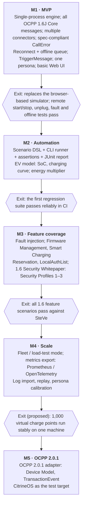

# ocpp-mimic design

Updated 2026-11-14 · Chinese version: [design.zh-CN.md](design.zh-CN.md). This English version is the source of truth.

## Overview

ocpp-mimic is a standalone OCPP charge point simulation platform: an engine runs many virtual charge points in one server process. Each charge point implements the OCPP specification, and persona files reproduce the timing and quirks of real hardware. The first release covers OCPP 1.6J Core only, with a data model shaped after 2.0.1.

**Positioning**: the engine is built to the standard of automated regression and load testing. The Web UI, the CLI and CI scripts are all remote controls for the engine. Manual QA is one way to use the UI layer, not the starting point of the design.

**Design principles**

- Separate the spec from the differences: the engine implements only the OCPP specification; everything vendor- or firmware-specific goes into personas.
- Pure core: the protocol, state machines and persona interpreter do no IO and receive time from outside, so they are unit-testable, replay deterministically and can run in a browser.
- Separate physics from protocol: plugging in, unplugging and so on are input events; OCPP messages are outputs of the state machine.
- Safe by default: connect only to allow-listed CSMS addresses, so a simulator never reaches production by mistake.

## Lessons from a browser-based simulator

A simulator written as a web page component works in the short term and gets stuck in the places below. The ocpp-mimic design answers each of them.

| Browser-based approach | Problem it causes | ocpp-mimic approach |
| --- | --- | --- |
| Virtual charge points run inside a page component | Closing the page takes the charge point offline; timers keep sending heartbeats after the component unmounts, which needs a lot of cleanup code | The engine is its own process with explicitly managed lifecycles |
| The station list is read straight from the CSMS database, with an exclusion list to avoid production stations | The simulator is coupled to the system under test | The simulator owns its station configuration and needs only a CSMS URL + chargeBoxId; CSMS addresses are allow-listed |
| Timing is fixed delays scattered through the code | Real hardware behaviour cannot be reused or switched | Extracted into persona files |
| Responses are matched to requests by guessing from the payload shape | Mismatches under concurrency | Strict uniqueId correlation with timeouts |
| Unsupported messages get `[4, id, {}]` | The CallError format is not spec-compliant | `[4, id, "NotImplemented", "description", {}]` |
| One connector, a handful of messages | Multiple connectors and other features cannot be tested | Full Core profile, multiple connectors, connectorId 0 |
| Scattered boolean flags guard against races | State is implicit and hard to test | Explicit state machine |
| Real time only, meter sampled every 300 s | A full charging session takes hours to test | Adjustable sampling interval + energy multiplier |
| "Simulate offline" just closes the socket cleanly | Real outages are mostly half-open connections (TCP stays up, no data flows) | Support both a clean disconnect and a half-open connection |

## Architecture


The Web UI, the CLI and the scenario runner only call the engine API. Each virtual charge point has six layers: the top five belong to the pure-logic core package (no IO, time injected through `Clock`, unit-testable and replayable), and only the transport layer does network IO.

## Services and runtime

M1 deploys a single service, the engine process; the Web UI and the CLI are its clients. It is not split into microservices: thousands of virtual charge points share one clock and scheduler and the modules call each other constantly, so a single process keeps timing consistent and is easier to deploy and debug.

**Runtime processes**

| Process | Count | Responsibility |
| --- | --- | --- |
| Engine (core service) | 1 | Runs all virtual charge points, serves the API, and hosts the Web UI's static files |
| CLI / scenario runner | On demand | Runs scenario YAML, drives the engine through the API, asserts and writes a JUnit report; can also embed an engine in its own process so CI needs no separate deployment |
| Web UI | In the browser | A pure client: every action goes through the engine API, no simulation logic |

**Engine modules**

| Module | Responsibility |
| --- | --- |
| API Server | REST for commands (create stations, plug in, swipe a card, trigger faults or outages); WebSocket push of message logs and state changes |
| Fleet Manager | Creates and destroys virtual charge points in bulk from templates (persona + configuration); manages start, stop and restart; controls ramp-up during load tests |
| Virtual charge point (× N) | The main workload: core logic (persona, device model, meter, protocol adapter, RPC) plus one WebSocket to the CSMS |
| Clock / Scheduler | One timer scheduler shared by all charge points instead of a timer per charge point; injects time into core and applies the energy multiplier |
| Persona Registry | Loads and validates persona YAML and resolves `extends` inheritance |
| State Store | Persists station configuration, config keys, meter readings and offline queues in SQLite, so stations keep their state across engine restarts |
| Event Recorder | Records every OCPP message and state change; supports queries and export, and is the source for replays |
| Metrics | Aggregates CSMS response latency, timeout rate, error rate and schema violations; exposes a Prometheus endpoint |
| Fault Injector | Hooks into the transport and RPC layers; injects delays, disconnects, half-open connections and malformed messages under API control |

The architecture diagram shows only the main modules.

**How a command flows** (clicking "Plug in" in the UI)

1. The Web UI calls the REST API; the API Server asks the Fleet Manager for the charge point (for example SIM-001).
2. The device model's state machine moves from Available to Preparing.
3. The protocol adapter produces a StatusNotification and sends it to the CSMS through the RPC and transport layers.
4. The CSMS response comes back the same way, and the RPC layer matches it by uniqueId.
5. The Event Recorder logs the exchange, and the API Server pushes it to the UI over WebSocket.

**Scaling out** (after M4, when needed): when one machine is not enough, run several engine instances, each owning a share of the charge points, assigned by the CLI or a lightweight coordinator. Each instance stays a single-process model, so the architecture does not change.

## Transport and RPC layers

The transport layer makes sure connections work and fail realistically; the RPC layer makes sure every message is matched and compliant.

**Transport layer**

- Subprotocol negotiation: `ocpp1.6`, with `ocpp2.0.1` reserved.
- Security: no authentication, plus Security Profiles 1–3 (Basic Auth / TLS + Basic / mutual TLS).
- WebSocket ping/pong keepalive.
- Reconnect: exponential backoff with random jitter. Many charge points reconnecting at once can overwhelm a CSMS, which is a test scenario in itself.
- Fault injection hooks: delay, packet loss, half-open connections, forced disconnects (see fault injection).

**RPC layer**

- Requests and responses are correlated by uniqueId; every CALL has a timeout.
- The spec says (SHOULD) a party does not send the next CALL until the previous one is answered or times out, so the charge point needs an outbound queue.
- Messages in both directions are validated against core's 1.6 message definitions, written from the specification with a small dependency-free schema module that also yields the TypeScript types: what we send is guaranteed compliant, and non-compliant messages from the CSMS are flagged, which doubles as a CSMS compliance checker. As a second check, the engine validates every frame against OCA's official OCPP 1.6 JSON Schemas, shipped unchanged with attribution under their CC BY-ND 4.0 licence in `packages/engine/oca-schemas/` and read by a generic draft-04 validator (Ajv); nothing is generated from them. Problems show up on the frame's record and in the Web UI's message log. A test cross-checks core's definitions against the official schemas with generated payloads; the only differences are the 1..* array cardinalities from the specification text, which the schemas leave out and core enforces (#18).
- CallError strictly follows `[4, uniqueId, errorCode, errorDescription, errorDetails]`; unsupported actions get `NotImplemented`.

## Device model and EV / meter model

The device model decides which state a charge point is in and which messages it sends; the EV / meter model decides how energy and power change.

**Device model**

- The hierarchy follows 2.0.1: Station → EVSE → Connector. 1.6 just maps connectorId onto EVSE / Connector, so moving to 2.0.1 needs no rewrite.
- The connector state machine covers the 1.6 statuses: Available, Preparing, Charging, SuspendedEV, SuspendedEVSE, Finishing, Reserved, Unavailable, Faulted. A pure reducer derives each status from the connector's physical and logical state (cable, transaction, EV / EVSE suspension, fault, availability) instead of storing it, so only transitions the 1.6 status table allows can happen, and it emits a StatusNotification whenever a status changes. No state-machine library: core stays dependency-free.
- Input events: plug in, unplug, lock / unlock, EV ready, EV paused, fault raised / cleared.
- Config key store: typed and read-only aware, supports `RebootRequired`, survives restarts.
- Authorization: Authorize, local authorization list, authorization cache, `AuthorizationRequired`.
- Offline queue: transaction messages are persisted, retried per `TransactionMessageAttempts` / `TransactionMessageRetryInterval`, and resent with their original timestamps after reconnecting.
- Restart semantics: the cumulative meter reading survives; when a power loss interrupts a transaction, StopTransaction (reason=PowerLoss) is sent after the restart.

**EV / meter model**

- EV profile: battery capacity (kWh), initial SoC, maximum AC power, number of phases.
- Charging curve: power tapers once SoC passes about 80% and the session naturally reaches SuspendedEV at 100%. "Fully charged" comes out of the model; no dedicated button is needed.
- Actual power = min(charge point rating, cable limit, charging profile limit, what the EV accepts), so SetChargingProfile has a verifiable effect.
- Meter energy is the integral of power and only increases; measurands follow `MeterValuesSampledData`, with Transaction.Begin / End and clock-aligned sampling (`ClockAlignedDataInterval`).
- Implemented in M2 (`packages/core/src/ev.ts`): above `taperSoc` (default 80 %) the accepted power falls linearly to 10 % of the maximum at `targetSoc` (default 100 %), where the EV stops and the connector reports SuspendedEV. Charging is solved in closed form, so the moment the EV is full is scheduled exactly. A cable is plugged in with an EV profile (a persona `evs` name or an inline profile, through the API, the Web UI or a scenario's `plugIn: { ev }`); without one the M1 fixed power applies. `SoC` is sampled with location EV, and currents are per phase of the EV (three-phase EVs report `Current.Import` / `Current.Offered` for L1, L2 and L3). Charging-profile limits join the minimum in M3.

## Personas

A persona is a declarative configuration describing how a vendor or firmware behaves within what the spec allows: message order, delays, supported features, default configuration, fault codes and known quirks. Engine code implements only the spec; when a real charge point shows new behaviour, only the persona changes, not the engine.

```yaml
persona: vendorX-fw2.5 # example values, not real vendor data
extends: generic-1.6 # built-in persona; only the differences are listed
boot:
  chargePointVendor: VendorX
  chargePointModel: AC-7
  firmwareVersion: "2.5.0"
connectors: 2
power: { offeredW: 11000 }
features: [Core, RemoteTrigger]
config:
  HeartbeatInterval: 60
  MeterValueSampleInterval: 300
  StopTransactionOnEVSideDisconnect: true
timing:
  startTransactionDelay: 2s
  commandDelays: { RemoteStopTransaction: 800ms }
  resetDowntime: { soft: 30s, hard: 3m }
evs: # EV profiles a cable can be plugged in with
  compact-40kwh: { capacityKWh: 40, initialSoc: 20, maxPowerW: 7400, phases: 1 }
faults:
  - { name: Ground fault, errorCode: GroundFailure, info: GND_FAULT, vendorErrorCode: E101 }
```

Persona v1 (implemented in `packages/core/src/persona.ts`, loaded by the engine's Persona Registry) covers BootNotification fields, connectors, power, advertised feature profiles, configuration defaults, timing (durations in milliseconds or with `ms` / `s` / `m` / `h`), named EV profiles (`evs`: `capacityKWh`, `initialSoc`, `maxPowerW`, `phases`, optional `taperSoc` and `targetSoc`) and a fault catalogue. `extends` merges objects key by key and replaces arrays and scalars. Scripted message flows (for example sending StatusNotification Finishing before answering RemoteStop) and vendor quirks such as a minimum firmware version for UpdateFirmware are planned for a later version.

Personas come from three sources: written by hand; generated from statistics over real logs (see record & replay); or inherited from an existing persona and overridden (`extends: vendorX-fw2.5`).

## Scenario engine, fault injection, and record & replay

These three turn ocpp-mimic from a simulator you click by hand into a test tool that runs in CI.

**Scenario engine**

Scenarios are actions plus assertions, written in YAML, run by the CLI, and reported as JUnit for CI. An `http` step can call the business system under test, so app-side actions join the same scenario. The format is specified in "Scenario format v1" below.

```yaml
name: Unplug while charging; the CSMS should end the session and send no RemoteStop
csms: wss://csms.example.com/ocpp # the CSMS under test (example address)
station: { id: SIM-001, persona: vendorX-fw2.5 }
steps:
  - plugIn: { connector: 1 }
  - http: { method: POST, url: "{{APP_API}}/charges/start", json: { station: SIM-001 } }
  - expect: { received: RemoteStartTransaction, within: 10s }
  - charge: { connector: 1, duration: 20m }
  - unplug: { connector: 1 }
  - expect: { sent: StopTransaction, payload: { reason: EVDisconnected } }
  - expectNo: { received: RemoteStopTransaction, within: 30s }
```

**Fault injection**

| Layer | Faults that can be injected |
| --- | --- |
| Network | Delay, packet loss, clean disconnect, half-open connection, flapping, reconnect storms |
| Protocol | Malformed JSON, wrong or duplicate uniqueId, out-of-order messages, no response, CallError responses, schema-violating messages |
| Device | Faulted (errorCode / info / vendorErrorCode combinations), meter rollback or reset to zero, clock drift, malformed timestamps |
| Power | Power loss and restart, resending after an interrupted transaction |

**Record & replay**

- Import real charge point logs (direction, action, payload, timestamp) and replay them as scenarios to reproduce production issues.
- Derive the intervals between messages from logs to generate or calibrate personas.
- Mask idTags, serial numbers and other identifiers on import.

## Scenario format v1

Decided for M2 (#38). A scenario file is YAML; each YAML document in it (documents are separated by `---`) is one scenario. The runner executes scenarios one at a time, each on a fresh embedded engine, and reports a test suite per file and a test case per scenario. The files in `scenarios/examples/` are the reference examples.

```yaml
name: Card session with periodic meter values
station:
  id: SIM-001
  persona: generic-1.6
  config: { MeterValueSampleInterval: 10 }
vars:
  TAG: TAG-001
steps:
  - presentCard: { connector: 1, idTag: "{{TAG}}", result: authorized }
  - plugIn: { connector: 1 }
  - expect: { sent: StartTransaction, payload: { connectorId: 1, idTag: "{{TAG}}" } }
  - expectConnector: { connector: 1, status: Charging }
  - expect: { sent: MeterValues, within: 15s }
  - presentCard: { connector: 1, idTag: "{{TAG}}", result: stopping }
  - expect: { sent: StopTransaction, payload: { reason: Local } }
  - unplug: { connector: 1 }
  - expectConnector: { connector: 1, status: Available }
```

**Scenario fields**

| Field | Required | Meaning |
| --- | --- | --- |
| `name` | yes | Test case name |
| `description` | no | Free text, shown in reports |
| `csms` | no | `builtin` (the default) or the WebSocket URL of a CSMS; the station id is appended as for any station. `--csms` on the command line overrides it |
| `station` or `stations` | yes | One station, or a list of them. Fields: `id`, `persona`, and optionally `password`, `config` (configuration key overrides), `behaviour` (test switches), `energyMultiplier`, `waitForBoot` |
| `vars` | no | Default values for templates |
| `timeout` | no | Limit for the whole scenario; default 5 minutes |
| `checkSchemas` | no | Default `true`: the scenario fails if any frame broke the official OCA schema |

Setup creates and starts every station; with `waitForBoot` (the default) it also waits until the station's BootNotification is Accepted. Set `waitForBoot: false` to test registration itself.

**Steps**

A step is a map with one step key whose value is the step's arguments. Steps that act on a station take `station` (its id; default the first station), and connector steps take `connector` (default 1). Any step may carry `name` next to the step key (`- name: Card in` above `presentCard: ...`), which reports show instead of the generated label. Steps without arguments can be written `online:` or `online: {}`.

Charge point actions, the same operations the API offers:

| Step | Arguments | Effect |
| --- | --- | --- |
| `plugIn` | `connector`, `ev` | Cable in; `ev` names an EV profile |
| `unplug` | `connector` | Cable out |
| `presentCard` | `connector`, `idTag`, `result` | A card at the connector; `result` optionally asserts `authorized`, `rejected`, `stopping` or `busy` |
| `evSuspend`, `evResume` | `connector` | The EV pauses or resumes |
| `fault` | `connector` (0 = the whole charge point), `errorCode`, `info`, `vendorErrorCode` | Raise a fault |
| `clearFault` | `connector` | Clear it |
| `offline` | `mode`: `clean` or `half-open` | Simulated outage |
| `online` | — | End the outage |
| `stopStation`, `startStation` | — | Disconnect or reconnect the station |
| `setBehaviour` | `refuseRemoteStart`, `cableLock` | Test switches |
| `wait` | a duration | Pause |
| `charge` | `connector`, `duration` | Wait for `duration`; fails unless the connector has a running transaction at the start and at the end |

An action the engine refuses (for example unplugging a locked cable) fails the step. With `expectError: <text>` the step instead requires a refusal whose message contains the text.

Expectations:

| Step | Arguments | Passes when |
| --- | --- | --- |
| `expect` | `sent` or `received` (an action), `payload`, `answer`, `within`, `from` | A matching CALL is recorded in time. `sent` means charge point → CSMS, `received` CSMS → charge point. `payload` must match the CALL and `answer` the CALLRESULT to it |
| `expectNo` | `sent` or `received`, `payload`, `within` | No matching CALL is recorded during `within` |
| `expectConnector` | `connector` plus connector snapshot fields (`status`, `errorCode`, `plugged`, `locked`, `transactionId`, `ev`, ...), `within` | The connector snapshot matches in time. `connector: 0` is the whole charge point (`status`, `errorCode`) |
| `expectStation` | station snapshot fields (`registration`, `transport`, `queuedMessages`, `behaviour`, ...), `within` | The station snapshot matches in time |

`within` defaults to 10 s. Message expectations are ordered: a search starts after the message the previous `expect` matched (`from: last`, the default), so consecutive `expect` steps also assert the order of the messages. `from: step` ignores messages recorded before the step began, and `from: start` searches from the start of the scenario.

CSMS steps, available only with the built-in CSMS:

| Step | Arguments | Effect |
| --- | --- | --- |
| `csmsCall` | `action`, `payload`, `answer`, `error` | The built-in CSMS sends a CALL to the station. `answer` must match the CALLRESULT; `error` instead names the expected CALLERROR code |
| `csmsReply` | `action`, then `payload`, `error` or `ignore: true`, and `times` | How the built-in CSMS answers the station's next `times` calls of `action` (default: all of them) |

HTTP, for the system under test:

| Step | Arguments | Effect |
| --- | --- | --- |
| `http` | `method` (default GET), `url`, `headers`, `basicAuth` (`user`, `password`), `json`, `expect` (`status`, `json`), `save` | Sends a request (10 s timeout) and checks the response. Without `expect.status` any 2xx passes; `expect.json` matches the parsed body |

`save: { NAME: <path> }` stores a value as a variable for later steps. It works on `expect` (path root `{ payload, answer }`), `expectConnector` and `expectStation` (the snapshot), `csmsCall` (`{ answer }`) and `http` (`{ status, json, text }`). Paths look like `$.answer.transactionId`.

**Matching**

`payload`, `answer`, the snapshot steps and `http` `expect.json` match partially: every field given must be present and equal, and fields not given are ignored. Arrays match element by element and must have the same length. Instead of a value, a field can hold operators, all of which must hold: `$exists`, `$regex`, `$ne`, `$gt`, `$gte`, `$lt`, `$lte`, and for arrays `$contains` (some item matches, partially) and `$size` (a number, or comparisons such as `{ $gte: 20 }`).

**Templates and variables**

`{{NAME}}` in a string is replaced before the step runs. Values come from, lowest priority first: `vars`, `--var NAME=value` on the command line, and variables saved by earlier steps. `{{env.NAME}}` reads an environment variable; those values are shown as `***` in output and reports. A string that is exactly one template keeps the value's type, so `"{{tx}}"` can stand for a number. Unknown names are errors found before the scenario starts; a saved variable counts only after the step that saves it.

**Durations** use the persona syntax: milliseconds as a number, or a string ending in `ms`, `s`, `m` or `h`.

**Where the code lives**

| Package | Part |
| --- | --- |
| core | Scenario model and validation (with the schema module), templates, matching, step labels. Pure, like personas |
| engine | The runner: a fresh embedded engine (and the built-in CSMS, `src/csms/builtin-csms.ts`) per scenario, steps executed in-process against the fleet and the recorder, teardown even after failures; the result model; console and JUnit reporters |
| cli | `ocpp-mimic run`: arguments, reading the YAML files, calling the runner, the exit code |

A remote engine over the HTTP API is not needed in M2: the CLI embeds its own engine, so CI needs no separate deployment.

**Running and reporting**

`ocpp-mimic run <file|dir>...` runs every `.yaml` / `.yml` file given, searching directories recursively in sorted order, one scenario at a time. Options: `--csms <url>`, `--var NAME=value` (repeatable), `--timeout <duration>` (the default scenario timeout), `--bail` (stop after the first scenario that does not pass), `--junit <file>`, `--allow-csms` and `--personas` as for `serve`.

- A scenario passes, fails (a step failed; the remaining steps are reported as skipped) or errors (invalid file, engine failure, timeout). Teardown always runs.
- The console shows one line per scenario with its duration and, for a failure, the failing step with expected and actual values.
- JUnit: one `testsuite` per file and one `testcase` per scenario (classname = the file), `failure` or `error` with the failing step, durations, and `properties` such as persona, CSMS and energy multiplier.
- Exit code 0 when every scenario passed, 1 when any failed or errored, 2 for usage errors and files that do not validate.

## M3 feature coverage

Decided for M3 (#65). M3 adds the remaining OCPP 1.6 feature profiles, the Security Whitepaper and fault injection. Its exit criterion is that every 1.6 feature has scenarios that pass against SteVe.

**Feature profiles**

- A persona's `features` decides which profiles a station advertises in `SupportedFeatureProfiles`. A message of a profile the station does not advertise is answered with CALLERROR NotSupported, so a persona can drop a profile to test how a CSMS copes. `generic-1.6` advertises every profile once it is implemented.
- Each feature task adds its profile's messages to core's definitions; the cross-check against OCA's schemas then covers them automatically.
- Configuration keys per profile, with the specification's names (defaults shown; personas can override them):

| Profile | Keys |
| --- | --- |
| Local Auth List Management | `LocalAuthListEnabled` (true), `LocalAuthListMaxLength` (100, read-only), `SendLocalListMaxLength` (100, read-only) |
| Reservation | `ReserveConnectorZeroSupported` (true, read-only) |
| Smart Charging | `ChargeProfileMaxStackLevel` (10), `ChargingScheduleAllowedChargingRateUnit` (Current,Power), `ChargingScheduleMaxPeriods` (24), `MaxChargingProfilesInstalled` (20), `ConnectorSwitch3to1PhaseSupported` (false); all read-only |
| Firmware Management | `SupportedFileTransferProtocols` (HTTP,HTTPS,FTP, read-only) |
| Security (whitepaper) | `SecurityProfile` (0), `AuthorizationKey` (write-only), `CpoName`, `CertificateStoreMaxLength`, `CertificateSignedMaxChainSize`, `AdditionalRootCertificateCheck` |

**Local Auth List and Reservation**

- The local list sits next to the authorization cache: with `LocalAuthListEnabled` a card on the list is decided locally (online with `LocalPreAuthorize`, offline with `LocalAuthorizeOffline`), as the specification describes. The list and its version are kept across engine restarts.
- A reservation is part of the device model: the connector reports Reserved, only the reserved idTag or its parentIdTag can start, the reservation ends at `expiryDate` or when its transaction starts, and StartTransaction carries the `reservationId`. connectorId 0 reserves any free connector when `ReserveConnectorZeroSupported` is true.

**Smart Charging**

- A pure model in core (`charging-profile.ts`) holds the installed profiles per connector (connectorId 0 for the whole station) and answers two questions: the limit in force at a moment, and the composite schedule over a duration.
- Stacking: the highest `stackLevel` valid at the moment wins within a purpose; a TxProfile (only during a transaction) overrides the TxDefaultProfile; a ChargePointMaxProfile on connectorId 0 caps the station, shared equally between the connectors that are charging.
- Absolute, Recurring (Daily / Weekly, from `startSchedule`) and Relative (from the transaction start) schedules; `validFrom` / `validTo`; limits in A or W, converted with the connector's voltage and `numberPhases` (default 3).
- The power delivered is min(charge point rating, EV acceptance, limit in force). A timer fires at the next period boundary, so power, MeterValues and SoC follow the schedule. Profiles are kept across engine restarts.

**Firmware and diagnostics**

- By default nothing is transferred: the station walks through the statuses with timings from the persona (`firmware: { downloadTime, installTime, uploadTime }`) and outcomes from the persona or from fault injection (DownloadFailed, InstallationFailed, UploadFailed).
- UpdateFirmware waits for `retrieveDate`, sends Downloading → Downloaded → Installing → Installed, then reboots. The new `firmwareVersion` in BootNotification is the version in the location's file name (`fw-2.5.1.bin` → 2.5.1), otherwise the old version with `-updated`; it is kept across restarts.
- GetDiagnostics answers with a `fileName` and sends Uploading → Uploaded. With `firmware: { transfer: real }` in the persona, an HTTP(S) location really receives the diagnostics file (the station's recent message log) by PUT, and UpdateFirmware really downloads an HTTP(S) location. FTP is never really transferred.
- TriggerMessage can request both status notifications.

**Fault injection**

- An engine Fault Injector per station, sitting in the transport and RPC layers. API: `POST /api/stations/:id/injections` with `{ type, ...parameters, for? }`, `DELETE` to clear. Scenario steps: `inject: { type, ..., for }` and `clearInjections: {}`.

| Layer | Types |
| --- | --- |
| Network | `latency` (ms, each direction), `drop` (frames in a direction, a count or a probability), `flap` (down / up times, repeats), `reconnectStorm` (every station at once; fleet-wide) |
| Protocol | `malformedJson` (next N frames sent), `duplicateId`, `unknownId` (answers with a uniqueId the CSMS never sent), `outOfOrder` (swaps the next two CALLs), `noAnswer` (ignores CSMS CALLs of an action), `callError` (answers them with a CALLERROR code), `schemaViolation` (an extra property in the next CALL of an action) |
| Device | `meterRollback` (Wh), `meterReset`, `clockDrift` (ms added to every timestamp), `badTimestamp` (next N timestamps malformed) |
| Power | `powerLoss` (`for`: off, then restart from the saved state: transactions end with PowerLoss, queued messages keep their timestamps), repeated with `times` |

- Injected frames are recorded with the injection's type, shown in the Web UI's message log and excluded from the OCA schema check, since they are wrong on purpose.

**Security (OCPP 1.6 Security Whitepaper)**

- Stations take `security: { profile, ca?, cert?, key? }` (PEM file paths). Profile 1: Basic Auth over ws or wss with `AuthorizationKey` as the password (the station's `password`). Profile 2: wss with the server certificate checked against `ca`, plus Basic Auth. Profile 3: wss with the client certificate `cert` / `key`, no Basic Auth.
- ChangeConfiguration of `AuthorizationKey` reconnects with the new key. `SecurityProfile` can only go up; the station reconnects with the new profile and falls back to the previous one when that fails, as the whitepaper requires.
- The built-in CSMS can serve TLS, require client certificates and check Basic Auth passwords (`csmsOptions` in a scenario). Tests use a fixed test PKI committed under `packages/engine/test-pki/` (CA, server and client certificates valid for 20 years, test only) with a script that regenerates it with openssl.
- All whitepaper messages are in M3: certificate management (SignCertificate / CertificateSigned, InstallCertificate, GetInstalledCertificateIds, DeleteCertificate), SecurityEventNotification, ExtendedTriggerMessage, GetLog / LogStatusNotification and SignedUpdateFirmware / SignedFirmwareStatusNotification. CSRs need X.509 support that Node lacks, so the engine may add a library for it (core stays dependency-free). OCA's whitepaper download is checked for JSON schemas, which would ship unchanged as in #50.

**SteVe**

- Scenarios make SteVe send commands through its REST API (`POST /steve/api/v1/operations/<Action>`, HTTP Basic with the admin user's API password) using `http` steps (#63). `scenarios/steve/` holds these SteVe variants and the SteVe workflow runs them.
- Data SteVe needs before a command (charging profiles to reference by id, OCPP tags for the local list and reservations) is created through its API or `tools/steve/register.sh`.

**Scenarios**

Each feature task adds regression scenarios for the built-in CSMS (`scenarios/regression/`) and, where SteVe can send the command, a SteVe variant (`scenarios/steve/`). For example, a TxProfile capping a running session:

```yaml
name: A TxProfile caps the power of a running session
station: { id: REG-SC-TX, persona: regression-1.6 }
steps:
  - presentCard: { idTag: TAG-REG, result: authorized }
  - plugIn: { ev: compact-40kwh }
  - expect: { sent: StartTransaction, save: { tx: $.answer.transactionId } }
  - expectConnector: { status: Charging, powerW: { $gt: 7000 } }
  - csmsCall:
      action: SetChargingProfile
      payload:
        connectorId: 1
        csChargingProfiles:
          chargingProfileId: 1
          transactionId: "{{tx}}"
          stackLevel: 0
          chargingProfilePurpose: TxProfile
          chargingProfileKind: Relative
          chargingSchedule:
            chargingRateUnit: W
            chargingSchedulePeriod: [{ startPeriod: 0, limit: 3680 }]
      answer: { status: Accepted }
  - expectConnector: { powerW: 3680 }
```

And a fault injected by a scenario:

```yaml
name: The CSMS copes with a slow, lossy connection
station: { id: REG-FI-NET, persona: regression-1.6 }
steps:
  - inject: { type: latency, ms: 2000, for: 30s }
  - presentCard: { idTag: TAG-REG, result: authorized }
  - plugIn: {}
  - expect: { sent: StartTransaction, within: 15s }
  - inject: { type: drop, direction: received, count: 1 }
  - expect: { sent: StatusNotification, payload: { status: Charging }, within: 15s }
```

## Observability and UI

The UI is one client of the engine API; everything it does can also be done through the REST / WebSocket API and the CLI.

- Message log: direction icons, include / exclude by action, raw payload view, JSON export.
- Sequence view: messages between charge point and CSMS over time, with timeouts and errors marked.
- State machine view: the current state of each connector, highlighted live.
- Fleet overview: online / offline / faulted counts, grouped by persona or tag.
- Metrics: CSMS response latency (p50 / p95), timeout rate, error rate and schema violations, exported via Prometheus or OpenTelemetry.

## Time acceleration

Decision: timestamps always use real time. Acceleration comes from shorter sampling intervals plus an energy multiplier, never from speeding up the clock itself. OCPP messages carry timestamps that the CSMS uses for durations and billing; accelerated timestamps would reach the CSMS as "future" times and break a lot of logic.

| Approach | How | Effect | Limitation |
| --- | --- | --- | --- |
| Shorter sampling interval | Set `MeterValueSampleInterval` to 10 s | Meter and status changes show up sooner | A full charge still takes real time |
| Energy multiplier | Add N× the energy per sampling period | A full session in minutes; kWh-based billing tests stay accurate | Time-based billing and power plausibility checks are not accurate |
| Fully virtual clock | Timestamps accelerated too | Compresses time completely | Only for integration tests where the CSMS clock is also controlled |

The UI and test reports must clearly show whether the energy multiplier is on, so results are not misread.

Implemented in M2: each station has an `energyMultiplier` (default 1), set when it is created (API, or `energyMultiplier` on a scenario station) and changed at run time (`PATCH /api/stations/:id/energy-multiplier`, or the Web UI). It is kept across engine restarts. The meter and the EV model advance energy and SoC that many times faster, and the full-battery moment comes that much sooner, while every timestamp and the reported power stay real. The Web UI shows an "energy ×N" badge, and scenario reports carry an `energyMultiplier` property, whenever it is not 1.

## Tech stack and repository layout

Recommended: TypeScript / Node. The engine and UI share a language, core runs directly in a browser, and a single process can hold thousands of WebSocket connections.

| Option | Pros | Cons |
| --- | --- | --- |
| TypeScript / Node (recommended) | Engine and UI share code; ajv for schema validation; the existing ocpp-rpc library; Vue experience carries over | CPU gets tight at tens of thousands of connections |
| Go | Best load-testing performance, single-binary deployment | The UI is a separate codebase with no shared code |
| Python | mobilityhouse/ocpp is mature and pleasant for tests | Weaker at large-scale concurrency |

The repository is a monorepo (pnpm workspaces):

- `packages/core`: protocol, state machines, persona interpreter; pure logic, no IO.
- `packages/engine`: runtime, persistence (SQLite first), REST / WebSocket API.
- `packages/cli`: scenario runner; the command is `ocpp-mimic` (a bare `mimic` is taken by a text-to-speech tool on Homebrew).
- `apps/web`: Vue 3 UI.

## Open-source references and differentiation

ocpp-mimic differs in four ways: personas grounded in real charge point experience, scenarios and CI as core features, a built-in CSMS compliance checker, and log replay. Study these projects before building (all confirmed actively maintained on 2026-11-14).

| Project | Type | Use |
| --- | --- | --- |
| [SAP/e-mobility-charging-stations-simulator](https://github.com/SAP/e-mobility-charging-stations-simulator) | OCPP-J charging station simulator (TypeScript) | Main reference; start by finding what it lacks |
| [mikuso/ocpp-rpc](https://github.com/mikuso/ocpp-rpc) | OCPP-J RPC library for Node | Could serve as the RPC layer directly |
| [mobilityhouse/ocpp](https://github.com/mobilityhouse/ocpp) | Python OCPP library | Reference for the message model and validation |
| [steve-community/steve](https://github.com/steve-community/steve) | Open-source CSMS (Java, 1.6) | A second test target, so we do not tune against one CSMS into false compatibility |
| [citrineos/citrineos-core](https://github.com/citrineos/citrineos-core) | Open-source CSMS (2.0.1) | Test target for the 2.0.1 phase |
| OCTT | OCA's official compliance test tool (paid) | Reference for test cases |

## OCPP 1.6J coverage

The protocol follows OCPP 1.6J throughout; personas, the EV model, the scenario engine and so on are this project's own design and not part of the spec. M1 covers the 1.6J Core profile plus TriggerMessage.

**Spec vs. project design**

| Module | Implemented per the 1.6J spec | The project's own design |
| --- | --- | --- |
| Transport | OCPP-J: WebSocket, `ocpp1.6` subprotocol, chargeBoxId at the end of the URL, keepalive via `WebSocketPingInterval` | Reconnect backoff, fault injection |
| RPC | Message types 2/3/4, uniqueId, CallError format and error codes, a single unanswered CALL at a time, the field definitions of every 1.6 message | Timeout lengths, CSMS compliance report |
| Protocol adapter | All 1.6J messages | — |
| Device model | The 9 connector statuses and their transitions, connectorId 0 meaning the whole charge point, config key semantics, authorization (Authorize / cache / local list), transaction message retries, StopTransaction reasons | The Station → EVSE → Connector hierarchy, borrowed from 2.0.1 to prepare for the upgrade |
| Meter | Measurands, ReadingContext, `MeterValuesSampledData`, clock-aligned sampling, transactionData | — |
| EV model | SetChargingProfile power-limit semantics | Battery, SoC, charging curve (OCPP does not model the vehicle) |
| Persona | `features` maps to 1.6 feature profiles, `config` to 1.6 standard config keys, fault codes use ChargePointErrorCode | Timing between messages and vendor quirks (the spec says what to send, not how long to wait) |
| Security | Security Profiles 1–3 from the OCPP 1.6 Security Whitepaper, an extension document | — |
| Scenarios, replay, fleet, metrics, UI, time acceleration | — | All the project's own |

**M1: charge point → CSMS messages**

| Message | Simulator behaviour |
| --- | --- |
| BootNotification | Sent after connecting; handles Accepted / Pending / Rejected, then starts heartbeats or retries later according to the returned interval |
| Heartbeat | Sent on the interval |
| StatusNotification | Once accepted at boot, reported once for connectorId 0 and each connector; afterwards on every status change, with errorCode / info / vendorErrorCode |
| Authorize | Sent on a local card swipe; the result goes into the authorization cache |
| StartTransaction | Sent once authorized and plugged in, with meterStart; the returned idTagInfo decides whether to continue or stop |
| MeterValues | Sent every `MeterValueSampleInterval`, with configurable measurands and clock-aligned sampling |
| StopTransaction | Sent on remote stop, card stop, unplug, restart or unlock, with reason and transactionData |
| DataTransfer | Vendor-specific data sent from the UI or a persona |

**M1: CSMS → charge point messages**

| Message | Simulator behaviour |
| --- | --- |
| RemoteStartTransaction | Checks connector state and idTag, then starts a transaction; with `AuthorizeRemoteTxRequests=true` it sends Authorize first. Answers Rejected while the station's refuse-remote-start switch is on |
| RemoteStopTransaction | Accepted when the transactionId matches; ends the transaction (reason=Remote) |
| Reset | Soft / Hard: end the transaction, disconnect, reconnect after the persona's delay and send BootNotification again |
| UnlockConnector | Answers Unlocked / UnlockFailed / NotSupported; ends a running transaction first (reason=UnlockCommand) and releases the cable lock |
| ChangeAvailability | Operative / Inoperative; answers first and reports the new status after the persona's command delay; answers Scheduled during a transaction and applies the change when it ends. connectorId 0 changes only through a request for connectorId 0, not when every connector has been changed one by one |
| GetConfiguration | Returns config keys with their read-only flag; unknown keys go into unknownKey |
| ChangeConfiguration | Answers Accepted / Rejected / RebootRequired / NotSupported, and the change takes effect |
| ClearCache | Clears the authorization cache |
| DataTransfer | Answers UnknownVendorId by default; personas can define custom replies |
| TriggerMessage | Supports BootNotification, Heartbeat, StatusNotification and MeterValues; after Accepted, sends the requested message. Firmware and diagnostics requests answer NotImplemented until M3 |

TriggerMessage belongs to the Remote Trigger profile. It moves into M1 because many CSMSs use it to make a charge point re-report status or heartbeats, and it is cheap to implement.

**Other M1 capabilities**

- A 9-state connector state machine with multiple connectors.
- 1.6 standard config keys: `HeartbeatInterval`, `MeterValueSampleInterval`, `MeterValuesSampledData`, `StopTransactionOnEVSideDisconnect`, `StopTransactionOnInvalidId`, `AuthorizeRemoteTxRequests`, `AuthorizationCacheEnabled`, `TransactionMessageAttempts`, `TransactionMessageRetryInterval`, `NumberOfConnectors`, `SupportedFeatureProfiles` and more.
- RPC correctness: schema validation in both directions, a single-CALL outbound queue, timeouts; unsupported messages get NotImplemented and disabled profiles get NotSupported.
- Offline: transaction messages are queued and resent after reconnecting; both clean disconnects and half-open connections can be simulated.
- Faults: report a Faulted status (using ChargePointErrorCode) and recover from it.
- Meter: fixed power at first, with "pause" and "fully charged" triggered by hand; M2 replaces this with the EV model.
- One persona; the UI and API can create stations, plug in and unplug, swipe cards, and trigger faults or outages; the message log can be filtered and shows raw payloads.
- Test switches per station, in the UI and API and kept across restarts: refuse remote starts, and a cable lock that holds the cable while a transaction runs. A locked cable cannot be unplugged until UnlockConnector or the end of the transaction releases it.

**M3: feature profiles** (implemented so far; the rest follows the design in "M3 feature coverage")

| Message | Simulator behaviour |
| --- | --- |
| SendLocalList | Full and Differential updates with versions; Failed beyond `SendLocalListMaxLength` / `LocalAuthListMaxLength`, VersionMismatch for an old Differential version; NotSupported without the profile |
| GetLocalListVersion | The list's version, 0 when empty, -1 without the profile |
| ReserveNow | Accepted (the connector reports Reserved; only the idTag or its parentIdTag, asked from the CSMS if unknown, may start), Occupied, Faulted, Unavailable or Rejected; the same reservationId replaces; connectorId 0 keeps one connector free; the reservation ends at `expiryDate`, when its transaction starts (StartTransaction carries `reservationId`), or when the connector faults or becomes Unavailable |
| CancelReservation | Accepted for a known reservationId, else Rejected |
| SetChargingProfile | Installs the profile per the Smart Charging model (Rejected for a TxProfile without a matching transaction, a ChargePointMaxProfile off connectorId 0, or beyond the configured limits); the limit takes effect at once |
| ClearChargingProfile | By id, or by every criterion given; Unknown when nothing matched |
| GetCompositeSchedule | The composite schedule from now for the duration, in A or W (default W); connectorId 0 for the whole station; Rejected for an unknown connector |

The Smart Charging limit in force becomes the power a connector offers: it caps the power drawn (with or without an EV), shows in Power.Offered / Current.Offered and in the snapshot's `limitW`, and changes at each period boundary. A ChargePointMaxProfile is split equally between the connectors with a transaction. A RemoteStartTransaction may carry a TxProfile, installed when the transaction starts; TxProfiles are deleted when their transaction ends and are not kept across restarts, other profiles are.

Actions of a profile the station does not advertise in `SupportedFeatureProfiles` are answered with CALLERROR NotSupported, except the local list's own answers. Reservations are kept across restarts.

A card on the local list is decided locally before the cache (`LocalAuthListEnabled`, `LocalPreAuthorize`, `LocalAuthorizeOffline`), and the list is kept across restarts. A transaction starts charging as soon as it starts, also offline; its StartTransaction is sent when possible, and a not-Accepted answer then stops or suspends it.

**1.6 features outside M1** (roadmap M3, designed in "M3 feature coverage"): Firmware Management (UpdateFirmware, GetDiagnostics and their status notifications), Local Auth List Management (SendLocalList, GetLocalListVersion), Reservation (ReserveNow, CancelReservation), Smart Charging (SetChargingProfile, ClearChargingProfile, GetCompositeSchedule), and the Security Whitepaper.

## Roadmap



Each phase ends with an exit criterion; the next phase starts once it is met. The M4 scale target is a proposal and can be adjusted to real needs.

## Open questions

- [ ] Deployment: a local tool (CLI / desktop) or a hosted SaaS? A SaaS connects to other people's CSMSs over the internet, which brings multi-tenancy and abuse prevention.
- [ ] When to start OCPP 2.0.1: do target users already need it?
- [ ] Open source or commercial: decides how much load testing, UI and documentation to build, and which license to use.
- [x] Ship OCA's OCPP 1.6 JSON Schema files: yes, unchanged and with attribution, as a second check next to core's own definitions (#18).
- [ ] Whether the energy multiplier is on by default, and how reports mark it.
- [ ] Which real charge point the first persona is modelled on, and where sample logs come from (they must be anonymised and must not use client project data).
