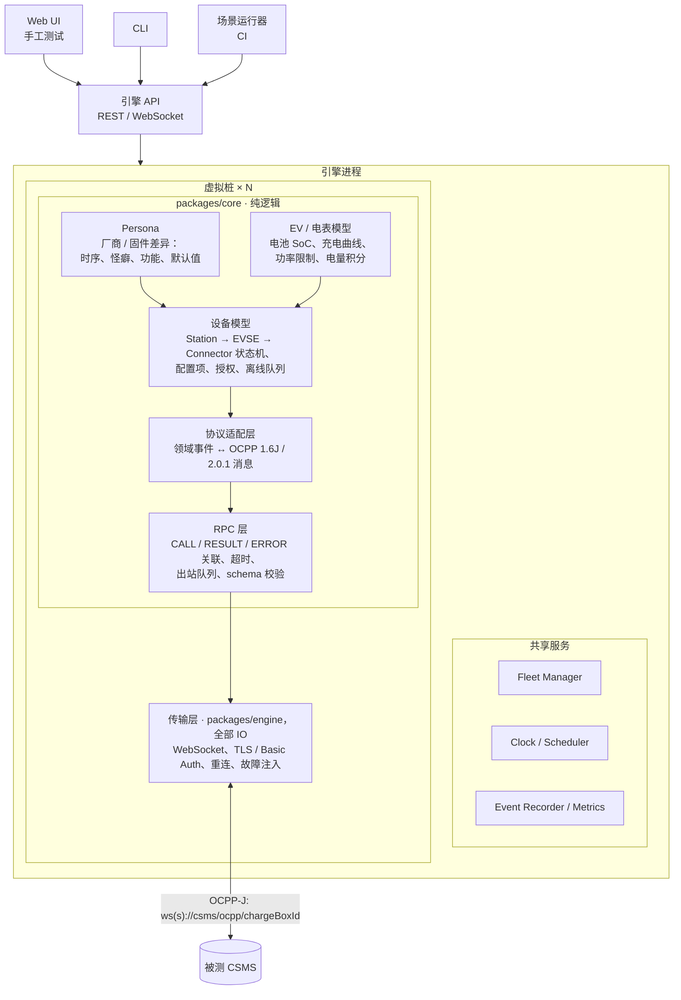

# ocpp-mimic 设计方案

更新于 2026-11-17 · 英文版：[design.md](design.md)（两版不一致时以英文版为准）

## 概述

ocpp-mimic 是一个独立的 OCPP 充电桩模拟平台：引擎在服务端进程里同时运行多个虚拟充电桩，每个桩按 OCPP 规范实现，再用 persona 文件复现真实桩的时序和怪癖。先做 OCPP 1.6J（M1 至 M4），M5 和 M7 在同一个引擎里加上了 OCPP 2.0.1 和 2.1；数据模型一开始就是按 2.0.1 设计的。M8 把它做成别人可以安装的发布版本。用法见[使用手册](guide.zh-CN.md)。

**定位**：引擎按“自动化回归 + 压测”的标准设计；Web UI、CLI 和 CI 脚本都只是引擎的遥控器。手动 QA 是 UI 层的一种用法，不是设计的出发点。

**设计原则**

- 规范与差异分离：引擎只实现 OCPP 规范，厂商和固件的差异全部写进 persona。
- core 纯逻辑：协议、状态机、persona 解释器不做 IO，时钟从外部注入，可单测、可确定性回放、可在浏览器里运行。
- 物理与协议分离：插枪、拔枪等是输入事件，OCPP 消息是状态机的输出。
- 默认安全：只连接白名单里的 CSMS 地址，防止误连生产环境。

## 浏览器版模拟器的经验教训

把模拟器写成网页组件，短期能用，长期会在下面这些地方卡住。ocpp-mimic 的设计逐条针对它们。

| 浏览器版的做法 | 带来的问题 | ocpp-mimic 的做法 |
| --- | --- | --- |
| 虚拟桩跑在网页组件里 | 关掉页面桩就掉线；组件卸载后定时器还在发心跳，需要大量清理代码 | 引擎独立进程，生命周期显式管理 |
| 桩列表直接读 CSMS 数据库，靠排除名单避开生产桩 | 模拟器与被测系统耦合 | 模拟器自管桩配置，只需 CSMS URL + chargeBoxId；CSMS 地址白名单 |
| 时序是散落在代码里的固定延时 | 真实桩的行为指纹没法复用、切换 | 抽成 persona 文件 |
| 按 payload 的形状猜回包对应哪个请求 | 并发时会配错 | 严格按 uniqueId 关联，带超时 |
| 不支持的消息回 `[4, id, {}]` | CallError 格式不合规 | `[4, id, "NotImplemented", "描述", {}]` |
| 只有一个枪，只覆盖少量消息 | 测不到多枪和其余功能 | 完整 Core profile、多枪、connectorId 0 |
| 用零散的布尔标志防竞态 | 状态是隐式的，很难测试 | 显式状态机 |
| 只能实时运行，电表 300 秒采样一次 | 测一次完整充电要好几个小时 | 可调采样间隔 + 能量倍率 |
| “模拟离线”就是正常关闭 socket | 真实掉线大多是半开连接（TCP 没断，只是没数据） | 同时支持正常断开和半开连接 |

## 总体架构



Web UI、CLI 和场景运行器都只调用引擎 API。每个虚拟桩内部分六层：上面五层属于纯逻辑的 core 包，只有传输层做网络 IO。

## 服务划分与运行时

M1 只部署一个服务：Engine 进程；Web UI 和 CLI 都是它的客户端。不拆微服务：几千个虚拟桩要共用一个时钟和调度器，模块之间调用频繁，单进程更容易保证时序，也更好部署和调试。

**运行时进程**

| 进程 | 数量 | 职责 |
| --- | --- | --- |
| Engine（核心服务） | 1 个 | 运行所有虚拟桩，对外提供 API，顺带托管 Web UI 的静态文件 |
| CLI / 场景运行器 | 按需启动 | 执行场景 YAML，通过 API 驱动 Engine 并做断言，输出 JUnit 报告；也可以用内嵌模式在自己的进程里起一个 Engine，CI 里不用单独部署 |
| Web UI | 在浏览器里运行 | 纯客户端，所有操作都调 Engine API，不含模拟逻辑 |

**Engine 内部模块**

| 模块 | 职责 |
| --- | --- |
| API Server | REST 接收命令（建桩、插枪、刷卡、触发故障或离线）；WebSocket 实时推送消息日志和状态变化 |
| Fleet Manager | 按模板（persona + 配置）批量创建和销毁虚拟桩；管理启动、停止、重启；压测时控制加压速度 |
| 虚拟桩实例（× N） | 主要工作负载：core 逻辑（persona、设备模型、电表、协议适配、RPC）加一条连到 CSMS 的 WebSocket |
| Clock / Scheduler | 所有桩共用一个定时调度器，代替每个桩各自的定时器；向 core 注入时间，负责能量倍率 |
| Persona Registry | 加载、校验 persona YAML，处理 `extends` 继承 |
| State Store | 用 SQLite 持久化桩配置、配置项、电表读数和离线队列，Engine 重启后桩的状态还在 |
| Event Recorder | 记录每条 OCPP 消息和状态变化，支持查询、导出，也是回放的数据来源 |
| Metrics | 汇总 CSMS 响应延迟、超时率、错误率、Schema 违规数，暴露 Prometheus 接口 |
| Fault Injector | 挂在传输层和 RPC 层上，由 API 控制注入延迟、断线、半开连接、畸形消息 |

架构图只画了其中最主要的几个模块。

**一条命令的流向**（以 UI 上点“插枪”为例）

1. Web UI 调 REST 接口，API Server 交给 Fleet Manager 找到对应的桩（如 SIM-001）。
2. 设备模型的状态机从 Available 变为 Preparing。
3. 协议适配生成 StatusNotification，经 RPC 层和传输层发给 CSMS。
4. CSMS 的回复沿原路返回，RPC 层按 uniqueId 配对。
5. Event Recorder 记录这次往来，API Server 通过 WebSocket 推送给 UI。

**扩展方式**（M4 之后按需）：一台机器撑不住时，起多个 Engine 实例，各自负责一部分桩，由 CLI 或一个轻量协调器分配；每个实例内部仍是单进程模型，架构不用改。

## 传输层与 RPC 层

传输层负责“连得上、断得像真的”，RPC 层负责“每条消息都配对、都合规”。

**传输层**

- 子协议协商：`ocpp1.6` 或 `ocpp2.0.1`，取桩的 persona 的版本（M5）。
- 安全：无认证，以及 Security Profile 1–3（Basic Auth / TLS + Basic / 双向 TLS）。
- WebSocket ping/pong 保活。
- 断线重连：指数退避 + 随机抖动。大量桩同时重连可能压垮 CSMS，这本身就是一个测试场景。
- 故障注入挂点：延迟、丢包、半开连接、强制断开（见故障注入一节）。

**RPC 层**

- 按 uniqueId 关联请求和响应，每个 CALL 都有超时。
- 规范要求（SHOULD）一方在上一个 CALL 得到响应或超时之前不发下一个，所以桩侧需要出站队列。
- 双向消息先用 core 自己按规范正文写的消息定义校验：自己发出的消息保证合规；CSMS 发来的不合规消息直接标红，等于附带一个 CSMS 合规检查器。engine 再用 OCA 官方的 OCPP 1.6 JSON Schema 对每一帧做第二道检查：schema 文件按 CC BY-ND 4.0 原样附带在 `packages/engine/oca-schemas/`，注明出处，只交给通用的 draft-04 校验器（Ajv）读取，不从中生成任何代码。发现的问题标在消息记录和 Web UI 的消息日志上。另有测试用生成的报文对照 core 的定义和官方 schema，唯一的差异是规范正文要求的 1..* 数组下限：官方 schema 没写，core 会检查（#18）。2.0.1 桩用同样的方式检查，对照 core 的 2.0.1 定义和 OCA 的 2.0.1 schema（draft-06）。
- CallError 严格按 `[4, uniqueId, errorCode, errorDescription, errorDetails]` 格式；不支持的 action 回 `NotImplemented`。

## 设备模型与 EV / 电表模型

设备模型决定“桩处于什么状态、该发什么消息”，EV / 电表模型决定“电量和功率怎么变”。

**设备模型**

- 层级按 2.0.1 建：Station → EVSE → Connector。1.6 只是把 connectorId 映射到 EVSE / Connector，升级 2.0.1 时不用重写（见「M5 OCPP 2.0.1」）。
- 连接器状态机照 1.6 规范的状态迁移表实现：Available、Preparing、Charging、SuspendedEV、SuspendedEVSE、Finishing、Reserved、Unavailable、Faulted。可以用 XState 这类库，状态图能直接展示给 QA。
- 输入事件：插枪、拔枪、锁枪 / 解锁、车辆就绪、车辆暂停、故障发生 / 恢复。
- 配置项存储：区分类型和只读，支持 `RebootRequired`，重启后保留。
- 授权：Authorize、本地授权列表、授权缓存、`AuthorizationRequired`。
- 离线队列：交易类消息持久化，按 `TransactionMessageAttempts` / `TransactionMessageRetryInterval` 重试，重连后按原始时间戳补发。
- 重启语义：电表累计读数保留；断电导致交易中断时，重启后补发 StopTransaction（reason=PowerLoss）。

**EV / 电表模型**

- EV 档案：电池容量（kWh）、初始 SoC、最大交流功率、相数。
- 充电曲线：SoC 超过约 80% 后功率逐步下降，到 100% 自然进入 SuspendedEV。“充满”由模型产生，不需要专门的按钮。
- 实际功率 = min(桩额定功率, 线缆限制, 充电配置文件限制, 车辆接受能力)，让 SetChargingProfile 有可以验证的效果。
- 电表能量由功率积分得出，读数单调递增；测量项按 `MeterValuesSampledData` 配置，支持 Transaction.Begin / End 和整点对齐采样（`ClockAlignedDataInterval`）。
- M2 已实现（`packages/core/src/ev.ts`）：SoC 超过 `taperSoc`（默认 80%）后，可接受功率线性降到最大功率的 10%，到 `targetSoc`（默认 100%）时 EV 停止取电，连接器报 SuspendedEV。充电过程用解析解计算，所以充满的时刻可以精确排定。插枪时可以带一个 EV 配置（persona 里 `evs` 的名字，或直接给出配置），通过 API、Web UI 或场景的 `plugIn: { ev }` 都行；不带 EV 时沿用 M1 的固定功率。`SoC` 测量项的 location 是 EV；电流按 EV 的相数计算，三相 EV 的 `Current.Import` / `Current.Offered` 分别报告 L1、L2、L3。充电配置文件的限值在 M3 加入取最小值的计算。

## Persona 行为画像

Persona 是一份声明式配置，描述某个厂商或固件“在规范允许的范围内具体怎么做”：消息顺序、延时、支持的功能、默认配置、故障码和已知怪癖。引擎代码只实现规范；发现真实桩的新行为时，只改 persona，不改引擎。

```yaml
persona: vendorX-fw2.5          # 示例值，不是真实厂商数据
boot:
  vendor: VendorX
  model: AC-7
  firmware: "2.5.0"
features: [Core, RemoteTrigger, FirmwareManagement]
config:
  HeartbeatInterval: 60
  MeterValueSampleInterval: 300
  StopTransactionOnEVSideDisconnect: true
flows:
  remoteStop:                    # 收到 RemoteStopTransaction 之后
    - { send: StatusNotification, status: Finishing }
    - { after: 200ms, reply: Accepted }
    - { after: 800ms, send: StopTransaction, reason: Remote }
    - { after: 6s, send: StatusNotification, status: Available }
  reset: { soft: 30s, hard: 180s }
quirks:
  firmwareUpdateMinVersion: "2.5.0"
faults:
  - { errorCode: GroundFailure, info: GND_FAULT, vendorErrorCode: E101 }
```

Persona 有三种来源：手写；从真实日志统计生成（见录制与回放）；在已有 persona 上继承并覆盖（`extends: vendorX-fw2.5`）。

## 场景引擎、故障注入与录制回放

这三块让 ocpp-mimic 从“能手动点的模拟器”变成“能在 CI 里跑的测试工具”。

**场景引擎**

场景由动作和断言组成，用 YAML 编写，由 CLI 运行，输出 JUnit 报告供 CI 使用。`http` 步骤可以调用被测业务系统的 API，把 App 端的操作串进同一个场景。具体格式见后面的「场景格式 v1」。

```yaml
name: 充电中拔枪，CSMS 应结束订单且不再发 RemoteStop
csms: wss://csms.example.com/ocpp # 被测 CSMS（示例地址）
station: { id: SIM-001, persona: vendorX-fw2.5 }
steps:
  - plugIn: { connector: 1 }
  - http: { method: POST, url: "{{APP_API}}/charges/start", json: { station: SIM-001 } }
  - expect: { received: RemoteStartTransaction, within: 10s }
  - charge: { connector: 1, duration: 20m }
  - unplug: { connector: 1 }
  - expect: { sent: StopTransaction, payload: { reason: EVDisconnected } }
  - expectNo: { received: RemoteStopTransaction, within: 30s }
```

**故障注入**

| 层 | 可注入的故障 |
| --- | --- |
| 网络 | 延迟、丢包、正常断开、半开连接、频繁闪断、重连风暴 |
| 协议 | 畸形 JSON、错误或重复的 uniqueId、乱序、超时不回、回 CallError、不符合 Schema 的消息 |
| 设备 | Faulted（errorCode / info / vendorErrorCode 组合）、电表回退或清零、时钟漂移、不规范的时间戳 |
| 电力 | 断电重启、交易中断后补发 |

**录制与回放**

- 导入真实桩日志（方向、action、payload、时间戳），回放成场景，复现线上问题。
- 统计日志里消息之间的间隔，自动生成或校准 persona。
- 导入时自动脱敏 idTag、序列号等标识。

具体设计见下文「M4 规模」（日志格式、导入映射、脱敏规则、回放和校准）。

## 场景格式 v1

M2 确定（#38）。场景文件是 YAML，文件里的每个 YAML 文档（用 `---` 分隔）是一个场景。runner 逐个执行场景，每个场景用一个全新的内嵌 engine；报告里每个文件是一个 test suite，每个场景是一个 test case。`scenarios/examples/` 里的文件是参考示例。

```yaml
name: 刷卡充电并定期上报电表
station:
  id: SIM-001
  persona: generic-1.6
  config: { MeterValueSampleInterval: 10 }
vars:
  TAG: TAG-001
steps:
  - presentCard: { connector: 1, idTag: "{{TAG}}", result: authorized }
  - plugIn: { connector: 1 }
  - expect: { sent: StartTransaction, payload: { connectorId: 1, idTag: "{{TAG}}" } }
  - expectConnector: { connector: 1, status: Charging }
  - expect: { sent: MeterValues, within: 15s }
  - presentCard: { connector: 1, idTag: "{{TAG}}", result: stopping }
  - expect: { sent: StopTransaction, payload: { reason: Local } }
  - unplug: { connector: 1 }
  - expectConnector: { connector: 1, status: Available }
```

**场景字段**

| 字段 | 必填 | 含义 |
| --- | --- | --- |
| `name` | 是 | 用例名 |
| `description` | 否 | 说明，显示在报告里 |
| `csms` | 否 | `builtin`（默认）或 CSMS 的 WebSocket 地址；和普通桩一样，地址后面会接上桩 id。命令行的 `--csms` 优先 |
| `station` 或 `stations` | 是 | 一个桩或一组桩。字段：`id`、`persona`，可选 `password`（初始的 `AuthorizationKey`）、`config`（覆盖配置键；1.6）、`deviceModel`（Device Model 的值，组件 → 变量 → 值；2.0.1）、`behaviour`（测试开关）、`energyMultiplier`、`security`（`profile` 和 PEM 文件 `ca`、`cert`、`key`、`manufacturerRoot`，路径相对场景文件；`test-pki:<文件>` 指仓库里的测试 PKI）、`waitForBoot` |
| `vars` | 否 | 模板变量的默认值 |
| `timeout` | 否 | 整个场景的时限，默认 5 分钟 |
| `checkSchemas` | 否 | 默认 `true`：只要有一帧不符合 OCA 官方 schema，场景就失败 |
| `csmsOptions` | 否 | 内置 CSMS 的设置：`tls`（`true`，或 `{ clientCertificates: none \| optional \| required }`）用测试 PKI 的服务器证书提供 wss://；`passwords`（桩 id → 密码）让它检查 Basic Auth。它改过并收到 Accepted 的 AuthorizationKey 会成为该桩的新密码 |

准备阶段会创建并启动所有桩；`waitForBoot` 为真（默认）时还会等到 BootNotification 被 Accepted。要测试注册过程本身，就设 `waitForBoot: false`。

**步骤**

每个步骤是一个只有一个步骤键的 map，值是步骤参数。作用于桩的步骤接受 `station`（桩 id，默认第一个桩），作用于连接器的步骤接受 `connector`（默认 1），2.0.1 桩上也可以写 `evse`：EVSE `n` 只有一个连接器，即连接器 `n`。任何步骤都可以在步骤键旁边写 `name`（`- name: 刷卡` 下一行写 `presentCard: ...`），报告里用它代替自动生成的标签。没有参数的步骤可以写成 `online:` 或 `online: {}`。

桩侧动作，和 API 提供的操作一致：

| 步骤 | 参数 | 作用 |
| --- | --- | --- |
| `plugIn` | `connector`、`ev` | 插枪；`ev` 指定 EV 配置 |
| `unplug` | `connector` | 拔枪 |
| `presentCard` | `connector`、`idTag`（或 `idToken`）、`type`、`result` | 在连接器上刷卡；`result` 可断言 `authorized`、`rejected`、`stopping` 或 `busy`。2.0.1 桩上卡是一个 `type` 类型的 IdToken（默认 ISO14443） |
| `presentPaymentCard` | `connector`、`brand`、`recognition`、`readingMethod`、`cardBin`、`last4`、`expiry`、`decline`、`settlement`、`declineIncrement`、`result` | 2.1：在 EVSE 的支付终端上刷银行卡，并说明支付服务商怎么回应；`result` 可断言 `authorized`、`declined`、`rejected` 或 `busy` |
| `stopPayment` | `connector`、`result` | 2.1：司机在终端上停止；事务开始前为 `canceled`，开始后为 `stopping` |
| `changeEvNeeds` | `connector`、`targetSoc`、`departureMinutes`、`minimumSoc`、`result` | 2.x：插着的车需求变化；2.1 上的 ISO 15118-20 车重新上报（`reported`，K20），其他车只按新目标充电（`changed`） |
| `validateVat` | `vatNumber`、`evse`、`result` | 2.1：交给 CSMS 校验的 VAT 号（`Accepted` 或 `Rejected`） |
| `evSuspend`、`evResume` | `connector` | EV 暂停或恢复 |
| `fault` | `connector`（0 表示整桩）、`errorCode`、`info`、`vendorErrorCode` | 触发故障 |
| `clearFault` | `connector` | 清除故障 |
| `offline` | `mode`：`clean` 或 `half-open` | 模拟断网 |
| `online` | — | 恢复网络 |
| `stopStation`、`startStation` | — | 断开或重新连接桩 |
| `setBehaviour` | `refuseRemoteStart`、`cableLock` | 测试开关 |
| `wait` | 一个时长 | 等待 |
| `inject` | `type` 及其参数、`for` | 开始一个故障注入（见 M3 的「故障注入」）；`reconnectStorm` 作用于所有桩 |
| `clearInjections` | — | 结束该桩的所有故障注入 |
| `charge` | `connector`、`duration` | 等待 `duration`；开始和结束时连接器都必须有进行中的交易，否则失败 |

engine 拒绝的动作（比如枪锁着时拔枪）会让步骤失败。写了 `expectError: <文字>` 时则反过来：必须被拒绝，且拒绝信息包含这段文字。

断言：

| 步骤 | 参数 | 通过条件 |
| --- | --- | --- |
| `expect` | `sent` 或 `received`（action）、`payload`、`answer`、`within`、`from` | 规定时间内记录到匹配的 CALL。`sent` 指桩 → CSMS，`received` 指 CSMS → 桩。`payload` 匹配 CALL，`answer` 匹配对它的 CALLRESULT |
| `expectNo` | `sent` 或 `received`、`payload`、`within` | `within` 期间没有记录到匹配的 CALL |
| `expectConnector` | `connector` 加连接器快照字段（`status`、`errorCode`、`plugged`、`locked`、`transactionId`、`ev` 等）、`within` | 规定时间内连接器快照匹配。`connector: 0` 表示整桩（`status`、`errorCode`） |
| `expectStation` | 桩快照字段（`registration`、`transport`、`queuedMessages`、`behaviour` 等）、`within` | 规定时间内桩快照匹配 |

`within` 默认 10 秒。消息断言是有顺序的：搜索从上一个 `expect` 匹配到的消息之后开始（`from: last`，默认），所以连续的 `expect` 也在断言消息的先后顺序。`from: step` 忽略步骤开始前的消息，`from: start` 从场景开始处搜索。

CSMS 侧步骤，只能配合内置 CSMS 使用：

| 步骤 | 参数 | 作用 |
| --- | --- | --- |
| `csmsCall` | `action`、`payload`、`answer`、`error`、`noAnswer`、`resultError` | 内置 CSMS 向桩发一个 CALL。`answer` 必须匹配 CALLRESULT；`error` 则指定预期的 CALLERROR 错误码；`noAnswer: <时长>` 表示在这段时间内收不到应答才算通过。`resultError: <错误码>`（2.1）用该错误码的 CALLRESULTERROR 回应桩的 CALLRESULT |
| `csmsReply` | `action`，再加 `payload`、`error` 或 `ignore: true` 之一，以及 `times` | 内置 CSMS 如何应答桩接下来 `times` 次（默认所有）`action` 调用 |

HTTP，用于调用被测系统：

| 步骤 | 参数 | 作用 |
| --- | --- | --- |
| `http` | `method`（默认 GET）、`url`、`headers`、`basicAuth`（`user`、`password`）、`json`、`expect`（`status`、`json`）、`within`、`save` | 发请求（超时 10 秒）并检查响应。没写 `expect.status` 时任何 2xx 都算通过；`expect.json` 匹配解析后的响应体。有 `within` 时每 250 毫秒重发一次，直到匹配或超时 |

`save: { NAME: <路径> }` 把一个值存成变量，供后面的步骤使用。可用于 `expect`（路径根是 `{ payload, answer }`）、`expectConnector` 和 `expectStation`（快照）、`csmsCall`（`{ answer }`）和 `http`（`{ status, json, text }`）。路径写法如 `$.answer.transactionId`。

**匹配规则**

`payload`、`answer`、快照断言和 `http` 的 `expect.json` 都是部分匹配：写出的字段必须存在且相等，没写的字段不管。数组逐个元素匹配，长度必须相同。字段的值也可以换成运算符，写多个时必须全部满足：`$exists`、`$regex`、`$ne`、`$gt`、`$gte`、`$lt`、`$lte`，以及数组专用的 `$contains`（有一项部分匹配）和 `$size`（数字，或 `{ $gte: 20 }` 这样的比较）。

**模板和变量**

字符串里的 `{{NAME}}` 在步骤执行前替换。取值优先级从低到高：`vars`、命令行的 `--var NAME=value`、前面步骤保存的变量。`{{env.NAME}}` 读取环境变量，这类值在输出和报告里显示为 `***`。如果整个字符串只有一个模板，替换后保留原值的类型，所以 `"{{tx}}"` 可以代表数字。`{{csmsUrl}}` 是场景中各桩连接的地址，`{{engineUrl}}` 是场景运行所在的引擎（它的 API：会话、费率、远程启动），`{{csmsApiUrl}}` 是内置 CSMS 的控制 API（仅在使用内置 CSMS 时），除非 `vars` 或 `--var` 另行定义。`{{now}}`、`{{now+30m}}`、`{{now-1h}}` 给出当前时间（加减一个时长）的 ISO 8601 时间戳，例如 CSMS API 要求的未来时间。未知的变量名在场景开始前就报错；保存的变量只在保存它的步骤之后才算已定义。

**时长**沿用 persona 的写法：数字表示毫秒，或以 `ms`、`s`、`m`、`h` 结尾的字符串。

**代码放在哪里**

| 包 | 部分 |
| --- | --- |
| core | 场景模型和校验（用 schema 模块）、模板、匹配、步骤标签。和 persona 一样是纯逻辑 |
| engine | runner：每个场景一个全新的内嵌 engine（以及内置 CSMS，`src/csms/builtin-csms.ts`），在进程内对 fleet 和 recorder 执行步骤，失败后也照样清理；结果模型；控制台和 JUnit 报告 |
| cli | `ocpp-mimic run`：解析参数、读取 YAML 文件、调用 runner、返回退出码 |

M2 不需要通过 HTTP API 连接远程 engine：CLI 自带内嵌 engine，CI 里不用另外部署。

**运行和报告**

`ocpp-mimic run <file|dir>...` 运行给出的所有 `.yaml` / `.yml` 文件，目录递归查找并排序，一次一个场景。选项：`--csms <url>`、`--var NAME=value`（可重复）、`--timeout <时长>`（场景默认时限）、`--bail`（遇到第一个没通过的场景就停）、`--junit <file>`，以及和 `serve` 一样的 `--allow-csms`、`--personas`。

- 场景结果分三种：通过；失败（某一步失败，后面的步骤记为跳过）；出错（文件无效、engine 故障、超时）。无论结果如何都会清理。
- 控制台每个场景一行，带耗时；失败时显示失败的步骤以及预期值和实际值。
- JUnit：每个文件一个 `testsuite`，每个场景一个 `testcase`（classname 是文件名），`failure` 或 `error` 里写失败的步骤，带耗时，以及 persona、CSMS、能量倍率等 `properties`。
- 退出码：全部通过为 0，有失败或出错为 1，用法错误或文件校验不通过为 2。

## M3 功能覆盖

M3 确定（#65）。M3 补齐 OCPP 1.6 其余的功能 profile、Security Whitepaper 和故障注入。出口标准是 1.6 的每个功能都有场景，并且在 SteVe 上通过。

**功能 profile**

- persona 的 `features` 决定桩在 `SupportedFeatureProfiles` 里声明哪些 profile。桩没声明的 profile，收到它的消息时回 CALLERROR NotSupported，所以 persona 去掉某个 profile 就能测试 CSMS 如何应对。各 profile 实现后，`generic-1.6` 会全部声明。
- 每个功能任务把自己 profile 的消息加进 core 的消息定义，和 OCA 官方 schema 的对照测试会自动覆盖到。
- 各 profile 的配置键沿用规范的名称（括号里是默认值，persona 可以覆盖）：

| Profile | 配置键 |
| --- | --- |
| Local Auth List Management | `LocalAuthListEnabled`（true）、`LocalAuthListMaxLength`（100，只读）、`SendLocalListMaxLength`（100，只读） |
| Reservation | `ReserveConnectorZeroSupported`（true，只读） |
| Smart Charging | `ChargeProfileMaxStackLevel`（10）、`ChargingScheduleAllowedChargingRateUnit`（Current,Power）、`ChargingScheduleMaxPeriods`（24）、`MaxChargingProfilesInstalled`（20）、`ConnectorSwitch3to1PhaseSupported`（false），均只读 |
| Firmware Management | `SupportedFileTransferProtocols`（HTTP,HTTPS,FTP，只读） |
| Security（whitepaper） | `SecurityProfile`（0）、`AuthorizationKey`（只写，CSMS 设置时须 16 到 40 个字符）、`AllowSecurityProfileDowngrade`（false）、`CpoName`（空）、`CertificateStoreMaxLength`（10，只读）、`CertificateSignedMaxChainSize`（10000，只读）、`AdditionalRootCertificateCheck`（false，只读） |

**本地授权列表和预约**

- 本地列表和授权缓存并列：开启 `LocalAuthListEnabled` 时，列表里的卡在本地决定（在线时看 `LocalPreAuthorize`，离线时看 `LocalAuthorizeOffline`），和规范一致。列表和版本号在 engine 重启后保留。
- 预约属于设备模型：连接器报 Reserved，只有预约的 idTag 或它的 parentIdTag 能启动，预约在 `expiryDate` 到期或它的交易开始时结束，StartTransaction 带 `reservationId`。`ReserveConnectorZeroSupported` 为 true 时，connectorId 0 表示预约任意空闲连接器。

**Smart Charging**

- core 里的纯逻辑模型（`charging-profile.ts`）保存每个连接器上安装的配置文件（connectorId 0 表示整桩），回答两个问题：某一时刻生效的限值，以及一段时间内的合成调度（composite schedule）。
- 叠加规则：同一用途内，当时有效、`stackLevel` 最高的配置文件生效；交易进行中，TxProfile 覆盖 TxDefaultProfile；connectorId 0 上的 ChargePointMaxProfile 限制整桩，由正在充电的连接器平分。
- 支持 Absolute、Recurring（Daily / Weekly，从 `startSchedule` 起算）和 Relative（从交易开始起算）三种调度，以及 `validFrom` / `validTo`。限值可以是 A 或 W，按连接器电压和 `numberPhases`（默认 3）换算。
- 实际功率 = min(桩额定功率, EV 可接受功率, 生效限值)。在下一个时段的开始时刻设定时器，所以功率、MeterValues 和 SoC 都会跟着调度变化。配置文件在 engine 重启后保留。

**固件和诊断**

- 默认不真的传输文件：桩按 persona 给的时长（`firmware: { downloadTime, installTime, uploadTime }`）依次上报各个状态，结果由 persona 或故障注入决定（DownloadFailed、InstallationFailed、UploadFailed）。
- UpdateFirmware 等到 `retrieveDate`，依次发 Downloading → Downloaded → Installing → Installed，然后重启。BootNotification 里新的 `firmwareVersion` 取自下载地址文件名里的版本号（`fw-2.5.1.bin` → 2.5.1），取不到就用旧版本号加 `-updated`；新版本号在重启后保留。
- GetDiagnostics 回一个 `fileName`，然后发 Uploading → Uploaded。persona 设 `firmware: { transfer: real }` 时，HTTP(S) 地址会真的用 PUT 收到诊断文件（桩的状态和配置的文本摘要，放进该目录），UpdateFirmware 也会真的下载 HTTP(S) 地址。FTP 不做真实传输。
- TriggerMessage 可以请求这两种状态通知。

**故障注入**

- engine 给每个桩一个 Fault Injector，挂在传输层和 RPC 层。API：`POST /api/stations/:id/injections`，参数 `{ type, ...参数, for? }`，`DELETE` 清除。场景步骤：`inject: { type, ..., for }` 和 `clearInjections: {}`。

| 层 | 类型 |
| --- | --- |
| 网络 | `latency`（每个方向的延迟毫秒数）、`drop`（丢弃某个方向的帧，按数量或概率）、`flap`（断开、恢复的时长和次数）、`reconnectStorm`（所有桩同时重连，作用于整个 fleet） |
| 协议 | `malformedJson`（接下来发送的 N 帧）、`duplicateId`、`unknownId`（用 CSMS 没发过的 uniqueId 应答）、`outOfOrder`（调换接下来两个 CALL 的顺序）、`noAnswer`（不应答 CSMS 某个 action 的 CALL）、`callError`（用 CALLERROR 应答这些 CALL）、`schemaViolation`（某个 action 的下一个 CALL 多一个字段） |
| 设备 | `meterRollback`（回退的 Wh 数）、`meterReset`、`clockDrift`（每个时间戳加上的毫秒数）、`badTimestamp`（接下来 N 个时间戳格式错误） |
| 断电 | `powerLoss`（`off`：断电这么久，然后从保存的状态重启：交易以 PowerLoss 结束，排队的消息保留原时间戳），用 `times` 重复，间隔 `on` |

- 注入产生的帧会记录注入类型，在 Web UI 的消息日志里标出，并且不参加 OCA schema 检查，因为它们本来就是故意出错的。

网络层和协议层已实现（T30）：

- Fault Injector 位于桩和传输层之间的“线路”上，帧在它之后记录：消息日志显示的就是连接上实际传输的内容。被注入修改或产生的帧带 `injected`（注入类型）；没有到达对方的帧（被丢弃，或没有应答的 CALL）另带 `dropped`，`expect` 步骤会忽略它们。
- 参数：`latency { ms, direction: sent | received | both }`；`drop { direction, count?, probability?, action? }`；`flap { down, up, times? }`；`malformedJson`、`duplicateId`、`unknownId`、`schemaViolation` 接受 `count`（默认 1），`schemaViolation` 以及 `noAnswer` / `callError` 接受 `action`，`callError` 接受 `errorCode`（默认 InternalError）。都可以用 `for` 设定持续时间；计数类用完即止；`outOfOrder` 调换接下来发送的两帧（只有一帧时 1 秒后发出）。重复 uniqueId 的应答会被改回原 id，桩自己不会因此混乱。
- `GET`、`POST`、`DELETE /api/stations/:id/injections`；`reconnectStorm` 不管发给哪个桩都作用于整个 fleet。快照列出正在生效的注入，Web UI 显示它们并提供清除按钮。
- `csmsCall` 支持 `noAnswer: <时长>`，用来断言 CSMS 侧超时。

设备层和断电已实现（T31）：

- `meterRollback { wh, connector? }` 和 `meterReset { connector? }` 直接设置充电桩里连接器的电能寄存器；之后的电表值和 meterStop 都从这里继续，所以 meterStop 可能小于 meterStart，和真实的故障电表一样（不再强制不小于 meterStart）。
- `clockDrift { ms }`（负数表示落后）把桩发出的每个 `timestamp` 平移，`badTimestamp { count? }` 把它们换成 `not-a-timestamp`；两者都在线路层生效，在桩自己的校验之后。
- `powerLoss { off, on?, times? }`：fleet 保存桩的状态、断开连接（快照显示 `running: false`），`off` 之后从这个状态重建桩，就像断电后重启：进行中的交易以 PowerLoss 结束，排队的消息保留原时间戳，并上报 StartupOfTheDevice。多次断电之间间隔 `on`（默认 5 秒）。
- persona 故障目录里的故障（errorCode、info、vendorErrorCode）照旧通过 `fault` 步骤和 Web UI 触发。
- Web UI 的桩详情有一行 Inject：选择故障类型，填 `key=value` 参数，例如断电填 `off=10s`。
- 比较操作符（`$lt` 等）可以接受模板，因此可以拿保存下来的读数和之后的读数比较。

**安全（OCPP 1.6 Security Whitepaper）**

- 桩增加 `security: { profile, ca?, cert?, key? }`（PEM 文件路径）。Profile 1：ws 或 wss 上的 Basic Auth，密码是 `AuthorizationKey`（即桩的 `password`）。Profile 2：wss，用 `ca` 校验服务器证书，同时用 Basic Auth。Profile 3：wss，用客户端证书 `cert` / `key`，不再用 Basic Auth。
- 用 ChangeConfiguration 修改 `AuthorizationKey` 后，桩用新密码重连（A01）。`SecurityProfile` 只能调高，唯一例外是 `AllowSecurityProfileDowngrade` 为 true 时可以从 3 降到 2；桩用新 profile 重连，失败时退回原来的 profile（A05）。
- 内置 CSMS 可以提供 TLS、要求客户端证书、检查 Basic Auth 密码（场景里用 `csmsOptions` 设置）。测试用一套固定的测试 PKI，提交在 `packages/engine/test-pki/` 下（CA、服务器证书和客户端证书，有效期 20 年，仅供测试），附带用 openssl 重新生成的脚本。
- whitepaper 的消息全部放在 M3：证书管理（SignCertificate / CertificateSigned、InstallCertificate、GetInstalledCertificateIds、DeleteCertificate）、SecurityEventNotification、ExtendedTriggerMessage、GetLog / LogStatusNotification、SignedUpdateFirmware / SignedFirmwareStatusNotification。生成 CSR 和签发证书需要 Node 没有直接提供的 X.509 能力；engine 用 node:crypto 加一个很小的 DER 模块（`x509.ts`，测试里用 openssl 交叉验证）实现，没有引入第三方库，core 通过注入的 `CertificateTools` 使用它。OCA 的 whitepaper 下载包（第 4 版）里有 JSON Schema（draft-06），已原样放在 `packages/engine/oca-schemas/ocpp16-security/`，和 1.6 的 schema 一样用来检查每一帧。

**SteVe**

- 场景通过 SteVe 的 REST API（`POST /steve/api/v1/operations/<Action>`，HTTP Basic，用 admin 用户的 API 密码）让 SteVe 发命令，用的是普通的 `http` 步骤（#63）。这些 SteVe 版本的场景放在 `scenarios/steve/`，由 SteVe workflow 运行。
- SteVe 发命令前需要的数据（按 id 引用的充电配置文件、本地列表和预约要用的 OCPP 标签）通过它的 API 或 `tools/steve/register.sh` 创建。
- 已实现（T39）：`scenarios/steve/features.yaml` 通过 SteVe 3.14.1 的 REST API 驱动本地列表、预约、Smart Charging、固件和诊断，以及安全白皮书的消息（这些 SteVe 都支持）。`register.sh --charging-profile` 添加充电配置文件 1001（TxDefaultProfile、Relative、3680 W），供 SetChargingProfile 使用。SteVe workflow 会和其他 SteVe 场景一起运行它们。

**场景**

每个功能任务都为内置 CSMS 增加回归场景（`scenarios/regression/`）；SteVe 能发的命令，再加一个 SteVe 版本（`scenarios/steve/`）。例如，用 TxProfile 限制正在进行的充电：

```yaml
name: A TxProfile caps the power of a running session
station: { id: REG-SC-TX, persona: regression-1.6 }
steps:
  - presentCard: { idTag: TAG-REG, result: authorized }
  - plugIn: { ev: compact-40kwh }
  - expect: { sent: StartTransaction, save: { tx: $.answer.transactionId } }
  - expectConnector: { status: Charging, powerW: { $gt: 7000 } }
  - csmsCall:
      action: SetChargingProfile
      payload:
        connectorId: 1
        csChargingProfiles:
          chargingProfileId: 1
          transactionId: "{{tx}}"
          stackLevel: 0
          chargingProfilePurpose: TxProfile
          chargingProfileKind: Relative
          chargingSchedule:
            chargingRateUnit: W
            chargingSchedulePeriod: [{ startPeriod: 0, limit: 3680 }]
      answer: { status: Accepted }
  - expectConnector: { powerW: 3680 }
```

以及在场景里注入故障：

```yaml
name: The CSMS copes with a slow, lossy connection
station: { id: REG-FI-NET, persona: regression-1.6 }
steps:
  - inject: { type: latency, ms: 2000, for: 30s }
  - presentCard: { idTag: TAG-REG, result: authorized }
  - plugIn: {}
  - expect: { sent: StartTransaction, within: 15s }
  - inject: { type: drop, direction: received, count: 1 }
  - expect: { sent: StatusNotification, payload: { status: Charging }, within: 15s }
```

## M4 规模

M4 确定（#97）。M4 把 ocpp-mimic 做成压测工具：批量创建、能自己充电的桩，一个给出通过 / 失败报告的压测命令，供 Prometheus 和 OpenTelemetry 使用的指标，以及录制回放（导入日志并脱敏、回放成场景、校准 persona）。扩展到多台机器仍放在 M4 之后。

**出口标准**

1,000 个虚拟桩在一台机器上稳定运行一小时。具体地说，`scenarios/load/m4-exit.yaml` 在私有仓库的 GitHub 托管 `ubuntu-latest` runner（2 vCPU、8 GB 内存）上通过，engine 和 `ocpp-mimic csms` 是这台 runner 上的两个进程：

- 1,000 个 `load-ac-1.6` 桩（两个连接器，HeartbeatInterval 60 秒，MeterValueSampleInterval 60 秒），每秒启动 10 个。
- 每个空闲连接器平均每小时来一次充电，每次 10 到 40 分钟（见下面的使用模型），其中 5% 是未知卡。CSMS 随机延迟 20 到 100 毫秒再回答。
- 第 30 分钟一次重连风暴（所有连接同时断开），第 45 分钟 5% 的桩断电 30 秒。

下面每一条都满足才算通过：

| 指标 | 要求 |
| --- | --- |
| 每个桩的 BootNotification 被 Accepted | ramp-up 结束后 60 秒内 |
| 注入以外的断线 | 没有 |
| 每次批量事件后重新上线 | 所有桩在 120 秒内 |
| 定时任务的延迟（心跳、电表采样、使用模型事件、重试） | p99 小于 1 秒，最大不超过 5 秒 |
| engine 事件循环延迟 | p99 小于 100 毫秒 |
| engine 内存 | RSS 小于 2 GB；最后 5 分钟的堆底线不高于第 10 到 15 分钟堆底线的 110% |
| 任何一方的 CALL 超时、CALLERROR、schema 违规 | 没有 |
| 充电次数 | 至少达到预期数量的 80%；结束时每个已开始的交易要么已停止，要么仍在进行 |

CPU 占用只报告，不作为判定条件。本地可以用 `--duration 8h` 跑更久。这些数字是 M4 的目标，实际需要不同时可以调整。

**批量模板**

- `POST /api/stations/bulk` 按模板创建桩：`{ count, id, persona, csmsUrl, password?, security?, config?, energyMultiplier?, tags?, group?, usage?, start?, rampUp? }`。`id` 里有一个花括号计数器，其中的数字同时给出起始值和位数：`SIM-{0001}` 生成 SIM-0001、SIM-0002……；`SIM-{1001}` 从 SIM-1001 开始。要么全部创建，要么一个都不建（有重复 id 时返回 409），在 State Store 的一个事务里写入。
- `tags`（最多 10 个，由字母、数字、`.`、`_`、`-` 组成）用于选择；`group`（一个名字）还用作指标和报告的分组。单个创建的桩也可以带这两个字段。
- Ramp-up：`rampUp: { rate, jitter }` 每秒启动 `rate` 个桩（默认 20），每个桩在自己的时间槽内随机偏移 `jitter`（0 到 1，默认 0.5）；`rampUp: false` 表示全部同时启动。
- 批量操作：`POST /api/stations/bulk/start`、`/stop`、`/offline`、`/online` 和 `DELETE /api/stations/bulk` 接受 `{ ids?, tag?, group? }`（start 还接受 `rampUp`）。`GET /api/stations` 可按 `tag`、`group`、`state` 过滤，`?view=summary` 只返回 id、persona、group、tags、连接状态和连接器状态。

**使用模型**

桩可以自己充电，由 core 的时钟和带种子的随机数生成器驱动。默认关闭，所以场景和手动操作仍是确定的。可以在 persona（`usage`）、模板或压测计划的分组里设置，也可以通过 API 按桩设置；`PATCH /api/stations/:id/usage` 加 `{ enabled }` 开关。

```yaml
usage:
  sessionsPerHour: 1 # 每个连接器空闲时的平均到达次数（泊松到达）
  stay: { min: 20m, max: 2h } # 司机停留多久，均匀分布
  evs: { compact-40kwh: 3, suv-77kwh: 1 } # persona 中 evs 的权重（默认相等）
  idTags: { prefix: LOAD-, count: 500, unknownShare: 0.05, unknownPrefix: UNKNOWN- }
  cardFirst: 0.3 # 先刷卡再插枪的司机比例
  stopBy: { card: 0.7, unplug: 0.3 } # 司机离开时如何结束充电
  steps: { min: 5s, max: 30s } # 刷卡与插枪之间、拔枪之前的等待
```

- 一次充电：到达时选好 EV、卡、先后顺序和停留时长；刷卡和插枪间隔一个 step（`steps`，默认 5 到 30 秒）。卡被拒绝时，司机一个 step 后拔枪。停留结束时，司机再刷一次卡（StopTransaction 原因 Local），一个 step 后拔枪；或者直接拔枪（EVDisconnected）。EV 提前充满就停在 SuspendedEV 等待。
- 连接器不空闲（Unavailable、Faulted、Reserved 或仍被占用）时，到达的司机离开，并计数。远程启动不在模型里：它需要 CSMS 发起。
- 每个桩的随机数生成器用运行的 `seed` 和桩 id 作种子，所以只要 CSMS 的回答相同，这个桩的充电过程就会重现，与其他桩无关。重启后，已插枪的连接器重新选一个停留时长。
- 内置 CSMS 可以设置为：以未知前缀（默认 `UNKNOWN-`）开头的 idTag 回答 Invalid，这样未知卡的比例在 CSMS 端也能看到。

**压测计划和报告**

`ocpp-mimic load <plan.yaml>` 运行一个压测计划。示例（`scenarios/load/example.yaml`）：

```yaml
name: Two groups for an hour, with a reconnect storm
csms: ws://127.0.0.1:9100/ocpp # 或 builtin：同进程运行，适合小规模计划
seed: 1
duration: 60m
rampUp: { rate: 10, jitter: 0.5 }
groups:
  - name: ac
    count: 900
    id: LOAD-AC-{0001}
    persona: load-ac-1.6
    tags: [ac]
  - name: busy
    count: 100
    id: LOAD-BUSY-{0001}
    persona: load-ac-1.6
    usage: { sessionsPerHour: 4, stay: { min: 5m, max: 20m } }
events:
  - at: 30m
    reconnectStorm: {}
  - at: 45m
    inject: { type: powerLoss, off: 30s }
    stations: { share: 0.05, group: ac } # 或 count；或 tag
thresholds:
  bootAcceptedWithin: 60s
  recoverWithin: 120s
  unexpectedDisconnects: 0
  lateWork: { p99: 1s, max: 5s }
  csmsLatency: { p95: 1s } # 按 action 和总体
  timeouts: 0
  callErrors: 0
  schemaViolations: 0
  eventLoopDelay: { p99: 100ms }
  memory: { rss: 2GB, heapGrowth: 10% }
  sessions: { min: 0.8 } # 占预期数量的比例
```

- 选项：`--csms`、`--duration`、`--report-dir`（写出 `report.json` 和 `report.md`）、`--junit`（每个阈值一个测试用例）、`--log-dir`（每个桩的帧，JSONL）、`--port`（同时提供 API 和 Web UI，用来观察运行）、`--metrics` 和 `--otlp-endpoint`、`--personas`、`--allow-csms`。任一阈值不满足时退出码为 1。
- 每 10 秒输出一行进度：在线桩数、进行中的充电、CSMS 延迟 p95、错误数。报告列出每个阈值和实测值、各分组的结果、按 action 的 CSMS 延迟，以及每次批量事件和恢复时间。
- 允许列表和场景一样生效（默认只允许本机，除非 `--allow-csms`）。只压测你自己运营或获准测试的 CSMS。

**指标**

在 engine 里从线路和传输层采集，所以 Event Recorder 关闭时也能用。标签只有 `action`、`persona`、`group`（以及表中列出的 `direction`、`outcome`、`code`）；没有按桩的标签，所以 1,000 个桩和一个桩的时间序列数量一样。

| 指标 | 类型 | 标签 |
| --- | --- | --- |
| `ocpp_mimic_stations` | gauge | `state`（connected、connecting、offline、stopped）、persona、group |
| `ocpp_mimic_connectors` | gauge | `status`（1.6 的各状态，或 2.0.1 EVSE 的连接器状态）、persona、group |
| `ocpp_mimic_csms_response_seconds` | histogram | action、persona、group：桩的 CALL 从 socket 发出到回答从 socket 收到 |
| `ocpp_mimic_csms_answers_total` | counter | action、`outcome`（result、error、timeout） |
| `ocpp_mimic_calls_received_total` | counter | action：CSMS 发来的 CALL |
| `ocpp_mimic_callerrors_total` | counter | `direction`、action、`code` |
| `ocpp_mimic_schema_violations_total` | counter | `direction`、action |
| `ocpp_mimic_frames_total`、`ocpp_mimic_frame_bytes_total` | counter | `direction`、`ocpp`（1.6、2.0.1） |
| `ocpp_mimic_connections_total` | counter | `outcome`（opened、failed）、`ocpp` |
| `ocpp_mimic_disconnects_total` | counter | `cause`（local、remote、error） |
| `ocpp_mimic_transactions_total` | counter | `outcome`（started、stopped、refused）：1.6 的 Start/StopTransaction，2.0.1 的 TransactionEvent Started 和 Ended |
| `ocpp_mimic_sessions_turned_away_total` | counter | persona、group |
| `ocpp_mimic_energy_wh_total` | counter | persona、group |
| `ocpp_mimic_offline_queue_messages` | gauge | — |
| `ocpp_mimic_work_lateness_seconds` | histogram | —：定时任务实际执行时间减去应执行时间 |
| `ocpp_mimic_eventloop_delay_seconds` | summary | `quantile`（0.5、0.99，以及表示最大值的 1），统计最近 10 秒 |
| `process_cpu_seconds_total`、`process_resident_memory_bytes`、`nodejs_heap_size_used_bytes` | — | —（沿用常见名称，现成的看板可以直接用） |

- 直方图桶（秒）：0.005、0.01、0.025、0.05、0.1、0.25、0.5、1、2.5、5、10、30。内部用误差约 2% 的对数分桶记录延迟，所以报告给出真实的 p50 / p95 / p99；Prometheus 的桶由它折算。
- `GET /metrics` 提供 Prometheus 文本格式（不加新依赖）；`GET /api/metrics` 以 JSON 提供同样的数字和百分位，给 Web UI 和 CLI 用。
- OpenTelemetry：同样的指标通过 OTLP/HTTP（JSON 编码）推送到 `<endpoint>/v1/metrics`，累计值，每 10 秒一次。编码由 engine 自己实现，不用官方 SDK：为一个小协议引入大量包不值得。配置用 `--otlp-endpoint` 和 `--otlp-header`，或标准的 `OTEL_EXPORTER_OTLP_ENDPOINT`、`OTEL_EXPORTER_OTLP_HEADERS`、`OTEL_METRIC_EXPORT_INTERVAL`、`OTEL_SERVICE_NAME` 和 `OTEL_RESOURCE_ATTRIBUTES`；资源属性有 `service.name`、`service.version` 和 `ocpp_mimic.run`。M4 不做 trace：1,000 个桩每帧一个 span，成本高于它比延迟直方图多提供的信息。

**规模下的 engine**

- **先做基准测试。** `pnpm bench --stations N --duration D` 在同一进程里运行 engine，以子进程方式运行 `ocpp-mimic csms`，每 5 秒采样：事件循环延迟、CPU、RSS 和堆、每秒帧数、连接耗时、定时任务延迟。100、500、1,000 个桩的基线，加上 CPU profile 和堆快照，决定 T45 改什么；数字记入本文档。
- **候选优化**，基线证明有影响才保留：所有桩共用一个调度器（一个按到期时间排序的堆，背后只有一个 Node 定时器），代替每个定时器一个 Node 定时器；帧在线路上只解析一次，不再由 Fault Injector、recorder 和 core 各解析一次；状态保存合并为每秒一个 SQLite 事务；快照只在被请求时生成。
- **Event Recorder。** 每个桩的记录上限：`serve` 1,000 条，`load` 10 条，0 表示不保留（`--record-limit`）。压测中每个桩每分钟约产生 3 条记录，上限 10 条会在预热期内填满，这样堆增长阈值衡量的是泄漏，而不是仍在填充的缓冲；完整日志由 `--log-dir` 保存。不保留时 schema 检查仍计入指标。
- **事件 WebSocket。** 客户端订阅它正在显示的桩（`{ type: subscribe, stations: [...] }`）：记录和完整快照只发给订阅者，充电中的桩每 2 秒的推送也是。所有客户端都收到车队摘要（有变化的桩的 `?view=summary` 字段），最多每秒一批。

**录制与回放**

- **日志格式。** ocpp-mimic 的日志是 JSONL：可选的头部一行 `{ "format": "ocpp-mimic-log", "version": 1, "masked": false }`，之后每行一帧：`{ "at": "2026-11-15T09:00:00.000Z", "station": "SIM-001", "direction": "cp-to-csms", "frame": [2, "19223201", "BootNotification", { ... }] }`。不是 JSON 的帧用 `text` 代替 `frame`；注入和丢弃的帧保留标记。
- **导出。** `GET /api/stations/:id/messages?format=jsonl`、Web UI 消息日志里的导出按钮，以及 `run` 和 `load` 的 `--log-dir`（每个桩一个文件）。仓库自己的场景录下的日志就是样本日志。
- **导入。** `ocpp-mimic import <file>... --map <mapping.yaml> [--mask] [--salt <s> | --salt-file <f>] [-o <out.jsonl>]` 把其他日志转换成这个格式。映射文件可以读 JSONL（字段路径）、CSV（列）或普通日志行（带命名分组的正则表达式），并指定时间格式（ISO 8601、epoch 秒或毫秒、无时区时间所用的时区）和方向的取值。示例见 `scenarios/import/csv-mapping.yaml`。
- **脱敏**，导入时默认开启，对 ocpp-mimic 自己的日志用 `--mask` 开启。稳定的假名（用盐对类别和值做 HMAC-SHA-256，截短到字段允许的长度）用于 chargeBoxId、所有位置的 `idTag` 和 `parentIdTag`、`chargePointSerialNumber`、`chargeBoxSerialNumber`、`meterSerialNumber`、`iccid` 和 `imsi`：同一个盐下，同一个值总是得到同一个假名，所以脱敏后各次充电仍能对上。删除：DataTransfer 的 `data`、URL 里的密码、`AuthorizationKey` 的值、证书和 CSR。保留：`info` 和 `vendorErrorCode`，校准需要它们。映射文件可以增加要脱敏或保留的路径。没有给盐时使用一个随机盐且不保存，因此两次导入无法关联。头部记录 `masked: true`。
- **回放。** `replay` 场景步骤直接驱动一个桩的连接：这一步期间，桩自己的逻辑断开。它按顺序发送日志里桩发出的帧，记录的间隔除以 `speed`，并以 `maxGap` 为上限；用 `compare: status`（默认：结果还是错误、错误码，以及所有 `status` 字段）、`strict`（整个 payload，除了 `currentTime`、`transactionId`、时间戳等易变字段）或 `none` 检查 CSMS 的回答。CSMS 发来的 CALL 与日志里下一条同 action 的 CALL 对应，用日志里的回答回复；对不上的，以及日志里有但一直没来的，都会报告。时间戳移到当前时间（遵循时间加速的决定），uniqueId 重新生成，`transactionId` 映射为 CSMS 分配的新值。日志从充电中途开始时，先发一条 BootNotification。
- `ocpp-mimic replay <log> [--station <id>] [--csms <url>] [--speed <n>] [--max-gap <d>] [--compare <mode>]` 直接运行并像 `run` 一样报告；`--write <scenario.yaml>` 改为写出场景，帧以内联形式写入，可以编辑。
- **校准。** `ocpp-mimic calibrate <log>... [--station <id>] [--extends <persona>] [-o persona.yaml] [--report report.md]` 从同一型号的一个或多个桩推导 persona：BootNotification 字段、连接器数量、最近一次 GetConfiguration 回答中的配置、HeartbeatInterval 和 MeterValueSampleInterval（间隔的中位数）、测量项、相位和位置、供电功率、`timing`（启动交易的延迟、对每种 CSMS action 的回答延迟、重启停机时间）、故障目录（errorCode、info、vendorErrorCode）、上报 SoC 时的 EV 参数，以及使用模型（到达频率、停留时长、结束方式、未知卡）。每个值都列出样本数和离散程度；样本少于 3 个的值报告为无法推导。
- **样本日志。** 测试使用从仓库自己的 persona 和场景录下的合成日志，规模很小，放在 `scenarios/logs/`。真实日志只来自用户自己的来源，必须脱敏，且不提交。校准测试用一个参数有明显特征的 persona 录一段日志，检查校准结果能还原这些参数。

**已实现：独立运行的测试 CSMS（T42）**

- `ocpp-mimic csms` 在 9100 端口运行内置 CSMS（`--port`、`--host`），不保留帧，所以长时间运行内存不会增长。`--delay 50ms` 或 `--delay 20ms-100ms` 让每个回答延迟一段固定或随机的时间；`--heartbeat-interval` 设置 BootNotification 回答里的间隔（默认 60 秒）；以 `--unknown-prefix`（默认 `UNKNOWN-`，空字符串表示不启用）开头的 idTag 在 Authorize 和 StartTransaction 中回答 Invalid；`--password` 是所有桩共用的 Basic Auth 密码；`--tls-cert`、`--tls-key`、`--tls-ca` 和 `--client-certificates` 用于 wss://。
- 每隔 `--status`（默认 60 秒，0 表示不输出）输出一行状态：连接的打开、关闭和拒绝数，请求和回答数；收到 SIGINT 或 SIGTERM 时输出按 action 统计的请求汇总。
- 在笔记本上实测：1,000 个连接各自每秒发一次心跳（约为出口计划流量的 50 倍），占约 4% 的 CPU 核、内存 119 MB。

**实测：基准测试基线（T43）**

在任何 M4 改动之前，用 `pnpm bench` 在笔记本（Apple M1 Pro）上测量：`load-ac-1.6` 桩每秒启动 10 个，30% 在充电，对接 `ocpp-mimic csms --delay 20ms-100ms`，分别运行 5、8、10 分钟。参考 runner 上的数字由 T45 通过 `bench` 工作流给出。

| 桩数 | 100 | 500 | 1,000 |
| --- | --- | --- | --- |
| ramp-up 之后 engine 的 CPU，平均 / 最大（占一个核的 %） | 1.0 / 2.7 | 2.6 / 4.3 | 6.1 / 10.2 |
| 事件循环延迟，最差的 5 秒窗口 p99 / 最大（毫秒） | 11 / 56 | 17 / 40 | 12 / 38 |
| 心跳延迟，p99 / 最大（毫秒） | 11 / 14 | 9 / 23 | 16 / 37 |
| 电表值延迟，p99 / 最大（毫秒） | 7 / 7 | 6 / 11 | 8 / 25 |
| WebSocket 连接耗时，p99（毫秒） | 12 | 9 | 9 |
| RSS 峰值（MB） | 98 | 158 | 241 |
| 堆底线，前四分之一 → 后四分之一（MB） | 17 → 18 | 21 → 31 | 22 → 52 |
| `ocpp-mimic csms` 进程：CPU 秒 / RSS MB | 1.1 / 55 | 5.8 / 63 | 9.3 / 66 |

瓶颈，按重要性排序：

1. **没人看的快照和推送**，1,000 个桩时约占 engine 忙碌时间的四分之一（CPU profile：`readableConfigValues`、`snapshot`、`broadcast`）。即使没有客户端连接，engine 也会在每次变化后、并对每个充电中的桩每 2 秒构建一次完整快照（含所有配置值的副本），并为事件 WebSocket 序列化每条记录。
2. **Event Recorder 的内存随运行时间增长**：1,000 个桩时 10 分钟内堆底线涨了 30 MB，约每条记录 0.9 KB，并会一直涨到每个桩存满 1,000 条记录，1,000 个桩约 850 MB。
3. **在这个规模下不是瓶颈**：定时器（每个定时器一个 Node 定时器，延迟仍在 40 毫秒以内，所以不需要共享调度器）、帧解析（不到忙碌时间的 1%）和 CSMS 进程。
4. **尚未测量**：使用 `--store` 时的状态保存，每次保存都是单独的 SQLite 事务；T45 会带 store 测量。

**已实现：批量模板（T44）**

- `POST /api/stations/bulk` 返回 `201 { created, ids }`。id 计数器、标签和分组的校验在 core 里（`fleet-template.ts`），压测计划以后也会用；id 须为 1 到 48 个可见字符，不含 `/ ? # %`，一个模板最多 10,000 个桩。所有桩先全部构建再保存，所以遇到未知 persona、不允许的 CSMS 地址或已存在的 id 时，一个桩都不会加。
- 批量路由背后是 fleet 的 `addMany`、`startMany`、`stopMany` 和 `removeMany`；在 ramp-up 轮到之前就被停止或删除的桩保持停止。站点定义在一个 SQLite 事务里保存和删除。
- 快照带 `tags` 和 `group`。`GET /api/stations?view=summary` 返回 `{ id, persona, group?, tags, state, registration, connectors: [{ connectorId, status }] }`，其中 `state` 是 connected、connecting（等待重连时也算）、offline（被设为离线，干净断开或半开）或 stopped。
- 批量操作拒绝空的选择条件；`{ all: true }` 表示所有桩。批量路由位于 `/api/stations/bulk...`，所以桩不能叫 `bulk`。

**已实现：指标（T46）**

- `engine/src/metrics.ts` 从 Event Recorder 的记录（只解析一次、只做一次 schema 检查）、传输层事件和 RPC 超时获取数据；系统时钟报告每个定时器晚了多久。`GET /metrics` 在 engine 的端口上提供 Prometheus 文本格式；`GET /api/metrics` 以 JSON 提供汇总（计数、按 action 和总体的 CSMS 延迟 p50 / p95 / p99（毫秒）、事件循环延迟、进程 CPU 和内存）。
- CSMS 延迟按记录的帧计算：从桩的 CALL 经过 Fault Injector 发出，到回答从 Fault Injector 出来，所以注入的 `latency` 也计算在内。
- 断线分为 `local`（桩自己断开：停止、设为离线、注入、重置或重连）、`remote`（CSMS 关闭连接）和 `error`（没有关闭帧就断了）；出口标准里的意外断线是 `remote` 加 `error`。从未打开的连接尝试计为 `failed`。
- 交易按 StartTransaction 的回答计为 `started` 或 `refused`，按 StopTransaction 的回答计为 `stopped`；`ocpp_mimic_energy_wh_total` 累加已结束交易的 meterStop − meterStart。连接器 gauge 使用每个连接器（不含连接器 0）最近一次 StatusNotification。
- `ocpp_mimic_info{version}` 给出版本。`ocpp_mimic_sessions_turned_away_total` 随使用模型（T48）提供。
- CI 用 `promtool check metrics`（prom/prometheus v3.5.0）检查运行中 engine 的输出。

**已实现：使用模型（T48）**

- `core/src/usage.ts`：模型、校验、带种子的随机数生成器（mulberry32）和驱动。persona 的 `usage` 是完整的模型；桩的 `usage`（API、模板、场景）可以是 `true`（使用 persona 的）、一个改动对象（合并到 persona 的模型上，`evs` 整体替换），或 `false` / 不填（关闭）。桩上的 `seed` 是运行的种子，桩的生成器用它和桩 id（FNV-1a）作种子，不填时为 0；生成器在断电后保留，所以充电过程会继续而不是从头重复。
- `steps: { min, max }`（默认 5 到 30 秒）是司机在刷卡和插枪之间、卡被拒绝后放弃之前、刷卡结束后拔枪之前等待的时间。较短的 steps 和停留时长可以让一次充电在回归场景里跑完。
- 驱动通过充电桩的输入操作：连接器为 Available 且没有插枪时才算空闲；只有交易进行中（Charging、SuspendedEV 或 SuspendedEVSE）时才用卡结束，否则司机直接拔枪，因为刷卡会开始新的交易。EV 名称必须在 persona 中存在。
- 驱动在桩运行时运行（桩停止或断电时停止）；`PATCH /api/stations/:id/usage { enabled }` 开关它（没有模型时返回 409），开关状态在断电后保留，但 engine 重启后不保留。有模型的桩在快照里带 `usage: true | false`。
- 驱动事件写入桩的日志（`usage: a driver arrives at connector 1 with LOAD-0042 and EV compact-40kwh`），并计入 `ocpp_mimic_sessions_turned_away_total`。
- `load-ac-1.6` 带一个使用模型；`scenarios/regression/usage.yaml` 运行以刷卡结束和以拔枪结束的充电。

**已实现：日志导出、导入和脱敏（T51）**

- 日志格式在 core 里（`log-format.ts`：`logLine`、`formatLog`、`parseLog`）。`GET /api/stations/:id/messages?format=jsonl` 下载一个桩的帧（recorder 中保存的部分）；Web UI 的消息日志有 Export JSONL 链接；`run --log-dir <dir>` 把每个场景的帧写到 `<dir>/<文件名>-<n>.jsonl`。`load --log-dir` 随压测命令（T49）提供。
- `ocpp-mimic import <file>... [--map <mapping.yaml>] [--mask | --no-mask] [--salt <s> | --salt-file <f>] [-o <out>]` 按时间顺序把 ocpp-mimic 格式写到标准输出或文件。不带 `--map` 时输入是 ocpp-mimic 自己的格式。有无法读取的行时退出码为 1（列出这些行，其余照常写出），文件或映射无法读取时为 2。
- 映射（`engine/src/logs/import.ts`）：`format: jsonl | csv | lines`；`fields.at | station | direction | frame` 分别指定 `column`（CSV，按表头名或序号）、`path`（JSONL，点分路径）或 `group`（日志行；默认是字段自己的名字）；`fields.at.time` 为 `iso`、`epoch-s` 或 `epoch-ms`，`timeZone`（IANA，默认 UTC）用于没有偏移的 ISO 时间，考虑夏令时；`fields.direction.values` 映射日志里的取值。`frame` 可以是 OCPP-J 文本或数组。CSV 字段可以加引号，支持双写引号和换行。
- 脱敏（`core/src/mask.ts`，engine 里用 HMAC-SHA-256）：假名由前缀加 10 个 base-32 字符组成：桩用 `CP-`，`idTag` 和 `parentIdTag`（出现在任何位置，包括本地列表）用 `T`，序列号用 `S`，`iccid` 和 `imsi` 用 `SIM`，映射文件追加的路径用 `X`。回答与其 CALL 对应，所以 DataTransfer 回答里的 `data` 也会删除。不是消息的文本整体删除，因为其中可能有任何内容。盐来自 `--salt`、`--salt-file` 或 `OCPP_MIMIC_MASK_SALT`；没有时使用随机盐并输出警告。已标记为脱敏的日志不会再次脱敏。
- `scenarios/logs/` 有从仓库场景录下的合成样本日志（1.6、2.0.1，以及 M7 起的 2.1）。

**已实现：1,000 个桩下的 engine（T45）**

基线发现的两个瓶颈，以及基线没有覆盖的一个：

- **没人看就不构建。** 事件 WebSocket 上没有客户端时，engine 不为它构建快照、不序列化记录，也跳过充电中桩每 2 秒的推送。
- **记录上限。** `serve --record-limit <n>`（默认 1000，0 表示不保留）；压测每个桩保留 10 条（T49）。
- **状态保存。** 使用 `--store` 时，每个桩的状态原本各自用一个 SQLite 事务保存：每次变化后 50 毫秒保存一次，并且每 10 秒保存所有桩。1,000 个桩时，这次 10 秒一轮的保存会占住事件循环约 300 毫秒。现在变化先收集一秒再用一个事务写入；定时保存改为每秒写十分之一的桩，所以每个桩仍然每 10 秒保存一次，但不会有长时间占住事件循环的事务。State Store 使用 WAL 和 `synchronous=NORMAL`：在 CI runner 上曾有一次提交的 fsync 占住事件循环 2.5 秒；现在提交不再等待磁盘（崩溃时可能丢失最后几次提交）。
- **没有改动**（基线表明不需要）：共享调度器，以及每帧只解析一次。

用 `pnpm bench` 测量：1,000 个 `load-ac-1.6` 桩，带 `--store`，每秒启动 20 个，30% 在充电，运行 5 分钟，与基线同一台笔记本：

| | 改动前 | 改动后 |
| --- | --- | --- |
| ramp-up 之后 engine 的 CPU，平均 / 最大（占一个核的 %） | 9.8 / 13.9 | 4.0 / 6.2 |
| 事件循环延迟，最差的 5 秒窗口 p99 / 最大（毫秒） | 14 / 372 | 15 / 46 |
| 心跳延迟，p99 / 最大（毫秒） | 19 / 45 | 10 / 42 |
| 电表值延迟，p99 / 最大（毫秒） | 7 / 24 | 8 / 20 |
| RSS 峰值（MB） | 249 | 183 |

在参考机器上（`bench` 工作流：GitHub 托管 runner，2 vCPU、8 GB），1,000 个桩运行 10 分钟，每秒启动 10 个，30% 在充电：

| | 基线（无 store，每桩 1,000 条记录） | 改动后（`--store`，每桩 10 条记录） |
| --- | --- | --- |
| ramp-up 之后 engine 的 CPU，平均 / 最大（占一个核的 %） | 4.1 / 6.6 | 5.0 / 7.7 |
| 事件循环延迟，最差的 5 秒窗口 p99 / 最大（毫秒） | 1.7 / 29 | 2.4 / 20 |
| 心跳延迟，p99 / 最大（毫秒） | 1.2 / 16 | 1.3 / 13 |
| WebSocket 连接耗时，p99 / 最大（毫秒） | 3.8 / 33 | 4.8 / 19 |
| BootNotification 被接受，p99 / 最大（毫秒） | 101 / 121 | 101 / 111 |
| RSS 峰值（MB） | 269 | 249 |
| ramp-up 之后的堆底线，前四分之一 → 最后（MB） | 21 → 54 | 46.8 → 47.1 |

所有数字都在出口阈值以内；堆不再增长。出口运行本身（T54）使用不带 store 的 `load`。

**实测：1,000 个 OCPP 2.0.1 桩（T73）**

`pnpm bench`，1,000 个桩，带 `--store`，每秒启动 20 个，30 % 充电，5 分钟，在同一台笔记本上，两个 persona 各跑一次、先后进行：

| | `load-ac-1.6` | `load-ac-2.0.1` |
| --- | --- | --- |
| 爬坡后引擎 CPU，平均 / 最高（单核的 %） | 3.1 / 5.1 | 3.8 / 8.0 |
| 事件循环延迟，最差 5 秒 p99 / 最大（ms） | 8.4 / 43 | 11.6 / 42 |
| 心跳延迟，p99 / 最大（ms） | 5.5 / 44 | 6.8 / 31 |
| 计量值延迟，p99 / 最大（ms） | 4.9 / 23 | 17.6 / 24 |
| WebSocket 连接，p99 / 最大（ms） | 32 / 236 | 20 / 73 |
| BootNotification 被接受，p99 / 最大（ms） | 118 / 318 | 110 / 240 |
| RSS 峰值（MB） | 156 | 265 |
| 爬坡后堆的底线，第一个四分之一 → 最后（MB） | 57.8 → 55.5 | 126.4 → 124.4 |

2.0.1 桩保存自己的 Device Model（两个 EVSE 时有 102 个变量及其属性），这是每个桩多出约 70 KB 堆的主要原因；堆不增长。所有数字都远在出口阈值以内。在参考机器上（`bench` 工作流，1,000 个桩运行 10 分钟，每秒启动 10 个，30 % 充电，带 `--store`，每个桩保留 10 条记录），两个 persona 同一天运行：

| | `load-ac-1.6`（[43686586649](https://github.com/JasonKong/ocpp-mimic/actions/runs/43686586649)） | `load-ac-2.0.1`（[43686584412](https://github.com/JasonKong/ocpp-mimic/actions/runs/43686584412)） |
| --- | --- | --- |
| 爬坡后引擎 CPU，平均 / 最高（单核的 %） | 4.7 / 7.6 | 4.3 / 8.9 |
| 事件循环延迟，最差 5 秒 p99 / 最大（ms） | 1.8 / 25 | 3.6 / 225 |
| 心跳延迟，p99 / 最大（ms） | 1.4 / 12 | 1.7 / 154 |
| WebSocket 连接，p99 / 最大（ms） | 4.5 / 18 | 9.7 / 58 |
| BootNotification 被接受，p99 / 最大（ms） | 101 / 273 | 101 / 496 |
| RSS 峰值（MB） | 257 | 335 |
| 爬坡后堆的底线，第一个四分之一 → 最后（MB） | 52.6 → 52.5 | 121.5 → 122.4 |

两者都在出口阈值以内。2.0.1 有一次 225 ms 的尖峰，1.6 没有；#180 跟进。

**已实现：OpenTelemetry 导出（T47）**

- `engine/src/otlp.ts` 把与 `/metrics` 相同的指标写成 OTLP/HTTP JSON 的 `ExportMetricsServiceRequest`：gauge；counter 写成累计的单调 sum（按 OpenTelemetry 的习惯去掉 `_total`，Prometheus exporter 会加回来）；显式分桶的 histogram（把 Prometheus 的累计桶换成每个桶自己的计数，并带最大值）；以及事件循环的 summary。单位 `s` 和 `By` 由名称推断。
- 用 `serve --otlp-endpoint <url>`（URL 不以 `/v1/metrics` 结尾时自动补上）和 `--otlp-header name=value`，或标准环境变量 `OTEL_EXPORTER_OTLP_ENDPOINT` / `OTEL_EXPORTER_OTLP_METRICS_ENDPOINT`、`OTEL_EXPORTER_OTLP_HEADERS`、`OTEL_METRIC_EXPORT_INTERVAL`（默认 10 秒）、`OTEL_SERVICE_NAME` 和 `OTEL_RESOURCE_ATTRIBUTES` 配置。资源属性有 `service.name`（默认 `ocpp-mimic`）、`service.version`、`ocpp_mimic.run`（未指定时每次运行随机生成）。按间隔推送，engine 停止时再推送一次；collector 失败时只报告一次，直到恢复正常。
- CI 向 OpenTelemetry Collector（otel/opentelemetry-collector 0.120.0，debug exporter）推送，并检查指标确实到达。

**已实现：支持上千个桩的 Web UI（T50）**

- 事件 WebSocket 在客户端连接时发送整个车队的摘要（`{ type: fleet, full: true, stations, removed: [] }`），之后最多每秒发送一次有变化和被删除的桩。客户端发送 `{ type: subscribe, stations: [...] }`（最多 100 个 id）后，只收到这些桩的记录和完整快照，包括充电时每 2 秒的推送。没有客户端连接时，不为 WebSocket 构建任何内容。
- Web UI 用摘要显示列表，只订阅选中的桩。列表只渲染可见的行（每行 36 px），带搜索框和按连接状态、分组的过滤；添加表单可以填数量和分组，数量大于 1 时用带 id 计数器的批量 API。车队面板按 persona 或分组统计在线、离线、停止的桩，以及充电中、故障的连接器，并每 5 秒显示 `/api/metrics` 的主要数字。
- 在浏览器里用 1,000 个桩（其中 900 个运行使用模型）检查：只渲染 25 行，过滤在 1 毫秒内生效，10 秒的持续更新中没有超过 50 毫秒的长任务，页面堆 13 MB；各项计数与 `/api/metrics` 一致，差别只来自每秒一次的批量更新。

**已实现：压测命令（T49）**

- 压测计划在 core 里校验（`load-plan.ts`），由 engine 运行（`engine/src/load/runner.ts`），CLI 写出报告。分组默认运行使用模型（`usage: false` 时不运行）；所有分组按计划顺序共用一个 ramp-up；`selectStations` 用运行的带种子生成器选出事件作用的比例或数量，所以同一个种子会选中同样的桩。
- 运行时测量指标没有覆盖的部分：每个桩的 BootNotification 被接受的时间；每次批量事件后的恢复时间（从事件结束算起，所以断电的黑屏时间不计入）；贯穿整个运行的事件循环延迟直方图；每 5 秒的内存（预热后——最多 10 分钟或运行时长的四分之一——的堆底线，和最后一个窗口的堆底线）；以及每个分组的充电次数与预期次数的比较（每个连接器的周期为 1 / rate 的等待、各 step 和停留时长之和）。
- `ocpp-mimic load <plan> [--csms <url>] [--duration <d>] [--report-dir <dir>] [--junit <file>] [--port <n>] [--record-limit <n>] [--log-dir <dir>]`：`--log-dir` 把每一帧流式写入 `frames.jsonl`；recorder 默认每个桩保留 10 条记录。所有阈值都满足时退出码为 0，有阈值不满足时为 1，计划无法运行时为 2。`--port` 在运行期间提供 API、Web UI 和 `/metrics`。
- CI 每次改动都对 `ocpp-mimic csms` 运行 `scenarios/load/smoke-100.yaml`（100 个桩、两分钟、一次重连风暴；M7 起三个版本都有），并把报告加到 job summary。

**已实现：回放（T52）**

- `replay: true` 的桩（场景、API 定义）让充电桩逻辑脱离线路：它看不到连接打开，因此不发送任何内容，场景准备阶段也不等待它的 BootNotification。由 `replay` 步骤驱动连接：`replay: { log: <file> | frames: [{ at, sent | received }], logStation?, speed?, maxGap?, compare? }`，日志路径相对场景文件。
- `engine/src/replay/replay.ts` 按顺序发送桩的 CALL，等待记录的间隔除以 `speed`（最长 `maxGap`，默认 30 秒），并等待每个回答（30 秒）；桩对 CSMS CALL 的记录回答在这些 CALL 到来时发出，按 action 和日志顺序对应。uniqueId 为 `replay-<n>`；之后帧里的 `transactionId` 换成 CSMS 在 StartTransaction 回答中给出的值；所有 `timestamp` 平移日志第一帧到当前时间的差值。
- `compare: status`（默认）检查结果还是错误、错误码以及所有 `status` 字段；`strict` 检查整个 payload（不含 `currentTime`、`transactionId`、`timestamp`、`expiryDate`），也检查 CSMS 发来的 CALL，日志里有但没来的 CALL、日志里没有的 CALL 都算失败；`none` 只回放。没有可用回答的 CSMS CALL 回 CALLERROR NotImplemented。差异会让步骤失败，并按 action 和日志行号列出。
- `ocpp-mimic replay <log> [--station] [--csms] [--persona] [--speed] [--max-gap] [--compare] [--write <file>]` 直接运行（默认对内置 CSMS），像 `run` 一样报告，退出码 0、1 或 2；`--write` 改为写出场景，帧以内联形式写入，可编辑保存。
- 日志从充电中途开始时不会补发 BootNotification：日志按原样回放，需要先 boot 的 CSMS 会在差异里体现出来。

**已实现：校准（T53）**

- `core/src/calibrate.ts` 从一个或多个桩的日志推导：出现最多的 BootNotification 字段（厂商、型号、固件、电表类型；不含序列号）；连接器数量；最近一次 GetConfiguration 回答中的配置（模拟器认识的键、可接受的值，不含 AuthorizationKey）；HeartbeatInterval 和 MeterValueSampleInterval（间隔中位数，电表值只取交易中的周期采样；超过中位数三倍的间隔，例如断线，排除在外）；采样的测量项；`power.offeredW`（Power.Offered 的 p95，没有时用 Power.Active.Import）；`timing.commandDelays` 和 `timing.actionDelay`（从 TriggerMessage、RemoteStopTransaction、ChangeAvailability 到它们要求的消息，persona 的延迟作用在这里而不是回答上）；`timing.startTransactionDelay`（从 Authorize 回答到 StartTransaction）；重置停机时间（从 Reset 到下一次 BootNotification）；故障目录；以及使用模型的到达频率（每个空闲连接器小时的充电次数）、停留时长（p10 到 p90）、结束方式和被拒卡的比例。
- 每个值都列出样本数和 p10 到 p90 的范围；少于 3 个样本时不推导，并在报告中说明原因。EV 参数暂不推导：日志很少包含 SoC，persona 的 EV 保持不变。
- `ocpp-mimic calibrate <log>... [--station <id>]... [--name <id>] [--extends <persona>] [-o <persona.yaml>] [--report <report.md>]` 写出 persona（默认继承 generic-1.6），文件头注明来源。
- 测试通过场景 runner 用一个参数有明显特征的 persona（两个连接器、2 秒间隔、11 kW、300 毫秒动作延迟、800 毫秒启动延迟、一个故障、一个使用模型）录下日志，校准结果在 10% 或 150 毫秒以内还原这些值；结果可以作为 persona 加载。

**已实现：出口运行（T54）**

- `.github/workflows/soak.yml` 在参考 runner 上对 `ocpp-mimic csms --delay 20ms-100ms` 运行 `scenarios/load/m4-exit.yaml`，每周（周日 18:00 UTC）和手动触发，上传报告、JUnit 文件和 CSMS 的汇总。
- 第一次运行（43640951674）所有阈值都通过：ramp-up 结束后 0.1 秒内所有桩被接受；重连风暴后 0.9 秒、断电后 0.3 秒全部重新上线；除注入外没有断线；定时任务延迟 p99 2 毫秒（最大 446 毫秒，发生在风暴期间）；事件循环延迟 p99 1.4 毫秒；RSS 最高 239 MB；没有超时、CALLERROR 或 schema 违规；1,501 次充电（预期 1,383 次）；101,780 个回答的 CSMS 延迟 p50 / p95 / p99 为 62 / 100 / 174 毫秒。engine 平均占用一个核的 1.6%。
- 堆底线增长 9.7%（46.7 → 51.3 MB），接近 10% 的上限；同期充电会话随车队填满从约 300 个增加到 540 个。用短会话跑 25 分钟（占用率稳定、1.2 万次会话、一次风暴和一次断电）仍增长 12.5%，说明确有泄漏；排查出四处，均已修复：
  - **csmsIds**：每个充电桩记住了它所有交易的 CSMS id，既在内存里也在保存的状态里。现在交易结束且没有待发消息后就删除。
  - **被替换的充电桩**：断电（以及删除）之后，旧的充电桩对象的电表和 EV 定时器仍在运行，因此永远不会被回收，还在不断排队电表值。fleet 现在调用新的 `chargePoint.halt()`，清除充电桩设置的所有定时器。
  - **授权缓存**没有上限；现在保留最近见过的 100 张卡，并使用字典对象，避免车队里不同的卡号组合各自生成一个 V8 隐藏类。
  - **连接断开时还在等待回答的 CALL**：指标和 recorder 一直在等永远不会来的回答；现在断线时清除。

  修复后同样的 25 分钟运行只增长 1.3%（1.2 万次会话，52.3 → 53.0 MB）。

**验收（T55）**

M4 的出口标准已满足。soak 工作流在 main 上的第二次运行（[43655940937](https://github.com/JasonKong/ocpp-mimic/actions/runs/43655940937)）所有阈值都通过：

- ramp-up 结束后 0.1 秒内所有桩被接受；重连风暴后 0.9 秒、断电后 0.3 秒全部重新上线
- 没有意外断线、超时、CALLERROR 或 schema 违规
- 定时任务延迟 p99 7 毫秒，事件循环延迟 p99 1.4 毫秒
- RSS 最高 243 MB，堆增长 9.0%
- 1,501 次充电（预期 1,383 次）

堆增长随车队填满时活跃会话的增加而增加；#133 让这项检查在占用率稳定后才开始比较。

**文件放在哪里**

压测计划放 `scenarios/load/`，导入映射放 `scenarios/import/`，样本日志放 `scenarios/logs/`，压测用的 persona 放 `scenarios/personas/`。测试会把 `scenarios/` 下其余所有文件当作场景校验，所以 `scenarios/examples/` 只放场景。

## M5 OCPP 2.0.1

M5 确定（#135）。M5 在同一个引擎里、在 1.6J 旁边加上 OCPP 2.0.1。一个桩只说一种版本，就是它的 persona 写的那个；桩外围的一切（车队、场景、内置 CSMS、压测、回放、Web UI）两种版本都能用。规范依据是 OCPP 2.0.1 Edition 3（2024-05-06）加 2025-09 的勘误，测试对象是 CitrineOS。

**范围**

按认证 profile（Part 5）：

| Profile | M5 是否包含 |
| --- | --- |
| Core | 是 |
| Advanced Security | 是 |
| Local Authorization List Management | 是 |
| Smart Charging | 是 |
| Reservation | 是 |
| Advanced Device Management（监控） | 否；NotifyEvent 只用来上报故障 |
| Advanced User Interface（显示消息、电价和费用） | 否 |
| ISO 15118 support | 否 |

64 个 action 里有 44 个在范围内，清单见「OCPP 2.0.1 覆盖范围」。其余 20 个，2.0.1 桩认识它们，所以回 CALLERROR NotSupported；根本不属于 2.0.1 的 action 回 NotImplemented。

**出口标准**

覆盖的 profile 的每个 2.0.1 场景在 CI 里对 CitrineOS 通过，这些运行的每一帧都符合 OCA 的 2.0.1 JSON schema，同时 1.6 的回归套件和 SteVe 套件保持全绿。

**选择版本**

- persona 声明 `ocpp: "2.0.1"`（默认 `"1.6"`），桩使用它的 persona 的版本。真实固件只说一种版本，两种版本的设备模型差别太大，一个 persona 描述不了两者。`generic-2.0.1`、`regression-2.0.1` 和 `load-ac-2.0.1` 加入现有的 1.6 persona。
- 桩只提供自己版本的子协议（`ocpp2.0.1` 或 `ocpp1.6`），CSMS 选了别的就让连接失败。内置 CSMS 两种都接受，取桩提供的那个。
- 快照、桩列表、State Store、日志和指标都带上版本，字段名 `ocpp`。

**协议接缝**

`charge-point.ts` 是一个把物理行为和 1.6 消息混在一起的闭包。M5 把它拆开，1.6 桩的行为一点不变：

- **按消息集工作的 RPC。** `createRpc` 接收一个 `MessageSet`：按发送方分的 action 名、请求和响应校验器、错误码（1.6 是 `FormationViolation`，2.0.1 是 `FormatViolation`，2.0.1 还加了 `MessageTypeNotSupported`、`RpcFrameworkError`、`GenericError` 等）。每个版本一个消息集。
- **共享的桩部件。** 两种版本做法相同的部分从闭包里搬到纯模块：带 `halt()` 的定时器、保证送达的发件箱（重试次数、重试间隔、保留原时间戳、发送时填入 id）、功率和电量（EV 模型、电表读数、能量倍率、生效的限值、充满定时器）、证书库和安全日志、文件传输（固件下载、日志上传、重试），以及预约到期。版本不同的地方由回调传入。
- **两个适配器。** `charge-point.ts` 仍是 1.6 桩，建在共享部件上。`ocpp201/charge-point.ts` 是 2.0.1 桩，建在同样的部件和 2.0.1 模块（Device Model、交易、状态）上。两者都实现引擎使用的 `ChargePoint` 接口。
- **`ChargePoint` 接口**增加 `ocpp`。连接器操作用 `{ evse?, connector }` 指定连接器；不写 `evse` 时，`connector: n` 指 EVSE n 的第一个连接器，也就是常见的每个 EVSE 一个连接器的布局，所以 1.6 式的调用照样能用。卡是一个 IdToken：`presentIdTag(target, idTag, type?)`，2.0.1 上 type 默认 ISO14443。快照增加可选的 2.0.1 字段（EVSE id、`chargingState`、字符串形式的 `transactionId`）。
- 设备 reducer 仍是连接器事实的唯一来源（插线、锁、授权、交易、EV 或 EVSE 暂停、故障、可用性、预约）。1.6 的状态，以及 2.0.1 的连接器状态和充电状态，都是同一组事实的纯视图。
- 目录：2.0.1 模块放 `packages/core/src/ocpp201/`，共享部件放 `src/` 顶层，1.6 文件留在原处。

已实现（T59）：

- core 的 `message-set.ts`：`OCPP16_MESSAGE_SET` 和 `OCPP201_MESSAGE_SET`，包含子协议、按发送方分的 action、校验器和错误码拼写。`createRpc` 接收 `messages`，类型由 `RpcTypes` 提供（`Ocpp16RpcTypes`、`Ocpp201RpcTypes`）。2.0.1 桩收到未知消息类型、且能读出 uniqueId 时回 MessageTypeNotSupported；1.6 桩和以前一样忽略。
- 目前已从 1.6 闭包里搬出：`station-timers.ts`（定时器和 `halt()`）、`outbox.ts`（保证送达；版本差异通过 `prepare`、`final` 和 `answered` 钩子传入，1.6 用它们填 CSMS 的 transactionId 和处理 SecurityEventNotification 的规则）以及 `energy.ts`（电表、EV、能量倍率、限值、充满定时器）。证书库、文件传输和预约到期随复用它们的 2.0.1 任务一起搬（T69、T71）。
- `ChargePoint.ocpp` 表示版本。传输层提供并要求桩的子协议，记录器按桩的版本用对应的 OCA schema 检查每一帧，某个版本的 schema 在第一次用到时加载。

已实现（T60）：

- 带 `ocpp: "2.0.1"` 的 persona 用它自己的 schema 校验：`boot` 是 BootNotification 的 chargingStation 信息，`features` 列认证 profile，`timing.commandDelays` 用 2.0.1 的 action 名，`connectors` 表示若干个各带一个连接器的 EVSE。`ResolvedPersona` 带 `ocpp`。内置 `generic-2.0.1`。
- 遇到 2.0.1 persona 时，车队创建 2.0.1 桩（`core/src/ocpp201/charge-point.ts` 的 `createChargePoint201`），使用 `ocpp2.0.1` 子协议。2.0.1 桩拒绝桩的 `config`，改用 `deviceModel`；`password` 和 `security` 设置 SecurityCtrlr 变量和证书（T69）。保存的状态记下版本，另一个版本的状态不会被恢复。
- 桩带启动原因（PowerUp）和 chargingStation 信息启动；Pending 和 Rejected 按间隔重试，期间不上报；按启动时的间隔发心跳；启动被接受后上报每个连接器的 2.0.1 状态，之后每次变化再报；处理针对整桩、EVSE 或连接器的 ChangeAvailability（先回答，经过动作延迟后生效；未知 EVSE 或连接器回 Rejected）。CSMS 设置的可用性在重启后保留。尚未处理的 CALL 回 NotSupported。快照带 `ocpp` 和每个连接器的 `evseId`。

**Device Model**

- 一个存放组件（名称、实例、EVSE id、连接器 id）及其变量（名称、实例）的存储。变量有 Actual 属性，可选 Target、MinSet、MaxSet，每个属性有可变性（ReadOnly、WriteOnly、ReadWrite）、persistent 和 constant 标记，另有 characteristics（dataType、unit、valuesList、maxLimit；监控不在范围内，所以 supportsMonitoring 为 false）。
- core 按 Part 2 附录（v1.4）的数据类型定义桩用到的标准变量：Part 5 为覆盖的 profile 要求的控制器组件（OCPPCommCtrlr、TxCtrlr、DeviceDataCtrlr、ClockCtrlr、SecurityCtrlr、SampledDataCtrlr、AlignedDataCtrlr、AuthCtrlr；LocalAuthListCtrlr、SmartChargingCtrlr 和 ReservationCtrlr 随各自的 profile），AuthCacheCtrlr，以及 ChargingStation、EVSE 和 Connector（AvailabilityState、Available、SupplyPhases、Power、ConnectorType）。persona 不包含的 profile，其控制器不出现在报告里，相应的 CALL 回 NotSupported。
- 桩在需要时从模型读取行为参数（心跳间隔、交易开始点和结束点、测量项和间隔、消息重试次数、授权选项），所以 SetVariables 的效果和 1.6 里 ChangeConfiguration 一样。persistent 的值在重启后保留。WriteOnly 的值（BasicAuthPassword）从不上报。
- GetVariables 和 SetVariables 逐项回答规范的状态（Accepted、Rejected、UnknownComponent、UnknownVariable、NotSupportedAttributeType、RebootRequired），按 characteristics 检查取值，超出 `DeviceDataCtrlr.ItemsPerMessage` 和 `BytesPerMessage` 的请求被拒绝。
- GetBaseReport（ConfigurationInventory、FullInventory、SummaryInventory）和 GetReport（componentVariable 列表，以及 Active、Available、Enabled、Problem 条件）回答 Accepted、EmptyResultSet 或 NotSupported，然后分页发送 NotifyReport，每页 `ItemsPerMessage[GetReport]` 条，用 `seqNo` 编号，除最后一页外都带 `tbc`。
- persona 格式：

```yaml
persona: generic-2.0.1
ocpp: "2.0.1"
boot: { vendorName: ocpp-mimic, model: Generic-AC-2.0.1, firmwareVersion: "1.0.0", serialNumber: SIM-SN-1 }
evses: # 或者 `connectors: 2`：两个 EVSE，各有一个 cType2 连接器
  - { connectors: [{ type: cType2 }] }
  - { connectors: [{ type: cType2 }] }
features: [Core, AdvancedSecurity, LocalAuthListManagement, SmartCharging, Reservation]
deviceModel:
  OCPPCommCtrlr:
    HeartbeatInterval: 300
    "MessageAttempts:TransactionEvent": 3
  TxCtrlr: { TxStartPoint: PowerPathClosed, TxStopPoint: PowerPathClosed }
  SampledDataCtrlr: { TxUpdatedInterval: 60, TxUpdatedMeasurands: "Energy.Active.Import.Register,Power.Active.Import" }
  "EVSE@1": { Power: 11000 }
  VendorCtrlr: { Mode: { actual: eco, mutability: ReadWrite, dataType: OptionList, valuesList: "eco,boost" } }
faults:
  - { name: Ground fault, errorCode: GroundFailure, info: GND_FAULT, vendorErrorCode: E101 }
```

  组件键写作 `Name`、`Name:instance`、`Name@evse` 或 `Name@evse.connector`；变量键写作 `Name` 或 `Name:instance`。标量设置标准变量的 Actual 值；对象定义厂商自己的变量。`power`、`timing`、`evs`、`usage` 和 `firmware` 的含义与 1.6 相同。场景里的桩和 API 接受 `deviceModel` 覆盖，就像 1.6 接受 `config`。

已实现（T62）：

- `core/src/ocpp201/device-model.ts` 是存储和 CSMS 操作；`standard-variables.ts` 列出标准变量及其规范默认值：ChargingStation、EVSE 和 Connector（AvailabilityState、Available、SupplyPhases、Power、ConnectorType），OCPPCommCtrlr、TxCtrlr、AuthCtrlr、AuthCacheCtrlr、SampledDataCtrlr、AlignedDataCtrlr、DeviceDataCtrlr（GetReport、GetVariables、SetVariables 的 ItemsPerMessage 和 BytesPerMessage 为 20 和 8192）、ClockCtrlr 和 SecurityCtrlr。AvailabilityState、Power 和 DateTime 在被读取时从桩取值。其他认证 profile 的控制器随各自的任务加入。
- GetVariables 和 SetVariables 按 B05 和 B06：逐项回答 UnknownComponent、UnknownVariable、NotSupportedAttributeType、Rejected（Get 遇到 WriteOnly；Set 遇到 ReadOnly、constant 或无效值，`attributeStatusInfo.reasonCode` 为 ReadOnly 或 InvalidValue），未设置的属性回空字符串；条目多于 ItemsPerMessage 回 CALLERROR OccurrenceConstraintViolation，请求长于 BytesPerMessage 回 FormatViolation。
- GetBaseReport 支持全部三种报告，GetReport 支持 B08 的组件-变量选择和条件；报告以 NotifyReport 分页发送，启动为 Pending 时也发送，因为 CSMS 可能在接受桩之前就要求报告。
- 启动时的间隔写入 OCPPCommCtrlr.HeartbeatInterval，用 SetVariables 修改它会重启心跳定时器。CSMS 设置的值会保存；重启后保存的值优先于 persona 的值，与 1.6 的配置一致。
- persona 和桩接受 `deviceModel`（加载 persona 和创建桩时检查）；API 对 2.0.1 桩接受它，1.6 桩拒绝它。WebSocketPingInterval 取自其中。快照在 `config` 下显示可读的 Actual 值，键为 `component/variable`。
- 已手工对 CitrineOS v2.1.0 验证：通过它的 REST API 发 GetBaseReport FullInventory（四页 NotifyReport）、SetVariables 和 GetVariables，每一帧都合规。

1.6 配置项和对应的 2.0.1 变量，供手工移植 persona 和场景时参考（不做自动转换）：

| 1.6 配置项 | 2.0.1 变量 |
| --- | --- |
| HeartbeatInterval | OCPPCommCtrlr.HeartbeatInterval |
| MeterValueSampleInterval、MeterValuesSampledData | SampledDataCtrlr.TxUpdatedInterval、TxUpdatedMeasurands |
| StopTxnSampledData | SampledDataCtrlr.TxEndedMeasurands |
| ClockAlignedDataInterval、MeterValuesAlignedData、StopTxnAlignedData | AlignedDataCtrlr.Interval、Measurands、TxEndedMeasurands |
| TransactionMessageAttempts、TransactionMessageRetryInterval | OCPPCommCtrlr.MessageAttempts、MessageAttemptInterval（实例 TransactionEvent） |
| ConnectionTimeOut | TxCtrlr.EVConnectionTimeOut |
| StopTransactionOnEVSideDisconnect、StopTransactionOnInvalidId | TxCtrlr.StopTxOnEVSideDisconnect、StopTxOnInvalidId |
| UnlockConnectorOnEVSideDisconnect | OCPPCommCtrlr.UnlockOnEVSideDisconnect |
| AuthorizeRemoteTxRequests | AuthCtrlr.AuthorizeRemoteStart |
| LocalAuthorizeOffline、LocalPreAuthorize、AllowOfflineTxForUnknownId | AuthCtrlr.LocalAuthorizeOffline、LocalPreAuthorize、OfflineTxForUnknownIdEnabled |
| AuthorizationCacheEnabled | AuthCacheCtrlr.Enabled |
| LocalAuthListEnabled、LocalAuthListMaxLength、SendLocalListMaxLength | LocalAuthListCtrlr.Enabled、Entries、ItemsPerMessage |
| WebSocketPingInterval、ResetRetries | OCPPCommCtrlr.WebSocketPingInterval、ResetRetries |
| SecurityProfile、AuthorizationKey、CpoName | SecurityCtrlr.SecurityProfile、BasicAuthPassword、OrganizationName |
| ChargeProfileMaxStackLevel、ChargingScheduleMaxPeriods、MaxChargingProfilesInstalled、ChargingScheduleAllowedChargingRateUnit | SmartChargingCtrlr.ProfileStackLevel、PeriodsPerSchedule、Entries（实例 ChargingProfiles）、RateUnit |

**状态、可用性和故障**

- StatusNotification 带 `evseId`、`connectorId`、`connectorStatus` 和 `timestamp`。状态是连接器事实的视图：Faulted（连接器、所属 EVSE 或整桩有故障）、Unavailable（任一层级为 Inoperative）、Reserved（已预约且没插线）、Occupied（插着线，或有交易在进行），否则 Available。只授权不会占用连接器；2.0.1 没有 Preparing。
- 1.6 放在状态里的内容（充电中、暂停、结束中）在 2.0.1 里是交易的 `chargingState`：EVConnected、Charging、SuspendedEV、SuspendedEVSE 或 Idle，变化时在 TransactionEvent 里发送，triggerReason 为 ChargingStateChanged。
- 启动被接受后，桩上报每个连接器，之后每次变化再报。没有整桩级别的状态。
- ChangeAvailability 可以针对整桩（不带 `evse`）、一个 EVSE 或一个连接器。回答 Accepted；目标上有交易时回答 Scheduled，等交易结束再生效。AvailabilityState 变量随之变化。
- 故障让对应的连接器、EVSE 或整桩变为 Faulted，并针对该组件的 `Problem` 变量发送 NotifyEvent（trigger Alerting，actualValue `true`，techCode 和 techInfo 取自 persona 的故障目录）；清除故障时发送 `false`。故障目录沿用 1.6 的字段，这样 API、场景和 Web UI 对两种版本用同样的方式触发故障：techCode 是 `vendorErrorCode`，没有时用 `errorCode`；techInfo 是 `info`。
- 已实现（T66）：ChargingStation、EVSE 和 Connector 都有动态的 `Problem` 变量，所以 GetVariables、SummaryInventory 和带 Problem 条件的 GetReport 能看到故障。NotifyEvent（eventNotificationType 为 HardWiredNotification，每个事件一个 eventId）在线时发送，QueueAllMessages 为 true 时进队列；有交易的连接器发生故障时，交易以 AbnormalCondition 结束。`scenarios/regression/ocpp201-faults.yaml` 覆盖故障及其清除、它结束的交易，以及 2.0.1 桩上的故障注入器：延迟、注入的 CALLERROR、丢弃 CSMS 的 CALL、以 PowerLoss 结束交易的断电、电表回退和时钟漂移。

**交易**

- 交易由桩发起并命名：`transactionId` 是桩生成的字符串，同一个桩内唯一，最长 36 个字符。每个 TransactionEvent 带 `eventType`（Started、Updated、Ended）、`seqNo`（交易的第一个事件为 0，之后逐个加 1）、`triggerReason`（发生了什么：Authorized、CablePluggedIn、ChargingStateChanged、MeterValuePeriodic、MeterValueClock、RemoteStart、RemoteStop、StopAuthorized、Deauthorized、EVCommunicationLost、EVConnectTimeout、Trigger、ResetCommand、UnlockCommand、AbnormalCondition、EnergyLimitReached）、`transactionInfo`（id、chargingState、stoppedReason、remoteStartId），以及适用时的 `evse`、`idToken` 和 `meterValue`。
- TxCtrlr.TxStartPoint 和 TxStopPoint 从 EVConnected、Authorized、PowerPathClosed（已连接且已授权）和 EnergyTransfer 中列出条件；ParkingBayOccupancy 和 DataSigned 不在范围内（没有车位传感器，没有签名电表值）。列出的任一开始条件成立时交易开始，列出的任一结束条件不再成立时交易结束。`generic-2.0.1` 两者都用 PowerPathClosed，行为和 1.6 一样：卡被接受且插上线后开始，刷卡停止、远程停止或拔线时结束。
- 电表值：Started 事件带 SampledDataCtrlr.TxStartedMeasurands（context Transaction.Begin）；Updated 事件每隔 TxUpdatedInterval 带 TxUpdatedMeasurands（Sample.Periodic），在对齐间隔上带 AlignedDataCtrlr.Measurands（Sample.Clock）；Ended 事件带按 SampledDataCtrlr.TxEndedInterval 和 AlignedDataCtrlr.TxEndedInterval 采集的 TxEnded 样本，以及最终读数（Transaction.End）。交易之外，AlignedDataCtrlr.SendDuringIdle 为 true 时对齐数据放在 MeterValues 里发送。EV 模型和能量倍率与 1.6 相同。
- CSMS 在 Authorize 或 TransactionEvent 回答里给的 idTokenInfo：不是 Accepted 时，TxCtrlr.StopTxOnInvalidId 为 true 则结束交易（stoppedReason DeAuthorized），否则充到 TxCtrlr.MaxEnergyOnInvalidId 为止。
- EV 侧拔线：StopTxOnEVSideDisconnect 为 true 时结束交易（EVDisconnected）；否则交易保留，充电停止，等线插回来。UnlockOnEVSideDisconnect 释放线缆锁。授权后迟迟不插线，EVConnectionTimeOut 到期后授权失效（如果授权已开始交易，triggerReason 为 EVConnectTimeout）。
- 离线：TransactionEvent 按顺序进入发件箱，离线时产生的带 `offline: true`。每条最多发送 `MessageAttempts` 次，两次之间等待 `MessageAttemptInterval` 乘以第几次尝试，之后丢弃。OCPPCommCtrlr.QueueAllMessages 为 true 时，StatusNotification 和 NotifyEvent 也进队列。GetTransactionStatus 回答 `messagesInQueue` 和 `ongoingIndicator`。
- 桩断电时正在进行的交易，在重启后以 stoppedReason PowerLoss 结束，仍在队列里的事件先发。

已实现（T64）：

- `core/src/ocpp201/transaction.ts` 判断开始点、结束点和充电状态；`meter-values.ts` 把共享电表的采样转成 2.0.1 的 MeterValues。连接器插着线、有已授权的 token，且没有暂停、故障、Inoperative 或超过能量上限时才能取电。
- 触发原因和停止原因按 Part 2 的时序：刷卡停止是 StopAuthorized（Local），拔线是 EVCommunicationLost（EVDisconnected；如果之前已经刷卡停止充电，则是之前的 Local），无效 token 是 Deauthorized（DeAuthorized），插线超时是 EVConnectTimeout（Timeout），故障是 AbnormalCondition（Other）。StopTxOnEVSideDisconnect 为 true 时，拔线总会结束交易，不论结束点如何设置。
- 每个事件都带 EVSE 和当前充电状态，适用时带 token，离线时产生的带 `offline`。事件经过发件箱，按 MessageAttempts 和 MessageAttemptInterval（实例 TransactionEvent）重试；QueueAllMessages 为 true 时 StatusNotification 也进队列。CSMS 对 token 的回答不是 Accepted 时结束交易；StopTxOnInvalidId 为 false 时则在 MaxEnergyOnInvalidId 处停止充电（EnergyLimitReached）。
- T67 之前的基本授权：在线时发 Authorize，离线时只有 OfflineTxForUnknownIdEnabled 为 true 才接受；AuthCtrlr.Enabled 为 false 时接受任何 token。同一个 token 结束会话，其他 token 被拒绝（`busy`）。
- 快照带每个连接器的 `chargingState`、字符串形式的 `transactionId`，以及作为 `idTag` 的 token。
- `scenarios/regression/ocpp201-transactions.yaml` 覆盖 PowerPathClosed、EVConnected 和 Authorized 三种开始点，本地、CSMS、超时和 EV 侧的停止，GetTransactionStatus，离线期间的交易，事件重试，以及周期、时钟对齐和 TxEnded 采样。

**授权**

- 卡是一个 IdToken `{ idToken, type }`，类型有 Central、eMAID、ISO14443、ISO15693、KeyCode、Local、MacAddress 和 NoAuthorization；回答里的 idTokenInfo 带 status、groupIdToken 和 cacheExpiryDateTime。
- AuthCtrlr 选项（LocalAuthorizeOffline、LocalPreAuthorize、OfflineTxForUnknownIdEnabled、AuthorizeRemoteStart、DisableRemoteAuthorization、MasterPassGroupId）、授权缓存（AuthCacheCtrlr.Enabled、LifeTime、Policy、DisablePostAuthorize；ClearCache）和本地列表（LocalAuthListCtrlr、SendLocalList 全量和差量、GetLocalListVersion）按用例 C01 至 C16 实现。规则一致的地方复用 1.6 的缓存和本地列表模块；缓存保留 100 条的上限。
- 一个 token 开始的交易，可以由 groupIdToken 相同的另一个 token 停止。MasterPassGroupId 组的 token 停止所有交易，但不开始交易。
- 已实现（T67）：`core/src/ocpp201/authorization.ts` 包含授权缓存（按类型和值作为键，到 cacheExpiryDateTime 或上次使用后 LifeTime 过期，最多 100 条，满时先删非 Accepted 的）、本地授权列表和判断逻辑。在线时：列表里 Accepted 的 token 不发 Authorize 直接开始（C14.FR.02），列表里其他状态或未知的 token 询问 CSMS，缓存里 Accepted 的在 LocalPreAuthorize 为 true 时直接开始，缓存里其他状态的除非 DisablePostAuthorize 为 true 否则询问，DisableRemoteAuthorization 为 true 时从不询问。离线时：列表里 Accepted 的、LocalAuthorizeOffline 为 true 时缓存里 Accepted 的、OfflineTxForUnknownIdEnabled 为 true 时未知的，可以开始。Authorize 和 TransactionEvent 的回答更新缓存；没有收到回答的 Authorize 按离线判断。列表和缓存在重启后保留。LocalAuthListCtrlr（Enabled、maxLimit 为 100 的 Entries、ItemsPerMessage 50、BytesPerMessage 8192）只在支持该 profile 时存在；不支持时 SendLocalList 和 GetLocalListVersion 回 NotSupported。`generic-2.0.1` 现在支持 LocalAuthListManagement。
- 对 CitrineOS 运行前，`tools/citrineos/register.sh` 先把场景用到的 token 加进它的数据库：CitrineOS 根据自己的 Authorizations 回答 Authorize、生成本地列表，又没有创建它们的 REST 接口。CitrineOS 只接受 8 位或 14 位十六进制的 ISO14443 token，这正是规范描述的 UID 格式，所以场景使用这样的 token。

**远程控制和运维操作**

- RequestStartTransaction（evseId 可选；AuthorizeRemoteStart 为 true 时桩先授权该 token；可附带 TxProfile）、按 transactionId 的 RequestStopTransaction、UnlockConnector（Unlocked、UnlockFailed、OngoingAuthorizedTransaction、UnknownConnector）、TriggerMessage（BootNotification、Heartbeat、StatusNotification、MeterValues、TransactionEvent、FirmwareStatusNotification、LogStatusNotification、SignChargingStationCertificate）、针对整桩或单个 EVSE 的 Reset Immediate 或 OnIdle（启动原因 RemoteReset）、DataTransfer，以及 CustomerInformation（上报或清除桩为某个 idToken 保存的数据，以 NotifyCustomerInformation 分页发送）。
- persona 的 `timing` 含义与 1.6 相同；`commandDelays` 使用 2.0.1 的 action 名。
- 已实现（T68）：RequestStartTransaction 没有指定 EVSE 时选一个空闲的，拒绝忙碌、Unavailable 或 Faulted 的 EVSE（`refuseRemoteStart` 开着时也拒绝），AuthorizeRemoteStart 为 true 时先授权 token；如果已有一笔不带 token 开始的交易，回答里返回它的 transactionId，该交易随后发出 Updated RemoteStart 事件（F01.FR.13）。开始点为 Authorized 时，远程启动以 RemoteStart 开始交易（F02.FR.21）；为 PowerPathClosed 时由插线完成开始（CablePluggedIn，带 remoteStartId）。RequestStopTransaction 取消授权（RemoteStop，Remote）。Reset OnIdle 等相关交易结束（Scheduled），Immediate 直接结束交易（ResetCommand，ImmediateReset）；整桩复位以启动原因 RemoteReset 重启，EVSE 复位（EVSE.AllowReset）结束该 EVSE 的交易并重新上报状态。TriggerMessage 在回答之后发送 BootNotification（仅在启动被接受之前）、Heartbeat、StatusNotification、MeterValues（AlignedDataCtrlr 的测量项，context Trigger）和 TransactionEvent（triggerReason Trigger），其他回 NotImplemented。CustomerInformation 上报或从缓存清除桩为某个 idToken 保存的内容（缓存、本地列表、交易），以每页 512 字符的 NotifyCustomerInformation 发送，没有内容时发 "No information available"；引用不是恰好一个时回 Invalid，report 和 clear 都为 false 时回 Rejected。CSMS 发来的 DataTransfer 回 UnknownVendorId。

**安全、证书、固件和日志**

- Security Profile 1 至 3 的连接方式与 1.6 相同。SecurityCtrlr.BasicAuthPassword 只写；SetVariables 修改它后，下一次连接使用新密码（A01 不要求重连）。SecurityCtrlr.SecurityProfile 在 2.0.1 里只读：升级按 A05 进行，先用 SetNetworkProfile 写入一个配置槽，再用 SetVariables 设置 OCPPCommCtrlr.NetworkConfigurationPriority，然后 Reset。之后桩先尝试第一优先级，失败 NetworkProfileConnectionAttempts 次后退到下一个。降低 profile 会被拒绝。
- 证书：InstallCertificate（CSMSRootCertificate 和 ManufacturerRootCertificate；V2G 和 MO 根证书属于 ISO 15118，只保存）、GetInstalledCertificateIds、DeleteCertificate、ChargingStationCertificate 的 SignCertificate 和 CertificateSigned（CertSigningWaitMinimum、CertSigningRepeatTimes）、AdditionalRootCertificateCheck，以及按附录安全事件发送的 SecurityEventNotification。复用 1.6 安全白皮书的代码；白皮书本来就取自这些用例。
- UpdateFirmware 校验签名更新（signingCertificate 和 signature，L01），也接受未签名的更新（L02）；上报 1.6 SignedUpdateFirmware 的那些状态，带 requestId。GetLog 和 LogStatusNotification 与 1.6 相同。
- 已实现（T69）：`core/src/ocpp201/security.ts` 负责 2.0.1 桩的安全部分，复用 `certificates.ts`、`security-events.ts` 和 `firmware.ts`；1.6 桩暂时保留自己的一份流程。桩的 `password` 和 `security`（profile 和 PEM 文件）设置 SecurityCtrlr.BasicAuthPassword、SecurityProfile 以及新桩的初始证书。
  - 网络配置：配置槽 0 至 2，槽 0 是桩自己的地址和 Security Profile。SetNetworkProfile 拒绝其他槽号、更低的 Security Profile（B09.FR.04）、JSON 以外的传输方式，以及不用 wss:// 的 profile 2 或 3。NetworkConfigurationPriority 回 RebootRequired，下次重启后生效；列出的槽未设置，或其 profile 缺少密码、CSMS 根证书或 ChargingStationCertificate 时拒绝（A05.FR.02、.03）。桩按各槽的地址（须是允许的 CSMS）和 Security Profile 连接，每个槽尝试 NetworkProfileConnectionAttempts 次，然后退回最近一次连接成功的槽（B10.FR.07）。更高的 profile 连接成功后成为 SecurityProfile，更低的槽从 NetworkConfigurationPriority 中移除（A05.FR.06）。ActiveNetworkProfile 显示正在使用的槽。
  - 证书：CertificateEntries 统计已安装的证书（最多 20 个）。不能删除桩自己的证书（M04.FR.06），正在使用 profile 2 或 3 的槽时也不能删除最后一个 CSMS 根证书。profile 3 下续签的证书会触发重连，新证书连不上时换回旧证书。AdditionalRootCertificateCheck 为 true 时，被替换的 CSMS 根证书保留为后备，直到连接成功（M05.FR.12 至 .14）。安全事件使用 2.0.1 的名称和关键性；传输层报告的 1.6 名称会被转换。
  - 固件：时间在未来时发 DownloadScheduled 和 InstallScheduled，等交易结束后安装，发 InstallRebooting，然后以启动原因 FirmwareUpdate 重启。下一次启动被接受后发 Installed 和 FirmwareUpdated，引擎重启后也一样。TriggerMessage 发送最近一次的 FirmwareStatusNotification（Installed 之后为 Idle）、LogStatusNotification（Idle 或正在进行的上传），以及 SignChargingStationCertificate 的新 CSR（与 CertificateSigned 一样只在 AdvancedSecurity 下）。`generic-2.0.1` 支持 AdvancedSecurity。
  - 未实现：安装等待交易结束期间不把 EVSE 设为 Unavailable（L01.FR.07，AllowNewSessionsPendingFirmwareUpdate）；未签名的更新会被接受（L02），而 TC_L_18_CS 期望支持安全固件更新的桩拒绝它。
  - `scenarios/regression/ocpp201-security.yaml` 覆盖 Security Profile 1 至 3、错误的密码、未知的服务器证书、证书续签、升级到 profile 2 及回退、CA 证书、签名固件、GetLog，以及启动和复位的安全事件。`scenarios/citrineos/security.yaml` 通过 CitrineOS 覆盖证书、GetLog、固件更新和 SetNetworkProfile。

**Smart Charging 和预约**

- M3 的组合计划模型两种版本共用。2.0.1 里 profile 带 `evseId`（0 代表整桩），用途为 ChargingStationMaxProfile、TxDefaultProfile 或 TxProfile；ChargingStationExternalConstraints 只来自外部系统，拒绝。一个 profile 带一个充电计划；多于一个的属于 ISO 15118，拒绝。GetChargingProfiles 用 ReportChargingProfiles 分页回答；ClearChargingProfile 按 id 或条件清除；GetCompositeSchedule 按 EVSE 回答。SmartChargingCtrlr 设定各项上限。
- 已实现（T70）：`core/src/ocpp201/smart-charging.ts` 负责 2.0.1 的规则，并把 profile 转换成 1.6 模型（`charging-profile.ts`）来计算，所以等价 profile 的组合计划与 1.6 相同（有测试比较二者）。SetChargingProfile 拒绝：未知的 EVSE（K01.FR.28）、ChargingStationExternalConstraints、设在 EVSE 上或为 Relative 的 ChargingStationMaxProfile、evseId 0 上的 TxProfile、EVSE 上没有交易或 transactionId 不符的 TxProfile（K01.FR.09、.16、.33）、多于一个的计划、RateUnit 以外的单位、超过 PeriodsPerSchedule 的时段、高于 ProfileStackLevel 的 stackLevel，以及同一 EVSE 上 stackLevel 和用途相同且有效期重叠的 profile（K01.FR.06；TxProfile 按同一交易判断，K01.FR.39）。相同 id 的 profile 被替换（K01.FR.05）。限值与 1.6 一样作用于能量模型：EVSE 自己的 TxProfile 或 TxDefaultProfile，以及它在有交易的 EVSE 之间分得的 ChargingStationMaxProfile 份额；限值为 0 时以 ChargingStateChanged 上报 SuspendedEVSE。交易结束时删除它的 TxProfile，其他 profile 重启后保留（K01.FR.27）。GetChargingProfiles 按 EVSE 各发一条 ReportChargingProfiles（chargingLimitSource 为 CSO）；GetCompositeSchedule 对没有交易的 EVSE 按此刻开始一笔交易来计算（K08.FR.06），未知的 EVSE 或单位回 Rejected；ClearChargingProfile 按 id 或条件清除。RequestStartTransaction 带的 TxProfile 会先检查（不合格时回 Rejected，reasonCode 为 InvalidProfile），交易开始后带上 transactionId 安装（K05）。SmartChargingCtrlr（Available、Enabled、maxLimit 为 20 的 Entries:ChargingProfiles、LimitChangeSignificance、PeriodsPerSchedule 24、ProfileStackLevel 10、RateUnit A,W、Phases3to1）只在支持该 profile 时存在；不支持时四条消息回 NotSupported（K01.FR.29），远程启动带的 profile 被忽略（K05.FR.04）。`generic-2.0.1` 支持 SmartCharging。`scenarios/regression/ocpp201-smart-charging.yaml` 和 `scenarios/citrineos/smart-charging.yaml` 覆盖这些消息。
- ReserveNow 可以预约一个 EVSE、任意 EVSE（ReservationCtrlr.NonEvseSpecific）或某种连接器类型，可带 groupIdToken；另有 CancelReservation；ReservationStatusUpdate 上报 Expired 和 Removed。被预约的连接器上报 Reserved；对任意 EVSE 的预约，桩保持足够数量的 EVSE 空闲。
- 已实现（T71）：`core/src/ocpp201/reservation.ts` 负责规则；设备 reducer 的 Reserved 状态跟随这些规则，预约由桩保存。Available 且没有被指定该 EVSE 的预约占用的 EVSE 算空闲。不指定 evseId 的预约（需 ReservationCtrlr.NonEvseSpecific，否则回 Rejected）需要一个对应连接器类型的空闲 EVSE，带类型的预约优先分配；当其他空闲 EVSE 不足以满足这些预约时，该空闲 EVSE 显示 Reserved（H01.FR.20、.24）。ReserveNow 按 EVSE 不计预约时的状态回 Occupied、Faulted 或 Unavailable（H01.FR.11、.12、.14）；EVSE 已被其他预约占用或为其他预约所需时回 Occupied；未知的 EVSE、桩没有的连接器类型、已过去的 expiryDateTime 或 ReservationCtrlr.Enabled 为 false 时回 Rejected（H01.FR.01）；相同 id 替换原预约（H01.FR.02），回答之后发 StatusNotification Reserved。被占用的 EVSE 只接受预约的 idToken，或 Authorize 回答中 groupIdToken 与预约相同的 token（H03）；匹配的 token 使用该预约，预约结束且不另行上报（H03.FR.09），带该 token 的第一条 TransactionEvent 带上 reservationId（H01.FR.15）。其他 token 在该 EVSE 上被拒绝，为其他 token 在被占用 EVSE 上的远程启动回 Rejected。到期发 ReservationStatusUpdate Expired（H04.FR.01）；预约的所有 EVSE 变为 Faulted 或 Unavailable 时发 Removed（H01.FR.16、.17）。预约在重启后保留。ReservationCtrlr（Available、Enabled、NonEvseSpecific，默认 true）只在支持该 profile 时存在；不支持时 ReserveNow 和 CancelReservation 回 NotSupported。`generic-2.0.1` 支持 Reservation，至此 M5 的所有认证 profile 都已实现。`scenarios/regression/ocpp201-reservation.yaml` 和 `scenarios/citrineos/reservation.yaml` 覆盖这些消息；CitrineOS 只为通过基础报告认识的 EVSE 保存预约，所以其场景先请求 FullInventory 报告。

**内置 CSMS**

- 两种子协议都接受，对 `ocpp2.0.1` 连接运行 2.0.1 会话：回答 BootNotification（Accepted 加心跳间隔）、Heartbeat、StatusNotification、Authorize 和 TransactionEvent（idTokenInfo 为 Accepted，未知前缀为 Invalid）、MeterValues、NotifyReport、NotifyEvent、SecurityEventNotification、各种状态通知、SignCertificate（用测试 CA 签名）、ReportChargingProfiles、ReservationStatusUpdate 和 NotifyCustomerInformation。
- `csmsCall` 和 `csmsReply` 支持 2.0.1 action，按桩的消息集校验，合规报告检查 2.0.1 的回答。
- 已实现（T63）：场景文件接受两种版本的 action 名和错误码，运行器在开始前按每个桩的 persona 版本检查每个 `expect`、`expectNo`、`csmsCall` 和 `csmsReply`；不匹配是场景错误，并指出是哪一步。场景里的桩接受 `deviceModel`（组件 → 变量 → 值），就像 1.6 的 `config`；`presentCard` 接受 `idToken`（`idTag` 的别名）和 `type`；连接器步骤接受 `evse`。`scenarios/personas/` 里有 `regression-2.0.1`（两个 EVSE、短的停机时间）；`scenarios/regression/ocpp201-provisioning.yaml` 和 `ocpp201-availability.yaml` 覆盖启动（Accepted、Pending）、GetVariables、SetVariables、基础报告和自定义报告、连接器状态，以及针对 EVSE、整桩和连接器的 ChangeAvailability；CI 把它们和其他回归场景一起运行。
- 已实现（T61）：CSMS 选择桩提供的、它会说的第一个子协议，所以 `connection.ocpp` 是 `1.6` 或 `2.0.1`，并按该版本的默认值回答；自定义的 `handlers` 对两种版本都生效。2.0.1 桩发来 CSMS 认识但没有处理器的 action 时回 NotSupported，不认识的回 NotImplemented（1.6 两种情况都仍回 NotImplemented）。SignCertificate 之后的 CertificateSigned 带上请求里写的 `certificateType`。和 1.6 一样，CSMS 不校验 `csmsCall` 和 `csmsReply` 的负载：桩的 RPC 层校验它收到的内容，记录器按桩的版本用 schema 检查每一帧。

**场景**

- 场景里的桩从 persona 取版本。步骤名不变：对 2.0.1 桩，`presentCard` 接受 `idToken`（`idTag` 的别名）和 `type`，连接器步骤在 `connector` 旁加 `evse`，`fault` 接受 2.0.1 的故障字段。`expect`、`expectNo`、`csmsCall` 和 `csmsReply` 按桩的消息集检查 action 名，所以 2.0.1 场景里写了 1.6 的 action 会在运行前报错。`expectConnector` 匹配 2.0.1 的快照字段（`status`、`chargingState`、`transactionId`、`evse`）。
- 可追溯性：ocpp-mimic 扮演充电桩。对 CitrineOS 的场景遵循 Part 6 里针对 CSMS 的测试用例（`TC_…_CSMS`），这些用例里测试工具扮演桩；对内置 CSMS 的回归场景遵循针对充电桩的测试用例（`TC_…_CS`），检查 ocpp-mimic 自己。场景名以测试用例 id 开头，例如 `TC_B_01_CS Cold boot, Accepted`。仓库里只放 id，不放规范正文。

**CitrineOS**

- CitrineOS v2.1.0（Apache-2.0），由 `tools/citrineos/docker-compose.yml` 启动，镜像按 digest 固定：`ghcr.io/citrineos/citrineos-server`、`postgis/postgis:16-3.5` 和 `rabbitmq:3-management`。仓库里不复制 CitrineOS 的代码。
- 桩连接 security profile 0 端口（`ws://localhost:8081/<id>`），它接受未登记的桩，并对 BootNotification 回答 Accepted。Profile 1 至 3 的场景使用 8082、8443 和 8444 端口：桩的密码通过 CitrineOS 的 API 设置，测试 PKI 的服务器证书挂载进去替换 CitrineOS 自带的证书。
- 场景用 `http` 步骤通过 CitrineOS 的 REST API 驱动它：先从 `POST /dev/token` 取得本地开发 token 存为变量，再调用 `POST /ocpp/2.0.1/<module>/<action>?identifier=<station>&tenantId=1`。这个回答只表示 CALL 已发出，所以场景随后在桩这边 expect 这个 CALL，并检查桩的回答。
- `.github/workflows/citrineos.yml` 启动整套服务，等服务端健康后运行 `scenarios/citrineos/`，保留 JUnit 报告和各服务的日志。触及 2.0.1 代码或这些场景的 PR、main 分支和手动触发时运行。
- 已知的 CitrineOS 偏差记在 `scenarios/citrineos/README.md`，写明场景如何处理。未经询问不向上游报告。
- 已实现（T65）：`tools/citrineos/docker-compose.yml` 按 digest 固定三个镜像，`CITRINE_HTTP_PORT` 和 `CITRINE_WS_PORT` 可以在端口被占用的机器上换端口。第一批场景覆盖冷启动（TC_B_01_CSMS）、完整报告和摘要报告（TC_B_13、14）、读取和设置变量（TC_B_07、10）、EVSE 和整桩的可用性（TC_G_03 至 06），以及一笔不带 token 的交易（TC_E_09、14）。场景写了 `csms: ws://localhost:8081` 和 `vars: { CITRINE: http://localhost:8080 }`，用 `--csms` 和 `--var` 可以指向别处。目前没有发现偏差。
- 已实现（T75）：`scenarios/citrineos/` 有 53 个场景，覆盖五个 profile 中 CitrineOS 的 REST API 能发起的 Part 6 CSMS 测试用例；`scenarios/citrineos/README.md` 按文件列出它们、未覆盖的用例及原因（测试环境只提供安全 profile 0、ocpp-mimic 不模拟的失败、CitrineOS 没有 API 的回答），以及场景所适应的 CitrineOS 行为（token 在其数据库中、每笔交易一个 token、预约前先要基础报告、充电计划 id 唯一、GetChargingProfiles 须给出条件）；没有发现偏离 OCPP 2.0.1 的地方。token 列在 `scenarios/citrineos/tokens.txt`。场景运行时每一帧都按 OCA 的 2.0.1 schema 检查。由此修了桩的两处：复位要等队列中的消息（Ended 事件、ResetOrReboot 事件）送达后再重启，最多等 MessageTimeout，与 1.6 桩等待 StopTransaction 一样；固件签名无效时先报告 InvalidSignature，再发安全事件。新增 persona：`firmware-fails-2.0.1`、`firmware-bad-signature-2.0.1` 和 `core-only-2.0.1`。

**车队、压测、日志和 Web UI**

- 模板和压测计划接受两种版本的 persona，车队可以混合。使用模型驱动 2.0.1 会话，把卡当作 ISO14443 token 出示。连接和帧相关指标带 `ocpp` 标签（两个取值）。
- 已实现（T73）：批量模板、分组和标签接受两种版本的 persona，车队可以混合；压测计划的分组像为 1.6 接受 `config` 一样，为 2.0.1 桩接受 `deviceModel`。使用模型驱动 2.0.1 会话：卡是 ISO14443 token；因为 2.0.1 报告 Occupied 而不是 Charging，它按 transactionId 判断是否有交易在进行。指标从 TransactionEvent Started（idTokenInfo 不是 Accepted 时算 refused）和 Ended 统计 2.0.1 交易，从它们的 Energy.Active.Import.Register 读数统计电量，从 2.0.1 的 StatusNotification 统计 EVSE 状态；帧和连接指标带 `ocpp` 标签。`scenarios/personas/load-ac-2.0.1.yaml` 是 `load-ac-1.6` 的 2.0.1 对应版本，CI 的冒烟计划（`scenarios/load/smoke-100.yaml`）现在两种各 50 个桩。`bench` 工作流接受 `persona` 输入。
- 日志行带桩的版本；日志没写时，导入根据子协议或 action 名判断。回放 2.0.1 日志时，交易用新的 transactionId 发送，保留 seqNo，平移时间戳，并比较 CSMS 的回答（`status`、`idTokenInfo.status`）。校准读 2.0.1 日志的方式与 1.6 相同，日志里有 NotifyReport 帧时从中取 Device Model 的值。
- 已实现（T74）：帧记录和日志行带上桩的版本（`ocpp: 1.6 | 2.0.1`），所以导出、`run --log-dir` 和 `load --log-dir` 都会写入。某行没有版本时由读取方补上：取映射中可选的 `subprotocol` 字段（`ocpp1.6`、`ocpp2.0.1`），否则按桩根据只属于一个版本的 action（TransactionEvent、NotifyReport、StartTransaction、ChangeConfiguration 等）判断。回放 2.0.1 日志时选用 `generic-2.0.1`（`--persona` 仍可覆盖），2.0.1 的 transactionId 换成新的 UUID（同一笔录制交易的所有事件以及桩的回答都用同一个），保留 seqNo，把录制的 remoteStartId 映射为 CSMS 在 RequestStartTransaction 中发来的值，严格比较时不比较 remoteStartId、expiryDateTime 和 cacheExpiryDateTime。2.0.1 日志的校准结果继承 `generic-2.0.1`：boot 取自 chargingStation 块，EVSE 数取自 StatusNotification，Device Model 值取自桩最近一次 NotifyReport 中运维可设且与默认值不同的变量，HeartbeatInterval 和 SampledDataCtrlr.TxUpdatedInterval 取自心跳之间和 MeterValuePeriodic 事件之间的间隔，TxUpdatedMeasurands 和输出功率取自它们的采样值，命令延迟取自 TriggerMessage、RequestStopTransaction 和 ChangeAvailability，复位停机时间取自 OnIdle（软）和 Immediate（硬）复位，故障取自 NotifyEvent 的 Problem（不是 1.6 错误码的 techCode 变为 OtherError 加该 vendorErrorCode），会话取自 TransactionEvent Started 到 Ended。`scenarios/logs/ocpp201-sessions.yaml-1.jsonl` 是合成的 2.0.1 样例，由 `scenarios/examples/ocpp201-sessions.yaml` 录制；它对内置 CSMS 回放没有差异，校准它得到的是通用 persona 的值。
- Web UI 显示版本、带 2.0.1 状态和充电状态的 EVSE / 连接器树、出示卡时的 token 类型，以及一个 Device Model 浏览器，可以像本地运维人员那样修改可写变量。
- 已实现（T72）：桩列表标出 2.0.1 桩，新建表单在每个 persona 后注明版本。2.0.1 桩的视图显示 `OCPP 2.0.1`、每个 EVSE 的连接器状态、充电状态和 transactionId，以及出示卡时的 token 类型选择（`POST …/id-tag` 接受 `type`，取值为 IdTokenEnumType）。其下方是交易事件表（时间、EVSE、transactionId、seqNo、eventType、triggerReason、chargingState、stoppedReason），取自桩的记录；Device Model 浏览器按组件分组变量（每个 EVSE 后跟它的连接器），可以过滤，显示 Actual 值及其可变性、其他属性和特征，从不显示 WriteOnly 的值，并能像本地运维人员那样设置 ReadWrite 的值（`PATCH /api/stations/:id/device-model`，带 `component`、`variable` 和 `value`，与 SetVariables 做同样的检查；`GET` 列出变量）。消息日志能概括 2.0.1 消息，并像 1.6 一样显示其 schema 问题。`/api/health` 列出两种子协议，`/api/personas` 给出每个 persona 的 `ocpp`（2.0.1 persona 还有 `features`），车队摘要带 `ocpp`。这些视图的测试用 Vue 的服务端渲染器渲染（一个带 Vue 插件的 `web` vitest 项目）。


**已验收（T76）**

M5 的出口标准已满足：CitrineOS 工作流在 main 上通过了完整的 2.0.1 套件（[43688861535](https://github.com/JasonKong/ocpp-mimic/actions/runs/43688861535)）。
- **套件：** 53 个场景，覆盖 Core、Advanced Security、Local Authorization List Management、Smart Charging 和 Reservation 的 Part 6 CSMS 测试用例。每一帧都符合 OCA 的 2.0.1 schema。
- **其余部分对两种版本都可用：**
  - 1.6 回归套件和 SteVe 套件（[43687960751](https://github.com/JasonKong/ocpp-mimic/actions/runs/43687960751)）仍然通过。
  - CI 冒烟计划运行 1.6 / 2.0.1 混合车队和使用模型。
  - 1,000 个 2.0.1 桩在参考机器上保持在 M4 阈值以内。
  - 录制的 2.0.1 会话对内置 CSMS 回放没有差异，校准它得到的是通用 persona 的值。
  - 可以在 Web UI 中添加、充电和查看 2.0.1 桩。

后续工作，不属于任何里程碑：
- #176：两种版本的证书、固件和日志流程改用共享模块。
- #177：2.0.1 安装等待期间把 EVSE 设为 Unavailable，以及拒绝未签名的更新。
- #178：对 CitrineOS 运行安全 profile 的测试用例。
- #179：为部分 CSMS 测试所需的失败加行为开关。
- #180：参考机器上 2.0.1 的事件循环尖峰。

## M6 充电会话

M6 的决定（#183）。M6 新增一个"会话"视图，从头到尾跟踪一次充电会话。需求和编号（R-START-1 等）见 [session-ui.md](session-ui.md)（英文）；本节决定怎么实现。M6 覆盖 OCPP 1.6 和 2.0.1；OCPP 2.1 以后再做，这次只在数据模型里留位置。

**出口标准（G6）**

- 本地启动、远程启动和被拒绝的远程启动，在会话 API 和会话视图里显示正确的启动来源、idTag / idToken、remoteStartId 和启动时间线，1.6 和 2.0.1 都要。回归场景在 CI 里对内置 CSMS 检查；SteVe（1.6）和 CitrineOS（2.0.1）工作流检查从 CSMS 自己的 API 发出的远程启动。
- 参考 EV profile 在恒定功率上限下，上报的 SoC 上升 5 个点之后，推算的充到目标时间不会被标成偏差：与真值的差距不超过 5 分钟或 10 %，取较大者。
- 一次录下的会话，参考价与用它导出的报文另行计算的结果一致，精确到分。
- 参考 bench（1,000 个站，10 分钟，`--store`，两个版本）开启会话跟踪后仍在 M4 阈值内。
- 1.6 回归、SteVe 和 CitrineOS 套件保持全绿。

**会话模型**

core 里的纯函数追踪器（`packages/core/src/session.ts`）用两种输入生成会话记录：站点的报文（录制器看到的，在故障注入器之后）和站点适配器发出的会话提示。报文给出时间线、采样和费用，也就是 CSMS 能看到的东西；提示给出只有站点知道的东西，这样就不用从报文反推（R-START-1）。

```ts
interface SessionRecord {
  stationId: string;
  n: number; // 每站从小到大编号
  ocpp: '1.6' | '2.0.1';
  evseId: number; // 1.6 里是 connectorId
  connectorId: number;
  state: 'running' | 'finished' | 'not-started';
  source: 'local' | 'remote' | 'noAuth'; // 预留：'payment' | 'vehicle' | 'plugAndCharge'
  idToken?: { idToken: string; type?: string }; // 1.6：idTag，没有 type
  remoteStartId?: number; // 2.0.1
  transactionId?: number | string;
  requestedAt: string; // 会话的第一帧或第一个提示
  startedAt?: string; // 交易开始
  endedAt?: string;
  failure?: { reason: 'Rejected' | 'NotAuthorized' | 'ConnectionTimeout' | 'StartFailed'; detail?: string };
  timeline: TimelineStep[]; // 按顺序的启动报文：seq、时间、action、方向、状态、距上一步的毫秒数
  samples: ReportedSample[]; // 时间、seq、电表读数 Wh、功率 W、提供功率 W、SoC %、各相电流和电压
  truth: TrueSample[]; // 时间、SoC %（小数）、电量 Wh、功率 W、到 EV 目标的毫秒数
  states: { at: string; state: 'charging' | 'suspendedEV' | 'suspendedEVSE' | 'idle' }[];
  meterStartWh?: number;
  meterStopWh?: number;
  chargingNeeds?: object; // NotifyEVChargingNeeds 的 payload，2.0.1
  costs: { at: string; seq: number; totalCost: number; from: 'TransactionEventResponse' | 'CostUpdated' }[];
  stopReason?: string;
  framesTruncated?: true;
}
```

- **提示。** `ChargePointEvent` 新增 `{ type: 'session'; hint }`。适配器在决定谁能充电、为什么能充时发 `authorized`（evseId、idToken、来源、remoteStartId）；一次已接受的启动最终没有变成交易时发 `start-failed`（evseId、来源、idToken、原因）：未通过授权（AuthorizeRemoteTxRequests 或 AuthorizeRemoteStart）、ConnectionTimeOut / EVConnectionTimeOut 内没插枪、StartTransaction 被拒。被拒绝的 RemoteStartTransaction / RequestStartTransaction 不需要提示：它的 CALLRESULT 就是 Rejected，追踪器记一个未开始的会话。
- **启动来源。** 1.6：授权来自 RemoteStartTransaction 时为 remote，否则为 local。2.0.1：RequestStartTransaction 为 remote，idToken 类型为 NoAuthorization 时为 noAuth，否则为 local。模拟器没有免授权（free vend）模式，所以 1.6 的会话只有 local 和 remote。2.1 的支付和车辆启动先预留。
- **开始和结束。** 1.6：会话从 Authorize、RemoteStartTransaction 或本地白名单 / 缓存接受的刷卡开始，到 StopTransaction 得到应答结束。2.0.1：从 RequestStartTransaction、Authorize 或 TransactionEvent Started 中最早的一个开始（在 EVConnected 就开始的交易，等 Authorized 到来时才确定来源），到 TransactionEvent Ended 得到应答结束。启动失败时会话以未开始结束。
- **时间线。** 从开始到交易以已接受的 idToken 运行为止的报文：1.6 到 StartTransaction 的应答，2.0.1 到第一个带已接受 idToken 的 TransactionEvent 的应答。每一步保留录制器的 seq，UI 可以打开对应的报文。
- **采样和状态。** 上报采样来自 MeterValues 和 TransactionEvent 里的电表值（Energy.Active.Import.Register、Power.Active.Import、Power.Offered、SoC、各相的 Current.Import 和 Voltage）。状态来自 1.6 的 StatusNotification（Charging、SuspendedEV、SuspendedEVSE，Finishing 算空闲）和 2.0.1 的 chargingState（Charging、SuspendedEV、SuspendedEVSE，EVConnected 或 Idle 算空闲）。真值采样由引擎在每个上报采样和状态变化时从 EV 模型取：小数 SoC、电量、功率，以及当前提供功率下的 `msUntilFull`。
- **费用。** 2.0.1 TransactionEventResponse 的 totalCost 和 CostUpdated，连同它们的 seq。
- **上限。** 每个会话最多 2,000 个采样（满了就把旧的隔一个删一个）和 2,000 帧；超过后不再保留周期性的电表报文，记录里标出 `framesTruncated`。
- 已实现（T78）：`packages/core/src/session.ts` 的 `createSessionTracker`，以及两个适配器发出的提示（`{ type: 'session', hint }`）。与设计不同或补充的地方：交易运行之前会话是 `starting`，所以状态是 `starting | running | finished | not-started`；`evseId` 未知时不填（比如没指定 EVSE 又被拒绝的远程启动）；Authorize 不带 EVSE，要等站点的提示才归入会话（被拒的卡立即成为一个未开始的本地会话）；令牌给了已在运行的交易的远程启动，会合并进那个会话，touch 里标出 `mergedInto`，引擎据此搬移它的报文（编号因此可能不连续）；应答只有在它的请求在时间线里时才加入时间线。每帧或每个提示返回它影响的会话，以及属于这些会话的报文 seq，供引擎保存。

**存储和 API**

- 引擎在 `serve` 和 `run` 里为每个站运行追踪器。`load` 和 `bench` 不保存状态，只有加 `--store` 时才跟踪，这样 bench 能测出它的开销。
- 现有状态库里加两张 SQLite 表：`sessions (station_id, n, record, updated_at)` 和 `session_frames (station_id, n, seq, record)`，站点删除时一起删除。运行中的会话最多每 30 秒保存一次，开始和结束时也各保存一次。每个站保留最近 20 次会话（`--sessions-per-station`），更早的连同报文一起清理。
- `GET /api/stations/:id/sessions` 列出摘要，最新的在前。`GET /api/stations/:id/sessions/:n` 返回记录，以及它的推算值和参考价。`GET /api/stations/:id/sessions/:n/frames` 返回它的报文，格式为 JSON，或（`?format=jsonl`）录制器的 JSONL，可直接用于回放和生成场景（R-LOG-6）。
- `/api/events` 为订阅的站推送 `{ type: 'session', stationId, session }` 摘要，每个会话每秒最多一次（R-UI-2）。
- 参考费率每个引擎一份：`GET` 和 `PUT /api/tariff`，存在 `settings` 表里。价格在读取会话时计算，所以换了费率，旧会话也按新费率重算。
- 已实现（T83）：`packages/engine/src/sessions.ts` 的 `createSessionService` 把录制器的报文和桩的提示喂给每个站的追踪器；运行中的会话每有新的上报采样或状态变化，就补一个真值采样；记录存在状态库里（`sessions`、`session_frames`、`settings` 三张表），没有状态库时存在内存里。新会话和结束的会话立即写入，运行中的每 30 秒写一次，引擎停止时也写一次。清理时保留最新的 N 个和所有未结束的会话。重启后运行中的会话继续；还在启动中的会话以未开始结束（`StartFailed`，引擎重启）。连接器快照新增 `offeredW`，供真值计算使用。`serve --sessions-per-station`；`load` 不跟踪会话，`bench` 只在加 `--store` 时跟踪。

**推算值和真值**

`packages/core/src/session-estimate.ts`，纯函数：

- 容量：有 chargingNeeds 时用 evEnergyCapacity；否则在 SoC 至少上升 5 个点后，用第一个和最新一个带 SoC 的采样算 Δ电量 ÷ ΔSoC。
- 目标：有 chargingNeeds 时用 fullSoC，否则 100 %。降功率从 bulkSoC 开始（没有就从 80 % 开始），线性降到目标处功率的 10 %。
- 充到目标的时间：降功率开始之前，按最近 5 分钟的平均功率算剩余电量需要多久，之后按降功率曲线算。有 departureTime 时，另外判断离开前能不能充到目标。
- 没有 SoC：不推算，并给出原因（`no SoC reported`、`SoC has not risen enough`）。
- 真值：`ev.ts` 的 `msUntilFull`，在当前提供功率下精确求解 EV 模型。
- 推算值与真值差距超过 5 分钟或 10 %（取较大者）时，UI 高亮（R-SRC-2）。
- 已实现（T79）：`packages/core/src/session-estimate.ts` 的 `estimateSession`、`sessionTruth` 和 `estimateGap`。容量是对整数 SoC 刚跳变的那些读数做直线拟合（它们的取整误差差不多，在斜率里相互抵消）；当前 SoC 是最近一次跳变的整数加上之后送出的电量；功率用最新上报的值（降功率时平均值会滞后），没有上报功率时才用 5 分钟平均。推算值和真值按 ETA 比较。参考 profile（11 kW 和 50 kW 充 60 kWh，7.4 kW 充 10 kWh），在 EV 按满功率充电时，SoC 上升 5 个点之后的每一分钟都在阈值内。桩限功率的会话在降功率段推算偏保守，因为不知道 EV 自己的最大功率。

**参考费率**

参考费率就是一个不带 conditions 的 2.1 TariffType，以后同一份 JSON 可以直接发给 2.1 的桩（M7 起，电能部分也可以按时段设价，见 T107）：

```json
{
  "tariffId": "reference",
  "currency": "NZD",
  "fixedFee": { "prices": [{ "priceFixed": 1.0 }] },
  "energy": { "prices": [{ "priceKwh": 0.35 }], "taxRates": [{ "type": "GST", "tax": 15 }] },
  "chargingTime": { "prices": [{ "priceMinute": 0.02 }] },
  "idleTime": { "prices": [{ "priceMinute": 0.5 }] },
  "minCost": { "exclTax": 2.0 },
  "maxCost": { "exclTax": 80.0 }
}
```

- `packages/core/src/tariff.ts` 检查费率（M6 每项一个价格，不带 conditions），并只用上报值给会话定价：交易开始后收一次服务费；电量为 meterStop（或最后一个电表读数）减 meterStart；充电和空闲分钟数来自状态；minCost 和 maxCost 作用于总价；税按每项计算。每一项列出用到的报文 seq（R-PRICE-3）。
- 已实现（T80）：`packages/core/src/tariff.ts` 的 `tariffProblems`、`priceSession`、`taxOn` 和 `deliveredWh`。空闲时间是 SuspendedEV 加上空闲状态（Finishing、EVConnected、Idle）；桩自己暂停的时间（SuspendedEVSE）不计费。每项四舍五入到分；高 stack 的税也对低 stack 的税计税；minCost 或 maxCost 限定总价时，税按比例跟着调整。会话记录现在保留 meterStartWh / meterStopWh 来自的报文（`meterStartSeq`、`meterStopSeq`）和每次状态变化的报文（`seq`），这样每一项都能指出它的报文。参考费率暂不支持的字段（conditions、reservationTime、reservationFixed、validFrom）会被拒绝。
- 分时条件（R-PRICE-4）和 2.1 的桩端计费（R-PRICE-5）以后再做。
- 内置 CSMS 可以加载同样的费率（`ocpp-mimic csms --tariff <file>`）：这时它在 2.0.1 TransactionEvent 的应答里带 totalCost，并每分钟发一次 CostUpdated。这样不接外部 CSMS 也能演示计价卡。

**车桩通信能力**

- EV profile 新增可选的 `communication: basic | dc | iso15118`。`basic` 不报 SoC，`dc` 和 `iso15118` 报。不设置时保持现有行为：配置了 SoC measurand 就报 SoC，现有 persona 和场景不变（R-EV-2）。
- 已实现（T81）：EV profile 的 `communication`（persona、API 和场景里的内联 profile 都可用），由 `evProfileProblems` 检查；`reportsSoc` 决定电表是否采样 SoC。
- `departureMinutes`（可选）给 `iso15118` 车一个离开时间，从插枪起算。
- M7：`communication: iso15118-20` 是 ISO 15118-20 的车，可设 `controlMode`（默认 ScheduledControl，或 DynamicControl）和 `minimumSoc`（可选）；见 M7 的“ISO 15118-20 车辆数据”。
- 2.0.1 的桩接 `iso15118` 车时，每次会话在插着枪、交易得到授权后，立即发一次 NotifyEVChargingNeeds（R-EV-3）。EVSE 的连接器类型是直流（cCCS1、cCCS2、cG105、cChaoJi）时用 DC 参数，否则用 AC 参数：capacityKWh → evEnergyCapacity，targetSoc → fullSoC，taperSoc → bulkSoC，maxPowerW → evMaxPower，energyAmount 由 SoC 和容量算出，evMaxCurrent 和 evMaxVoltage 由功率和相数算出，requestedEnergyTransfer 由相数决定（AC_single_phase、AC_three_phase 或 DC）。
- 已实现（T82）：`packages/core/src/ocpp201/charging-needs.ts` 的 `chargingNeeds` 生成报文内容；2.0.1 桩在每次插枪后、EV 插着且得到授权时（不论交易起点设成什么）发一次，并在日志里记下 CSMS 返回的状态。内置 CSMS 应答 Accepted。`regression-iso15118-2.0.1`（scenarios/personas）提供一辆 AC 和一辆 DC 的 ISO 15118 车，供 `scenarios/regression/ocpp201-charging-needs.yaml` 和一个 CitrineOS 场景使用；连接器类型取自站点的 Device Model（`Connector@1.1.ConnectorType`）。

**从 UI 发起远程启动**

- 内置 CSMS 是一个独立进程（`ocpp-mimic csms`），在一个端口上接受 WebSocket 连接。它在同一端口上增加控制 API：`GET /api/health` 返回 `{ service: "ocpp-mimic-csms" }`；`POST /api/stations/:id/remote-start` 接收 `{ evseId?, idToken: { idToken, type? } }`，向该站发 RemoteStartTransaction（1.6）或 RequestStartTransaction（2.0.1，remoteStartId 递增，type 默认 Central），并返回站点的应答。和 CSMS 本身一样，这是测试工具，没有认证。
- 引擎在每次连接时检查一次站点的 CSMS（对 CSMS URL 的 origin 发 `GET`，ws → http，wss → https），在快照里给出 `csms: builtin | external`。`POST /api/stations/:id/remote-start` 转发给内置 CSMS；对外部 CSMS 返回 409：对外部 CSMS，远程启动必须由它自己发起（R-START-5、R-START-6）。

- 已实现（T84）：控制 API 默认开启（`controlApi: false` 关闭），远程启动的应答是站点的应答，加上发出的 `action`，2.0.1 还带 `remoteStartId`；`ocpp-mimic csms` 启动时打印它的地址。引擎只探测本机的 CSMS URL（localhost、127.0.0.1、::1），外部 CSMS 不会收到它没预料到的请求；这时快照显示 `csms: external`，`POST /api/stations/:id/remote-start` 返回 409。

**Web UI**

- 不加路由依赖：选中一个站后，用标签页在"站点"和"会话"之间切换；hash（`#/stations/<id>/sessions/<n>`）可以链接到某个会话。
- 组件：SessionList、SessionHeader（启动来源徽章、idToken、remoteStartId、时间线）、EnergyPanel 和 EnergyChart、VehicleCard、PriceCard 和 TariffEditor，以及 SessionLog（复用消息日志的行和摘要）。一个共享开关在"CSMS 视角"和"显示真值"之间切换（R-SRC-1）。
- `apps/web/src/versions.ts` 存放版本能力表（R-VER-3）：术语、每个版本的车辆字段（session-ui.md 第 6 节），以及版本有没有 remoteStartId、totalCost 和费率。加 2.1 就是加一行。
- 已实现（T91）：`scenarios/regression/sessions.yaml` 通过引擎 API、对着内置 CSMS 检查会话：1.6 刷卡会话从开始到停止、由引擎 API 经内置 CSMS 发起的远程启动、被拒绝的 1.6 远程启动、带 remoteStartId 的 2.0.1 RequestStartTransaction 和一个被拒绝的、NoAuthorization 启动。SteVe 和 CitrineOS 的远程启动场景现在也检查引擎记下了一个已结束的远程会话，带着 CSMS 给的 idToken（和 remoteStartId），时间线以远程启动开头。场景新增内置变量 `{{engineUrl}}` 和 `http.within`。
- 已实现（T90）：SessionLog（`apps/web/src/session-log.ts`）显示打开会话的报文（随会话一起加载，之后在后台刷新），也可以切换到整个站点的记录；每个 CALL 带上它的应答和响应时间，找不到 CALL 的应答单独成行，会话期间站点的日志行也排进同一条时间线。过滤：动作、方向、只看错误（CALLERROR、OCA schema 问题、故障注入）、日志行。列表可以折叠、可以拉高；每行能打开 JSON；Export JSONL 下载这个会话的报文。选中一条 MeterValues 或 TransactionEvent，会在电量曲线上标出它的时刻；点击曲线则选中最近的一条。
- 已实现（T89）：`GET` / `PUT /api/tariff` 保存参考费率（用 `tariffProblems` 检查，存在 `settings` 表里；没设置时用一份示例费率），会话详情带上 `price`。PriceCard 并排显示 CSMS 最新的费用（来自 TransactionEventResponse 或 CostUpdated；OCPP 1.6 则说明它没有费用消息）和参考价，说明两者是否精确到分一致，列出各项及其用到的报文，以及费用更新记录，并用表单编辑费率（每项一个价格、一个税率）。`ocpp-mimic csms --tariff <file>` 让内置 CSMS 用同一个会话追踪器跟踪每个 2.0.1 会话，用同一套算法定价：TransactionEvent 的应答带 totalCost（含税），运行中的交易每分钟收到一次 CostUpdated；它算出的最终费用等于会话的参考价。2.0.1 桩接受 CostUpdated，并在日志里记下运行中的费用（I03）。
- 能量倍率（#216）：开启倍率时，推算值和真值都是模拟时间（上报的功率仍是真实功率，电量和 SoC 却快了这么多倍），所以会话详情带上站点的 `energyMultiplier`，电量面板和车辆卡把 ETA 和剩余时间换算成钟表时间显示，并标出倍率。偏差检查仍比较模拟时间，两边按同样比例缩放。
- 已实现（T88）：VehicleCard 列出 session-ui.md 第 6 节的 12 项车辆信息（`apps/web/src/vehicle.ts`）。每一项给出：桩上报的值（ChargingNeeds、电表值、状态、令牌），第三方推算的值（由读数推算容量、剩余电量和时间、假设的目标、由各相电流推算相数），上报 / 推算标签；版本不提供时给出版本说明，或者说明这个桩或这辆车没有上报；打开显示真值时，附上插着的 EV 在模型里的值（容量、SoC、目标和降功率点、离开时间、最大功率、相数）。来自电表值或状态变化的上报值可以点开对应的报文。ETA 偏差提醒在电量面板里。
- 已实现（T87）：EnergyPanel 显示已充电量、功率和 SoC（标为上报值，打开显示真值时旁边附上真值）、充电和暂停时长、推算的充到目标时间（说明目标从哪来，推算不了时说明原因）、真值 ETA，推算偏差超限时给出提醒、离开时间判断、各相电流和电压，以及结束会话的总电量、峰值功率、SoC 区间和停止原因。EnergyChart 是 SVG，由 `apps/web/src/chart.ts`（坐标换算、整数刻度、时间刻度、路径、会话的数据序列）绘制：kW 轴上是上报功率和提供功率，% 轴上是 SoC；打开显示真值时，EV 模型的功率和 SoC 用虚线画出。未开始的会话不显示电量面板。
- 已实现（T86）：站点视图上方新增“站点 / 会话”两个标签页；`#/stations/<id>/sessions/<n>` 可以直接打开某个会话，浏览器前进后退也能跟着走。SessionsView 包括会话列表（两行：编号、启动来源、电量或失败原因；EVSE、令牌、时间）、SessionHeader（来源徽章、令牌和类型、remoteStartId、交易号、开始时间和时长、用文字说明的失败原因、停止原因）和启动时间线，时间线上每一步都能打开对应的报文和应答。`/api/events` 推送的会话摘要会更新列表，打开的会话同时最多只有一个重新加载请求在进行。站点连着内置 CSMS 时提供远程启动表单；连着其他 CSMS 时说明远程启动要由那个 CSMS 发起。“CSMS 视角 / 显示真值”开关已就位，供 T87、T88 的面板使用。车队总览的表格改为在卡片内横向滚动，不再撑宽页面。
- 已实现（T85）：`apps/web/src/versions.ts`（术语、令牌类型、remoteStartId、totalCost、费率、session-ui.md 里 12 项车辆信息的可得性，以及哪些状态或充电状态算充电中）和 `VersionBadge`：站点列表、站点视图和消息日志的每一帧都按版本显示不同颜色的徽章。站点列表和车队总览按能力表统计充电中，所以 2.0.1 的 EVSE 在 chargingState 为 Charging、SuspendedEV 或 SuspendedEVSE 时计入；车队摘要带上每个连接器的 chargingState。
- EnergyChart 手写 SVG：左轴是功率（kW）和提供功率，右轴是 SoC，横轴是时间。不需要新依赖，坐标换算是纯函数，可以单独测试。
- 测试：纯函数（格式化、坐标换算、能力表）用单元测试；组件和 M5 一样用 Vue 的服务端渲染测试；每个视图对着运行中的引擎手动检查。

**任务**

T78 追踪器、T79 推算、T80 费率、T81 车桩通信能力（第 2 波）；T82 NotifyEVChargingNeeds、T83 存储和 API、T84 经内置 CSMS 远程启动、T85 版本能力表（第 3 波）；T86 会话视图（第 4 波）；T87 电量、T88 车辆、T89 计价、T90 日志、T91 场景（第 5 波）；T92 验收。关键路径是 T77 → T78 → T83 → T86 → T87 → T92。

**已验收（T92）**

M6 的出口标准在 main（b317bbe）上达成：

- **启动来源和时间线。** `scenarios/regression/sessions.yaml` 在 CI 里通过：1.6 刷卡、由引擎 API 经内置 CSMS 发起的 1.6 远程启动、被拒绝的 1.6 远程启动、带 remoteStartId 的 2.0.1 RequestStartTransaction 和一个被拒绝的、NoAuthorization。SteVe 工作流（[43726086019](https://github.com/JasonKong/ocpp-mimic/actions/runs/43726086019)）和 CitrineOS 工作流（[43726034214](https://github.com/JasonKong/ocpp-mimic/actions/runs/43726034214)）都通过：从 CSMS 自己的 API 发起的远程启动被记成一个已结束的远程会话，带着 CSMS 给的 idToken（和 remoteStartId），时间线以远程启动开头。
- **推算。** core 测试检查模拟会话（11 kW 和 50 kW 充 60 kWh，7.4 kW 充 10 kWh）在 SoC 上升 5 个点之后的每一分钟。本地引擎上的实测（一个 1.6 刷卡会话、一个 2.0.1 远程启动会话，40 kWh 的车、7.4 kW，每 5 秒采样 SoC，能量 ×60）每个会话把推算值和真值比较了 69 次：从未超限，最大偏差 17.4 分钟，当时还剩约 300 分钟（6 %）。推算出的容量是 41.2 kWh，电池实际 40 kWh。
- **价格。** 两个实测会话结束后，在含服务费、15 % 税的电费和充电时长费的费率下，引擎的参考价（12.41 NZD）、另用 Python 从导出的 JSONL 报文独立算出的价格，以及 2.0.1 会话里内置 CSMS 的最终 totalCost，三者精确到分一致。`packages/engine/src/csms/pricing.test.ts` 在 CI 里检查 CSMS 的最终费用等于参考价。
- **套件。** CI（含回归场景）、CitrineOS 和 SteVe 工作流在 main 上全绿。
- **规模。** 开启会话跟踪的参考 bench（1,000 个站，10 分钟，`--store`，每站 10 条记录）在 M4 阈值内：

| | `load-ac-1.6`（[43726040081](https://github.com/JasonKong/ocpp-mimic/actions/runs/43726040081)） | `load-ac-2.0.1`（[43726043810](https://github.com/JasonKong/ocpp-mimic/actions/runs/43726043810)） |
| --- | --- | --- |
| 爬坡后引擎 CPU，平均 / 最大（单核 %） | 3.4 / 6.1 | 4.7 / 10 |
| 事件循环延迟，最差 5 秒 p99 / 最大（ms） | 1.7 / 153 | 2.5 / 365 |
| 心跳迟到，p99 / 最大（ms） | 1.9 / 147 | 67 / 311 |
| 电表值迟到，p99 / 最大（ms） | 1.2 / 2 | 84 / 343 |
| BootNotification 接受，p99 / 最大（ms） | 106 / 355 | 118 / 546 |
| RSS 峰值（MB） | 298 | 370 |
| 爬坡后堆底，第一个四分之一 → 最后（MB） | 63 → 68.7 | 135 → 142.2 |

和 M5 相比长尾变长了（最可能是每 30 秒一次的会话保存），堆底也随着会话积累采样而上升；两者都在阈值内，后续在 #217 跟进。

后续事项，不归入任何 milestone：
- #216：开启能量倍率时，ETA 按钟表时间显示。
- #217：会话保存对 1,000 站 bench 的事件循环长尾和堆底的影响。已完成：运行中的会话分批保存（每秒最多 50 个，每个在改动等满 30 秒后保存），更新会话时不再从 SQLite 读回，之后要引用的报文只保留 Authorize 帧。参考 bench（[1.6](https://github.com/JasonKong/ocpp-mimic/actions/runs/43739632631)、[2.0.1](https://github.com/JasonKong/ocpp-mimic/actions/runs/43739635880)）上：心跳迟到 p99 / 最大为 1.7 / 53 ms 和 5.9 / 188 ms（原为 1.9 / 147 和 67 / 311），电表值迟到为 1.3 / 24 和 27 / 188 ms（原为 1.2 / 2 和 84 / 343），事件循环最大为 60 和 241 ms（原为 153 和 365），堆底不再上升（61.8 → 59 和 130.6 → 129.6 MB）。2.0.1 剩下的尖峰是 #180 跟踪的那些。

## M7 OCPP 2.1

M7 确定（#221）。M7 在同一个引擎里、在 1.6J 和 2.0.1 旁边加上 OCPP 2.1。和 M5 一样，一个桩只说一种版本，就是它的 persona 写的那个；桩外围的一切三种版本都能用。规范依据是 OCPP 2.1 Edition 1（2025-01-23）加 2025-09 的勘误；测试对象是内置 CSMS 和 CitrineOS v2.1.0，后者接受 `ocpp2.1`，并处理 2.1 的资费和支付消息。

**对模拟器来说 2.1 是什么**

- 2.1 保留 2.0.1 的应用逻辑并在其上扩展（Part 0 第 2 章）。对 2.0.1 已有的每个 action，2.1 在线上都是超集，只有一个例外：对比 OCA 的 2.0.1 和 2.1 schema，没有删除字段，也没有收窄枚举或长度，新增的必填字段只有 NotifyMonitoringReport 里的 VariableMonitoringType.eventNotificationType（属于监控，M7 不做）。有三个枚举变成了开放字符串（IdTokenEnumType、ConnectorEnumType、ChargingLimitSourceEnumType）。新增 27 个 action，共 91 个。
- 最大的新增是双向充放电（V2X）、DER 控制和 ISO 15118-20；其次是按资费本地计费、临时支付、带限额的事务、重启后恢复事务、动态和优先充电曲线，以及通过新的不确认消息 SEND 发送的周期事件流。
- 2.1 目前没有 Part 5（认证 profile），也没有 Part 6（测试用例）。所以范围按功能块和用例来定，场景按 Part 2 的用例和需求编号命名。

**范围**

按 Part 2 的功能块（2.1 还没有认证 profile）：

| 功能块 | M7 是否包含 | 说明 |
| --- | --- | --- |
| A Security | 是 | 同 M5，加上 A02/A03 的 requestId 和 A05 的降级；不含 ISO 15118-20 证书 |
| B Provisioning | 是 | B09 新的连接数据；B13 复位后恢复事务 |
| C Authorization | 是 | 开放的 idToken 类型；C17 预付卡；C18–C25 临时支付；不含 C07/C08（ISO 15118 合同证书） |
| D Local Authorization List | 是 | 除开放的 idToken 类型外不变 |
| E Transactions | 是 | E16 事务限额；E17 强制重启后恢复；新的触发原因和停止原因；不含 E15（ISO 15118 结束充电） |
| F Remote Control | 是 | F06 的 customTrigger；F07 带限额的远程启动 |
| G Availability | 是 | 连接器可用性也可用 NotifyEvent 上报 |
| H Reservation | 是 | 除开放的类型和 NoTransaction 外不变 |
| I Tariff and Cost | 是 | 本地计费（I07–I12）；I01–I06 显示在虚拟屏幕上 |
| J Metering | 是 | Upstream 位置；EV 模型给出 ISO 15118-20 的测量量 |
| K Smart Charging | 是 | 动态曲线（K28、K29）、优先充电（K21、K22）、LocalGeneration 用途、2.1 的时段字段；只充不放的 ISO 15118-20 充电需求（K18、K20）；不含外部限值（K11–K14，同 M5）和 EMS 拓扑（K23–K26） |
| L Firmware Management | 是 | statusInfo；不含本地控制器 |
| M Certificate Management | 部分 | 同 M5：CA 证书；不含 ISO 15118 证书和证书链状态 |
| N Diagnostics | 部分 | 同 M5：日志（加上 DataCollectorLog）和客户信息；不含监控和周期事件流 |
| O Display Message | 否 | |
| P DataTransfer | 是 | 不变 |
| Q Bidirectional Power Transfer | 否 | V2X 放电 |
| R DER Control | 否 | |
| S Battery Swapping | 否 | |

91 个 action 里有 58 个在范围内，清单见「OCPP 2.1 覆盖范围」。

**出口标准 G7**

覆盖的功能块的每个 2.1 场景在 CI 里对内置 CSMS 通过，CitrineOS v2.1.0 能驱动的那些也对它通过；这些运行的每一帧都符合 OCA 的 2.1 JSON schema；用 2.1 压测 persona 跑基准，结果在 M4 的阈值以内；1.6 和 2.0.1 的套件（回归、SteVe、CitrineOS）保持全绿。

**测试对象**

- 内置 CSMS，覆盖所有功能块；它在 T106 学会 2.1 消息。
- CitrineOS v2.1.0，就是 2.0.1 套件已经钉住的版本。这个版本号是 CitrineOS 自己的，不是 OCPP 的；它同样会说 OCPP 2.1：WebSocket 服务器接受 `ocpp2.1`，REST API 在 `/ocpp/2.1/<module>/<action>` 下提供 2.x 的 action，并且有 Authorize、GetCompositeSchedule、SetDefaultTariff、GetTariffs、NotifySettlement、VatNumberValidation 和 NotifyWebPaymentStarted 的 2.1 处理器。T111 摸清它能驱动哪些 2.1 场景，2.1 套件放进现有的 CitrineOS workflow。
- 已实现（T111）：`scenarios/citrineos/ocpp21.yaml` 有七个对 CitrineOS v2.1.0 的 2.1 场景，通过它的 2.1 REST API 驱动：启动和 NotifyEvent 可用性、本地会话、默认资费加桩自己的费用和 CostUpdated、远程启停、支付终端会话及其 NotifySettlement、充电曲线，以及读取一个 2.1 变量。它们和 2.0.1 套件一起在 CitrineOS workflow 里运行。`scenarios/citrineos/README.md` 记录了 CitrineOS v2.1.0 的两个行为，这两项交给内置 CSMS 覆盖：它不应答 VatNumberValidation；它的 2.1 REST API 只接受 2.0.1 的 idToken 类型，因此无法发起网页支付（DirectPayment）的远程启动。

**选择版本**

- persona 声明 `ocpp: "2.1"`；`generic-2.1`、`regression-2.1` 和 `load-ac-2.1` 加入 1.6 和 2.0.1 的 persona。
- 桩只提供 `ocpp2.1`。Part 4 允许桩同时提供几个子协议（`ocpp2.1, ocpp2.0.1, ocpp1.6`），但模拟的桩代表一种固件，这是 M5 定下的。内置 CSMS 三种都接受，取桩提供的、自己会说的第一个。
- `OcppVersion` 在 core、引擎（车队、API、State Store、录制器、指标标签、日志、回放、标定）、场景和 Web UI 里变成 `'1.6' | '2.0.1' | '2.1'`。代码里用「是不是 2.0.1」来表示「是不是 2.x 桩」的地方，改成调用辅助函数 `isOcpp2(version)`。

**协议接缝：2.1 作为 2.0.1 适配器上的增量**

- **消息。** `core/src/ocpp21/messages.ts` 放 2.1 的定义，和 2.0.1 一样从 Part 2 的「Messages, Datatypes and Enumerations」誊写。没变的类直接再导出 2.0.1 的 schema；变了的类在 2.0.1 的结构上加新字段和新枚举值；27 个新 action 是新类。因为 2.1 在线上是超集，2.0.1 的载荷类型可以赋给对应的 2.1 类型（NotifyMonitoringReport 除外）。引擎里有测试把这些定义和 OCA 的 2.1 schema 交叉核对，同 2.0.1（T95）。
- **消息集。** `OCPP21_MESSAGE_SET`：子协议 `ocpp2.1`，按发送方列出 91 个 action，错误码同 2.0.1，另加两个属性：`sendsCallResultError`（true）和 `unconfirmedActions`（用 SEND 发送的 action，即 NotifyPeriodicEventStream）。
- **2.0.1 和 2.1 共用一个适配器。** `createChargePoint201` 变成 2.x 的桩：从 persona 取 `ocpp: '2.0.1' | '2.1'`，用该版本的消息集，类型按 2.1 的消息类型。2.1 新增的东西放在 `core/src/ocpp21/` 下的新模块里（事务限额和恢复、资费和费用、支付、动态和优先充电），只在 2.1 桩上接入；2.0.1 桩永远不会发 2.1 才有的字段或 action。2.0.1 的回归套件和 CitrineOS 套件守住这一点，录制器对其中每一帧都做 schema 检查。
- 已实现（T94）：`core/src/ocpp21/messages.ts` 完整定义了 2.1 的每个类，而不是再导出没变的 2.0.1 类，这样两个版本互不牵连。字段表是用脚本从 Part 2 的文本誊写的，借助 PDF 的单词坐标把单元格里折行的文字拼回去（`ChargingRateChang` + `ed`）；结果和 OCA 的 2.1 schema 在每个字段、必填标志、类型、长度、取值范围、基数和枚举值上都一致。一个类型层面的测试检查每个 2.0.1 请求和应答类型都能赋给对应的 2.1 类型，唯一的例外是 NotifyMonitoringReport 的请求。`number()` 加上了 2.1 给部分小数规定的取值范围（放电限值不能为正）。`core/src/ocpp21/constants.ts` 放子协议、OCPP-J 2.1 的消息类型号，以及三个开放枚举的预定义值。core 把它们导出为 `ocpp21` 命名空间，另外导出 action 列表和校验函数。
- 已实现（T95）：OCA 的 181 个 OCPP 2.1 schema 文件原样放在 `packages/engine/oca-schemas/ocpp21/`，附 `SHA256SUMS-ocpp21`，来源和许可写在该目录的 README 里，并登记为 `OCA_SCHEMA_DIRS['2.1']`。引擎本来就按桩的版本加载 schema 集，所以一旦桩可以是 2.1（T97），2.1 桩的每一帧都会被检查。交叉核对测试从 2.1 schema 生成 6,000 多个载荷，包括合法载荷和针对每条约束的一个变体（现在也覆盖小数的取值范围），core 的 2.1 定义和 OCA 对每一个的判定都一致。
- 否决的方案：从 2.0.1 适配器复制出一个单独的 2.1 适配器。那会重复大约 2,400 行 2.1 没改的代码，每个修复都得落两遍。
- 设备 reducer 仍然是连接器事实的唯一来源，共享部件（定时器、outbox、能量、证书、文件传输）照原样使用。

**OCPP-J 2.1**

2.1 的 Part 4 给 RPC 框架加了两种消息类型：

- **SEND (6)**，不确认的消息：`[6, messageId, action, payload]`，从不应答，在有 CALL 未完成时也可以发。帧解析器和 RPC 层在 2.1 连接上接受它；收到的 SEND 交给对应的处理器，不应答；SEND 里的未知 action 记日志后丢弃。`rpc.send(action, payload)` 用来发送。M7 里只有内置 CSMS 和测试会用到：SEND 承载的唯一 action 是 NotifyPeriodicEventStream，属于周期事件流，不在范围内。
- **CALLRESULTERROR (5)**，对无法处理的 CALLRESULT 的错误应答，messageId 用那个 CALLRESULT 的，其余是 CALLERROR 的五个元素。2.1 桩收到校验不通过的 CALLRESULT 时，回一个 CALLRESULTERROR（FormatViolation、OccurrenceConstraintViolation 等，和对 CALL 一样），然后把自己的 CALL 当作失败，和 2.0.1 一样；收到 CALLRESULTERROR 时记日志并录制。内置 CSMS 对桩的应答做同样的事，故障注入可以让它发一个。
- 未知的消息类型号按 2.0.1 处理：messageId 可读时回 MessageTypeNotSupported。
- 录制器、日志导出导入、回放和 Web UI 的帧视图认识消息类型 5 和 6。SEND 的载荷按该 action 的请求 schema 检查。
- 已实现（T96）：`parseFrame(text, { ocppj21: true })` 和 `serializeFrame` 处理 CALLRESULTERROR 和 SEND（`Frame21`）；不加这个选项时它们仍是未知消息类型，所以 1.6 和 2.0.1 的行为不变。`OCPP21_MESSAGE_SET`（`ocppj21`、`unconfirmedActions`）加入 `MESSAGE_SETS`，`OcppVersion` 包含 `'2.1'`，并有辅助函数 `isOcpp2()`。`createRpc` 对校验不通过的 CALLRESULT 回 CALLRESULTERROR，收到 CALLRESULTERROR 时上报（`call-result-error`），收到 SEND 时交给处理器且不应答（或上报为 `send-dropped`），并提供 `send()`。内置 CSMS 接受 `ocpp2.1`，像应答 2.0.1 桩一样应答 2.1 桩，另加 T101 到 T106 的 2.1 应答，把收到的 SEND 和 CALLRESULTERROR 放在 `connection.unconfirmed` 里，2.1 桩的应答不合法时回 CALLRESULTERROR。录制器用 OCPP-J 2.1 解析 2.1 桩的帧（消息类型 5 和 6，CALLRESULTERROR 标上它针对的 action），会话和指标只看 CALL 及其应答，日志接受 `ocpp: 2.1`，消息日志给新类型加了标签。内置 CSMS 可以用 `csmsCall` 的 `resultError` 故意发送 CALLRESULTERROR（T106）。

**Persona 和设备模型**

- 2.1 persona 用 2.0.1 persona 的格式。`features` 写 2.1 桩保留的 M5 profile（Core、AdvancedSecurity、LocalAuthListManagement、SmartCharging、Reservation），再加三个 2.1 分组：`TariffAndCost`（TariffCostCtrlr 和 I 块）、`Payment`（PaymentCtrlr、C18–C23、VatNumberValidation）和 `WebPayments`（WebPaymentsCtrlr、C25）。更细的开关是 2.1 为它们定义的设备模型变量（TxCtrlr.SupportedLimits、TxCtrlr.ResumptionTimeout、SmartChargingCtrlr.SupportsFeature[...] 和 SupportedAdditionalPurposes），persona 像设置其他变量一样设置它们。
- 标准变量取自 2.1 附录（Appendices CSV v2.0）里覆盖的功能块：M5 的各个 controller 及其 2.1 新增变量，加上 TariffCostCtrlr、PaymentCtrlr、WebPaymentsCtrlr、CustomizationCtrlr.CustomTriggers、每个槽位的 NetworkConfiguration 组件（B09），以及 2.1 的 SampledDataCtrlr 和 AlignedDataCtrlr Upstream 变量。V2XChargingCtrlr、DER 的 controller 和 BatterySwapCtrlr 随它们的功能块一起不做。
- 已实现（T98）：`standardVariables` 接受桩的版本。和 M5 一样，controller 跟着赋予它行为的任务一起加：TxCtrlr 的限额和恢复变量随 T99，NetworkConfiguration 组件和 SecurityCtrlr.AllowSecurityProfileDowngrade 随 T100，SmartChargingCtrlr 的 2.1 变量随 T101，CustomizationCtrlr.CustomTriggers 随 T102，TariffCostCtrlr 随 T103，PaymentCtrlr 和 WebPaymentsCtrlr 随 T104，ISO15118Ctrlr 随 T105。T98 给 2.1 桩加上 AuthCtrlr.SupportedIdTokenTypes（11 个预定义类型，只读）。和附录 v2.0 相比，2.1 桩的每个变量名称和数据类型都一致，有两个是有意保留的例外：OCPPCommCtrlr.NetworkConfigurationPriority 仍是 SequenceList（v2.0 写的是 string），这样 SetVariables 还能检查槽位；ActiveNetworkProfile 仍是 integer（v2.0 是 string）。BasicAuthPassword 按 string 上报，因为附录里的 passwordString 不是 DataEnumType 的取值。
- 连接器可用性：2.1 优先用 NotifyEvent 上报 Connector.AvailabilityState，StatusNotification 已弃用但仍允许（G01、B01.FR.05、E02.FR.05）。2.1 桩用 NotifyEvent 上报可用性（trigger Delta，HardWiredNotification）；persona 可以改用 StatusNotification（`connectorStatus: StatusNotification`），给仍然依赖它的 CSMS 用。两者不同时发，否则每次变化会报两遍。
- 已实现（T97）：`createChargePoint201` 接受 `ocpp: '2.0.1' | '2.1'`，类型按 2.1 的消息；它的辅助模块（授权、预约、智能充电、安全）改用 2.1 类型，2.0.1 的类型可以放宽成它们。2.1 桩使用 `OCPP21_MESSAGE_SET`，按上面的方式上报可用性（每次变化一条 NotifyEvent，每个连接器一个事件），接受任意 idToken 类型；在恢复功能做好之前拒绝 Reset ImmediateAndResume（B13.FR.01）；在 T101 之前拒绝 2.1 的曲线用途、Dynamic 类型、没有 limit 的时段，以及 ChargingOnly 以外的运行模式。persona 可以写 `ocpp: "2.1"`、2.1 的特性分组（做好之前会给警告）和 `connectorStatus`；2.0.1 persona 写了这些会被拒绝。内置 `generic-2.1`（即 2.1 版本的 generic-2.0.1）；`regression-2.1`、`statusnotification-2.1` 和 `load-ac-2.1` 放在 `scenarios/personas`。车队能建 2.1 桩，只恢复同版本的保存状态；API、回放和指标（NotifyEvent 上报的可用性）支持 2.1；Web UI 有版本表的 2.1 行、自己的徽标颜色和 2.1 的 token 类型。`scenarios/regression/ocpp21-core.yaml` 让 2.1 桩对内置 CSMS 运行。

**事务（E、F 块和 B13）**

- **限额（E16、F07、C17、C24）。** TransactionLimitType 包含 maxEnergy、maxTime、maxSoC 和 maxCost。CSMS 在 TransactionEventResponse 里下发限额（RequestStartTransaction 没有限额字段：F07 在对 Started 的应答里下发）；桩用 triggerReason LimitSet 回显一次它支持的限额，绝不超出；达到某个限额时暂停供电（SuspendedEVSE），如果 TxStopPoint 含 EnergyTransfer 就结束事务，原因为 CostLimitReached、EnergyLimitReached、TimeLimitReached 或 SoCLimitReached。限额调高后恢复充电。maxSoC 用 EV 模型的 SoC；maxCost 在桩有资费时用自己算的费用，否则用 CSMS 的 totalCost 和 CostUpdated。TxCtrlr.SupportedLimits 列出 persona 支持哪些（默认四个都支持）。离线队列削减时绝不丢弃 LimitSet 和限额事件（E12.FR.04）。
- **恢复（B13、E17）。** TxCtrlr.ResumptionTimeout 大于 0 时，Reset ImmediateAndResume 和模拟断电（现有的重启和断电操作）会保留每个事务的状态。重启后桩用 TxResumed 恢复事务，回到之前的状态；AllowEnergyTransferResumption 为 false 时回到 SuspendedEVSE；中断超过超时时间就以 PowerLoss 或 Reboot 结束事务。带 evseId 的 Reset 只复位那个 EVSE。
- 已实现（T99）：2.1 桩有 TxCtrlr.SupportedLimits（默认四种都支持）、ResumptionTimeout（0 表示不恢复）和 AllowEnergyTransferResumption（false）。TransactionEventResponse 里的限额先过滤成支持的那些，用 LimitSet 回显，然后持续检查：时间限额在到期时检查，maxEnergy 按当前功率估算，SoC 和 CSMS 的费用每秒检查一次，另外功率变化时至少每五秒检查一次。达到限额就暂停供电（SuspendedEVSE）；如果 TxStopPoint 含 EnergyTransfer，就以 stoppedReason Local 结束事务，因为按限额命名的停止原因在 2.1 里已弃用。有事务时的 Reset ImmediateAndResume 会发 ResetCommand、停止供电并重启（只复位一个 EVSE 时暂停一个软复位时长），开机被接受后发 TxResumed。2.1 桩保存时会带上每个事务的充电状态、限额和车辆；在 ResumptionTimeout 之内重新启动就把车辆插回去并恢复事务，超过就和以前一样以 PowerLoss 结束。没有 AllowEnergyTransferResumption 时，恢复的 Charging 事务保持 SuspendedEVSE 直到结束，因为 B13.FR.14 和 E17.FR.12 没有给它恢复供电的办法。E05.FR.09（被拒的 token 让事务回到 EVConnected）和 2.1 的缓存规则（C10、C17）无需改动。`scenarios/regression/ocpp21-transactions.yaml` 覆盖限额、复位和断电。
- **其他变化。** TriggerMessage 的 CustomTrigger（persona 没在 CustomizationCtrlr.CustomTriggers 里列出的触发器回 NotImplemented，列出的就发送 persona 定义的 DataTransfer）；idToken 最长 255 个字符，类型任意；事务中被拒的 idToken 进入 EVConnected 而不是 SuspendedEVSE（E05.FR.09）；cacheExpiryDateTime 和 C10 的 2.1 缓存规则；不发 preconditioningStatus（没有需求用到它），不发 evseSleep（属于 V2X）。

- 已实现（T102）：2.1 桩保留 2.0.1 的本地列表、授权缓存、预约、远程控制、配置、可用性和故障行为。这些功能块的 2.0.1 回归场景，连同事务和智能充电的，都在 `scenarios/regression/ocpp21-*.yaml` 里用 2.1 桩运行（用 `statusnotification-2.1`，因为这些场景期望 StatusNotification），每一帧都按 OCA 的 2.1 schema 检查。2.1 新增：TriggerMessage 的 CustomTrigger 对 CustomizationCtrlr.CustomTriggers 里列出的触发器（默认为空；没有取值列表的 MemberList 接受任意名称）回一个以它命名的 DataTransfer，其他的回 NotImplemented（F06.FR.18、.19）；token 用掉了预约，却在 EVConnectionTimeOut 内没有开始事务时，用 ReservationStatusUpdate NoTransaction 上报（H03.FR.11）。

**资费和本地计费（I 块）**

2.1 桩可以按 CSMS 下发的资费自己给会话计价（I07–I12），这是 M7 新建的最大一块行为。它也覆盖 `docs/session-ui.md` 的 R-PRICE-4 和 R-PRICE-5。

- **资费存储。** 每个 EVSE 上存 SetDefaultTariff 下发的默认资费（evseId 0 表示装到每个 EVSE），连同 validFrom 持久保存：生效的是 validFrom 已过的最新那个，进行中的事务继续用它开始时的资费（I07.FR.17–24）。司机资费随 AuthorizeResponse 下发，跟授权缓存条目同生命周期，事务结束或 EVConnectionTimeOut 到期时删除（I08）。ChangeTransactionTariff 从那一刻起替换进行中事务的资费，并发 TariffChanged（I11）。GetTariffs 和 ClearTariffs 查询和删除资费（I09、I10）。状态码照规范：TooManyElements（按维度，对比 TariffCostCtrlr.MaxElements）、ConditionNotSupported、DuplicateTariffId、UnknownEVSE、TxNotFound、NoCurrencyChange。
- **计算。** `core/src/tariff.ts` 从 M6 的子集扩展到完整的 TariffType：条件（跨午夜的时段、星期、有效日期、EVSE 类型、电量、电流、功率、总时长、充电时长和空闲时长；固定费用的支付品牌和识别方式），每个维度取第一个适用的价格，固定费用在开始时计算一次，预约时长和预约费，叠加税率，结束时的 minCost 和作为上限的 maxCost。时间和电量按秒和按 Wh 分摊；规范没有计费步长或取整规则，所以不做，只在显示时取整。时段和日期按桩的时区算，即 ClockCtrlr.TimeZone（IANA 名称，如 Pacific/Auckland；未设置时为 UTC）。M6 的参考价格用同一个函数计算，所以给桩下发参考资费时，桩上报的就是参考价格。
- **costDetails。** 适用价格的集合变化或资费变化时开始一个新的计费时段；每个时段带 tariffId，以及 Energy、ChargingTime、IdleTime 和功率或电流维度。Started 以及之后每 Interval[Cost] 秒带上实时费用（按 2025-09 勘误，不带计费时段），没有别的事要报时 triggerReason 为 RunningCost；Ended 带最终费用和全部时段。桩处理不了的资费会把 TariffCostCtrlr.Problem 置位、发 NotifyEvent，并按 HandleFailedTariff 处理（Deauthorize、UseDefaultTariff、CentralCost）。
- **设备模型。** 带 2.1 变量的 TariffCostCtrlr。有 TariffAndCost 特性的 persona 默认：Tariff 和 Cost 的 Available、Enabled 为 true，RunningCost 开、Interval[Cost] 60 秒，Interval[Tariff] 0，MaxElements 10，ConditionsSupported true，HandleFailedTariff 为 UseDefaultTariff；persona 都可以改。
- **司机确认。** 真实的桩可能要求司机确认资费。模拟的司机在插枪时隐式接受（桩随后发送一次 tariffId，I07.FR.31）；有行为开关让司机拒绝，这会撤销该 token 的授权，事务进行中则发送 TariffNotAccepted（I07.FR.30）。
- **显示（I01–I06）。** 桩没有屏幕，但会保存它本该显示的内容：个人消息、兜底消息、实时费用和最终费用。这些放在快照的 `display` 里，场景和 Web UI 可以检查。
- **规范没说清或自相矛盾的地方的取舍**，记录下来以保证测试结果确定：MaxElements 按一个维度的价格数计；maxCost 把总价精确封顶在 maxCost，而不是晚一个计算周期再冻结；空闲时长按整个事务累计；没有税率时 inclTax 等于 exclTax；HandleFailedTariff 用成员列表里的拼写 UseDefaultTariff。Part 2 I 块 1.3 的算例数字对不上，不用作测试向量；测试用手工核对过的用例。

- 已实现（T103）：`core/src/ocpp21/tariff-cost.ts` 校验资费（`checkTariff`），按桩的时区判断条件（用 `Intl`，夏令时随时区变化），并在事务进行中计价（`createCostMeter`），测试数字都是手算核对过的。有 TariffAndCost 特性的 2.1 桩：按 EVSE 保存默认资费并跨重启保留；从 AuthorizeResponse 接收司机资费，随其事务结束而删除；应答 SetDefaultTariff、GetTariffs、ClearTariffs 和 ChangeTransactionTariff（没有 Enabled[Tariff] 时回 NotSupported）；在 Started 事件里报一次资费 id；在 Started 里带实时费用，之后每 Interval[Cost] 秒发一次 RunningCost 事件；Ended 带完整费用和计费时段；maxCost 限额按自己算的费用判断（不取整，取整只用于上报）。计价每 Interval[Tariff] 秒一次（为 0 时 10 秒），时段或日期条件变化时也会计价。桩处理不了的司机资费会置位 TariffCostCtrlr.Problem、发 NotifyEvent，并按 HandleFailedTariff 处理。尚未实现：模拟司机总是接受资费（没有 TariffNotAccepted 开关）；桩不计预约时长和预约费（计费器支持，但预约没有记录创建时间）；虚拟屏幕（I01–I06）随 #235 补上（见 T107）；M6 的参考价格仍按上报值单独计算，便于 Web UI 对比两者。`scenarios/regression/ocpp21-tariffs.yaml`（persona `tariffs-2.1`）覆盖 I07 到 I12。

**支付（C 块）**

桩模拟一个集成的支付终端（C18–C23）和动态二维码（C25）；独立终端和静态二维码（C24、C25）在桩这边只需要带限额的远程启动。

- **终端。** `presentPaymentCard`（API、场景步骤和 Web UI）在某个 EVSE 的终端上刷卡：品牌和识别方式（例如 Visa、Contactless），变成一个 DirectPayment 类型的 idToken，id 是生成的 PspRef，additionalInfo 带上 persona 列出的 PaymentDetails。终端预授权 PaymentCtrlr.AuthorizationAmount；AuthorizeDirectPayment 为 true 时桩发 Authorize，否则本地授权。事务带上 maxCost = 预授权金额（E16），司机可以在开始前或开始后取消（C19、C20），结束时终端按桩算出的最终费用结算，除非 SettlementByCSMS，否则桩发送 NotifySettlement（C21）。卡本身说明支付服务商怎么回应：可以拒卡、结算被拒或失败（C22），也可以拒绝追加金额；PaymentCtrlr.IncrementalAuthorizationAmount 大于 0 时终端会追加授权（C23）。
- **VAT 号。** 司机可以在结算前输入 VAT 号：桩发送 VatNumberValidation，并把号码和公司信息放进 NotifySettlement。
- **网页支付（C25）。** 有 WebPaymentsCtrlr 时，每个 EVSE 的虚拟屏幕显示用 URLTemplate 生成的支付链接，带 TOTP 码（v1：对 ValidityTime 时间片做 HMAC-SHA256，base62，Length 个字符），每 ValidityTime 更新一次。NotifyWebPaymentStarted 在超时时间内禁止该 EVSE 本地启动；随后 CSMS 用 RequestStartTransaction 加限额启动事务。内置 CSMS 可以像支付后端一样校验 TOTP 码。
- 会话跟踪器的 `payment` 启动来源（R-START-1）在终端支付和网页支付时设置，会话保存结算信息。
- 已实现（T104）：`core/src/ocpp21/payment.ts` 提供 TOTP v1（与按规范伪代码独立实现的结果对照过）、CSMS 对动态码的校验（前后各一个时间片也算）、支付链接的生成与解析，以及 additionalInfo 用的卡信息。core 不含加密代码，所以 engine 像传 X.509 工具一样传入 node:crypto 的 HMAC-SHA256。带 Payment 功能的 2.1 桩有 PaymentCtrlr（测试默认值：AuthorizationAmount 50，PaymentDetails 为 PaymentBrand 和 PaymentRecognition，收据在 receipts.example.com），每个 EVSE 一个终端：`presentPaymentCard`（API `POST /api/stations/:id/connectors/:n/payment`、场景步骤）、`stopPayment`（`POST .../payment/stop`、步骤）和 `validateVatNumber`（`POST /api/stations/:id/vat-number`、步骤 `validateVat`）。第一个带这张卡令牌的事件附上 maxCost = 预授权金额；结束时终端按桩自己算的费用结算，没有就用 CSMS 的 totalCost，没花钱则为 Canceled；重启中断的事务按保存时的费用结算。带 WebPayments 的桩有 WebPaymentsCtrlr（首次启动生成随机 SharedSecret）和 `webPaymentUrl`（`GET .../payment-url?maxenergy=&maxtime=&maxcost=`）；链接里的限额用于网页支付在该 EVSE 上由 RequestStartTransaction 启动的事务，NotifyWebPaymentStarted 让刷卡等待（busy），直到超时或那条 RequestStartTransaction 到来。内置 CSMS 确认 NotifySettlement，并接受两个字母加 2 到 18 个字母或数字的 VAT 号，附带一个测试公司。暂未实现：RoamingEvseId 和 `{roamingevseid}` 占位符，二维码图片（Web UI 显示链接，T107），NotifySettlement 只在在线时发送（不进队列）；恢复的事务（E17）只计重启前的费用。`scenarios/regression/ocpp21-payment.yaml`（persona `payments-2.1`）覆盖 C18 到 C23 和 C25。

**智能充电（K 块）**

- M5 的合成曲线模型加入 2.1 的用途和类型：PriorityCharging 激活期间替代 TxProfile 和 TxDefaultProfile（K21 由 CSMS 通过 UsePriorityCharging 触发，K22 由 API 和 Web UI 里的按钮触发；两种情况都发 NotifyPriorityCharging）；LocalGeneration 把它的容量加在合成曲线之上；Dynamic 曲线只有一个时段，由 UpdateDynamicSchedule 替换，或由桩每隔 dynUpdateInterval 用 PullDynamicScheduleUpdate 拉取，超过其 duration 后失效（K28，含勘误）。每一项都由对应的 SmartChargingCtrlr 变量（SupportedAdditionalPurposes、SupportsDynamicProfiles）控制，persona 关掉时按 K01.FR.120–126 给的原因码拒绝。randomizedDelay、useLocalTime、limitAtSoC、evseSleep 和 maxOfflineDuration 是可选特性，不支持：对应的 Supports\* 变量为 false，用到它们的曲线会被拒绝（K01.FR.123–126）。
- 已实现（T101）：`profileProblem21` 按 K01 的原因码检查 2.1 曲线（UnsupportedPurpose、UnsupportedKind、InvalidProfile、InvalidSchedule、InvalidOperationMode、PhaseConflict）。激活的 PriorityCharging 曲线变成该 EVSE 的 TxProfile，叠放层级高于一切，所以 ChargingStationMaxProfile 仍然给它封顶；UsePriorityCharging（NoProfile、TxNotFound）和司机的按钮（`priorityCharging()`、`POST /api/stations/:id/connectors/:n/priority`）切换它，并通过 outbox 发送 NotifyPriorityCharging，事务结束时随之结束。LocalGeneration 曲线在 EVSE 已有限值时把它的容量加上去；GetCompositeSchedule 会体现优先充电，但不体现这部分叠加。Dynamic 曲线安装时得到 dynUpdateTime，接受 UpdateDynamicSchedule 和拉取到的更新；拉取没带来新值时每隔 dynUpdateInterval 再问；距离上次更新超过 duration 就不再生效。内置 CSMS 确认 NotifyPriorityCharging，对 PullDynamicScheduleUpdate 回它最后设置的值（T106）。`scenarios/regression/ocpp21-smart-charging.yaml` 覆盖 K21、K22、K28 和一个拒绝场景。
- ChargingOnly 以外的运行模式、setpoint、放电限值和 EVSE 休眠属于 V2X，用 InvalidOperationMode 拒绝；外部系统给 LocalGeneration 的 ExternalLimits 和 ExternalSetpoint（K27、K29）属于外部限值，和 M5 一样不做。

**ISO 15118-20 车辆数据（K、J 块），只充不放**

- EV 模型的 `communication` 增加 `iso15118-20`。这样的 EV 让桩发送带 2.1 字段的 NotifyEVChargingNeeds：controlMode（默认 ScheduledControl，EV 设置可改为 DynamicControl）、mobilityNeedsMode、带充电数值的 v2xChargingParameters（功率、电流、电压、能量需求、目标 SoC）、离开时间，以及离线时收到需求的 timestamp。NoChargingProfile 表示不会有曲线；Rejected 以 ReqEnergyTransferRejected 结束事务（K18、K19）。需求变化时重新发送（K20）。
- 对 ISO 15118-20 的 EV，测量量变量里列出时，Display.\* 和 EnergyRequest.\* 从 EV 模型采样（R-EV-4）；有 Display.RemainingTimeToTargetSOC 和 Display.BatteryEnergyCapacity 时，会话估算直接用它们。
- NotifyAllowedEnergyTransfer 接受并记录；只充不放时没有什么可切换的。
- 不做：ISO 15118 证书和 Plug & Charge（同 M5）、NotifyEVChargingSchedule 和发给 EV 的价格表、放电。
- 已实现（T105）：EV profile 支持 `communication: iso15118-20`、`controlMode`（ScheduledControl 或 DynamicControl）和 `minimumSoc`。`core/src/ocpp21/iso15118-20.ts` 生成 -20 的充电需求：availableEnergyTransfer、controlMode、mobilityNeedsMode EVCC，以及 v2xChargingParameters（最小/最大充电功率，DC 还有电流和电压；目标、最大、最小能量需求和 targetSoC）。它还生成 EV 的 Display.\* 和 EnergyRequest.\* 数值；因为模型里的车充到目标就停，最大 SoC 取目标值；剩余时间用 `msUntilSoc`，按仿真时间计算。2.1 桩在 EV 插着且得到授权后发送 -20 需求；离线时先存着，之后带上 EV 给出需求的时间发送。Rejected 结束事务（AbnormalCondition，ReqEnergyTransferRejected），NoChargingProfile 记日志。需求发出前针对该事务的 TxProfile 以 InvalidMessageSeq 拒绝；这是附录里的码，K18 正文写的 InvalidMessageSequence 超过 20 个字符的长度限制。NotifyAllowedEnergyTransfer 对已知事务回 Accepted（只充电的桩），否则回 Rejected 和 TxNotFound。`changeEvNeeds`（API `POST /api/stations/:id/connectors/:n/ev-needs`、场景步骤）修改目标、离开时间或最低 SoC，并重新发送需求（K20）。车辆 measurand 列在 2.1 的 measurand 变量里，只对 -20 的车采样。2.0.1 桩把 -20 的车当作 ISO 15118-2 上报。会话保存上报的数值；估算采用 Display.BatteryEnergyCapacity、Display.TargetSOC 和 Display.RemainingTimeToTargetSOC（`etaFrom: display`），车辆卡片把它们显示为上报值。暂未实现：ISO15118Ctrlr 的 2.1 变量；收到 Accepted 或 Processing 后桩不等待曲线。`scenarios/regression/ocpp21-vehicle.yaml`（persona `iso15118-20-2.1`）覆盖 K18、K19、K20 和这些 measurand。

**安全、配置和诊断（A、B、L、N 块）**

- SignCertificate 带 requestId，CertificateSigned 必须回带（未知的拒绝）；CSR 重发退避在 CertSigningRepeatTimes 次后停止，直到 CSMS 触发新的 CSR（A02、A03）。SecurityCtrlr.AllowSecurityProfileDowngrade 允许从 profile 3 降到 2（A05）。
- SetNetworkProfile 的 identity 和 basicAuthPassword，以及每个槽位的 NetworkConfiguration 组件，按勘误的校验规则（B09、B10）。
- 固件和日志状态通知的 statusInfo；GetLog 的 DataCollectorLog 类型；NotifyEvent 的 severity。
- 已实现（T100）：2.1 桩的 CSR 带 requestId（会持久保存，重发时保持不变），requestId 对不上的 CertificateSigned 会被拒绝；内置 CSMS 会原样回带。SecurityCtrlr.AllowSecurityProfileDowngrade 允许在桩处于 profile 3 时设置并使用 profile 2 的槽位，连上之后安全等级变成 2；profile 1 仍然拒绝。SetNetworkProfile 不再要求 ocppVersion；槽位自带的 identity 和 basicAuthPassword 随该槽位使用，连上之后成为 SecurityCtrlr.Identity 和 BasicAuthPassword（B09.FR.28）。每个槽位是一个只读的 NetworkConfiguration 组件（B09.FR.08、.10），其中不放密码，因为只读副本会把密码报出去。GetLog 支持 DataCollectorLog。固件和日志通知里可选的 statusInfo 不发，NotifyEvent 的 severity 也不填，两者都是可选的。`scenarios/regression/ocpp21-security.yaml` 在 2.1 桩上跑 2.0.1 的安全场景。

**内置 CSMS、Web UI 和工具**

- 内置 CSMS 接受 `ocpp2.1`，应答新的桩消息（NotifySettlement；VatNumberValidation 返回一个测试公司；NotifyPriorityCharging；PullDynamicScheduleUpdate 返回曲线的当前值）。它的控制 API 和场景步骤可以下发资费（把参考资费作为 2.1 资费下发）、在 TransactionEventResponse 里下发事务限额、动态曲线更新、UsePriorityCharging 和 NotifyWebPaymentStarted，也可以在 Authorize 应答里带司机资费。
- 已实现（T106）：对 2.1 桩，内置 CSMS 记住自己设置过的内容，并据此应答。PullDynamicScheduleUpdate 得到最后一次被接受的 SetChargingProfile 或 UpdateDynamicSchedule 里 Dynamic 曲线的值，没有则 Rejected（NotFound）。被接受的令牌，其 Authorize 应答带上为该桩设置的司机资费。下一条 TransactionEventResponse（Ended 除外）带上排队的事务限额。它设置过的 WebPaymentsCtrlr 值（SharedSecret、ValidityTime、URLTemplate）用于校验支付链接。控制 API 除 `remote-start` 外，还接受 `POST /api/stations/:id/` 加命令：`call`（该桩版本的任意 CSMS 命令：`{action, payload}`），以及 2.1 专用的 `default-tariff`（CSMS 的参考资费或给定的 `tariff`，下发到 `evseId`，默认 0）、`transaction-limit`（`{transactionLimit, transactionId?}`）、`driver-tariff`（`{tariff}`，null 为删除）和 `web-payment`。`web-payment` 就是二维码背后的支付页面：给定 `{url}`，它校验 TOTP（前后各一个时间片也算），把链接里的限额排队等事务的应答带上，并发送 NotifyWebPaymentStarted（`timeout`，默认 60 秒）。场景通过 `{{csmsApiUrl}}` 访问它。`csmsCall` 支持 `resultError`，用 CALLRESULTERROR 回应 CALLRESULT。引擎的 HMAC 移到了 `engine/src/hmac.ts`。`scenarios/regression/ocpp21-csms.yaml` 通过控制 API 驱动这些命令；所覆盖 2.1 块的其余 CSMS 命令在 T99 到 T105 的场景里用 `csmsCall` 驱动。
- Web UI 加上版本表的 2.1 行（徽标、术语、能力），2.1 桩上的支付终端和优先充电按钮，桩自己算的费用（costDetails）和 CSMS 的费用、参考价格并排显示，会话的限额，虚拟屏幕，以及车辆卡片里的 Display.\* 值。
- 已实现（T107）：会话保存桩自己算的费用（最新的 costDetails：总额、币种、typeOfCost、是否最终）以及桩最后上报的事务限额。计价卡把桩的费用和 CSMS 的费用、参考价格并排显示；会话头显示限额、结算（带收据链接）和 Payment 来源。2.1 桩的每个 EVSE 有司机的优先充电按钮（开、关）；有 Payment 时有支付终端（卡品牌、Pay by card、Stop payment）；有 WebPayments 时显示支付链接及其有效期（是链接，不是二维码图片）。车辆卡片显示 Display.\* 值（T105）。组件测试渲染 2.1 的桩、计价卡和会话头；这些视图已对着引擎和内置 CSMS 手工检查过。资费条件和虚拟屏幕随 #235 的第二个 PR 补上：
  - **按时段的电价。** 参考资费的电能部分可以有带 2.1 日历条件（时段、星期、日期）的价格，最后一个价格不带条件；其他部分仍只有一个价格。参考价格按读数之间的区段拆分电量：每段采用在其起点满足条件的第一个价格，按桩的 ClockCtrlr.TimeZone 判断（1.6 或未设置时为 UTC），每个用到的价格一行。内置 CSMS 的 `--tariff` 按 UTC 计价。资费编辑器加了谷时电价及其时段，计价卡写明每行的时段。
  - **虚拟屏幕（I01–I06）。** 2.1 桩在快照里保存每个 EVSE 屏幕当前显示的内容（`display`），桩视图会显示出来：Authorize 的 personalMessage 里的司机资费说明（I01），否则显示 TariffFallbackMessage（I04）；CostUpdated 和 TransactionEventResponse 里的实时费用（I02）；Ended 应答里的总费用（I03），没有应答时显示 TotalCostFallbackMessage（I05）；以及 updatedPersonalMessage（I06）。
  - 未做：把参考价格和桩自己的计费统一。
- 日志、导出导入、回放、标定和指标带上 `ocpp: 2.1`；回放像处理事务 id 一样映射 tariffId 和 pspRef；用 ocpp-mimic 录制一份合成的 2.1 样例日志。
- 已实现（T108）：
  - 日志行和导出已带 `ocpp: 2.1`（T96）。
  - 不带版本的日志里，某个桩只要发过 2.1 独有的 action，或 OCPP-J 2.1 的 SEND 或 CALLRESULTERROR，就认作 2.1，因为 2.1 桩也用 2.0.1 的 action。
  - 回放像映射 remoteStartId 一样，映射 CSMS 安装的资费的 tariffId（SetDefaultTariff、ChangeTransactionTariff）和 CSMS 启动网页支付用的 DirectPayment 令牌；桩自己的终端生成的 pspRef 保持录制时的值。严格比较不比较 tariffId。
  - 校准取日志里最多的版本：2.1 日志继承 `generic-2.1`。EVSE 数取自 StatusNotification 和 Connector.AvailabilityState 的 NotifyEvent；桩只用 StatusNotification 时给出 `connectorStatus: StatusNotification`。NotifyReport 的值和 2.1 的标准变量比较。
  - 指标已按版本标注 2.1 桩。
  - `scenarios/logs/ocpp21-sessions.yaml-1.jsonl` 是合成的 2.1 样例，由 `scenarios/examples/ocpp21-sessions.yaml` 录制。它对内置 CSMS 回放没有差异（严格模式只列出 CSMS 脚本里的限额和它自己的命令，和 2.0.1 样例一样），校准它得到的是 `generic-2.1` 的值。
- 压测和基准：开启资费的 `load-ac-2.1`，基准 workflow 可选该 persona。
- 已实现（T109）：
  - `load-ac-2.1` 保留通用 persona 的功能，并加上 TariffAndCost。
  - `ocpp-mimic csms --tariff <file> --install-tariff` 在每次启动被接受后（越过应答延迟），把参考资费作为默认资费发给 2.1 桩（SetDefaultTariff，EVSE 0）。这样 2.1 桩自己给会话计价；1.6 和 2.0.1 桩不受影响，2.0.1 只有 `--tariff` 原本就有的费用。
  - `scenarios/load/tariff.json` 是压测用的这份资费。
  - CI 的冒烟计划改为混合：1.6、2.0.1、2.1 各 34、33、33 个桩，对接会安装资费的 CSMS。本地运行通过全部阈值：没有 CALLERROR，没有 schema 违规，事件循环 p99 6.5 ms，内存 217 MB。
  - 基准测试支持 `--tariff`（workflow 的 `tariff` 输入），persona 输入写明了 `load-ac-2.1`。
  - `scenarios/load/m7-exit-21.yaml` 是 M4 的出口计划换成 1,000 个 `load-ac-2.1` 桩。soak workflow 新增 `plan` 输入来运行它，对接会安装资费的 CSMS。M7 在参考机器上的运行结果随验收（T112）记录。

**测试**

- 每个 core 模块有自己的测试；由某条需求驱动的测试，名字里带需求编号。
- `scenarios/regression/ocpp21-*.yaml`，每个功能块一个文件，按 Part 2 的用例和需求编号命名，对内置 CSMS 运行，每一帧都按 OCA 的 2.1 schema 检查。
- 已实现（T110）：2.1 套件共 15 个文件、91 个场景，和 1.6、2.0.1 套件一起在 CI 的回归 job 里运行（共 218 个场景）：
  - 覆盖 core、可用性、授权（含本地列表）、事务、远程控制、预约、配置、故障、安全（含固件、证书和日志）、智能充电、资费、支付、车辆（ISO 15118-20）、计量，以及内置 CSMS 的 2.1 命令。
  - 套件发现了缺口，在这里补上：J 块的上游电表原先没有实现。现在 SampledDataCtrlr 和 AlignedDataCtrlr 有 UpstreamInterval 和 UpstreamMeasurands，默认关闭。事务在 Started 里和每个 UpstreamInterval 带上上游读数；整站读数按时钟对齐，用 EVSE 0 的 MeterValues 发送。所有读数的 location 都是 Upstream；模拟的上游电表在电能、功率和电流上加 2% 的损耗。
  - 新场景还覆盖 GetLog 的 DataCollectorLog、DataTransfer，以及用 CSMS 的 CostUpdated 衡量 maxCost（E16.FR.15）。
  - 显示消息（O 块）仍不在范围内；I01–I06 随 #235 补上。
- `scenarios/citrineos/ocpp21-*.yaml` 放 CitrineOS v2.1.0 能驱动的部分，在现有的 CitrineOS workflow 里运行。

**任务**

| 任务 | Issue | 波次 | 依赖 |
| --- | --- | --- | --- |
| T93 设计（本节） | #221 | 1 | |
| T94 core 里的 2.1 消息集 | #222 | 2 | T93 |
| T95 OCA 2.1 schema 和帧检查 | #223 | 2 | T94 |
| T96 OCPP-J 2.1：SEND、CALLRESULTERROR、ocpp2.1 | #224 | 2 | T94 |
| T97 2.1 桩，OcppVersion 2.1 全链路 | #225 | 3 | T96 |
| T98 设备模型 2.1 | #226 | 3 | T97 |
| T99 事务 2.1：限额、恢复 | #227 | 4 | T98 |
| T100 2.1 上的安全和网络配置 | #228 | 4 | T97 |
| T101 智能充电 2.1 | #229 | 4 | T98 |
| T102 2.1 上的本地列表、预约、远程控制、配置 | #230 | 4 | T98 |
| T103 资费和本地计费 | #231 | 5 | T99 |
| T104 支付 | #232 | 5 | T99 |
| T105 ISO 15118-20 车辆数据 | #233 | 5 | T99 |
| T106 内置 CSMS 支持 2.1 | #234 | 5 | T99 |
| T107 Web UI 支持 2.1 | #235 | 6 | T103、T104、T105 |
| T108 日志、回放、标定、指标 | #236 | 6 | T99 |
| T109 压测和基准 | #237 | 6 | T97 |
| T110 2.1 回归套件 | #238 | 7 | T100–T106 |
| T111 CitrineOS 2.1 套件 | #239 | 7 | T110 |
| T112 验收 | #240 | 8 | 全部 |

关键路径是 T93 → T94 → T96 → T97 → T98 → T99 → T103 → T110 → T112。

**已验收（T112）**

M7 的出口标准 G7 在 main（664cb3a）上达成：

- **2.1 对内置 CSMS。** 2.1 套件在 CI 的回归 job 里通过（[43862739852](https://github.com/JasonKong/ocpp-mimic/actions/runs/43862739852)）：15 个文件、91 个场景，每个覆盖的功能块一个文件。它和 1.6、2.0.1 套件一起运行，共 218 个场景，每一帧都按 OCA 的 2.1 schema 检查。
- **2.1 对 CitrineOS。** CitrineOS v2.1.0 能驱动的七个 2.1 场景在 CitrineOS workflow 里通过（[43862739722](https://github.com/JasonKong/ocpp-mimic/actions/runs/43862739722)），和 2.0.1 套件一起共 61 个。它在 2.1 上的两个缺口记录在 `scenarios/citrineos/README.md` 和 [#265](https://github.com/JasonKong/ocpp-mimic/issues/265)。
- **1.6 和 2.0.1 保持全绿。** CI（796 个单元测试）、CitrineOS workflow 和 SteVe workflow（[43862777345](https://github.com/JasonKong/ocpp-mimic/actions/runs/43862777345)，18 个场景）在 main 上全部通过。
- **规模。** 1,000 个 `load-ac-2.1` 桩在参考机器（2 vCPU 的 GitHub 托管 runner）上保持在 M4 的阈值内。资费开启：CSMS 安装 `scenarios/load/tariff.json`，桩自己给会话计价。

| | Soak：`scenarios/load/m7-exit-21.yaml`，1 小时（[43862882430](https://github.com/JasonKong/ocpp-mimic/actions/runs/43862882430)） | Bench：10 分钟，`--store`（开启会话跟踪）（[43862887288](https://github.com/JasonKong/ocpp-mimic/actions/runs/43862887288)） |
| --- | --- | --- |
| 被接受的桩 | 1,000，最后一个在爬坡结束后 0.7 秒 | 1,000 |
| 事件循环延迟 p99 | 1.5 ms（上限 100 ms） | 最差的 5 秒 p99 为 7.5 ms，最大 68.6 ms |
| 延迟的工作 | p99 2 ms，最大 499 ms | 心跳 p99 1.9 ms，计量值 p99 44.6 ms |
| 内存 | RSS 476 MB（上限 2 GB），堆底 +1.7%（上限 10%） | RSS 463 MB，堆底 188 → 210 MB |
| 超时、CALLERROR、schema 违规、意外断线 | 0 | — |
| 会话 | 1,518，为预期 1,383 的 110% | 30% 的桩在充电 |
| 重连风暴、5% 的桩断电 | 最慢恢复 1 秒 | — |

- **手工检查。** 对着引擎和内置 CSMS 检查了 2.1 视图：
  - 支付终端（刷卡支付、停止支付），会话的 Payment 来源、限额、结算和收据；
  - 桩自己的费用，与 CSMS 费用、参考价格并排；
  - 支付链接，以及收到 CostUpdated 后的虚拟屏幕；
  - 按桩所在时区计价的谷时电价；
  - ISO 15118-20 车辆的车辆卡片，Display 值和预计完成时间显示为上报值。
- **后续工作**（不属于任何里程碑）：
  - [#261](https://github.com/JasonKong/ocpp-mimic/issues/261)：参考价格和桩共用一套计费。
  - [#262](https://github.com/JasonKong/ocpp-mimic/issues/262)：ISO 15118-20 等待充电曲线，以及 ISO15118Ctrlr 的 2.1 变量。
  - [#263](https://github.com/JasonKong/ocpp-mimic/issues/263)：离线时把 NotifySettlement 放进队列、RoamingEvseId、恢复的事务的计价。
  - [#264](https://github.com/JasonKong/ocpp-mimic/issues/264)：对 CitrineOS 失败的场景要约 15 分钟才结束。
  - [#265](https://github.com/JasonKong/ocpp-mimic/issues/265)：CitrineOS v2.1.0 在 2.1 上的缺口。

## M8 发布

M8 确定（#267）。M1 到 M7 做出了模拟器；M8 把它变成别人可以安装和评估的发布版本：版本号、变更日志、由发布工作流构建的一个 npm 包和一个 Docker 镜像、监听在环回地址以外时使用的访问令牌、许可证和第三方声明，以及示例经过检查的使用手册。M8 不增加 OCPP 行为。

**面向谁**

- 想把 ocpp-mimic 指向自家 CSMS、但不想克隆和构建 monorepo 的 CSMS 团队。
- 用固定版本对被测 CSMS 跑场景的 CI 流水线。
- 要判断公司能不能用它的人：许可证、声明和手册要能回答这个问题，不需要读代码。

**出口标准 G8**

由发布工作流从 tag 发布 v0.1.0。只用发布产物，在干净的 GitHub 托管 runner 上，npm 包（ubuntu-latest 和 macos-latest）和 Docker 镜像（linux/amd64 和 linux/arm64）各自跑通手册的快速开始（内置 CSMS、`serve`、通过 API 让一个桩充电）、`scenarios/examples` 和 100 个桩的冒烟压测计划。使用手册里每个可运行的示例都在 CI 里检查。仓库有许可证、第三方声明和变更日志。

**版本**

- 整个工具一个版本号，从 0.1.0 开始。`--version`、引擎和内置 CSMS 的 `/api/health`、OTLP 的 `service.version` 都从同一处读取。
- 对用户编写或调用的东西遵循语义化版本：CLI 命令和选项；场景、persona、压测计划和日志格式；引擎 HTTP API 和内置 CSMS 的控制 API。内部 TypeScript API 不算在内。主版本为 0 期间，次版本可以改变这些内容，变更日志会说明如何迁移。
- `CHANGELOG.md` 采用 Keep a Changelog 格式；0.1.0 汇总 M1 到 M7。用户可见的改动在同一个 PR 里、和手册更新一起，在 Unreleased 下加一行。
- 已实现（T115）：`packages/core/src/version.ts` 里的 `VERSION` 为 0.1.0，任何包清单（根目录、core、engine、cli、web）与之不符时测试失败。内置 CSMS 的 `/api/health` 现在也报告版本。`CHANGELOG.md` 在 Unreleased 下汇总 M1 到 M8，打发布 tag 时（T122）改为 0.1.0 一节。手册的“版本与兼容性”一节说明版本策略，`CLAUDE.md` 把变更日志加入工作流。

**npm 包**

- 一个包 `ocpp-mimic`（npm 上这个名字还没人用），提供 `ocpp-mimic` 命令。它把 core、engine 和 cli 打包成一个 ESM 入口，并带上构建好的 Web UI、内置 persona、OCA schema 和示例（persona、示例场景、压测计划、导入映射）。运行时依赖（ws、yaml、ajv）仍是 npm 依赖；没有原生模块，因为 SQLite 用的是 `node:sqlite`。workspace 里的包继续保持私有。
- `engines.node` 为 `>=24`，命令启动时先检查 Node 版本并说出需要的版本，而不是因为缺少某个导出而报错。
- 内置文件从包里解析，绝不从工作目录解析。`ocpp-mimic samples <目录>` 把示例复制到一个目录里，供阅读、修改，以及传给 `--personas`、`run` 和 `load`。
- 存在 `NPM_TOKEN` secret 时，发布工作流带 npm provenance 发布这个包；npm 账号归仓库所有者。在那之前，每次发布都附上 tarball，可以用 `npm install -g <url>` 安装。
- 已实现（T116）：`tools/pack.mjs`（`pnpm pack:release`）用 rolldown（已通过 Vite 在 lockfile 里）把 `packages/cli/dist/bin.js` 打包成 `dist/ocpp-mimic.js` 和一个 chunk，npm 依赖和 Node 内置模块保留为 import；把 Web UI 复制到 `web/`，引擎的 `personas/`、`oca-schemas/` 和 `test-pki/` 放在 `dist/` 旁边（引擎本来就按自身代码的相对位置查找），示例放到 `samples/`，再加上 LICENSE、THIRD_PARTY_NOTICES.md、CHANGELOG.md 和 README.md；写入清单（版本取自 `VERSION`、`license: BUSL-1.1`、`engines.node >=24`、引擎的依赖）后运行 `npm pack`：约 450 个文件、485 kB。入口先检查 Node.js 版本，再导入其余部分，所以在 Node 16 上会说明需要的版本，而不是报导入错误。CLI 先在包里找 Web UI 和示例，找不到再到 monorepo 里找（`paths.ts`）。`ocpp-mimic samples <目录>` 复制 persona、示例场景、压测计划、导入映射和日志，不覆盖已有文件。`tools/smoke-package.sh` 把 tarball 装进临时前缀，检查版本、示例、一个示例场景、CSMS、引擎及其 Web UI、通过 API 的一次会话，以及 30 秒的冒烟压测；CI 在 `package` job 里运行它，并把 tarball 存为 artifact。

**Docker 镜像**

- `ghcr.io/jasonkong/ocpp-mimic:<版本>` 和 `:latest`，支持 linux/amd64 和 linux/arm64：从 `node:24-slim` 多阶段构建，安装的就是 npm tarball，所以镜像和包是同一份构建。非 root 用户，入口为 `ocpp-mimic`，默认命令 `serve --host 0.0.0.0`，`/data` 用于 `--store`。
- CSMS 很少在容器的环回地址上，但镜像不会自行放宽白名单：用户自己传 `--allow-csms`。手册演示宿主机上的 CSMS（`host.docker.internal`），以及把引擎和内置 CSMS 作为两个服务的 `docs/examples/docker-compose.yml`。
- 已实现（T117）：`Dockerfile` 在构建平台上打包（`--platform=$BUILDPLATFORM`），因为包是纯 JavaScript；每个目标平台的最终 `node:24-slim` 阶段只安装 tarball，所以 arm64 不需要模拟构建。镜像 256 MB，以 `node` 用户运行，`/data` 作为卷。compose 示例里 CSMS 共享引擎的网络命名空间（`network_mode: service:engine`），并在其中监听 127.0.0.1：引擎通过环回地址访问它，桩不需要白名单条目，引擎对 CSMS 的探测（只探测环回地址）也仍能找到内置 CSMS 用于远程启动；只对外发布 Web UI 的端口，且只在宿主机的 127.0.0.1 上；没有 `OCPP_MIMIC_API_TOKEN` 时 compose 拒绝启动。`tools/smoke-image.sh` 按这种方式运行镜像，检查版本、Web UI、无令牌时的 401、经 CSMS 的远程启动和会话，以及重启后桩仍在。`.dockerignore` 把本地构建产物排除在上下文之外，包括会让 `tsc -b` 跳过构建的 `*.tsbuildinfo`。

**引擎 API 的访问控制**

- 引擎 API 和内置 CSMS 的控制 API 没有鉴权，在 127.0.0.1 上没问题，但容器一旦对外发布端口就不行了。`serve`、`load --port` 和 `csms` 加上 `--api-token <令牌>`（或 `OCPP_MIMIC_API_TOKEN`）后，`/api/*`、`/metrics` 和事件 WebSocket 都要求 `Authorization: Bearer <令牌>`；Web UI 只询问一次令牌，并在本次浏览器会话里保留。比较采用常量时间，令牌不会出现在日志、错误信息或快照里。
- 在环回以外的地址上监听却没有设令牌时，启动时打印警告。不设令牌时，环回地址上的行为不变。
- 已实现（T118）：`packages/engine/src/api-token.ts` 用 `timingSafeEqual` 比较 `Authorization: Bearer` 的 SHA-256 摘要。引擎和 CSMS 的 `GET /api/health` 保持开放，引擎探测 CSMS 和容器健康检查都不需要令牌。浏览器无法给 WebSocket 加请求头，所以事件 WebSocket 也接受子协议 `ocpp-mimic.token.<base64url>`，与 `ocpp-mimic` 一同提供，服务器选用后者；令牌不会出现在 URL 里。引擎在远程启动时把 `--csms-api-token`（或 `OCPP_MIMIC_CSMS_API_TOKEN`）发给内置 CSMS。Web UI 把令牌存在 `sessionStorage`，每个请求都带上，提供子协议，导出时带令牌下载，收到 401 时询问令牌。没有给 `--api-token` 时，`serve`、`load --port` 和 `csms` 读取 `OCPP_MIMIC_API_TOKEN`。

**发布工作流**

- `.github/workflows/release.yml` 在 `v*` tag 上运行：检查 tag 与版本号一致、变更日志里有对应章节；运行 CI 的各个 job；构建 tarball 和镜像；用变更日志的这一节创建 GitHub Release 并附上 tarball；把镜像推到 GHCR 并附带 provenance 证明；有令牌时发布到 npm。
- 改动打包相关文件的 PR 上运行 `release-check` job：构建 tarball 和镜像，并用它们跑冒烟测试，让打包问题在打 tag 之前就暴露出来。
- 已实现（T119）：`.github/workflows/release.yml` 先调用 `ci.yml`（现在也是可复用的工作流），再由 `tools/release-notes.mjs` 核对 tag 与 `VERSION`，并输出变更日志中对应的一节。package job 打包并对 tarball 跑冒烟测试。image job 用 Buildx 和 QEMU 构建 linux/amd64 和 linux/arm64（只有最终的安装阶段需要模拟），推送 `<版本>` 和 `latest` 标签，附带 BuildKit provenance 和 SBOM，并添加 GitHub 构建证明。`image-smoke` 在 `ubuntu-latest` 和 `ubuntu-24.04-arm` 上拉取推送的 digest 并运行 `tools/smoke-image.sh`。这些都通过后，`github-release` 才用发布说明、安装命令和 tarball 创建 Release；设置了 `NPM_TOKEN` 时 `npm` job 带 provenance 发布，否则只留一条提示。改动打包相关文件的 PR 和手动运行走 `release-check` 路径。`tools/prepare-release.mjs <版本>` 统一设置版本号并开出变更日志的一节；`CONTRIBUTING.md` 列出了发布步骤。

**使用手册**

- `docs/guide.md` 和 `docs/guide.zh-CN.md` 随每个用户可见的改动一起更新（`CLAUDE.md` 里的工作流规则）。
- 一个测试读取英文手册：其中属于 persona、场景、压测计划、使用模型或资费的 YAML 和 JSON 代码块用 core 的校验器检查，提到的每个 `--option` 都必须是对应命令真实存在的选项。
- 安装一节改为先讲 npm 包和镜像；从源码构建移到面向贡献者的一节。桩列表、桩视图和 Sessions 视图的截图取自一个只有合成桩的演示环境。
- 已实现（T120）：`packages/cli/src/guide.test.ts` 读取两份手册。每个 YAML 或 JSON 代码块都必须属于已知的类型并按该类型校验通过：persona（与内置 persona 一起解析）、场景、步骤列表、压测计划、使用模型、资费、批量模板或日志行；未知类型的代码块会失败，这样新加的示例都会被检查。手册提到的每个 `--option` 都必须属于某个 ocpp-mimic 命令、`pnpm bench`（其选项移到了 `BENCH_OPTIONS`）或少数几个其他工具的选项；在 `ocpp-mimic <命令>` 那一行里，还必须属于该命令（`COMMANDS` 已导出）。安装一节先讲从发布版本安装，地址为 `releases/latest/download/ocpp-mimic.tgz`（发布时会另附一个不带版本号的 tarball），然后是 Docker，最后是从源码构建；`ocpp-mimic samples scenarios` 把示例放到手册路径所指的位置。`docs/images/` 里有两张用无头 Chrome 从合成桩演示环境截取的图。

**许可证和声明**

- 许可证采用 Business Source License 1.1（2026-11-17 决定，见“待决问题”）。参数：Additional Use Grant 允许个人、教育及其他非商业用途的生产使用；Change Date 为每个版本发布后四年；Change License 为 Apache License 2.0。BUSL 本身就允许任何非生产使用，所以评估 ocpp-mimic 是免费的；商业性的生产使用需要向许可方购买商业授权。T114 负责落实：`LICENSE`、发布包的 `license` 字段（`BUSL-1.1`），以及 README 里的说明。
- `THIRD_PARTY_NOTICES.md` 列出包和镜像里附带的东西：运行时依赖及其许可证（目前是 MIT、ISC、BSD），以及 OCA 的 OCPP JSON schema（CC BY-ND 4.0，原样保留，和现在一样）。附带的依赖许可证不在白名单里时，构建失败。
- `CONTRIBUTING.md`（构建、测试、工作流、在所选许可证下贡献的条款）和 `SECURITY.md`（如何私下报告漏洞）。
- 已实现（T114）：`LICENSE` 是带上述参数的 BUSL 1.1 文本；许可方是仓库所有者，OCA schema 不属于 Licensed Work。每个包的 `license` 都是 `BUSL-1.1`。`tools/notices.mjs`（`pnpm notices`）根据已安装的包生成 `THIRD_PARTY_NOTICES.md`：引擎的 npm 依赖及其依赖（9 个包）和 Web UI 打包进去的 Vue 运行时（5 个），每个附许可证全文，另加 OCA schema。CI 第一步运行 `pnpm notices:check`，文件过期或附带的许可证不是 MIT、ISC、BSD-2-Clause、BSD-3-Clause、0BSD、Apache-2.0 时失败。贡献按 Apache License 2.0 接收，这样许可方可以在 BUSL、商业授权和 Change License 下发布它们。README 和两份手册都说明了许可证。

**同样放进 M8 的**

- #264：对 CitrineOS 失败的场景要等约 15 分钟才结束。给失败后运行器等待的东西设上限，让失败的运行几秒内结束。
- 已实现（T121）：运行器其实没有在等什么。失败的场景要等满 `within`（10 秒），而在跑这些场景的笔记本上，系统日志显示恰好在这些等待期间开始了 900 到 1,000 秒的合盖睡眠；通过的场景一秒内就结束，碰不上睡眠。CI runner 不会睡眠。现在运行器用醒着的时间（`performance.now()`，宿主机挂起时停止，和 Node 的定时器一致）计算时限（`within`、等待启动、场景超时），用墙钟时间计算时长；两者相差一秒以上的场景会报告 `hostAsleepMs`，控制台那一行写 `host asleep 15m`，JUnit 里有 `hostAsleep` 属性。手册提醒长时间运行时保持电脑唤醒。

**不在 M8 范围内**

- 托管服务、账号和多租户；Docker 和 WSL 之外的 Windows 打包；新的 OCPP 功能。M7 的后续问题（#261–#263、#265）和更早的未关闭 issue 继续不挂里程碑。

**任务**

| 任务 | Issue | 波次 | 依赖 |
| --- | --- | --- | --- |
| T113 设计（本节） | #267 | 1 | |
| T114 许可证、声明、CONTRIBUTING、SECURITY | #268 | 2 | T113 |
| T115 版本 0.1.0、变更日志、版本策略 | #269 | 2 | T113 |
| T116 npm 包 | #270 | 3 | T115 |
| T117 Docker 镜像和 compose 示例 | #271 | 3 | T116 |
| T118 引擎和 CSMS 的 API 令牌 | #272 | 3 | T113 |
| T119 发布工作流和发布检查 | #273 | 4 | T116、T117 |
| T120 手册：检查示例、从发布版本安装、截图 | #274 | 4 | T116、T117、T118 |
| T121 对 CitrineOS 失败的场景尽快结束 | #264 | 2 | |
| T122 验收 | #275 | 5 | 全部 |

关键路径是 T113 → T115 → T116 → T117 → T119 → T122。没有 T114 就不能打发布 tag。

**验收（T122）**

- `tools/prepare-release.mjs 0.1.0` 开出变更日志的 0.1.0 一节；在 main 的合并提交上打 `v0.1.0` tag，触发发布工作流。
- `.github/workflows/acceptance.yml`（手动运行，输入版本号）只用发布产物检查已发布的版本。npm job 在 `ubuntu-latest` 和 `macos-latest` 上从 GitHub Release 下载 tarball，运行 `tools/smoke-package.sh`，包括全部示例场景和完整两分钟的冒烟压测。镜像 job 在 `ubuntu-latest` 和 `ubuntu-24.04-arm` 上拉取 `ghcr.io/jasonkong/ocpp-mimic:<版本>`，运行 `tools/smoke-image.sh`，再运行 `tools/accept-image.sh`：复制示例、运行全部示例场景，并让冒烟压测对着共享网络的另一个容器里的 CSMS 运行。只有测试脚本取自仓库，且是该版本 tag 下的版本。

**已验收（T122）**

M8 的出口标准 G8 已由 v0.1.0 达成（tag 打在 main 的 5d960fa 上）：

- **由工作流发布。** 发布运行（[44013456469](https://github.com/JasonKong/ocpp-mimic/actions/runs/44013456469)）依次通过了 CI 检查、tag 检查、包的冒烟测试、带 provenance 的 linux/amd64 和 linux/arm64 镜像构建，以及两个架构上的镜像冒烟测试，然后创建了 [GitHub Release](https://github.com/JasonKong/ocpp-mimic/releases/tag/v0.1.0)，附带 `ocpp-mimic-0.1.0.tgz` 和 `ocpp-mimic.tgz`（各 497 kB）。`ghcr.io/jasonkong/ocpp-mimic:0.1.0` 无需登录即可拉取。
- **只用发布产物。** 验收运行（[44015264585](https://github.com/JasonKong/ocpp-mimic/actions/runs/44015264585)）在四个 runner 上全部通过。每个都跑了手册的快速开始、全部 7 个示例场景和完整两分钟的 100 桩冒烟压测，所有阈值都满足：

| | npm 包，ubuntu-latest | npm 包，macos-latest | 镜像，linux/amd64 | 镜像，linux/arm64 |
| --- | --- | --- | --- | --- |
| 快速开始（版本、Web UI、通过 API 的一次会话） | 通过 | 通过 | 通过，带 API 令牌 | 通过，带 API 令牌 |
| 示例场景 | 7/7 | 7/7 | 7/7 | 7/7 |
| 冒烟压测，100 桩，2 分钟 | 通过 | 通过 | 通过：411 个会话（107.5%），事件循环 p99 1.3 ms，RSS 201 MB | 通过：411 个会话（107.5%），事件循环 p99 1.3 ms，RSS 200 MB |

- **另外手动检查。** 在开发用的 Mac 上从 `releases/latest/download/ocpp-mimic.tgz` 安装，示例场景也都通过。第一次验收运行（44014856730）的 npm 任务还没开始测试就失败了：`actions/setup-node` 会根据 `packageManager` 启用 pnpm 缓存，而这些任务只用 npm。修复（`package-manager-cache: false`）就在本次改动里。
- **M8 没有做的。**
  - npm 仓库：所有者添加 `NPM_TOKEN` secret 后，发布工作流就会发布到那里；在那之前从 GitHub Release 安装。
  - `SECURITY.md` 提到的私密漏洞报告是仓库设置，需要所有者开启。
- **后续问题**：[#283](https://github.com/JasonKong/ocpp-mimic/issues/283)，能量倍率下的出发时间判断，截图时发现。

## M9 演示

M9 在做过一个回放原型之后确定（#288、#289）：大家想看的不是一段录像，而是模拟器对自己的操作作出回应。M9 在 Web UI 里加一个演示页：选 OCPP 版本和会话的启动方式，插枪拔枪，让几辆车同时开始，看着它们充满，同时每条 OCPP 消息在线路上的往来都显示出来。页面驱动的是真实的引擎和内置 CSMS，所以它显示的就是桩真正发出的消息。

**出口标准 G9**

`ocpp-mimic demo` 启动内置 CSMS 和引擎。在它的演示页上，1.6、2.0.1 和 2.1 各自配合每种启动方式（免认证、刷卡、App、valet，以及在支持的版本上的支付和 Autocharge），车能插枪、一起开始、充到 SuspendedEV 再离开，在浏览器里检查通过。站点设了容量时，CSMS 用智能充电让所有会话不超过容量，把充满的车空出的份额转给别人，容量变化时重新分配；站点管理面板能看到这一切。

**会话的启动方式**

- 刷卡和 App（远程启动）原来就有。再加两种，和现场的充电桩一样：
  - **免认证（free vend）**，即插即充，家用常见：1.6 用 ocpp-mimic 的厂商配置键 `FreeVendEnabled` 和 `FreeVendIdTag`（1.6 没有对应的标准配置键）；2.x 用 `AuthCtrlr.Enabled` 为 false，按标准的写法带一个空的 `NoAuthorization` token。
  - **Valet**：这是 CSMS 的行为，不是桩的。每当有车插枪（1.6 的 Preparing，2.x 的 Occupied），CSMS 就启动一个会话（不关联司机，通常免费）。
- App 也要能结束会话，所以内置 CSMS 增加远程停止。
- 双口桩很常见：增加双口的 generic persona。
- 已实现（T123）：1.6 的 `plugIn` 在 `FreeVendEnabled` 为 true、连接器没有预约也没有交易时，用 `FreeVendIdTag` 授权，会话来源记为 `noAuth`。这两个键来自 `VENDOR_CONFIG_KEYS`，每个 1.6 桩都在标准键之后列出它们。2.x 的 `plugIn` 在 `AuthCtrlr.Enabled` 为 false 时先用 `{ idToken: '', type: 'NoAuthorization' }` 授权，再判断开始点；以前这样的桩会一直等刷卡。内置 CSMS 按 chargeBoxId 保存自动启动的 token（`setAutoStart`，或控制 API 的 `auto-start`；它和其他命令不同，桩连上之前就能设置）。CSMS 应答 StatusNotification（或 2.1 针对 Connector.AvailabilityState 的 NotifyEvent）之后，每次插枪发一次 `remote-start`；连接器报告其他状态后就不再记着这次插枪。`remote-stop` 发 RemoteStopTransaction 或 RequestStopTransaction。引擎通过 `controlVia` 把 `auto-start` 和连接器的 `remote-stop`（用快照里的交易 id）转给内置 CSMS，和远程启动一样。`generic-dual-1.6`、`generic-dual-2.0.1` 和 `generic-dual-2.1` 在 generic persona 的基础上设 `connectors: 2`。

**演示页**

- Web UI 里单独的一页（`#/demo`），和桩列表并列。它像人一样调用引擎的 API，不增加引擎行为，所以页面能演示的内容，场景同样能做到。
- 设置项包括版本、启动方式、1 到 3 台单口或双口的充电桩，以及能量倍率；构建时替换带 `demo` 标签的桩。每个车位分到一辆虚构的车（容量和初始 SoC 各不相同，所以充满的时间也不同）。
- 车位按桩的快照绘制：空位、已插枪、充电中、已充满（EV 到达目标时的 SuspendedEV）、暂停、已结束、故障。车充满后，页面显示它又在车位上停了多久。
- 消息来自引擎对演示桩的帧记录：每条变成一个胶囊，沿着充电桩和 CSMS 之间的线路飞过，同时在列表里加一行，可以展开看内容。
- `ocpp-mimic demo` 在一个进程里、只在环回地址上运行内置 CSMS 和引擎，远程启动和 valet 不用额外设置就能用。
- 已实现（T124）：`apps/web/src/demo.ts` 放模型（设置、桩定义、车辆、由连接器快照得出的 `bayView`、消息标签），有单元测试；`DemoView.vue` 负责绘制，它单独订阅演示桩的事件，用 CSS 动画做胶囊（减少动态效果时不显示），并把设置存在 `localStorage`，据此接着显示之前建好的停车场。免认证是桩的配置（1.6 的 `FreeVendEnabled`，2.x 的 `AuthCtrlr.Enabled`）；valet 为每个桩设置 CSMS 的自动启动，其他方式则清除它，因为 CSMS 按桩 id 保存这个设置，重建后仍然有效。2.x 没有 Finishing 状态，所以页面会记住某个车位上跑过会话，直到车离开。`App.vue` 按地址在桩列表和演示页之间切换。`packages/cli/src/demo.ts` 启动 `startBuiltinCsms`（不保留帧）和带 Web UI 的引擎，并打印页面地址。

**站点，以及它的电怎样分配（重新规划，#292 到 #296）**

第一版演示页之后，用户要求做成一个站点：逐台定义充电桩，双口桩画成一根立柱伸出标着 1 和 2 的两个连接器，左侧是充电区，右侧是站点管理，能看到功率以及电是怎样分出去的。电要经过三层，M9 之前 ocpp-mimic 只模拟了最后一层：

| 层级 | 由谁决定 | 之前 | M9 |
| --- | --- | --- | --- |
| 站点 → 各台桩 | CSMS（或能源管理系统）用智能充电，在站点电网容量之内分配 | 没有 | T127：内置 CSMS 的站点负载管理 |
| 桩 → 它的连接器 | 桩的固件，共用一路电源 | 每个连接器各自 `offeredW`；ChargePointMaxProfile 在交易之间平分，没用掉的份额浪费 | T126：`power.stationW` 按需求共享，整桩充电曲线也按同样方式共享 |
| 连接器 → 车 | 车（充电曲线、充满） | 已有（M2） | — |

- T125：演示页里的站点，用引擎已有的数据。
- T126：双口桩共用电源。
  - 已实现（T126）：`createEnergy` 接受 `stationW` 和 `setStationLimit`。它保存每个连接器的请求（能否取电、自己的限值）；有共享上限时，任何变化都会用注水法重新分配所有连接器：上限在正在充电的连接器之间平分；车取用的比份额少（按它当前 SoC 下的 `evPowerW`，不超过自己的上限）的连接器保留自己的上限，把多余的让出来，其余连接器得到份额。车充得越满取用越少，所以总和不会超过上限；有连接器被限住时，每个模拟分钟（至少每秒）重新分配一次，车充满后暂停会立即重新分配。没有共享上限时只更新单个连接器，和以前一样，大规模车队仍然便宜。充电桩把 ChargePointMaxProfile / ChargingStationMaxProfile 作为整桩限值传入（安培按三相 230 V 换算），不再平分；连接器自己的 TxProfile / TxDefaultProfile（以及 2.1 的本地发电）仍是它自己的限值；快照的 `offeredW` 显示分到的份额。persona 的 `power.stationW` 变成 `stationPowerW`；`generic-dual-*` 在 7.36 kW 的口之间共享 11.04 kW。
- T127：内置 CSMS 的站点：容量、平均分配、没用掉的转给别人、每个会话至少 6 A（分不到的先停在 0），只在限值变化超过阈值时才发 SetChargingProfile（以 W 为单位的 TxProfile）。分配由 CSMS 做，所以能在线路上看到。
  - 已实现（T127）：`packages/engine/src/csms/site-load.ts`。`allocate` 按每个会话 `minimumW` 计算能容纳多少个，先接纳正在取电的会话，再接纳 SuspendedEV 的会话，每组内按开始时间先后（其余为 0，这样已充满的车不会让正在充电的车等待），再用注水法在它们之间分配容量；会话的需求默认不设上限，车暂停时为 `minimumW`，取用低于限值的 90% 且少 300 W 以上时为实测值 × 1.1 + 300 W。`createSiteLoad` 根据内置 CSMS 的应答跟踪会话（1.6 的 StartTransaction 及应答里的 transactionId、StopTransaction、StatusNotification SuspendedEV、MeterValues；2.x 的 TransactionEvent 及其 EVSE、充电状态和电表值），有新消息 200 ms 后重新分配站点，并在 `worthSending`（变化超过 5% 且 250 W，或者变成 0、从 0 变回来）时发送 SetChargingProfile（TxProfile、Relative、单位 W、id 为 9000 加 EVSE 编号、stack level 1），再加上 `limitsToSend` 为了让限值总和不超过容量而必须发的较小下调，先发调低的再发调高的；只有 SuspendedEV 和 Charging 会改变 CSMS 对车是否取电的判断，因为它自己下发 0 限值引起的 SuspendedEVSE 与车无关；站点或桩离开时清除它下发的 profile。CSMS 的应答钩子现在也拿到应答本身，站点请求在桩命令之前处理。引擎把站点请求转给所列桩的内置 CSMS，并记住每个站点在哪个 CSMS 上。1.6 交易在限值为 0 时保持 SuspendedEVSE（EvseSuspend / EvseResume），直到限值提高；2.x 原来就会把自己的 0 限值算进去，现在整桩限值也算。
- T128：站点管理显示容量、分配与实际用量对比、带限值线的功率曲线，以及下发的智能充电消息；容量可以现场修改。
  - 已实现（T128）：设置项增加站点容量（`capacityKW`，默认 22，null 表示不限）。构建时在内置 CSMS 里设置站点 `demo` 及其桩，没有容量时删除它；桩在电表值里上报 Power.Active.Import（以及 SoC）。站点管理每两秒轮询一次 `GET /api/sites/demo` 并采样各桩功率；`stackedAreas` 把最近五分钟按充电桩堆叠画在限值虚线下。拖动限值滑块松手时发送 `PUT`。每个连接器的进度条在快照的 `limitW` 处画标记，也就是 CSMS 设定的 TxProfile。处于 SuspendedEVSE 的车位显示 "Waiting for power"，除非车已充满。
- T129：支付终端和二维码（2.1）、Autocharge（用车的 MAC 地址作为 token），并把即插即充改名为 "Free vend"，因为 Plug & Charge 指的是 ISO 15118 证书方式，这一项仍不在范围内。
- 已实现（T125）：设置项变成站点：名称、版本、启动方式、速度，以及最多 6 台充电桩的列表，每台单口或双口（`DemoSetup.chargers`）；第一版页面存下的设置按默认值读取（`normalizeSetup`）。桩的 id 是 `DEMO-CP-<n>`，显示为 CP-<n>。一台充电桩画成几行共用一根立柱（只在两端是圆角），每个连接器有一个带编号的插座，接线到自己的车位；消息线路通到站点管理，它用 `siteTotals` 汇总（当前功率、来自电表的电量，新建的桩电表从 0 开始，充电中和已充满的数量）以及充满车辆的最长占位时间，并把每个连接器的功率和它的 persona 的 `offeredW`（现在由 `GET /api/personas` 提供）对比显示。

  - 已实现（T129）：演示页提供七种启动方式，并注明各自的常见场所：免认证、RFID 卡、App、valet、银行卡和二维码（只有 2.1 有；版本不支持时退回到刷卡），以及 Autocharge。银行卡使用桩的支付终端（`presentPaymentCard`、`stopPayment`）；二维码读取桩的支付 URL，交给内置 CSMS 核验（经新的引擎接口调用 `web-payment`，演示桩使用已知的 `WebPaymentsCtrlr.SharedSecret`），再用 `DirectPayment` 类型的 token 远程启动会话。`generic-2.1` 增加 `Payment` 和 `WebPayments`。Autocharge 是桩的行为开关 `autocharge`，配合 EV 配置的 `evccid`：插枪时桩像刷卡一样提交 EVCCID（1.6 作为 idTag，2.0.1 为 MacAddress，2.1 为 EVCCID），由 CSMS 的 Authorize 决定；充电桩把 API 对象存在常量里，插枪时可以调用它。ISO 15118 合同证书方式的 Plug & Charge 仍不在范围内。

**验收通过（M9）**

M9 的出口标准 G9 在 main 25aa1ae 上、对 `ocpp-mimic demo` 达成：

- **每种启动方式，在每个支持它的版本上。** 通过演示页使用的引擎 API 跑了 17 种组合：免认证、RFID 卡、App、valet 和 Autocharge 在 1.6、2.0.1、2.1 上各一次，加上 2.1 的银行卡和二维码。每次都是：
  - 一台双口桩插上两辆车，两辆都开始充电；
  - 一辆充到 SuspendedEV；
  - 另一辆按该方式的结束办法停止（同一张卡、远程停止、支付终端），或者拔枪；
  - 两辆都拔枪后连接器回到 Available；
  - 每个会话记录了正确的来源：免认证是 noAuth，刷卡和 Autocharge 是 local，App 和 valet 是 remote，银行卡和二维码是 payment。

  17 种全部通过。
- **在浏览器里**，演示页配置为 CP-1 双口、CP-2 单口、CP-3 双口，五辆车同时插枪并开始充电，覆盖了：
  - 1.6 和 2.0.1 的免认证；
  - 1.6 的刷卡；
  - 2.1 的 App；
  - 2.0.1 的 valet；
  - 2.1 的银行卡和二维码；
  - 1.6 和 2.1 的 Autocharge（每辆车自己的 MAC 地址分别作为 idTag 和 EVCCID 类型的 token）。

  车充到 Full 后一直留着，直到拔枪。
- **在浏览器里检查站点负载管理。**
  - 22 kW 时五个会话各 4.4 kW。
  - 把限值拖到 11 kW，几秒内重新分配：五条 SetChargingProfile 全部 Accepted。
  - 5 kW 时三个会话充电、两个以 SuspendedEVSE 等待功率，每辆车充满后名额转给一辆等待的车。
  - 限值总和最高 4,998 W，没有超过容量。
  - 这些测试发现的三个分配问题，已在 #299 合并前修好。
- **CI**：#290、#291 和 #297 到 #301 全绿。最后一次运行有 853 个单元测试和 218 个回归场景。

## M10 支付

M9 之后确定。像 Invisible Urban 这样的 CSMS 是自己收司机的钱：会话开始前先在司机的卡上冻结一笔钱（Stripe PaymentIntent，手动扣款，默认 50），结束后扣实际金额；如果金额超过冻结额，就按全额重新扣。价格由资费决定，包括电量、充电时长、连接费和占位费，占位费从 SuspendedEV 开始计。这些钱都不在 OCPP 里：1.6 的 CSMS 只能根据电表值和状态计价。M10 在内置 CSMS 里加一个模拟支付服务商，让演示页显示每一步钱在哪里、由谁动了，同时也显示 2.1 里由桩自己完成的支付（支付终端和二维码）。不连接任何真实的支付服务商，卡只有虚构的品牌和末四位。退款、发票、分账和货币兑换都不做。

**出口标准 G10**

在演示页上、对 `ocpp-mimic demo`，每种启动方式配合司机卡的每种测试结果（通过、拒绝、需要确认、扣款失败），在每个支持它的版本上都满足：

- 冻结被拒时会话不会开始；
- 开始了的会话会被冻结、在充电过程中计价（包括宽限期之后的占位时间），并按设计扣款、释放或记为失败；
- 每笔扣款都和会话的参考价格精确到分；
- 三种超额策略（重新扣全额、追加冻结、到冻结额停止）都按设计工作；
- 2.1 支付终端和二维码支付能显示冻结和结算。

在浏览器和测试中检查。

**内置 CSMS 里的模拟支付服务商**

- **每个站点的支付设置**：
  - 资费：沿用参考资费，包括固定费、电量、充电时长、占位时长、税、最低和最高金额、峰谷电价；默认 NZD；
  - 冻结额：50；
  - 价格超过冻结额时的策略：默认 `recharge`，即取消冻结、结束时按全额扣款，和 Invisible Urban 一样；也可选 `increment`，价格接近冻结额时追加冻结；或 `stop`，通过 maxCost 在到达冻结额时结束会话；
  - 最低电量：低于它不收费，默认 0 Wh；
  - 占位宽限期：开始计占位费之前的时间，默认 0 分钟，和 Invisible Urban 一样。
- **司机账户**：每个 idToken（App 用户、RFID 卡、EVCCID）对应一张卡及其测试结果：`approve`、`decline`、`requires-action`（类似 3-D Secure）或 `fail-capture`。没有登记的 token 默认用一张会通过的测试卡。
- **每个会话一笔支付**：pending，冻结（可追加），然后扣款、释放（低于最低电量或价格为 0），或者失败（扣款失败，记为欠款）。冻结被拒时状态为 `declined`，会话不会开始。
- **计价**：1.6 和 2.x 都根据电表值和状态实时计价。2.x 桩照旧在 TransactionEvent 应答和 CostUpdated 里收到费用，1.6 没有费用消息。冻结、追加、扣款、释放记为支付事件，和 OCPP 帧分开。

**各种启动方式的资金流**

| 方式 | 什么时候冻结 | 冻结被拒时 | 结束时 |
| --- | --- | --- | --- |
| App | 发远程启动之前 | 不发远程启动，App 显示拒绝或要求确认 | CSMS 扣款 |
| RFID 卡、Autocharge | 应答 Authorize 时 | Authorize 回 Invalid，桩不开始 | CSMS 扣款 |
| 免认证 | 不冻结 | — | 不收费，记录电量 |
| Valet | 不冻结 | — | 记到站点账户，金额为 0，标记为已付（和 Invisible Urban 一样） |
| 银行卡（2.1） | 桩的终端冻结（AuthorizationAmount） | 终端拒卡 | 桩发 NotifySettlement；CSMS 只显示，不重复扣 |
| 二维码（2.1） | 网页付款时 | 网页拒绝，不发 NotifyWebPaymentStarted | CSMS 扣款 |

**接口和演示页**

- **控制 API**（引擎会转发）：
  - `PUT /api/sites/<id>/payments`：支付设置；
  - `PUT /api/accounts/<idToken>`：登记卡及其测试结果；
  - `GET /api/sites/<id>/payments`：每个会话的冻结额、实时价格（电量、时长、占位分项）、状态和扣款金额，以及支付事件。
- **设置区**：支付开关、资费、冻结额和超额策略、宽限期。
- **车位**：实时价格和冻结额；车充满后显示不断增加的占位费；每辆车的测试结果可以从菜单里选。
- **站点管理**：
  - 支付面板：列出每个会话的付款方式、冻结额、价格分项、状态和扣款金额，以及今日收入；
  - 支付事件，和 OCPP 消息分开；
  - 给司机的通知，比如"已充满，N 分钟后开始收占位费"。

**任务**

| 任务 | Issue | 范围 |
| --- | --- | --- |
| T130 | #305 | 内置 CSMS 的支付模型：设置、账户、支付状态机、1.6 和 2.x 计价（含宽限期）、控制 API 和引擎转发 |
| T131 | #306 | 按启动方式收费：冻结结果决定能否开始；免认证和 valet 不收费；2.1 支付终端和二维码的资金流 |
| T132 | #307 | 演示页：支付设置、车位价格、支付面板、测试结果 |
| T133 | #308 | M10 验收 |

先发布 0.2.0，再做 M10；支付功能放进 0.3.0。

## 观测与 UI

UI 只是引擎 API 的一个客户端，所有操作都能通过 REST / WebSocket API 和 CLI 完成。

- 消息日志：方向图标、按 action 包含 / 排除过滤、查看原始 payload、导出 JSON。
- 时序图视图：按时间显示桩与 CSMS 之间的消息往来，标出超时和错误。
- 状态机视图：实时高亮每个连接器的当前状态。
- 多桩总览：在线 / 离线 / 故障数量，按 persona 或标签分组。
- 充电会话视图：从头到尾看一次充电会话，包括启动方式、OCPP 版本、日志、已充电量、车辆信息和参考价。需求见 [session-ui.md](session-ui.md)（英文）。
- 指标：CSMS 响应延迟（p50 / p95）、超时率、错误率、Schema 违规数，通过 Prometheus 或 OpenTelemetry 导出。

## 时间加速策略

结论：时间戳始终用真实时间；加速靠缩短采样间隔加能量倍率，不加速时钟本身。OCPP 消息带时间戳，CSMS 会用它计算时长和计费；如果时间戳也被加速，CSMS 会收到“未来时间”，很多逻辑会出错。

| 方案 | 做法 | 效果 | 局限 |
| --- | --- | --- | --- |
| 缩短采样间隔 | 把 `MeterValueSampleInterval` 设为 10 秒 | 更快看到电表和状态变化 | 充满仍需真实时长 |
| 能量倍率 | 每个采样周期按 N 倍能量累加 | 几分钟完成一次完整充电；按 kWh 计费能测准 | 按时长计费、功率合理性检查测不准 |
| 全虚拟时钟 | 时间戳也按倍率加速 | 完全压缩时间 | 只适用于 CSMS 时钟也可控的集成测试 |

UI 和测试报告里要明确标出是否启用了能量倍率，避免误读结果。

M2 已实现：每个桩有一个 `energyMultiplier`（默认 1），可以在创建时设定（API，或场景里桩的 `energyMultiplier`），也可以运行中修改（`PATCH /api/stations/:id/energy-multiplier` 或 Web UI），engine 重启后保留。电表和 EV 模型按这个倍数加快累积电量和 SoC，充满的时刻也相应提前；所有时间戳和上报的功率仍是真实值。倍率不为 1 时，Web UI 显示「energy ×N」标记，场景报告带 `energyMultiplier` 属性。

## 技术选型与仓库结构

推荐 TypeScript / Node：引擎和 UI 用同一种语言，core 能直接在浏览器里运行，单进程可以撑几千个 WebSocket 连接。

| 方案 | 优点 | 缺点 |
| --- | --- | --- |
| TypeScript / Node（推荐） | 引擎和 UI 共用代码；ajv 做 Schema 校验；有现成的 ocpp-rpc 库；可以沿用 Vue 经验 | 上万个连接时 CPU 吃紧 |
| Go | 压测性能最好，单个二进制文件部署 | UI 要另写，不能共享代码 |
| Python | mobilityhouse/ocpp 成熟，写测试顺手 | 大规模并发偏弱 |

仓库用 monorepo（pnpm workspaces）：

- `packages/core`：协议、状态机、persona 解释器，纯逻辑、无 IO。
- `packages/engine`：运行时、持久化（先用 SQLite）、REST / WebSocket API。
- `packages/cli`：场景运行器，命令名 `ocpp-mimic`（单独的 `mimic` 已被 Homebrew 上的一个文本转语音工具占用）。
- `apps/web`：Vue 3 界面。

## 参考的开源项目与差异化

ocpp-mimic 的差异化在四点：来自真实桩经验的 persona、把场景和 CI 当作核心功能、内置 CSMS 合规检查、日志回放。动手前先研究下面的项目（以下仓库 2026-11-14 均确认在活跃维护）。

| 项目 | 类型 | 用途 |
| --- | --- | --- |
| [SAP/e-mobility-charging-stations-simulator](https://github.com/SAP/e-mobility-charging-stations-simulator) | OCPP-J 充电桩模拟器（TypeScript） | 主要参照对象，先看它缺什么 |
| [mikuso/ocpp-rpc](https://github.com/mikuso/ocpp-rpc) | Node 的 OCPP-J RPC 库 | 可以直接用作 RPC 层 |
| [mobilityhouse/ocpp](https://github.com/mobilityhouse/ocpp) | Python OCPP 库 | 参考消息模型和校验 |
| [steve-community/steve](https://github.com/steve-community/steve) | 开源 CSMS（Java，1.6） | 第二个测试对象，避免只对着一个 CSMS 调出“假兼容” |
| [citrineos/citrineos-core](https://github.com/citrineos/citrineos-core) | 开源 CSMS（2.0.1） | 2.0.1 的测试对象（M5） |
| OCTT | OCA 官方合规测试工具（付费） | 参考测试用例 |

## OCPP 1.6J 覆盖范围

协议部分完全以 OCPP 1.6J 为基准；persona、EV 模型、场景引擎等是项目自己的设计，规范里没有。M1 覆盖 1.6J 的 Core profile，外加 TriggerMessage。

**规范与自研的边界**

| 模块 | 按 1.6J 规范实现 | 项目自己的设计 |
| --- | --- | --- |
| 传输层 | OCPP-J：WebSocket、子协议 `ocpp1.6`、URL 末尾是 chargeBoxId、用 `WebSocketPingInterval` 保活 | 重连退避、故障注入 |
| RPC 层 | 消息类型 2/3/4、uniqueId、CallError 格式和错误码、同时只有一个未应答的 CALL、OCA 发布的 1.6 JSON Schema | 超时时长、CSMS 合规报告 |
| 协议适配 | 全部 1.6J 消息 | — |
| 设备模型 | 9 种连接器状态和迁移规则、connectorId 0 代表整桩、配置项语义、授权（Authorize / 授权缓存 / 本地列表）、交易消息重试、StopTransaction 的 reason | Station → EVSE → Connector 三层结构借自 2.0.1，为以后升级做准备 |
| 电表 | 测量项、ReadingContext、`MeterValuesSampledData`、整点对齐采样、transactionData | — |
| EV 模型 | SetChargingProfile 限功率的语义 | 电池、SoC、充电曲线（OCPP 不模拟车辆） |
| Persona | features 对应 1.6 的 feature profile，config 对应 1.6 标准配置项，故障码用 ChargePointErrorCode | 消息之间的时序和厂商怪癖（规范只规定“发什么”，不规定“隔多久发”） |
| 安全 | Security Profile 1–3，出自《OCPP 1.6 安全白皮书》这份扩展文档 | — |
| 场景、回放、多桩、指标、UI、时间加速 | — | 全部是项目自己的 |

**M1：桩 → CSMS 的消息**

| 消息 | 模拟器行为 |
| --- | --- |
| BootNotification | 连上后发送；分别处理 Accepted / Pending / Rejected，按返回的 interval 开始心跳或稍后重试 |
| Heartbeat | 按 interval 定时发送 |
| StatusNotification | 开机被接受后，为 connectorId 0 和每个连接器各报一次；之后状态一变就报，带 errorCode / info / vendorErrorCode |
| Authorize | 本地刷卡时发送，结果写入授权缓存 |
| StartTransaction | 授权通过并插好枪后发送，带 meterStart；根据返回的 idTagInfo 决定继续还是停止 |
| MeterValues | 按 `MeterValueSampleInterval` 周期发送，测量项可配置，支持整点对齐采样 |
| StopTransaction | 远程停、刷卡停、拔枪、重启、解锁时发送，带 reason 和 transactionData |
| DataTransfer | 由 UI 或 persona 主动发送厂商自定义数据 |

**M1：CSMS → 桩的消息**

| 消息 | 模拟器行为 |
| --- | --- |
| RemoteStartTransaction | 先检查连接器状态和 idTag，接受后发起交易；`AuthorizeRemoteTxRequests=true` 时先发 Authorize。桩的「拒绝远程启动」开关打开时回 Rejected |
| RemoteStopTransaction | transactionId 匹配就接受，结束交易（reason=Remote） |
| Reset | Soft / Hard：先结束交易，再断开，按 persona 设定的延时重连并重新发 BootNotification |
| UnlockConnector | 回 Unlocked / UnlockFailed / NotSupported；有交易时先结束交易（reason=UnlockCommand），并解开枪锁 |
| ChangeAvailability | 设为 Operative / Inoperative；先回响应，过 persona 的命令延迟后再上报新状态；有交易时回 Scheduled，等交易结束再生效。connectorId 0 只由针对 connectorId 0 的请求改变，逐个改完所有连接器不会带动它 |
| GetConfiguration | 返回配置项并标明哪些只读；不认识的 key 放进 unknownKey |
| ChangeConfiguration | 回 Accepted / Rejected / RebootRequired / NotSupported，并且实际生效 |
| ClearCache | 清空授权缓存 |
| DataTransfer | 默认回 UnknownVendorId；persona 可以自定义回复 |
| TriggerMessage | 支持 BootNotification、Heartbeat、StatusNotification、MeterValues；回 Accepted 后补发对应消息；M3 起也支持 FirmwareStatusNotification 和 DiagnosticsStatusNotification |

TriggerMessage 属于 Remote Trigger profile，提前到 M1 是因为很多 CSMS 用它让桩补报状态或心跳，而且实现成本低。

**M1 的其他功能**

- 9 种状态的连接器状态机，支持多枪。
- 1.6 标准配置项：`HeartbeatInterval`、`MeterValueSampleInterval`、`MeterValuesSampledData`、`StopTransactionOnEVSideDisconnect`、`StopTransactionOnInvalidId`、`AuthorizeRemoteTxRequests`、`AuthorizationCacheEnabled`、`TransactionMessageAttempts`、`TransactionMessageRetryInterval`、`NumberOfConnectors`、`SupportedFeatureProfiles` 等。
- RPC 的正确性：双向 Schema 校验、单 CALL 出站队列、超时；不支持的消息回 NotImplemented，未启用的 profile 回 NotSupported。
- 离线：交易消息排队，重连后补发；能模拟正常断开和半开连接。
- 故障：发出 Faulted 状态（用 ChargePointErrorCode）并能恢复。
- 电表：先用固定功率，“暂停”“充满”手动触发；M2 再换成 EV 模型。
- 一个 persona；通过 UI 和 API 可以建桩、插拔枪、刷卡、触发故障或离线，消息日志可过滤、可看原始 payload。
- 每个桩的测试开关，UI 和 API 都能改，重启后保留：拒绝远程启动；枪锁，交易进行时锁住枪，锁住时不能拔枪，直到 UnlockConnector 或交易结束才解开。

**不在 M1 的 1.6 功能**（路线图 M3）：Firmware Management（UpdateFirmware、GetDiagnostics 及状态通知）、Local Auth List Management（SendLocalList、GetLocalListVersion）、Reservation（ReserveNow、CancelReservation）、Smart Charging（SetChargingProfile、ClearChargingProfile、GetCompositeSchedule），以及安全白皮书。

**M3：功能 profile**（已实现的部分；其余按「M3 功能覆盖」的设计进行）

| 消息 | 模拟器行为 |
| --- | --- |
| SendLocalList | 支持 Full 和 Differential 更新及版本号；超过 `SendLocalListMaxLength` / `LocalAuthListMaxLength` 回 Failed，Differential 版本号不够新回 VersionMismatch；没声明这个 profile 时回 NotSupported |
| GetLocalListVersion | 返回列表版本号，列表为空时为 0，没声明这个 profile 时为 -1 |
| ReserveNow | Accepted（连接器报 Reserved；只有预约的 idTag 或它的 parentIdTag 能启动，不知道 parent 时先问 CSMS）、Occupied、Faulted、Unavailable 或 Rejected；相同 reservationId 会替换原预约；connectorId 0 保证留一个空闲连接器；预约在 `expiryDate` 到期、它的交易开始（StartTransaction 带 `reservationId`）、或连接器故障或不可用时结束 |
| CancelReservation | reservationId 存在时回 Accepted，否则 Rejected |
| SetChargingProfile | 按 Smart Charging 模型安装配置文件（没有匹配交易的 TxProfile、不在 connectorId 0 上的 ChargePointMaxProfile、超出配置限制时回 Rejected）；限值立即生效 |
| ClearChargingProfile | 按 id 清除，或清除符合全部给定条件的配置文件；什么都没清除时回 Unknown |
| GetCompositeSchedule | 从现在起、在给定时长内的合成调度，单位 A 或 W（默认 W）；connectorId 0 表示整桩；连接器不存在时回 Rejected |
| UpdateFirmware | 立即应答；到 `retrieveDate` 发 Downloading → Downloaded（或按 `retries`、`retryInterval` 重试后发 DownloadFailed），等进行中的交易结束，Installing → 重启 → 下一次 BootNotification 被接受后发 Installed，BootNotification 带新的 `firmwareVersion`；InstallationFailed 时保留旧版本 |
| GetDiagnostics | 回 `diagnostics-<UTC 时间>.log`，然后 Uploading → Uploaded 或 UploadFailed，支持重试 |
| SecurityEventNotification | whitepaper 列出的关键事件都会发送，离线时和交易消息一样排队（CSMS 回 CALLERROR，例如 NotImplemented 时直接丢弃，不支持 whitepaper 的 CSMS 不会因此卡住后面的消息）：桩上电时 StartupOfTheDevice，重启时 ResetOrReboot，固件更新后 FirmwareUpdated，TLS 连接失败时 InvalidCentralSystemCertificate / InvalidTLSVersion（连续失败只发一次），以及通过 API 触发的任何事件 |
| ExtendedTriggerMessage | 支持 BootNotification、Heartbeat、StatusNotification、MeterValues、LogStatusNotification（Idle，或正在进行的上传及其 requestId）和 FirmwareStatusNotification（用 SignedFirmwareStatusNotification 回应）；连接器不存在时回 Rejected |
| InstallCertificate | 安装 CentralSystemRootCertificate 或 ManufacturerRootCertificate：回 Accepted，相同证书会被替换；证书无效或过期、存储已满（`CertificateStoreMaxLength`）时回 Rejected；开启 `AdditionalRootCertificateCheck` 时只保留一个根证书，而且新证书必须由旧证书签发；没有 X.509 支持时回 Failed |
| GetInstalledCertificateIds | 返回该类型已安装证书的哈希数据（SHA256：颁发者名称和公钥哈希、序列号），没有时回 NotFound |
| DeleteCertificate | 已安装的 ManufacturerRootCertificate 回 Accepted；CentralSystemRootCertificate 或桩自己的证书回 Failed；找不到回 NotFound |
| SignCertificate / CertificateSigned | ExtendedTriggerMessage SignChargePointCertificate 让桩生成新的 RSA 2048 密钥并发送 CSR（CN 为序列号，O 为 `CpoName`），在收到 CertificateSigned 之前按退避重发（`CertSigningWaitMinimum`、`CertSigningRepeatTimes`）。证书链能连到已安装的 CentralSystemRootCertificate、且对应 CSR 的密钥时回 Accepted，成为桩的证书（profile 3 下桩用它重连，失败则退回旧证书并记录 DiscardedRenewedClientCertificate）；否则回 Rejected 并记录 InvalidChargePointCertificate。内置 CSMS 用测试 CA 签发 CSR |
| SignedUpdateFirmware | 签名证书连不到已安装的 ManufacturerRootCertificate 时回 InvalidCertificate（并记录 InvalidFirmwareSigningCertificate）。回 Accepted 后用 SignedFirmwareStatusNotification（带 requestId）报告：`retrieveDateTime` 之前 DownloadScheduled，Downloading → Downloaded（或 DownloadFailed），SignatureVerified 或 InvalidSignature（真实下载用签名证书校验，支持 RSA-PSS、PKCS #1 或 ECDSA，SHA256；模拟下载看 persona 的 `firmware.signature`），`installDateTime` 之前 InstallScheduled，没有交易时 Installing，然后 InstallRebooting，重启后 Installed。新的请求会取消正在进行的更新（回 AcceptedCanceled） |
| GetLog | 回 `security-` 或 `diagnostics-<UTC 时间>.log`，上传安全日志（所请求时间窗口内的条目）或诊断文件；LogStatusNotification 依次 Uploading → Uploaded 或 UploadFailure，都带 requestId；新的 GetLog 会取消正在进行的上传（回 AcceptedCanceled）。只有地址以 `/` 结尾时才会接上文件名 |

生效的 Smart Charging 限值就是连接器提供的功率：它限制实际取电功率（有没有 EV 都一样），反映在 Power.Offered / Current.Offered 和快照的 `limitW` 里，并在每个时段开始时更新。ChargePointMaxProfile 由有交易的连接器平分。RemoteStartTransaction 可以带一个 TxProfile，交易开始时安装；TxProfile 在交易结束时删除、重启后不保留，其他配置文件会保留。

**Security Profile**（《OCPP 1.6 安全白皮书》第 4 版）

- API、State Store 和场景里的桩都可以带 `security: { profile, ca, cert, key }`（PEM 文件）；`password` 是初始的 `AuthorizationKey`。每次连接前，桩按 `SecurityProfile` 选认证方式：0 只在设了密码时发 Basic Auth；1 需要密码，ws 或 wss 都可以；2 需要 wss，只用 `ca` 校验服务器证书，发 Basic Auth，TLS 1.2 及以上；3 需要 wss 和客户端证书，不发 Basic Auth。缺少前提时这次连接直接失败并给出原因。
- `AuthorizationKey` 只写：GetConfiguration 只列出键名不带值，快照和诊断文件里也没有它（A01.FR.12）。用 ChangeConfiguration 设置（16 到 40 个字符）时回 Accepted，桩用新密码重连，profile 3 除外。
- ChangeConfiguration 修改 `SecurityProfile` 按 A05：不高于当前值时回 Rejected（只有 `AllowSecurityProfileDowngrade` 为 true 时允许 3 降到 2）；升到 1、2 没有密码，升到 2、3 没有 `ca`，升到 3 没有 `cert` / `key` 时回 Rejected。回 Accepted 后桩重连；第一次连接失败就退回原来的 profile 再重连。改过的值在重启后保留。
- 所有安全事件，不论是否关键（例如修改密码或 profile 时的 ReconfigurationOfSecurityParameters、密码被拒时的 FailedToAuthenticateAtCentralSystem），都写进一个滚动的安全日志（500 条，重启后保留）；快照的 `securityEvents` 显示最近 20 条。`POST /api/stations/:id/security-events`（`{ type, techInfo? }`）可以手动触发一个，例如 TamperDetectionActivated。
- 桩的证书（已安装的 CA 证书、自己的证书和私钥）在重启后保留；`security.ca`、`cert`、`key` 和 `manufacturerRoot` 只是新桩的初始证书。快照里的 `certificates` 显示安装了多少。
- 与白皮书的有意差异：原来的 UpdateFirmware 继续可用，方便不支持白皮书的 CSMS（L01.FR.20 要求回 NotSupported）；更新等待交易结束期间不把连接器设成 Unavailable（L01.FR.07）。
- 桩的快照带 `connectionError`，即上一次连接失败的原因（例如 `Unexpected server response: 401`、证书错误），连接成功后清空。

桩没在 `SupportedFeatureProfiles` 里声明的 profile，它的消息回 CALLERROR NotSupported（本地列表的两条消息按规范自己回答）。预约在重启后保留。

本地列表里的卡先于授权缓存在本地决定（`LocalAuthListEnabled`、`LocalPreAuthorize`、`LocalAuthorizeOffline`），列表在重启后保留。交易一开始就充电，离线时也一样；StartTransaction 能发时再发，如果 CSMS 回的不是 Accepted，再停止或暂停交易。

## OCPP 2.0.1 覆盖范围

已在 M5 实现（见「M5 OCPP 2.0.1」），每行注明实现它的 M5 任务。功能块指 Part 2 的功能块。

**充电桩 → CSMS**（25 个里 16 个在范围内）

| 消息 | 功能块 | 模拟器行为 | 任务 |
| --- | --- | --- | --- |
| BootNotification | B | 连接后发送，带启动原因和 chargingStation 信息；按返回的间隔处理 Accepted、Pending 和 Rejected | T60 |
| Heartbeat | G | 按 OCPPCommCtrlr.HeartbeatInterval 发送 | T60 |
| StatusNotification | G | 启动被接受后每个连接器报一次，之后每次 connectorStatus 变化再报 | T60 |
| NotifyReport | B | 分页回答 GetBaseReport 和 GetReport | T62 |
| TransactionEvent | E | 按交易开始点和结束点发送 Started、Updated、Ended，带电表值；离线时排队 | T64 |
| MeterValues | J | 交易之外的时钟对齐数据（AlignedDataCtrlr.SendDuringIdle），以及 TriggerMessage 要求时 | T64 |
| Authorize | C | 出示 token 时发送，除非缓存或本地列表已能决定 | T64、T67 |
| NotifyEvent | N | 故障：组件的 Problem 变量置位和清除 | T66 |
| NotifyCustomerInformation | N | 分页回答 CustomerInformation | T68 |
| DataTransfer | P | API 或 persona 发起的厂商数据 | T68 |
| SecurityEventNotification | A | 严重安全事件，离线时排队 | T69 |
| SignCertificate | A | ChargingStationCertificate 的 CSR，按退避重发直到收到 CertificateSigned | T69 |
| FirmwareStatusNotification | L | 签名固件更新的各个状态，带 requestId | T69 |
| LogStatusNotification | N | Uploading、Uploaded、UploadFailure，带 requestId | T69 |
| ReportChargingProfiles | K | 分页回答 GetChargingProfiles | T70 |
| ReservationStatusUpdate | H | Expired 和 Removed | T71 |

**CSMS → 充电桩**（40 个里 29 个在范围内）

| 消息 | 功能块 | 模拟器行为 | 任务 |
| --- | --- | --- | --- |
| ChangeAvailability | G | 整桩、EVSE 或连接器；有交易时回答 Scheduled | T60 |
| GetVariables、SetVariables | B | 逐项回答规范的状态，遵守消息大小限制 | T62 |
| GetBaseReport、GetReport | B | Accepted、EmptyResultSet 或 NotSupported，随后发送 NotifyReport | T62 |
| GetTransactionStatus | E | messagesInQueue 和 ongoingIndicator | T64 |
| ClearCache | C | 清空授权缓存 | T67 |
| SendLocalList、GetLocalListVersion | D | 带版本的全量和差量更新 | T67 |
| RequestStartTransaction、RequestStopTransaction | F | 远程开始（可带 TxProfile）和停止 | T68 |
| UnlockConnector | F | Unlocked、UnlockFailed、OngoingAuthorizedTransaction、UnknownConnector | T68 |
| TriggerMessage | F | 「远程控制和运维操作」里列出的消息 | T68 |
| Reset | B | Immediate 或 OnIdle，整桩或 EVSE | T68 |
| CustomerInformation | N | 上报或清除为某个 idToken 保存的数据 | T68 |
| DataTransfer | P | 默认回 UnknownVendorId；persona 可以定义回答 | T68 |
| SetNetworkProfile | B | 把一个连接配置存进配置槽 | T69 |
| InstallCertificate、GetInstalledCertificateIds、DeleteCertificate | M | CSMS 根证书和制造商根证书；V2G 和 MO 根证书只保存 | T69 |
| CertificateSigned | A | 安装 ChargingStationCertificate，profile 3 时重连 | T69 |
| UpdateFirmware | L | 签名（L01）或未签名（L02）固件更新 | T69 |
| GetLog | N | 上传安全日志或诊断日志 | T69 |
| SetChargingProfile、GetChargingProfiles、ClearChargingProfile、GetCompositeSchedule | K | 按与 1.6 共用的组合计划模型 | T70 |
| ReserveNow、CancelReservation | H | EVSE、任意 EVSE 或连接器类型；groupIdToken | T71 |

DataTransfer 两个方向都有，两张表各算一次：共 44 个不同的 action。

M6 加入了下面所列中的两个：NotifyEVChargingNeeds，为 ISO 15118 车发送（T82）；CostUpdated，桩接受并记录（T89）。

**不在范围内**：下面的充电桩消息桩从不发送，CSMS 消息回 CALLERROR NotSupported：ClearedChargingLimit、NotifyChargingLimit（外部限值）；Get15118EVCertificate、GetCertificateStatus、NotifyEVChargingSchedule（ISO 15118）；NotifyDisplayMessages、SetDisplayMessage、GetDisplayMessages、ClearDisplayMessage（Advanced User Interface）；NotifyMonitoringReport、SetVariableMonitoring、ClearVariableMonitoring、SetMonitoringBase、SetMonitoringLevel、GetMonitoringReport（监控）；PublishFirmware、UnpublishFirmware、PublishFirmwareStatusNotification（本地控制器）。

## OCPP 2.1 覆盖范围

计划在 M7 实现（见「M7 OCPP 2.1」），每行注明实现它的 M7 任务。功能块指 Part 2 的功能块。2.1 桩对范围内的 CSMS action 按表中所列应答，对范围外的回 CALLERROR NotSupported，对根本不属于 2.1 的 action 回 NotImplemented。

**充电桩 → CSMS**（37 个里 21 个在范围内）

| 消息 | 功能块 | 2.1 新增 | M7 是否包含 | 任务 |
| --- | --- | --- | --- | --- |
| Authorize | C | 开放的 idToken 类型、DirectPayment；应答里的 tariff 和 allowedEnergyTransfer | 是 | T97、T103、T104 |
| BootNotification | B | | 是 | T97 |
| DataTransfer | P | | 是 | T102 |
| FirmwareStatusNotification | L | statusInfo | 是 | T100 |
| Heartbeat | G | | 是 | T97 |
| LogStatusNotification | N | statusInfo | 是 | T100 |
| MeterValues | J | Upstream 位置、新测量量 | 是 | T97、T105 |
| NotifyCustomerInformation | N | | 是 | T102 |
| NotifyEVChargingNeeds | K | 2.1 充电需求（ISO 15118-20） | 是 | T105 |
| NotifyEvent | N、G | severity；连接器可用性 | 是 | T97 |
| NotifyPriorityCharging | K | 新增 | 是 | T101 |
| NotifyReport | B | maxElements | 是 | T98 |
| NotifySettlement | C | 新增 | 是 | T104 |
| PullDynamicScheduleUpdate | K | 新增 | 是 | T101 |
| ReportChargingProfiles | K | 2.1 曲线字段 | 是 | T101 |
| ReservationStatusUpdate | H | NoTransaction | 是 | T102 |
| SecurityEventNotification | A | | 是 | T100 |
| SignCertificate | A | requestId、hashRootCertificate | 是 | T100 |
| StatusNotification | G | | 是 | T97 |
| TransactionEvent | E | costDetails、限额、新原因、预处理、EVSE 休眠 | 是 | T99、T103 |
| VatNumberValidation | C | 新增 | 是 | T104 |
| ClearedChargingLimit、NotifyChargingLimit | K | | 否（外部限值，同 M5） | |
| Get15118EVCertificate、GetCertificateStatus、GetCertificateChainStatus | M | GetCertificateChainStatus 新增 | 否（ISO 15118 证书） | |
| NotifyEVChargingSchedule | K | | 否（ISO 15118） | |
| NotifyDisplayMessages | O | | 否 | |
| NotifyMonitoringReport、OpenPeriodicEventStream、ClosePeriodicEventStream、NotifyPeriodicEventStream | N | 事件流新增 | 否（监控） | |
| PublishFirmwareStatusNotification | L | | 否（本地控制器） | |
| NotifyDERAlarm、NotifyDERStartStop、ReportDERControl | R | 新增 | 否（DER 控制） | |
| BatterySwap | S | 新增 | 否（换电） | |

**CSMS → 充电桩**（55 个里 38 个在范围内）

| 消息 | 功能块 | 2.1 新增 | M7 是否包含 | 任务 |
| --- | --- | --- | --- | --- |
| CancelReservation、ReserveNow | H | 开放的 idToken 和连接器类型 | 是 | T102 |
| CertificateSigned | A | requestId | 是 | T100 |
| ChangeAvailability | G | | 是 | T97 |
| ChangeTransactionTariff | I | 新增 | 是 | T103 |
| ClearCache | C | | 是 | T102 |
| ClearChargingProfile、GetChargingProfiles、GetCompositeSchedule、SetChargingProfile | K | Dynamic 类型、新用途和时段字段 | 是 | T101 |
| ClearTariffs、GetTariffs、SetDefaultTariff | I | 新增 | 是 | T103 |
| CostUpdated | I | | 是 | T103 |
| CustomerInformation | N | | 是 | T102 |
| DataTransfer | P | | 是 | T102 |
| DeleteCertificate、GetInstalledCertificateIds、InstallCertificate | M | 新证书类型 | 是 | T100 |
| GetBaseReport、GetReport、GetVariables、SetVariables | B | | 是 | T98 |
| GetLocalListVersion、SendLocalList | D | 开放的 idToken 类型 | 是 | T102 |
| GetLog | N | DataCollectorLog | 是 | T100 |
| GetTransactionStatus | E | | 是 | T99 |
| NotifyAllowedEnergyTransfer | Q | 新增 | 是：接受并记录（只充不放） | T105 |
| NotifyWebPaymentStarted | C | 新增 | 是 | T104 |
| RequestStartTransaction | F | 开放的 idToken 类型；限额在对 Started 的应答里下发（F07） | 是 | T99、T102 |
| RequestStopTransaction | F | | 是 | T102 |
| Reset | B | ImmediateAndResume | 是 | T99 |
| SetNetworkProfile | B | basicAuthPassword、identity | 是 | T100 |
| TriggerMessage | F | customTrigger | 是 | T102 |
| UnlockConnector | F | | 是 | T102 |
| UpdateDynamicSchedule、UsePriorityCharging | K | 新增 | 是 | T101 |
| UpdateFirmware | L | | 是 | T100 |
| ClearDisplayMessage、GetDisplayMessages、SetDisplayMessage | O | | 否 | |
| ClearVariableMonitoring、GetMonitoringReport、SetMonitoringBase、SetMonitoringLevel、SetVariableMonitoring、AdjustPeriodicEventStream、GetPeriodicEventStream | N | 事件流新增 | 否（监控） | |
| PublishFirmware、UnpublishFirmware | L | | 否（本地控制器） | |
| AFRRSignal | Q | 新增 | 否（V2X） | |
| ClearDERControl、GetDERControl、SetDERControl | R | 新增 | 否（DER 控制） | |
| RequestBatterySwap | S | 新增 | 否（换电） | |

## 分阶段路线图

```mermaid
flowchart TB
  M1["<b>M1 · MVP</b><br/>单进程引擎；OCPP 1.6J Core 全部消息；多连接器；合规的 CallError<br/>重连 + 离线队列；TriggerMessage；一个 persona；基础 Web UI"]
  G1{{"出口：替代浏览器版模拟器；远程启停、拔枪、故障、离线测试通过"}}
  M2["<b>M2 · 自动化</b><br/>场景 DSL + CLI 运行器 + 断言 + JUnit 报告<br/>EV 模型：SoC、充电曲线；能量倍率"]
  G2{{"出口：第一套回归套件在 CI 里稳定通过"}}
  M3["<b>M3 · 功能覆盖</b><br/>故障注入；Firmware Management、Smart Charging<br/>Reservation、LocalAuthList；1.6 安全白皮书：Security Profile 1–3"]
  G3{{"出口：1.6 全部功能场景对 SteVe 通过"}}
  M4["<b>M4 · 规模</b><br/>车队 / 压测模式；指标导出：Prometheus / OpenTelemetry<br/>日志导入、回放、persona 校准"]
  G4{{"出口：1,000 个虚拟桩在一台 2 vCPU 机器上稳定运行一小时"}}
  M5["<b>M5 · OCPP 2.0.1</b><br/>OCPP 2.0.1 适配层：Device Model、TransactionEvent<br/>Core、Advanced Security、Local Auth List、Smart Charging、Reservation；以 CitrineOS 为测试对象"]
  G5{{"出口：覆盖的 profile 的每个 2.0.1 场景在 CI 里对 CitrineOS 通过"}}
  M6["<b>M6 · 充电会话</b><br/>会话视图：启动来源和时间线、版本、会话日志<br/>电量和充满时间（推算 vs 真值）、各版本车辆信息、参考价"]
  G6{{"出口：1.6 和 2.0.1 的会话对内置 CSMS、SteVe 和 CitrineOS 显示正确的来源和时间线；推算值和价格经得起核对"}}
  M7["<b>M7 · OCPP 2.1</b><br/>在 2.0.1 适配层上做 2.1：SEND、CALLRESULTERROR、Device Model 2.1<br/>资费和本地计费、支付、事务限额和恢复、动态和优先充电、ISO 15118-20 充电需求"]
  G7{{"出口：覆盖的功能块的每个 2.1 场景在 CI 里对内置 CSMS 和 CitrineOS 通过"}}
  M8["<b>M8 · 发布</b><br/>版本 0.1.0 和变更日志；发布工作流构建的 npm 包和 Docker 镜像<br/>API 令牌；许可证和第三方声明；示例经过检查的使用手册"]
  G8{{"出口：从 tag 发布 v0.1.0；包和镜像在干净的 runner 上跑通快速开始、示例场景和冒烟压测"}}
  M9["<b>M9 · 演示</b><br/>免认证即插即充、valet 自动启动、远程停止、双口 persona<br/>交互式演示页：版本、启动方式、车辆进出、线路上的消息"]
  G9{{"出口：ocpp-mimic demo；每个版本和每种启动方式都能在浏览器的演示页里跑通"}}
  M10["<b>M10 · 支付</b><br/>内置 CSMS 里的模拟支付服务商：冻结、扣款、占位费<br/>按启动方式收费；演示页的支付面板"]
  G10{{"出口：每种启动方式和卡的测试结果都按设计冻结、计价、扣款，精确到分，在演示页上可见"}}
  M1 --> G1 --> M2 --> G2 --> M3 --> G3 --> M4 --> G4 --> M5 --> G5 --> M6 --> G6 --> M7 --> G7 --> M8 --> G8 --> M9 --> G9 --> M10 --> G10
```



每个阶段以一条出口标准收尾，达标后再进入下一阶段。M4 的具体阈值见「M4 规模」，可以按实际需求调整。

## 待决问题

- [x] 部署形态：本地工具。M8 提供 npm 包和 Docker 镜像；托管 SaaS 要从公网连别人的 CSMS，涉及多租户和防滥用，不在计划内。
- [x] OCPP 2.0.1 何时开始：M4 之后立即开始，覆盖 Core、Advanced Security、Local Authorization List Management、Smart Charging 和 Reservation 这几个 profile（#135）。
- [x] 开源还是商用：以 Business Source License 1.1 公开源码，商业使用的权利保留给许可方；每个版本发布四年后转为 Apache-2.0（M8，T114）。
- [ ] 能量倍率是否默认开启，在报告里如何标注。
- [ ] 首个 persona 参照哪一款真实桩。测试用的样本日志是 ocpp-mimic 自己录下的合成日志（M4）；真实日志必须脱敏，且不使用客户项目的数据。
