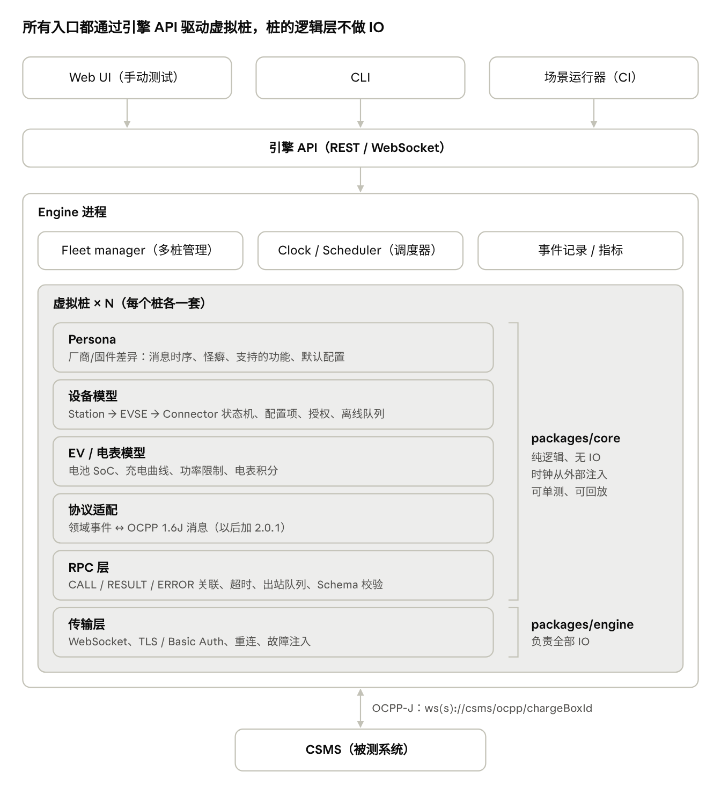
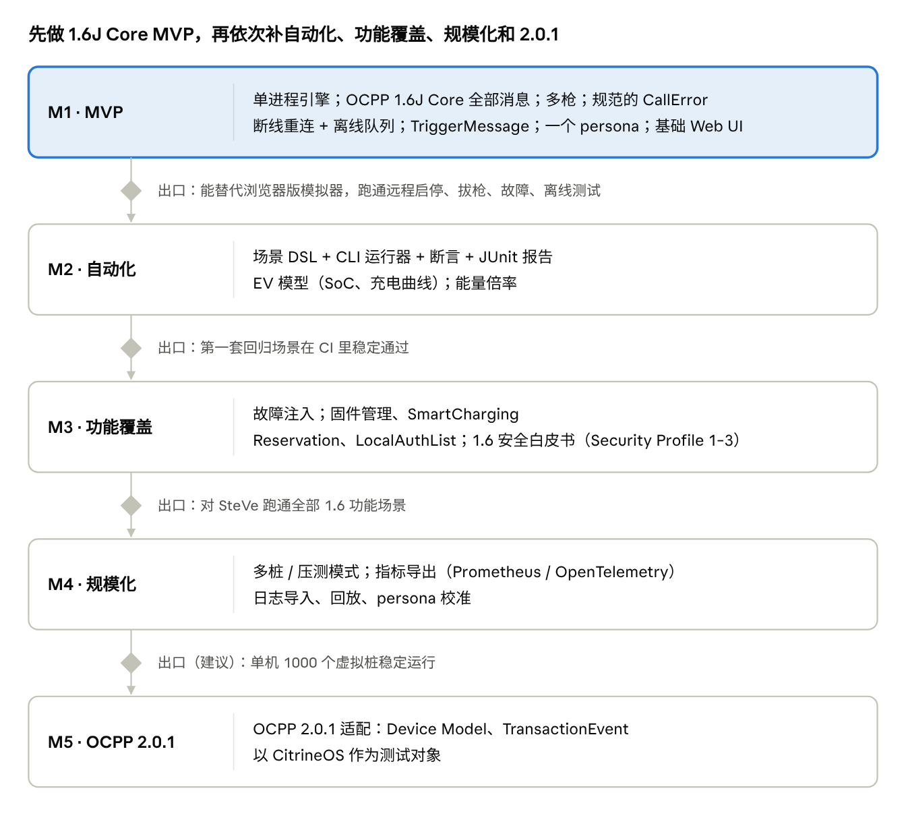

# ocpp-mimic 设计方案

更新于 2026-11-14 · 英文版：[design.md](design.md)（两版不一致时以英文版为准）

## 概述

ocpp-mimic 是一个独立的 OCPP 充电桩模拟平台：引擎在服务端进程里同时运行多个虚拟充电桩，每个桩按 OCPP 规范实现，再用 persona 文件复现真实桩的时序和怪癖。首个版本只做 OCPP 1.6J Core，数据模型按 2.0.1 设计。

**定位**：引擎按“自动化回归 + 压测”的标准设计；Web UI、CLI 和 CI 脚本都只是引擎的遥控器。手动 QA 是 UI 层的一种用法，不是设计的出发点。

**设计原则**

- 规范与差异分离：引擎只实现 OCPP 规范，厂商和固件的差异全部写进 persona。
- core 纯逻辑：协议、状态机、persona 解释器不做 IO，时钟从外部注入，可单测、可确定性回放、可在浏览器里运行。
- 物理与协议分离：插枪、拔枪等是输入事件，OCPP 消息是状态机的输出。
- 默认安全：只连接白名单里的 CSMS 地址，防止误连生产环境。

## 浏览器版模拟器的经验教训

把模拟器写成网页组件，短期能用，长期会在下面这些地方卡住。ocpp-mimic 的设计逐条针对它们。

| 浏览器版的做法 | 带来的问题 | ocpp-mimic 的做法 |
| --- | --- | --- |
| 虚拟桩跑在网页组件里 | 关掉页面桩就掉线；组件卸载后定时器还在发心跳，需要大量清理代码 | 引擎独立进程，生命周期显式管理 |
| 桩列表直接读 CSMS 数据库，靠排除名单避开生产桩 | 模拟器与被测系统耦合 | 模拟器自管桩配置，只需 CSMS URL + chargeBoxId；CSMS 地址白名单 |
| 时序是散落在代码里的固定延时 | 真实桩的行为指纹没法复用、切换 | 抽成 persona 文件 |
| 按 payload 的形状猜回包对应哪个请求 | 并发时会配错 | 严格按 uniqueId 关联，带超时 |
| 不支持的消息回 `[4, id, {}]` | CallError 格式不合规 | `[4, id, "NotImplemented", "描述", {}]` |
| 只有一个枪，只覆盖少量消息 | 测不到多枪和其余功能 | 完整 Core profile、多枪、connectorId 0 |
| 用零散的布尔标志防竞态 | 状态是隐式的，很难测试 | 显式状态机 |
| 只能实时运行，电表 300 秒采样一次 | 测一次完整充电要好几个小时 | 可调采样间隔 + 能量倍率 |
| “模拟离线”就是正常关闭 socket | 真实掉线大多是半开连接（TCP 没断，只是没数据） | 同时支持正常断开和半开连接 |

## 总体架构



Web UI、CLI 和场景运行器都只调用引擎 API。每个虚拟桩内部分六层：上面五层属于纯逻辑的 core 包，只有传输层做网络 IO。

## 服务划分与运行时

M1 只部署一个服务：Engine 进程；Web UI 和 CLI 都是它的客户端。不拆微服务：几千个虚拟桩要共用一个时钟和调度器，模块之间调用频繁，单进程更容易保证时序，也更好部署和调试。

**运行时进程**

| 进程 | 数量 | 职责 |
| --- | --- | --- |
| Engine（核心服务） | 1 个 | 运行所有虚拟桩，对外提供 API，顺带托管 Web UI 的静态文件 |
| CLI / 场景运行器 | 按需启动 | 执行场景 YAML，通过 API 驱动 Engine 并做断言，输出 JUnit 报告；也可以用内嵌模式在自己的进程里起一个 Engine，CI 里不用单独部署 |
| Web UI | 在浏览器里运行 | 纯客户端，所有操作都调 Engine API，不含模拟逻辑 |

**Engine 内部模块**

| 模块 | 职责 |
| --- | --- |
| API Server | REST 接收命令（建桩、插枪、刷卡、触发故障或离线）；WebSocket 实时推送消息日志和状态变化 |
| Fleet Manager | 按模板（persona + 配置）批量创建和销毁虚拟桩；管理启动、停止、重启；压测时控制加压速度 |
| 虚拟桩实例（× N） | 主要工作负载：core 逻辑（persona、设备模型、电表、协议适配、RPC）加一条连到 CSMS 的 WebSocket |
| Clock / Scheduler | 所有桩共用一个定时调度器，代替每个桩各自的定时器；向 core 注入时间，负责能量倍率 |
| Persona Registry | 加载、校验 persona YAML，处理 `extends` 继承 |
| State Store | 用 SQLite 持久化桩配置、配置项、电表读数和离线队列，Engine 重启后桩的状态还在 |
| Event Recorder | 记录每条 OCPP 消息和状态变化，支持查询、导出，也是回放的数据来源 |
| Metrics | 汇总 CSMS 响应延迟、超时率、错误率、Schema 违规数，暴露 Prometheus 接口 |
| Fault Injector | 挂在传输层和 RPC 层上，由 API 控制注入延迟、断线、半开连接、畸形消息 |

架构图只画了其中最主要的几个模块。

**一条命令的流向**（以 UI 上点“插枪”为例）

1. Web UI 调 REST 接口，API Server 交给 Fleet Manager 找到对应的桩（如 SIM-001）。
2. 设备模型的状态机从 Available 变为 Preparing。
3. 协议适配生成 StatusNotification，经 RPC 层和传输层发给 CSMS。
4. CSMS 的回复沿原路返回，RPC 层按 uniqueId 配对。
5. Event Recorder 记录这次往来，API Server 通过 WebSocket 推送给 UI。

**扩展方式**（M4 之后按需）：一台机器撑不住时，起多个 Engine 实例，各自负责一部分桩，由 CLI 或一个轻量协调器分配；每个实例内部仍是单进程模型，架构不用改。

## 传输层与 RPC 层

传输层负责“连得上、断得像真的”，RPC 层负责“每条消息都配对、都合规”。

**传输层**

- 子协议协商：`ocpp1.6`，预留 `ocpp2.0.1`。
- 安全：无认证，以及 Security Profile 1–3（Basic Auth / TLS + Basic / 双向 TLS）。
- WebSocket ping/pong 保活。
- 断线重连：指数退避 + 随机抖动。大量桩同时重连可能压垮 CSMS，这本身就是一个测试场景。
- 故障注入挂点：延迟、丢包、半开连接、强制断开（见故障注入一节）。

**RPC 层**

- 按 uniqueId 关联请求和响应，每个 CALL 都有超时。
- 规范要求（SHOULD）一方在上一个 CALL 得到响应或超时之前不发下一个，所以桩侧需要出站队列。
- 双向消息先用 core 自己按规范正文写的消息定义校验：自己发出的消息保证合规；CSMS 发来的不合规消息直接标红，等于附带一个 CSMS 合规检查器。engine 再用 OCA 官方的 OCPP 1.6 JSON Schema 对每一帧做第二道检查：schema 文件按 CC BY-ND 4.0 原样附带在 `packages/engine/oca-schemas/`，注明出处，只交给通用的 draft-04 校验器（Ajv）读取，不从中生成任何代码。发现的问题标在消息记录和 Web UI 的消息日志上。另有测试用生成的报文对照 core 的定义和官方 schema，唯一的差异是规范正文要求的 1..* 数组下限：官方 schema 没写，core 会检查（#18）。
- CallError 严格按 `[4, uniqueId, errorCode, errorDescription, errorDetails]` 格式；不支持的 action 回 `NotImplemented`。

## 设备模型与 EV / 电表模型

设备模型决定“桩处于什么状态、该发什么消息”，EV / 电表模型决定“电量和功率怎么变”。

**设备模型**

- 层级按 2.0.1 建：Station → EVSE → Connector。1.6 只是把 connectorId 映射到 EVSE / Connector，升级 2.0.1 时不用重写。
- 连接器状态机照 1.6 规范的状态迁移表实现：Available、Preparing、Charging、SuspendedEV、SuspendedEVSE、Finishing、Reserved、Unavailable、Faulted。可以用 XState 这类库，状态图能直接展示给 QA。
- 输入事件：插枪、拔枪、锁枪 / 解锁、车辆就绪、车辆暂停、故障发生 / 恢复。
- 配置项存储：区分类型和只读，支持 `RebootRequired`，重启后保留。
- 授权：Authorize、本地授权列表、授权缓存、`AuthorizationRequired`。
- 离线队列：交易类消息持久化，按 `TransactionMessageAttempts` / `TransactionMessageRetryInterval` 重试，重连后按原始时间戳补发。
- 重启语义：电表累计读数保留；断电导致交易中断时，重启后补发 StopTransaction（reason=PowerLoss）。

**EV / 电表模型**

- EV 档案：电池容量（kWh）、初始 SoC、最大交流功率、相数。
- 充电曲线：SoC 超过约 80% 后功率逐步下降，到 100% 自然进入 SuspendedEV。“充满”由模型产生，不需要专门的按钮。
- 实际功率 = min(桩额定功率, 线缆限制, 充电配置文件限制, 车辆接受能力)，让 SetChargingProfile 有可以验证的效果。
- 电表能量由功率积分得出，读数单调递增；测量项按 `MeterValuesSampledData` 配置，支持 Transaction.Begin / End 和整点对齐采样（`ClockAlignedDataInterval`）。
- M2 已实现（`packages/core/src/ev.ts`）：SoC 超过 `taperSoc`（默认 80%）后，可接受功率线性降到最大功率的 10%，到 `targetSoc`（默认 100%）时 EV 停止取电，连接器报 SuspendedEV。充电过程用解析解计算，所以充满的时刻可以精确排定。插枪时可以带一个 EV 配置（persona 里 `evs` 的名字，或直接给出配置），通过 API、Web UI 或场景的 `plugIn: { ev }` 都行；不带 EV 时沿用 M1 的固定功率。`SoC` 测量项的 location 是 EV；电流按 EV 的相数计算，三相 EV 的 `Current.Import` / `Current.Offered` 分别报告 L1、L2、L3。充电配置文件的限值在 M3 加入取最小值的计算。

## Persona 行为画像

Persona 是一份声明式配置，描述某个厂商或固件“在规范允许的范围内具体怎么做”：消息顺序、延时、支持的功能、默认配置、故障码和已知怪癖。引擎代码只实现规范；发现真实桩的新行为时，只改 persona，不改引擎。

```yaml
persona: vendorX-fw2.5          # 示例值，不是真实厂商数据
boot:
  vendor: VendorX
  model: AC-7
  firmware: "2.5.0"
features: [Core, RemoteTrigger, FirmwareManagement]
config:
  HeartbeatInterval: 60
  MeterValueSampleInterval: 300
  StopTransactionOnEVSideDisconnect: true
flows:
  remoteStop:                    # 收到 RemoteStopTransaction 之后
    - { send: StatusNotification, status: Finishing }
    - { after: 200ms, reply: Accepted }
    - { after: 800ms, send: StopTransaction, reason: Remote }
    - { after: 6s, send: StatusNotification, status: Available }
  reset: { soft: 30s, hard: 180s }
quirks:
  firmwareUpdateMinVersion: "2.5.0"
faults:
  - { errorCode: GroundFailure, info: GND_FAULT, vendorErrorCode: E101 }
```

Persona 有三种来源：手写；从真实日志统计生成（见录制与回放）；在已有 persona 上继承并覆盖（`extends: vendorX-fw2.5`）。

## 场景引擎、故障注入与录制回放

这三块让 ocpp-mimic 从“能手动点的模拟器”变成“能在 CI 里跑的测试工具”。

**场景引擎**

场景由动作和断言组成，用 YAML 编写，由 CLI 运行，输出 JUnit 报告供 CI 使用。`http` 步骤可以调用被测业务系统的 API，把 App 端的操作串进同一个场景。具体格式见后面的「场景格式 v1」。

```yaml
name: 充电中拔枪，CSMS 应结束订单且不再发 RemoteStop
csms: wss://csms.example.com/ocpp # 被测 CSMS（示例地址）
station: { id: SIM-001, persona: vendorX-fw2.5 }
steps:
  - plugIn: { connector: 1 }
  - http: { method: POST, url: "{{APP_API}}/charges/start", json: { station: SIM-001 } }
  - expect: { received: RemoteStartTransaction, within: 10s }
  - charge: { connector: 1, duration: 20m }
  - unplug: { connector: 1 }
  - expect: { sent: StopTransaction, payload: { reason: EVDisconnected } }
  - expectNo: { received: RemoteStopTransaction, within: 30s }
```

**故障注入**

| 层 | 可注入的故障 |
| --- | --- |
| 网络 | 延迟、丢包、正常断开、半开连接、频繁闪断、重连风暴 |
| 协议 | 畸形 JSON、错误或重复的 uniqueId、乱序、超时不回、回 CallError、不符合 Schema 的消息 |
| 设备 | Faulted（errorCode / info / vendorErrorCode 组合）、电表回退或清零、时钟漂移、不规范的时间戳 |
| 电力 | 断电重启、交易中断后补发 |

**录制与回放**

- 导入真实桩日志（方向、action、payload、时间戳），回放成场景，复现线上问题。
- 统计日志里消息之间的间隔，自动生成或校准 persona。
- 导入时自动脱敏 idTag、序列号等标识。

## 场景格式 v1

M2 确定（#38）。场景文件是 YAML，文件里的每个 YAML 文档（用 `---` 分隔）是一个场景。runner 逐个执行场景，每个场景用一个全新的内嵌 engine；报告里每个文件是一个 test suite，每个场景是一个 test case。`scenarios/examples/` 里的文件是参考示例。

```yaml
name: 刷卡充电并定期上报电表
station:
  id: SIM-001
  persona: generic-1.6
  config: { MeterValueSampleInterval: 10 }
vars:
  TAG: TAG-001
steps:
  - presentCard: { connector: 1, idTag: "{{TAG}}", result: authorized }
  - plugIn: { connector: 1 }
  - expect: { sent: StartTransaction, payload: { connectorId: 1, idTag: "{{TAG}}" } }
  - expectConnector: { connector: 1, status: Charging }
  - expect: { sent: MeterValues, within: 15s }
  - presentCard: { connector: 1, idTag: "{{TAG}}", result: stopping }
  - expect: { sent: StopTransaction, payload: { reason: Local } }
  - unplug: { connector: 1 }
  - expectConnector: { connector: 1, status: Available }
```

**场景字段**

| 字段 | 必填 | 含义 |
| --- | --- | --- |
| `name` | 是 | 用例名 |
| `description` | 否 | 说明，显示在报告里 |
| `csms` | 否 | `builtin`（默认）或 CSMS 的 WebSocket 地址；和普通桩一样，地址后面会接上桩 id。命令行的 `--csms` 优先 |
| `station` 或 `stations` | 是 | 一个桩或一组桩。字段：`id`、`persona`，可选 `password`（初始的 `AuthorizationKey`）、`config`（覆盖配置键）、`behaviour`（测试开关）、`energyMultiplier`、`security`（`profile` 和 PEM 文件 `ca`、`cert`、`key`、`manufacturerRoot`，路径相对场景文件；`test-pki:<文件>` 指仓库里的测试 PKI）、`waitForBoot` |
| `vars` | 否 | 模板变量的默认值 |
| `timeout` | 否 | 整个场景的时限，默认 5 分钟 |
| `checkSchemas` | 否 | 默认 `true`：只要有一帧不符合 OCA 官方 schema，场景就失败 |
| `csmsOptions` | 否 | 内置 CSMS 的设置：`tls`（`true`，或 `{ clientCertificates: none \| optional \| required }`）用测试 PKI 的服务器证书提供 wss://；`passwords`（桩 id → 密码）让它检查 Basic Auth。它改过并收到 Accepted 的 AuthorizationKey 会成为该桩的新密码 |

准备阶段会创建并启动所有桩；`waitForBoot` 为真（默认）时还会等到 BootNotification 被 Accepted。要测试注册过程本身，就设 `waitForBoot: false`。

**步骤**

每个步骤是一个只有一个步骤键的 map，值是步骤参数。作用于桩的步骤接受 `station`（桩 id，默认第一个桩），作用于连接器的步骤接受 `connector`（默认 1）。任何步骤都可以在步骤键旁边写 `name`（`- name: 刷卡` 下一行写 `presentCard: ...`），报告里用它代替自动生成的标签。没有参数的步骤可以写成 `online:` 或 `online: {}`。

桩侧动作，和 API 提供的操作一致：

| 步骤 | 参数 | 作用 |
| --- | --- | --- |
| `plugIn` | `connector`、`ev` | 插枪；`ev` 指定 EV 配置 |
| `unplug` | `connector` | 拔枪 |
| `presentCard` | `connector`、`idTag`、`result` | 在连接器上刷卡；`result` 可断言 `authorized`、`rejected`、`stopping` 或 `busy` |
| `evSuspend`、`evResume` | `connector` | EV 暂停或恢复 |
| `fault` | `connector`（0 表示整桩）、`errorCode`、`info`、`vendorErrorCode` | 触发故障 |
| `clearFault` | `connector` | 清除故障 |
| `offline` | `mode`：`clean` 或 `half-open` | 模拟断网 |
| `online` | — | 恢复网络 |
| `stopStation`、`startStation` | — | 断开或重新连接桩 |
| `setBehaviour` | `refuseRemoteStart`、`cableLock` | 测试开关 |
| `wait` | 一个时长 | 等待 |
| `charge` | `connector`、`duration` | 等待 `duration`；开始和结束时连接器都必须有进行中的交易，否则失败 |

engine 拒绝的动作（比如枪锁着时拔枪）会让步骤失败。写了 `expectError: <文字>` 时则反过来：必须被拒绝，且拒绝信息包含这段文字。

断言：

| 步骤 | 参数 | 通过条件 |
| --- | --- | --- |
| `expect` | `sent` 或 `received`（action）、`payload`、`answer`、`within`、`from` | 规定时间内记录到匹配的 CALL。`sent` 指桩 → CSMS，`received` 指 CSMS → 桩。`payload` 匹配 CALL，`answer` 匹配对它的 CALLRESULT |
| `expectNo` | `sent` 或 `received`、`payload`、`within` | `within` 期间没有记录到匹配的 CALL |
| `expectConnector` | `connector` 加连接器快照字段（`status`、`errorCode`、`plugged`、`locked`、`transactionId`、`ev` 等）、`within` | 规定时间内连接器快照匹配。`connector: 0` 表示整桩（`status`、`errorCode`） |
| `expectStation` | 桩快照字段（`registration`、`transport`、`queuedMessages`、`behaviour` 等）、`within` | 规定时间内桩快照匹配 |

`within` 默认 10 秒。消息断言是有顺序的：搜索从上一个 `expect` 匹配到的消息之后开始（`from: last`，默认），所以连续的 `expect` 也在断言消息的先后顺序。`from: step` 忽略步骤开始前的消息，`from: start` 从场景开始处搜索。

CSMS 侧步骤，只能配合内置 CSMS 使用：

| 步骤 | 参数 | 作用 |
| --- | --- | --- |
| `csmsCall` | `action`、`payload`、`answer`、`error` | 内置 CSMS 向桩发一个 CALL。`answer` 必须匹配 CALLRESULT；`error` 则指定预期的 CALLERROR 错误码 |
| `csmsReply` | `action`，再加 `payload`、`error` 或 `ignore: true` 之一，以及 `times` | 内置 CSMS 如何应答桩接下来 `times` 次（默认所有）`action` 调用 |

HTTP，用于调用被测系统：

| 步骤 | 参数 | 作用 |
| --- | --- | --- |
| `http` | `method`（默认 GET）、`url`、`headers`、`basicAuth`（`user`、`password`）、`json`、`expect`（`status`、`json`）、`save` | 发请求（超时 10 秒）并检查响应。没写 `expect.status` 时任何 2xx 都算通过；`expect.json` 匹配解析后的响应体 |

`save: { NAME: <路径> }` 把一个值存成变量，供后面的步骤使用。可用于 `expect`（路径根是 `{ payload, answer }`）、`expectConnector` 和 `expectStation`（快照）、`csmsCall`（`{ answer }`）和 `http`（`{ status, json, text }`）。路径写法如 `$.answer.transactionId`。

**匹配规则**

`payload`、`answer`、快照断言和 `http` 的 `expect.json` 都是部分匹配：写出的字段必须存在且相等，没写的字段不管。数组逐个元素匹配，长度必须相同。字段的值也可以换成运算符，写多个时必须全部满足：`$exists`、`$regex`、`$ne`、`$gt`、`$gte`、`$lt`、`$lte`，以及数组专用的 `$contains`（有一项部分匹配）和 `$size`（数字，或 `{ $gte: 20 }` 这样的比较）。

**模板和变量**

字符串里的 `{{NAME}}` 在步骤执行前替换。取值优先级从低到高：`vars`、命令行的 `--var NAME=value`、前面步骤保存的变量。`{{env.NAME}}` 读取环境变量，这类值在输出和报告里显示为 `***`。如果整个字符串只有一个模板，替换后保留原值的类型，所以 `"{{tx}}"` 可以代表数字。未知的变量名在场景开始前就报错；保存的变量只在保存它的步骤之后才算已定义。

**时长**沿用 persona 的写法：数字表示毫秒，或以 `ms`、`s`、`m`、`h` 结尾的字符串。

**代码放在哪里**

| 包 | 部分 |
| --- | --- |
| core | 场景模型和校验（用 schema 模块）、模板、匹配、步骤标签。和 persona 一样是纯逻辑 |
| engine | runner：每个场景一个全新的内嵌 engine（以及内置 CSMS，`src/csms/builtin-csms.ts`），在进程内对 fleet 和 recorder 执行步骤，失败后也照样清理；结果模型；控制台和 JUnit 报告 |
| cli | `ocpp-mimic run`：解析参数、读取 YAML 文件、调用 runner、返回退出码 |

M2 不需要通过 HTTP API 连接远程 engine：CLI 自带内嵌 engine，CI 里不用另外部署。

**运行和报告**

`ocpp-mimic run <file|dir>...` 运行给出的所有 `.yaml` / `.yml` 文件，目录递归查找并排序，一次一个场景。选项：`--csms <url>`、`--var NAME=value`（可重复）、`--timeout <时长>`（场景默认时限）、`--bail`（遇到第一个没通过的场景就停）、`--junit <file>`，以及和 `serve` 一样的 `--allow-csms`、`--personas`。

- 场景结果分三种：通过；失败（某一步失败，后面的步骤记为跳过）；出错（文件无效、engine 故障、超时）。无论结果如何都会清理。
- 控制台每个场景一行，带耗时；失败时显示失败的步骤以及预期值和实际值。
- JUnit：每个文件一个 `testsuite`，每个场景一个 `testcase`（classname 是文件名），`failure` 或 `error` 里写失败的步骤，带耗时，以及 persona、CSMS、能量倍率等 `properties`。
- 退出码：全部通过为 0，有失败或出错为 1，用法错误或文件校验不通过为 2。

## M3 功能覆盖

M3 确定（#65）。M3 补齐 OCPP 1.6 其余的功能 profile、Security Whitepaper 和故障注入。出口标准是 1.6 的每个功能都有场景，并且在 SteVe 上通过。

**功能 profile**

- persona 的 `features` 决定桩在 `SupportedFeatureProfiles` 里声明哪些 profile。桩没声明的 profile，收到它的消息时回 CALLERROR NotSupported，所以 persona 去掉某个 profile 就能测试 CSMS 如何应对。各 profile 实现后，`generic-1.6` 会全部声明。
- 每个功能任务把自己 profile 的消息加进 core 的消息定义，和 OCA 官方 schema 的对照测试会自动覆盖到。
- 各 profile 的配置键沿用规范的名称（括号里是默认值，persona 可以覆盖）：

| Profile | 配置键 |
| --- | --- |
| Local Auth List Management | `LocalAuthListEnabled`（true）、`LocalAuthListMaxLength`（100，只读）、`SendLocalListMaxLength`（100，只读） |
| Reservation | `ReserveConnectorZeroSupported`（true，只读） |
| Smart Charging | `ChargeProfileMaxStackLevel`（10）、`ChargingScheduleAllowedChargingRateUnit`（Current,Power）、`ChargingScheduleMaxPeriods`（24）、`MaxChargingProfilesInstalled`（20）、`ConnectorSwitch3to1PhaseSupported`（false），均只读 |
| Firmware Management | `SupportedFileTransferProtocols`（HTTP,HTTPS,FTP，只读） |
| Security（whitepaper） | `SecurityProfile`（0）、`AuthorizationKey`（只写，CSMS 设置时须 16 到 40 个字符）、`AllowSecurityProfileDowngrade`（false）、`CpoName`（空）、`CertificateStoreMaxLength`（10，只读）、`CertificateSignedMaxChainSize`（10000，只读）、`AdditionalRootCertificateCheck`（false，只读） |

**本地授权列表和预约**

- 本地列表和授权缓存并列：开启 `LocalAuthListEnabled` 时，列表里的卡在本地决定（在线时看 `LocalPreAuthorize`，离线时看 `LocalAuthorizeOffline`），和规范一致。列表和版本号在 engine 重启后保留。
- 预约属于设备模型：连接器报 Reserved，只有预约的 idTag 或它的 parentIdTag 能启动，预约在 `expiryDate` 到期或它的交易开始时结束，StartTransaction 带 `reservationId`。`ReserveConnectorZeroSupported` 为 true 时，connectorId 0 表示预约任意空闲连接器。

**Smart Charging**

- core 里的纯逻辑模型（`charging-profile.ts`）保存每个连接器上安装的配置文件（connectorId 0 表示整桩），回答两个问题：某一时刻生效的限值，以及一段时间内的合成调度（composite schedule）。
- 叠加规则：同一用途内，当时有效、`stackLevel` 最高的配置文件生效；交易进行中，TxProfile 覆盖 TxDefaultProfile；connectorId 0 上的 ChargePointMaxProfile 限制整桩，由正在充电的连接器平分。
- 支持 Absolute、Recurring（Daily / Weekly，从 `startSchedule` 起算）和 Relative（从交易开始起算）三种调度，以及 `validFrom` / `validTo`。限值可以是 A 或 W，按连接器电压和 `numberPhases`（默认 3）换算。
- 实际功率 = min(桩额定功率, EV 可接受功率, 生效限值)。在下一个时段的开始时刻设定时器，所以功率、MeterValues 和 SoC 都会跟着调度变化。配置文件在 engine 重启后保留。

**固件和诊断**

- 默认不真的传输文件：桩按 persona 给的时长（`firmware: { downloadTime, installTime, uploadTime }`）依次上报各个状态，结果由 persona 或故障注入决定（DownloadFailed、InstallationFailed、UploadFailed）。
- UpdateFirmware 等到 `retrieveDate`，依次发 Downloading → Downloaded → Installing → Installed，然后重启。BootNotification 里新的 `firmwareVersion` 取自下载地址文件名里的版本号（`fw-2.5.1.bin` → 2.5.1），取不到就用旧版本号加 `-updated`；新版本号在重启后保留。
- GetDiagnostics 回一个 `fileName`，然后发 Uploading → Uploaded。persona 设 `firmware: { transfer: real }` 时，HTTP(S) 地址会真的用 PUT 收到诊断文件（桩的状态和配置的文本摘要，放进该目录），UpdateFirmware 也会真的下载 HTTP(S) 地址。FTP 不做真实传输。
- TriggerMessage 可以请求这两种状态通知。

**故障注入**

- engine 给每个桩一个 Fault Injector，挂在传输层和 RPC 层。API：`POST /api/stations/:id/injections`，参数 `{ type, ...参数, for? }`，`DELETE` 清除。场景步骤：`inject: { type, ..., for }` 和 `clearInjections: {}`。

| 层 | 类型 |
| --- | --- |
| 网络 | `latency`（每个方向的延迟毫秒数）、`drop`（丢弃某个方向的帧，按数量或概率）、`flap`（断开、恢复的时长和次数）、`reconnectStorm`（所有桩同时重连，作用于整个 fleet） |
| 协议 | `malformedJson`（接下来发送的 N 帧）、`duplicateId`、`unknownId`（用 CSMS 没发过的 uniqueId 应答）、`outOfOrder`（调换接下来两个 CALL 的顺序）、`noAnswer`（不应答 CSMS 某个 action 的 CALL）、`callError`（用 CALLERROR 应答这些 CALL）、`schemaViolation`（某个 action 的下一个 CALL 多一个字段） |
| 设备 | `meterRollback`（回退的 Wh 数）、`meterReset`、`clockDrift`（每个时间戳加上的毫秒数）、`badTimestamp`（接下来 N 个时间戳格式错误） |
| 断电 | `powerLoss`（`for`：断电一段时间，然后从保存的状态重启：交易以 PowerLoss 结束，排队的消息保留原时间戳），可以用 `times` 重复 |

- 注入产生的帧会记录注入类型，在 Web UI 的消息日志里标出，并且不参加 OCA schema 检查，因为它们本来就是故意出错的。

**安全（OCPP 1.6 Security Whitepaper）**

- 桩增加 `security: { profile, ca?, cert?, key? }`（PEM 文件路径）。Profile 1：ws 或 wss 上的 Basic Auth，密码是 `AuthorizationKey`（即桩的 `password`）。Profile 2：wss，用 `ca` 校验服务器证书，同时用 Basic Auth。Profile 3：wss，用客户端证书 `cert` / `key`，不再用 Basic Auth。
- 用 ChangeConfiguration 修改 `AuthorizationKey` 后，桩用新密码重连（A01）。`SecurityProfile` 只能调高，唯一例外是 `AllowSecurityProfileDowngrade` 为 true 时可以从 3 降到 2；桩用新 profile 重连，失败时退回原来的 profile（A05）。
- 内置 CSMS 可以提供 TLS、要求客户端证书、检查 Basic Auth 密码（场景里用 `csmsOptions` 设置）。测试用一套固定的测试 PKI，提交在 `packages/engine/test-pki/` 下（CA、服务器证书和客户端证书，有效期 20 年，仅供测试），附带用 openssl 重新生成的脚本。
- whitepaper 的消息全部放在 M3：证书管理（SignCertificate / CertificateSigned、InstallCertificate、GetInstalledCertificateIds、DeleteCertificate）、SecurityEventNotification、ExtendedTriggerMessage、GetLog / LogStatusNotification、SignedUpdateFirmware / SignedFirmwareStatusNotification。生成 CSR 和签发证书需要 Node 没有直接提供的 X.509 能力；engine 用 node:crypto 加一个很小的 DER 模块（`x509.ts`，测试里用 openssl 交叉验证）实现，没有引入第三方库，core 通过注入的 `CertificateTools` 使用它。OCA 的 whitepaper 下载包（第 4 版）里有 JSON Schema（draft-06），已原样放在 `packages/engine/oca-schemas/ocpp16-security/`，和 1.6 的 schema 一样用来检查每一帧。

**SteVe**

- 场景通过 SteVe 的 REST API（`POST /steve/api/v1/operations/<Action>`，HTTP Basic，用 admin 用户的 API 密码）让 SteVe 发命令，用的是普通的 `http` 步骤（#63）。这些 SteVe 版本的场景放在 `scenarios/steve/`，由 SteVe workflow 运行。
- SteVe 发命令前需要的数据（按 id 引用的充电配置文件、本地列表和预约要用的 OCPP 标签）通过它的 API 或 `tools/steve/register.sh` 创建。

**场景**

每个功能任务都为内置 CSMS 增加回归场景（`scenarios/regression/`）；SteVe 能发的命令，再加一个 SteVe 版本（`scenarios/steve/`）。例如，用 TxProfile 限制正在进行的充电：

```yaml
name: A TxProfile caps the power of a running session
station: { id: REG-SC-TX, persona: regression-1.6 }
steps:
  - presentCard: { idTag: TAG-REG, result: authorized }
  - plugIn: { ev: compact-40kwh }
  - expect: { sent: StartTransaction, save: { tx: $.answer.transactionId } }
  - expectConnector: { status: Charging, powerW: { $gt: 7000 } }
  - csmsCall:
      action: SetChargingProfile
      payload:
        connectorId: 1
        csChargingProfiles:
          chargingProfileId: 1
          transactionId: "{{tx}}"
          stackLevel: 0
          chargingProfilePurpose: TxProfile
          chargingProfileKind: Relative
          chargingSchedule:
            chargingRateUnit: W
            chargingSchedulePeriod: [{ startPeriod: 0, limit: 3680 }]
      answer: { status: Accepted }
  - expectConnector: { powerW: 3680 }
```

以及在场景里注入故障：

```yaml
name: The CSMS copes with a slow, lossy connection
station: { id: REG-FI-NET, persona: regression-1.6 }
steps:
  - inject: { type: latency, ms: 2000, for: 30s }
  - presentCard: { idTag: TAG-REG, result: authorized }
  - plugIn: {}
  - expect: { sent: StartTransaction, within: 15s }
  - inject: { type: drop, direction: received, count: 1 }
  - expect: { sent: StatusNotification, payload: { status: Charging }, within: 15s }
```

## 观测与 UI

UI 只是引擎 API 的一个客户端，所有操作都能通过 REST / WebSocket API 和 CLI 完成。

- 消息日志：方向图标、按 action 包含 / 排除过滤、查看原始 payload、导出 JSON。
- 时序图视图：按时间显示桩与 CSMS 之间的消息往来，标出超时和错误。
- 状态机视图：实时高亮每个连接器的当前状态。
- 多桩总览：在线 / 离线 / 故障数量，按 persona 或标签分组。
- 指标：CSMS 响应延迟（p50 / p95）、超时率、错误率、Schema 违规数，通过 Prometheus 或 OpenTelemetry 导出。

## 时间加速策略

结论：时间戳始终用真实时间；加速靠缩短采样间隔加能量倍率，不加速时钟本身。OCPP 消息带时间戳，CSMS 会用它计算时长和计费；如果时间戳也被加速，CSMS 会收到“未来时间”，很多逻辑会出错。

| 方案 | 做法 | 效果 | 局限 |
| --- | --- | --- | --- |
| 缩短采样间隔 | 把 `MeterValueSampleInterval` 设为 10 秒 | 更快看到电表和状态变化 | 充满仍需真实时长 |
| 能量倍率 | 每个采样周期按 N 倍能量累加 | 几分钟完成一次完整充电；按 kWh 计费能测准 | 按时长计费、功率合理性检查测不准 |
| 全虚拟时钟 | 时间戳也按倍率加速 | 完全压缩时间 | 只适用于 CSMS 时钟也可控的集成测试 |

UI 和测试报告里要明确标出是否启用了能量倍率，避免误读结果。

M2 已实现：每个桩有一个 `energyMultiplier`（默认 1），可以在创建时设定（API，或场景里桩的 `energyMultiplier`），也可以运行中修改（`PATCH /api/stations/:id/energy-multiplier` 或 Web UI），engine 重启后保留。电表和 EV 模型按这个倍数加快累积电量和 SoC，充满的时刻也相应提前；所有时间戳和上报的功率仍是真实值。倍率不为 1 时，Web UI 显示「energy ×N」标记，场景报告带 `energyMultiplier` 属性。

## 技术选型与仓库结构

推荐 TypeScript / Node：引擎和 UI 用同一种语言，core 能直接在浏览器里运行，单进程可以撑几千个 WebSocket 连接。

| 方案 | 优点 | 缺点 |
| --- | --- | --- |
| TypeScript / Node（推荐） | 引擎和 UI 共用代码；ajv 做 Schema 校验；有现成的 ocpp-rpc 库；可以沿用 Vue 经验 | 上万个连接时 CPU 吃紧 |
| Go | 压测性能最好，单个二进制文件部署 | UI 要另写，不能共享代码 |
| Python | mobilityhouse/ocpp 成熟，写测试顺手 | 大规模并发偏弱 |

仓库用 monorepo（pnpm workspaces）：

- `packages/core`：协议、状态机、persona 解释器，纯逻辑、无 IO。
- `packages/engine`：运行时、持久化（先用 SQLite）、REST / WebSocket API。
- `packages/cli`：场景运行器，命令名 `ocpp-mimic`（单独的 `mimic` 已被 Homebrew 上的一个文本转语音工具占用）。
- `apps/web`：Vue 3 界面。

## 参考的开源项目与差异化

ocpp-mimic 的差异化在四点：来自真实桩经验的 persona、把场景和 CI 当作核心功能、内置 CSMS 合规检查、日志回放。动手前先研究下面的项目（以下仓库 2026-11-14 均确认在活跃维护）。

| 项目 | 类型 | 用途 |
| --- | --- | --- |
| [SAP/e-mobility-charging-stations-simulator](https://github.com/SAP/e-mobility-charging-stations-simulator) | OCPP-J 充电桩模拟器（TypeScript） | 主要参照对象，先看它缺什么 |
| [mikuso/ocpp-rpc](https://github.com/mikuso/ocpp-rpc) | Node 的 OCPP-J RPC 库 | 可以直接用作 RPC 层 |
| [mobilityhouse/ocpp](https://github.com/mobilityhouse/ocpp) | Python OCPP 库 | 参考消息模型和校验 |
| [steve-community/steve](https://github.com/steve-community/steve) | 开源 CSMS（Java，1.6） | 第二个测试对象，避免只对着一个 CSMS 调出“假兼容” |
| [citrineos/citrineos-core](https://github.com/citrineos/citrineos-core) | 开源 CSMS（2.0.1） | 2.0.1 阶段的测试对象 |
| OCTT | OCA 官方合规测试工具（付费） | 参考测试用例 |

## OCPP 1.6J 覆盖范围

协议部分完全以 OCPP 1.6J 为基准；persona、EV 模型、场景引擎等是项目自己的设计，规范里没有。M1 覆盖 1.6J 的 Core profile，外加 TriggerMessage。

**规范与自研的边界**

| 模块 | 按 1.6J 规范实现 | 项目自己的设计 |
| --- | --- | --- |
| 传输层 | OCPP-J：WebSocket、子协议 `ocpp1.6`、URL 末尾是 chargeBoxId、用 `WebSocketPingInterval` 保活 | 重连退避、故障注入 |
| RPC 层 | 消息类型 2/3/4、uniqueId、CallError 格式和错误码、同时只有一个未应答的 CALL、OCA 发布的 1.6 JSON Schema | 超时时长、CSMS 合规报告 |
| 协议适配 | 全部 1.6J 消息 | — |
| 设备模型 | 9 种连接器状态和迁移规则、connectorId 0 代表整桩、配置项语义、授权（Authorize / 授权缓存 / 本地列表）、交易消息重试、StopTransaction 的 reason | Station → EVSE → Connector 三层结构借自 2.0.1，为以后升级做准备 |
| 电表 | 测量项、ReadingContext、`MeterValuesSampledData`、整点对齐采样、transactionData | — |
| EV 模型 | SetChargingProfile 限功率的语义 | 电池、SoC、充电曲线（OCPP 不模拟车辆） |
| Persona | features 对应 1.6 的 feature profile，config 对应 1.6 标准配置项，故障码用 ChargePointErrorCode | 消息之间的时序和厂商怪癖（规范只规定“发什么”，不规定“隔多久发”） |
| 安全 | Security Profile 1–3，出自《OCPP 1.6 安全白皮书》这份扩展文档 | — |
| 场景、回放、多桩、指标、UI、时间加速 | — | 全部是项目自己的 |

**M1：桩 → CSMS 的消息**

| 消息 | 模拟器行为 |
| --- | --- |
| BootNotification | 连上后发送；分别处理 Accepted / Pending / Rejected，按返回的 interval 开始心跳或稍后重试 |
| Heartbeat | 按 interval 定时发送 |
| StatusNotification | 开机被接受后，为 connectorId 0 和每个连接器各报一次；之后状态一变就报，带 errorCode / info / vendorErrorCode |
| Authorize | 本地刷卡时发送，结果写入授权缓存 |
| StartTransaction | 授权通过并插好枪后发送，带 meterStart；根据返回的 idTagInfo 决定继续还是停止 |
| MeterValues | 按 `MeterValueSampleInterval` 周期发送，测量项可配置，支持整点对齐采样 |
| StopTransaction | 远程停、刷卡停、拔枪、重启、解锁时发送，带 reason 和 transactionData |
| DataTransfer | 由 UI 或 persona 主动发送厂商自定义数据 |

**M1：CSMS → 桩的消息**

| 消息 | 模拟器行为 |
| --- | --- |
| RemoteStartTransaction | 先检查连接器状态和 idTag，接受后发起交易；`AuthorizeRemoteTxRequests=true` 时先发 Authorize。桩的「拒绝远程启动」开关打开时回 Rejected |
| RemoteStopTransaction | transactionId 匹配就接受，结束交易（reason=Remote） |
| Reset | Soft / Hard：先结束交易，再断开，按 persona 设定的延时重连并重新发 BootNotification |
| UnlockConnector | 回 Unlocked / UnlockFailed / NotSupported；有交易时先结束交易（reason=UnlockCommand），并解开枪锁 |
| ChangeAvailability | 设为 Operative / Inoperative；先回响应，过 persona 的命令延迟后再上报新状态；有交易时回 Scheduled，等交易结束再生效。connectorId 0 只由针对 connectorId 0 的请求改变，逐个改完所有连接器不会带动它 |
| GetConfiguration | 返回配置项并标明哪些只读；不认识的 key 放进 unknownKey |
| ChangeConfiguration | 回 Accepted / Rejected / RebootRequired / NotSupported，并且实际生效 |
| ClearCache | 清空授权缓存 |
| DataTransfer | 默认回 UnknownVendorId；persona 可以自定义回复 |
| TriggerMessage | 支持 BootNotification、Heartbeat、StatusNotification、MeterValues；回 Accepted 后补发对应消息；M3 起也支持 FirmwareStatusNotification 和 DiagnosticsStatusNotification |

TriggerMessage 属于 Remote Trigger profile，提前到 M1 是因为很多 CSMS 用它让桩补报状态或心跳，而且实现成本低。

**M1 的其他功能**

- 9 种状态的连接器状态机，支持多枪。
- 1.6 标准配置项：`HeartbeatInterval`、`MeterValueSampleInterval`、`MeterValuesSampledData`、`StopTransactionOnEVSideDisconnect`、`StopTransactionOnInvalidId`、`AuthorizeRemoteTxRequests`、`AuthorizationCacheEnabled`、`TransactionMessageAttempts`、`TransactionMessageRetryInterval`、`NumberOfConnectors`、`SupportedFeatureProfiles` 等。
- RPC 的正确性：双向 Schema 校验、单 CALL 出站队列、超时；不支持的消息回 NotImplemented，未启用的 profile 回 NotSupported。
- 离线：交易消息排队，重连后补发；能模拟正常断开和半开连接。
- 故障：发出 Faulted 状态（用 ChargePointErrorCode）并能恢复。
- 电表：先用固定功率，“暂停”“充满”手动触发；M2 再换成 EV 模型。
- 一个 persona；通过 UI 和 API 可以建桩、插拔枪、刷卡、触发故障或离线，消息日志可过滤、可看原始 payload。
- 每个桩的测试开关，UI 和 API 都能改，重启后保留：拒绝远程启动；枪锁，交易进行时锁住枪，锁住时不能拔枪，直到 UnlockConnector 或交易结束才解开。

**不在 M1 的 1.6 功能**（路线图 M3）：Firmware Management（UpdateFirmware、GetDiagnostics 及状态通知）、Local Auth List Management（SendLocalList、GetLocalListVersion）、Reservation（ReserveNow、CancelReservation）、Smart Charging（SetChargingProfile、ClearChargingProfile、GetCompositeSchedule），以及安全白皮书。

**M3：功能 profile**（已实现的部分；其余按「M3 功能覆盖」的设计进行）

| 消息 | 模拟器行为 |
| --- | --- |
| SendLocalList | 支持 Full 和 Differential 更新及版本号；超过 `SendLocalListMaxLength` / `LocalAuthListMaxLength` 回 Failed，Differential 版本号不够新回 VersionMismatch；没声明这个 profile 时回 NotSupported |
| GetLocalListVersion | 返回列表版本号，列表为空时为 0，没声明这个 profile 时为 -1 |
| ReserveNow | Accepted（连接器报 Reserved；只有预约的 idTag 或它的 parentIdTag 能启动，不知道 parent 时先问 CSMS）、Occupied、Faulted、Unavailable 或 Rejected；相同 reservationId 会替换原预约；connectorId 0 保证留一个空闲连接器；预约在 `expiryDate` 到期、它的交易开始（StartTransaction 带 `reservationId`）、或连接器故障或不可用时结束 |
| CancelReservation | reservationId 存在时回 Accepted，否则 Rejected |
| SetChargingProfile | 按 Smart Charging 模型安装配置文件（没有匹配交易的 TxProfile、不在 connectorId 0 上的 ChargePointMaxProfile、超出配置限制时回 Rejected）；限值立即生效 |
| ClearChargingProfile | 按 id 清除，或清除符合全部给定条件的配置文件；什么都没清除时回 Unknown |
| GetCompositeSchedule | 从现在起、在给定时长内的合成调度，单位 A 或 W（默认 W）；connectorId 0 表示整桩；连接器不存在时回 Rejected |
| UpdateFirmware | 立即应答；到 `retrieveDate` 发 Downloading → Downloaded（或按 `retries`、`retryInterval` 重试后发 DownloadFailed），等进行中的交易结束，Installing → 重启 → 下一次 BootNotification 被接受后发 Installed，BootNotification 带新的 `firmwareVersion`；InstallationFailed 时保留旧版本 |
| GetDiagnostics | 回 `diagnostics-<UTC 时间>.log`，然后 Uploading → Uploaded 或 UploadFailed，支持重试 |
| SecurityEventNotification | whitepaper 列出的关键事件都会发送，离线时和交易消息一样排队（CSMS 回 CALLERROR，例如 NotImplemented 时直接丢弃，不支持 whitepaper 的 CSMS 不会因此卡住后面的消息）：桩上电时 StartupOfTheDevice，重启时 ResetOrReboot，固件更新后 FirmwareUpdated，TLS 连接失败时 InvalidCentralSystemCertificate / InvalidTLSVersion（连续失败只发一次），以及通过 API 触发的任何事件 |
| ExtendedTriggerMessage | 支持 BootNotification、Heartbeat、StatusNotification、MeterValues、LogStatusNotification（Idle，或正在进行的上传及其 requestId）和 FirmwareStatusNotification（用 SignedFirmwareStatusNotification 回应）；连接器不存在时回 Rejected |
| InstallCertificate | 安装 CentralSystemRootCertificate 或 ManufacturerRootCertificate：回 Accepted，相同证书会被替换；证书无效或过期、存储已满（`CertificateStoreMaxLength`）时回 Rejected；开启 `AdditionalRootCertificateCheck` 时只保留一个根证书，而且新证书必须由旧证书签发；没有 X.509 支持时回 Failed |
| GetInstalledCertificateIds | 返回该类型已安装证书的哈希数据（SHA256：颁发者名称和公钥哈希、序列号），没有时回 NotFound |
| DeleteCertificate | 已安装的 ManufacturerRootCertificate 回 Accepted；CentralSystemRootCertificate 或桩自己的证书回 Failed；找不到回 NotFound |
| SignCertificate / CertificateSigned | ExtendedTriggerMessage SignChargePointCertificate 让桩生成新的 RSA 2048 密钥并发送 CSR（CN 为序列号，O 为 `CpoName`），在收到 CertificateSigned 之前按退避重发（`CertSigningWaitMinimum`、`CertSigningRepeatTimes`）。证书链能连到已安装的 CentralSystemRootCertificate、且对应 CSR 的密钥时回 Accepted，成为桩的证书（profile 3 下桩用它重连，失败则退回旧证书并记录 DiscardedRenewedClientCertificate）；否则回 Rejected 并记录 InvalidChargePointCertificate。内置 CSMS 用测试 CA 签发 CSR |
| SignedUpdateFirmware | 签名证书连不到已安装的 ManufacturerRootCertificate 时回 InvalidCertificate（并记录 InvalidFirmwareSigningCertificate）。回 Accepted 后用 SignedFirmwareStatusNotification（带 requestId）报告：`retrieveDateTime` 之前 DownloadScheduled，Downloading → Downloaded（或 DownloadFailed），SignatureVerified 或 InvalidSignature（真实下载用签名证书校验，支持 RSA-PSS、PKCS #1 或 ECDSA，SHA256；模拟下载看 persona 的 `firmware.signature`），`installDateTime` 之前 InstallScheduled，没有交易时 Installing，然后 InstallRebooting，重启后 Installed。新的请求会取消正在进行的更新（回 AcceptedCanceled） |
| GetLog | 回 `security-` 或 `diagnostics-<UTC 时间>.log`，上传安全日志（所请求时间窗口内的条目）或诊断文件；LogStatusNotification 依次 Uploading → Uploaded 或 UploadFailure，都带 requestId；新的 GetLog 会取消正在进行的上传（回 AcceptedCanceled）。只有地址以 `/` 结尾时才会接上文件名 |

生效的 Smart Charging 限值就是连接器提供的功率：它限制实际取电功率（有没有 EV 都一样），反映在 Power.Offered / Current.Offered 和快照的 `limitW` 里，并在每个时段开始时更新。ChargePointMaxProfile 由有交易的连接器平分。RemoteStartTransaction 可以带一个 TxProfile，交易开始时安装；TxProfile 在交易结束时删除、重启后不保留，其他配置文件会保留。

**Security Profile**（《OCPP 1.6 安全白皮书》第 4 版）

- API、State Store 和场景里的桩都可以带 `security: { profile, ca, cert, key }`（PEM 文件）；`password` 是初始的 `AuthorizationKey`。每次连接前，桩按 `SecurityProfile` 选认证方式：0 只在设了密码时发 Basic Auth；1 需要密码，ws 或 wss 都可以；2 需要 wss，只用 `ca` 校验服务器证书，发 Basic Auth，TLS 1.2 及以上；3 需要 wss 和客户端证书，不发 Basic Auth。缺少前提时这次连接直接失败并给出原因。
- `AuthorizationKey` 只写：GetConfiguration 只列出键名不带值，快照和诊断文件里也没有它（A01.FR.12）。用 ChangeConfiguration 设置（16 到 40 个字符）时回 Accepted，桩用新密码重连，profile 3 除外。
- ChangeConfiguration 修改 `SecurityProfile` 按 A05：不高于当前值时回 Rejected（只有 `AllowSecurityProfileDowngrade` 为 true 时允许 3 降到 2）；升到 1、2 没有密码，升到 2、3 没有 `ca`，升到 3 没有 `cert` / `key` 时回 Rejected。回 Accepted 后桩重连；第一次连接失败就退回原来的 profile 再重连。改过的值在重启后保留。
- 所有安全事件，不论是否关键（例如修改密码或 profile 时的 ReconfigurationOfSecurityParameters、密码被拒时的 FailedToAuthenticateAtCentralSystem），都写进一个滚动的安全日志（500 条，重启后保留）；快照的 `securityEvents` 显示最近 20 条。`POST /api/stations/:id/security-events`（`{ type, techInfo? }`）可以手动触发一个，例如 TamperDetectionActivated。
- 桩的证书（已安装的 CA 证书、自己的证书和私钥）在重启后保留；`security.ca`、`cert`、`key` 和 `manufacturerRoot` 只是新桩的初始证书。快照里的 `certificates` 显示安装了多少。
- 与白皮书的有意差异：原来的 UpdateFirmware 继续可用，方便不支持白皮书的 CSMS（L01.FR.20 要求回 NotSupported）；更新等待交易结束期间不把连接器设成 Unavailable（L01.FR.07）。
- 桩的快照带 `connectionError`，即上一次连接失败的原因（例如 `Unexpected server response: 401`、证书错误），连接成功后清空。

桩没在 `SupportedFeatureProfiles` 里声明的 profile，它的消息回 CALLERROR NotSupported（本地列表的两条消息按规范自己回答）。预约在重启后保留。

本地列表里的卡先于授权缓存在本地决定（`LocalAuthListEnabled`、`LocalPreAuthorize`、`LocalAuthorizeOffline`），列表在重启后保留。交易一开始就充电，离线时也一样；StartTransaction 能发时再发，如果 CSMS 回的不是 Accepted，再停止或暂停交易。

## 分阶段路线图



每个阶段以一条出口标准收尾，达标后再进入下一阶段。M4 的规模目标是建议值，可以按实际需求调整。

## 待决问题

- [ ] 部署形态：本地工具（CLI / 桌面），还是托管 SaaS？SaaS 要从公网连别人的 CSMS，涉及多租户和防滥用。
- [ ] OCPP 2.0.1 何时开始：是否已有目标用户需要 2.0.1？
- [ ] 开源还是商用：决定压测、UI、文档要做多重，以及用什么许可证。
- [ ] 能量倍率是否默认开启，在报告里如何标注。
- [ ] 首个 persona 参照哪一款真实桩；样本日志从哪里来（必须脱敏，且不使用客户项目的数据）。
