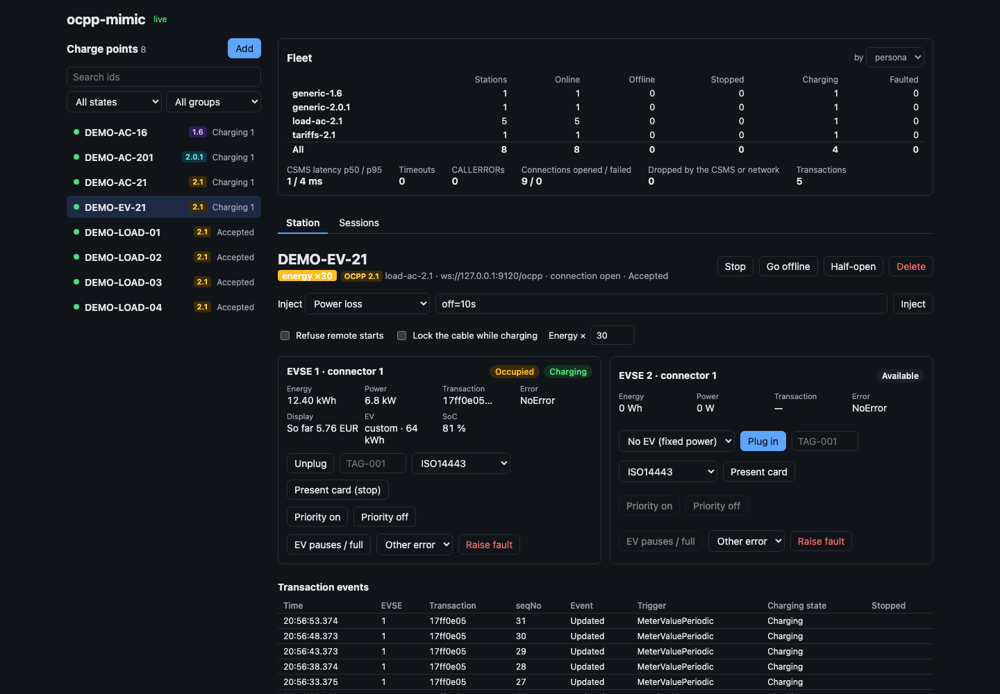
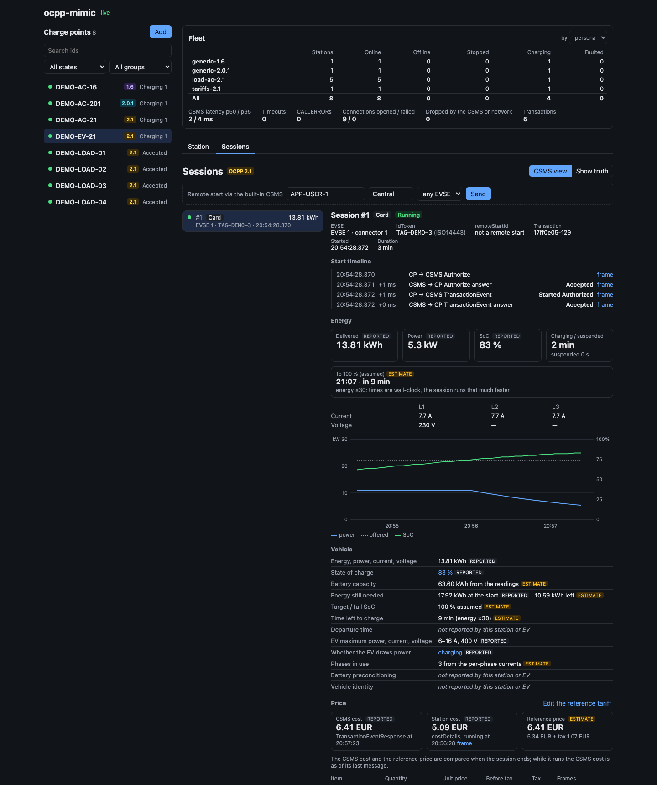
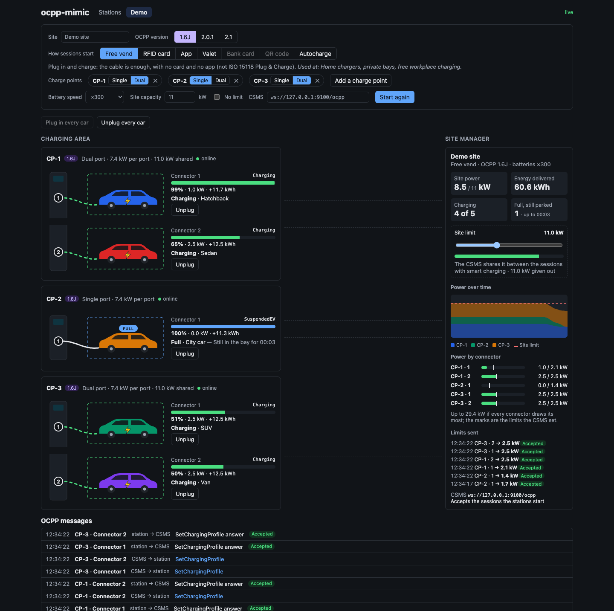

# ocpp-mimic 使用手册

英文版：[guide.md](guide.md)（两版不一致时以英文版为准）

ocpp-mimic 模拟 OCPP 充电桩。一个引擎可以同时运行一个到几千个虚拟桩，连接你要测试的 CSMS。你可以在 Web UI 里手动操作它们，也可以把操作写成 YAML 场景放进 CI，或者在压测里让它们自己充电。支持 OCPP 1.6J、2.0.1 和 2.1。

本手册讲怎么用。内部怎么实现、为什么这样设计，见[设计方案](design.zh-CN.md)。

ocpp-mimic 以 [Business Source License 1.1](../LICENSE) 公开源码：试用、评估和非商业用途免费，商业性的生产使用需要商业授权。详见 README 的 [License](../README.md#license) 一节。

## 目录

1. [安装和首次启动](#1-安装和首次启动)
2. [基本概念](#2-基本概念)
3. [Web UI](#3-web-ui)
4. [Persona 和 EV 配置](#4-persona-和-ev-配置)
5. [内置 CSMS](#5-内置-csms)
6. [场景](#6-场景)
7. [OCPP 版本和功能](#7-ocpp-版本和功能)
8. [故障注入](#8-故障注入)
9. [批量桩、压测和指标](#9-批量桩压测和指标)
10. [日志：导出、导入、回放和校准](#10-日志导出导入回放和校准)
11. [安全等级和测试 PKI](#11-安全等级和测试-pki)
12. [引擎 HTTP API](#12-引擎-http-api)
13. [命令参考](#13-命令参考)
14. [常见问题](#14-常见问题)

## 1. 安装和首次启动

### 安装

三种方式任选其一。

**从发布版本安装**，最快。需要 Node.js 24 或更高版本。每个 [GitHub Release](https://github.com/JasonKong/ocpp-mimic/releases) 都附带 npm 包：

```bash
npm install --global https://github.com/JasonKong/ocpp-mimic/releases/latest/download/ocpp-mimic.tgz
ocpp-mimic --version
ocpp-mimic samples scenarios
```

`ocpp-mimic samples <目录>` 把示例 persona、示例场景、场景模板、压测计划、导入映射和日志复制到 `<目录>`，已有的文件保留不动。目录用 `scenarios` 时，本手册里的路径（`scenarios/personas`、`scenarios/examples`、`scenarios/load` 等）可以直接使用。Node.js 低于 24 时，命令会说明需要哪个版本。指定版本可以从对应的发布安装，例如 `.../releases/download/v0.1.0/ocpp-mimic-0.1.0.tgz`。

**在 Docker 里运行**：见下面的[在 Docker 里运行](#在-docker-里运行)。

**从源码构建**，用于修改 ocpp-mimic 或跟随 `main`。需要 Node.js 24（仓库的 `.nvmrc`；用 `fnm use` 或 `nvm use` 切换）和 pnpm 12（`corepack enable` 会安装 `package.json` 指定的版本）：

```bash
git clone https://github.com/JasonKong/ocpp-mimic.git
cd ocpp-mimic
pnpm install
pnpm build
alias ocpp-mimic="node $PWD/packages/cli/dist/main.js"
```

克隆下来的 `scenarios/` 里已经有示例，还有回归套件以及 CitrineOS 和 SteVe 场景（这些需要 Docker）。`pnpm pack:release` 构建发布时提供的包 `release/ocpp-mimic-<版本>.tgz`，可以用 `npm install --global` 安装。[CONTRIBUTING.md](../CONTRIBUTING.md) 说明如何参与修改。

`ocpp-mimic --help` 列出所有命令和选项，`ocpp-mimic --version` 打印版本号。

### 在 Docker 里运行

每次发布还会提供镜像 `ghcr.io/jasonkong/ocpp-mimic`，支持 linux/amd64 和 linux/arm64。入口是 `ocpp-mimic`，默认命令是 `serve --host 0.0.0.0 --store /data/ocpp-mimic.db`。它会在容器的环回地址之外监听，所以要给它设 [API 令牌](#在本机以外监听api-令牌)：

```bash
export OCPP_MIMIC_API_TOKEN="$(openssl rand -hex 24)"
docker run --rm -p 127.0.0.1:7300:7300 -e OCPP_MIMIC_API_TOKEN -v ocpp-mimic-data:/data ghcr.io/jasonkong/ocpp-mimic
```

其他命令用法相同，例如 `docker run --rm ghcr.io/jasonkong/ocpp-mimic --version`，或者运行当前目录里的场景：`docker run --rm -v "$PWD:/work" -w /work ghcr.io/jasonkong/ocpp-mimic run scenarios/ --junit report.xml`。

演示也能在镜像里运行。它的 CSMS 留在容器内部，`--host 0.0.0.0` 让发布出来的端口能访问到引擎：

```bash
docker run --rm -p 127.0.0.1:7300:7300 -e OCPP_MIMIC_API_TOKEN ghcr.io/jasonkong/ocpp-mimic demo --host 0.0.0.0
```

[`docs/examples/docker-compose.yml`](examples/docker-compose.yml) 同时启动引擎和内置 CSMS。CSMS 共享引擎的网络，桩用 `ws://127.0.0.1:9100/ocpp` 就能连上它，Web UI 的远程启动也能用。只对外发布 Web UI 的端口，而且只在 127.0.0.1 上。

在容器里，你本机上的 CSMS 不在环回地址上。放行它的地址，例如 `--allow-csms ws://host.docker.internal:8180/`；在 Linux 上还要给 `docker run` 加 `--add-host host.docker.internal:host-gateway`。在克隆的仓库里用 `docker build -t ocpp-mimic .` 构建镜像。

### 首次启动：一个桩连内置 CSMS

需要两个进程：一个 CSMS 供桩连接，一个引擎运行桩并提供 Web UI。ocpp-mimic 自带一个小型 CSMS，正好用在这里。

1. 在一个终端里启动内置 CSMS。桩会连到 `ws://127.0.0.1:9100/ocpp/<桩 id>`。

   ```bash
   ocpp-mimic csms
   ```

2. 在第二个终端里启动引擎。`--personas scenarios/personas` 会在三个内置 persona 之外加载仓库里的示例 persona。

   ```bash
   ocpp-mimic serve --personas scenarios/personas
   ```

3. 打开 <http://127.0.0.1:7300>。

4. 点 **Add**。填入 id（如 `SIM-001`），选 `generic-1.6`，CSMS URL 填 `ws://127.0.0.1:9100/ocpp`，点 **Create and start**。桩会连上 CSMS、发送 BootNotification，连接器显示为 Available。

5. 在 1 号连接器上选一辆 EV（如 `compact-40kwh`），点 **Plug in**，输入卡号（如 `TAG-001`），点 **Present card**。交易开始，电表值开始上报。打开 **Sessions** 标签页可以看这次会话。

在克隆的仓库里，`pnpm serve` 会一步完成构建和启动引擎，但不加载示例 persona。

### 最快的体验方式：演示

```bash
ocpp-mimic demo
```

它在一个进程里同时启动内置 CSMS 和引擎，监听 127.0.0.1，并打印[演示页](#演示页)的地址：<http://127.0.0.1:7300/#/demo>。按 Ctrl-C 两者一起停止。`--port` 和 `--csms-port` 可以改端口（默认 7300 和 9100）；`--host` 让引擎在本机以外监听（比如在[容器](#在-docker-里运行)里），这时要配 API 令牌。

### 重启后保留桩

默认情况下引擎什么都不保存：停掉它，所有桩就没了。`serve --store <文件>` 把桩及其配置或 Device Model、交易、本地列表、充电配置文件（charging profile）、资费和会话存进一个 SQLite 文件，下次启动引擎时自动恢复并启动这些桩。

```bash
ocpp-mimic serve --personas scenarios/personas --store ocpp-mimic.db
```

### 允许连接哪些 CSMS 地址

为了防止填错 URL 把流量打到不该测的系统上，桩默认只能连本机：`ws://127.0.0.1`、`ws://localhost`、`ws://[::1]` 以及对应的 `wss://`。要测其他 CSMS，用 `--allow-csms` 放行它的地址（可重复多次）：

```bash
ocpp-mimic serve --allow-csms wss://csms.staging.example.com/
```

只测试你自己运维或已获授权测试的 CSMS，压测尤其如此。

### 在本机以外监听：API 令牌

引擎的 API 和内置 CSMS 的控制 API 没有登录：默认监听 127.0.0.1 时只有本机能访问。要在其他地址上监听（`--host 0.0.0.0`，或对外发布的容器端口）之前，先设置 API 令牌。优先用环境变量，令牌不会出现在进程列表里：

```bash
export OCPP_MIMIC_API_TOKEN="$(openssl rand -hex 24)"
ocpp-mimic serve --host 0.0.0.0 --personas scenarios/personas
```

设置令牌后，`/api/*` 和 `/metrics` 的每个请求都需要 `Authorization: Bearer <令牌>`，只有 `GET /api/health` 仍然开放。Web UI 只询问一次令牌，在浏览器标签页关闭前一直保留。`serve`、`load --port` 和 `csms` 也接受 `--api-token <令牌>`。在环回地址以外监听却没有令牌时，启动时会打印警告。

内置 CSMS 读取同一个环境变量。如果它设了令牌，用 `--csms-api-token` 或 `OCPP_MIMIC_CSMS_API_TOKEN` 把这个令牌告诉引擎，Web UI 的远程启动才能经由它发出。

### 版本与兼容性

`ocpp-mimic --version` 打印版本号；引擎和内置 CSMS 的 `GET /api/health` 也会报告版本。[CHANGELOG.md](../CHANGELOG.md) 列出每一个用户可见的改动。

版本号对你编写或调用的东西遵循语义化版本：

- CLI 的命令和选项；
- 场景、persona、压测计划和日志格式；
- 引擎 HTTP API 和内置 CSMS 的控制 API。

仓库内部的 TypeScript 包不在其中。主版本为 0 期间，次版本（0.1 → 0.2）可以改变上述内容，变更日志会说明改了什么、如何调整。补丁版本（0.1.0 → 0.1.1）只修 bug。

## 2. 基本概念

| 术语 | 含义 |
| --- | --- |
| **引擎** | 运行虚拟桩的进程：`ocpp-mimic serve`，或者嵌在 `run`、`load`、`replay` 里的引擎。它负责 socket、定时器、存储和 HTTP API |
| **桩（station）** | 一个虚拟充电桩（2.x 里叫 Charging Station）。它有 id（chargeBoxId / 桩标识）、persona、CSMS URL、连接器（2.x 里是 EVSE），以及配置、交易、充电配置文件等状态 |
| **Persona** | 描述一类充电桩的 YAML：OCPP 版本、BootNotification 字段、连接器、功率、功能、默认配置、时序、EV 配置和故障。桩从 persona 创建 |
| **EV 配置** | 一辆模拟的车：电池容量、初始 SoC、最大功率、相数，以及它和桩的通信方式。带 EV 插枪后，功率、电量和 SoC 按电池模型变化 |
| **CSMS** | 桩连接的中央系统。要么是你在测试的那个，要么是 ocpp-mimic 的**内置 CSMS** |
| **场景** | 一个 YAML 测试：桩、步骤和断言。`ocpp-mimic run` 运行场景并报告通过或失败 |
| **压测计划** | 一个 YAML 文件，描述一批桩、定时事件和通过 / 失败阈值，由 `ocpp-mimic load` 运行 |
| **会话** | 引擎记录下来的一次充电：谁、以什么方式启动的，相关报文、电表值、费用，以及 EV 的真实状态 |

桩 id 会拼在 CSMS URL 后面：id 为 `SIM-001`、CSMS URL 为 `ws://127.0.0.1:9100/ocpp` 的桩连接 `ws://127.0.0.1:9100/ocpp/SIM-001`。桩使用其 persona 的 OCPP 版本，并且只提供这一个子协议（`ocpp1.6`、`ocpp2.0.1` 或 `ocpp2.1`）。

**模拟时间。** 时间戳始终是真实时间。桩的**能量倍率**（默认 1）让电量和 SoC 按倍数加快增长，原本几小时的充电几分钟就能充满。Web UI 显示剩余时间时换算成实际时间，并标出倍率。

### 会话怎样开始

会话的启动方式，和现场的充电桩一样：

| 启动方式 | OCPP 1.6 | OCPP 2.0.1 和 2.1 | 怎样结束 | 常见场所 |
| --- | --- | --- | --- | --- |
| **免认证**（Free vend，即插即充） | 配置键 `FreeVendEnabled` 为 true：插枪就用 `FreeVendIdTag`（默认 `FreeVend`）开始，不发 Authorize | Device Model 的 `AuthCtrlr.Enabled` 为 false：插枪就用类型为 `NoAuthorization` 的空 token 开始 | 拔枪 | 家用桩、私人车位、免费的单位充电 |
| **RFID 卡** | 先 Authorize，插上枪后发 StartTransaction | 先 Authorize，再发 TransactionEvent Started | 刷同一张卡，或拔枪 | 单位、车队、可刷漫游卡的公共交流桩 |
| **App**（远程启动） | CSMS 发 RemoteStartTransaction | CSMS 发 RequestStartTransaction | CSMS 远程停止，或拔枪 | 公共交流和直流桩、住宅停车场 |
| **Valet**（CSMS 在插枪时启动） | 内置 CSMS 的[自动启动](#控制-api)：收到 Preparing 就发 RemoteStartTransaction | 收到 Occupied 就发 RequestStartTransaction | CSMS 远程停止，或拔枪 | 酒店、代客泊车和车行停车场 |
| **银行卡**（桩上刷卡） | — | 2.1 且有 `Payment` 功能：支付终端授权银行卡（C18）；TransactionEvent 带 `DirectPayment` 类型的 token | 在终端上停止，之后发 NotifySettlement | 公共快充 |
| **二维码**（网页支付） | — | 2.1 且有 `WebPayments`：司机在二维码背后的页面付款，CSMS 发 NotifyWebPaymentStarted，再用 `DirectPayment` 类型的 token 发 RequestStartTransaction（C25） | 远程停止，或拔枪 | 给没有账户的司机用的公共交流和直流桩 |
| **Autocharge** | 桩的 `autocharge` 开关：车的 `evccid`（MAC 地址）作为 idTag | 作为 token：2.0.1 是 MacAddress 类型，2.1 是 EVCCID 类型 | 拔枪 | 直流快充网络、车队 |

免认证不是 ISO 15118 的 Plug & Charge（车用合同证书证明身份），ocpp-mimic 没有模拟后者。`FreeVendEnabled` 和 `FreeVendIdTag` 是 ocpp-mimic 自己的厂商配置键，很多充电桩也用这种方式提供免认证充电：GetConfiguration 会列出它们，ChangeConfiguration 可以修改。Valet 是 CSMS 的行为，不是桩的：桩就是普通的桩，接受远程启动；每当有车插枪，CSMS 就启动一个会话（通常免费、不关联司机）。

车充满后不再取电：1.6 的连接器状态变成 SuspendedEV，2.x 的充电状态变成 SuspendedEV。会话不会结束，车仍然占着车位，直到被停止或拔枪。

## 3. Web UI

`ocpp-mimic serve` 在 API 的同一端口上提供 Web UI（默认 <http://127.0.0.1:7300>）。`load --port <n>` 也会提供，方便观察压测。引擎设了 [API 令牌](#在本机以外监听api-令牌)时，UI 会先询问令牌。UI 只调用引擎的 API；它能做的事都可以通过 [API](#12-引擎-http-api) 或场景完成。

### 桩列表和 Add 表单

左栏列出所有桩，显示 OCPP 版本标识、连接状态和各连接器状态。可以按 id 搜索，按状态（Connected、Connecting、Offline、Stopped）或分组筛选。

**Add** 打开创建表单：

| 字段 | 含义 |
| --- | --- |
| Charge point id | 桩 id。**How many** 大于 1 时，id 里要有一个带花括号的计数器：`SIM-{001}` 生成 SIM-001、SIM-002……，数字决定起始值和位数 |
| How many | 按同一模板创建 1 到 10,000 个桩 |
| Group (optional) | 批量创建时的分组名，用于筛选和给指标打标签 |
| Persona | 每个 persona 后面标着它的 OCPP 版本 |
| CSMS URL | 不含桩 id，id 会自动拼上。表单会记住上次填的值 |
| Password (optional) | Basic Auth 密码（1.6 的 AuthorizationKey，2.x 的 BasicAuthPassword） |

**Create and start** 创建并连接这些桩。

### Fleet 总览

桩视图上方的 **Fleet** 卡片按 persona 或分组统计桩数（在线、离线、已停止、充电中、故障），并显示引擎指标：CSMS 响应延迟 p50 / p95、超时数、CALLERROR 数、建立和失败的连接数、被 CSMS 或网络断开的连接数，以及交易数。

### 桩视图

选中一个桩就打开它的视图，分 **Station** 和 **Sessions** 两个标签页。



顶部显示 id、版本、persona、CSMS URL、连接状态，倍率不为 1 时还显示能量倍率。按钮：

| 按钮 | 作用 |
| --- | --- |
| Stop / Start | 断开桩并停止它的定时器，或重新启动 |
| Go offline | 干净断线：连接关闭，消息进入队列，直到点 **Back online** |
| Half-open | 连接看似开着但什么都传不过去，类似移动网络假死；桩只能靠自己的超时发现 |
| Delete | 删除桩及其保存的状态 |

顶部下方：

- **Inject**：选一种故障类型，用 `key=value` 形式填参数，例如断电填 `off=10s`。正在生效的注入会列出来，旁边有 **Clear** 链接。见[故障注入](#8-故障注入)。
- **Refuse remote starts**：所有远程启动都回复 Rejected。
- **Lock the cable while charging**：锁枪后不能拔枪，直到交易结束或 CSMS 解锁。
- **Autocharge**：EV 配置里有 `evccid`（车的 MAC 地址）时，插枪就用它来识别，就像刷了一张卡号为它的卡：1.6 作为 idTag，2.0.1 作为 MacAddress 类型的 token，2.1 作为 EVCCID 类型的 token。
- **Energy ×**：能量倍率。

每个连接器（2.x 桩上是每个 EVSE）有一张卡片，显示状态、充电状态（2.x）、交易 id、功率、电量、SoC，有限值生效时还显示限值。操作：

| 操作 | 作用 |
| --- | --- |
| EV + **Plug in** | 用 persona 里的某个 EV 配置插枪，或不带 EV 插枪（这时连接器直接按提供功率充电，没有电池模型） |
| **Unplug** | 拔枪 |
| 卡号、IdToken 类型（2.x）+ **Present card** | 刷卡。交易进行中刷同一张卡会结束交易（按钮显示 **Present card (stop)**） |
| **EV pauses / full**、**EV resumes** | 车辆停止取电（SuspendedEV），或恢复取电 |
| 故障 + **Raise fault**、**Clear fault** | 在连接器上触发 persona 故障目录里的某个故障，或清除故障 |

2.1 桩上视 persona 的功能而定：

| 操作 | 功能 | 作用 |
| --- | --- | --- |
| 卡组织 + **Pay by card**、**Stop payment** | Payment | 在 EVSE 的支付终端刷银行卡，以及司机在终端上结束 |
| **Priority on**、**Priority off** | （2.1 都有） | 司机的优先充电按钮 |
| **Payment URL** | WebPayments | 动态二维码会显示的 URL 及其过期时间 |
| **Display** | （有内容时显示） | 桩屏幕上会显示的内容：资费说明、实时费用、总费用 |

连接器下方，2.x 桩会显示**交易事件**（时间、EVSE、交易 id、seqNo、eventType、triggerReason、chargingState、stoppedReason）和 **Device Model 浏览器**：变量按组件分组，可筛选，显示每个变量的值、可变性和特性。ReadWrite 变量可以像本地运维人员那样直接修改。

底部的**报文日志**列出所有收发的帧，带简短摘要、版本标识，并标出 schema 问题、CALLERROR、注入或丢弃的帧。点一行可查看 JSON。**Export JSONL** 按 ocpp-mimic 的日志格式下载日志。

### Sessions 视图



**Sessions** 标签页按时间倒序列出桩的充电会话：编号、启动方式（Card、Remote start、No authorization、Payment）、电量或失败原因、EVSE、卡号和时间。地址 `#/stations/<id>/sessions/<n>` 可以直接链接到某个会话。

一个会话显示：

- **头部**：启动方式、卡号及类型、remoteStartId（2.x）、交易 id、开始时间和时长、启动失败的原因、停止原因、交易限值和支付结算（2.1）。下面是**启动时间线**：从第一个请求到交易开始的每一帧，以及每一步耗时。点某一步可以打开对应的帧和应答。
- **电量面板**：按上报值显示的已充电量、功率和 SoC，充电和暂停时长，第三方根据上报值估算的到达目标所需时间，各相电流和电压，以及上报功率、提供功率和 SoC 的曲线图。已结束的会话还会显示总量、峰值功率、SoC 区间和停止原因。
- **车辆卡片**：关于车辆的十二项信息（电池容量、SoC、目标、出发时间、最大功率、相数……），每项注明桩上报了什么、什么只能估算、什么是当前 OCPP 版本根本无法携带的。
- **价格卡片**：CSMS 的费用（2.0.1 和 2.1 会发；1.6 没有费用消息）、桩自己算的费用（2.1 有资费时），以及 ocpp-mimic 用你设的资费根据上报值算出的**参考价格**，每一项都列出所用的帧，并说明几者是否精确到分一致。OCPP 2.0.1 发送的 CSMS 费用不带币种，所以卡片按参考资费的币种显示它：要对比时，给内置 CSMS（`--tariff`）和价格卡片设同一份资费。**Edit the reference tariff** 修改参考资费：固定费用、每 kWh 价格（可选加一个谷时价及其时段）、每充电分钟和每空闲分钟的价格、最低和最高费用，以及一个税率。
- **会话日志**：会话的帧，每个 CALL 带着它的应答和响应时间，可按 action、方向、只看错误、日志行筛选。选中一行电表值会在曲线上标出对应时刻，点曲线会选中最近的一行。**Export JSONL** 下载这次会话的帧。

**CSMS view / Show truth。** 默认情况下面板只显示 CSMS 能从帧里知道的信息。**Show truth** 会在旁边加上 EV 模型的真实值：准确的 SoC、电量、功率和充满所需时间。估算偏差超过 5 分钟或 10% 时会高亮提示。

**远程启动。** 桩连的是内置 CSMS 时，Sessions 标签页有一个远程启动表单（EVSE、卡号和类型）：内置 CSMS 发送 RemoteStartTransaction（1.6）或 RequestStartTransaction（2.x）。连其他 CSMS 时，远程启动必须由那个 CSMS 发起。

### 演示页



页头的 **Demo**（或地址 `#/demo`）是一个可以动手操作的小充电站点，用来展示 OCPP 的工作过程，而不是做测试。用 `ocpp-mimic demo` 启动最方便；用 `serve` 的话，还要另外启动内置 CSMS。

1. 设置**站点**：名称、**OCPP 版本**（1.6J、2.0.1 或 2.1）、**会话的启动方式**（[免认证、RFID 卡、App、valet、银行卡、二维码或 Autocharge](#会话怎样开始)；银行卡和二维码只有 2.1 有）、站点的**充电桩**（最多添加 6 台，每台**单口**或**双口**）、**站点容量**（默认 22 kW，或者勾选 **No limit**），以及**电池速度**（即能量倍率；×300 时大多数车一两分钟就能充满）。
2. 点 **Build the site**。它用 generic persona（双口桩用 `generic-dual-*`）创建桩 `DEMO-CP-1`、`DEMO-CP-2`……（显示为 CP-1、CP-2……），打上 `demo` 标签，连到填写的 CSMS（默认 `ws://127.0.0.1:9100/ocpp`）。再次构建时会先删除带 `demo` 标签的桩。免认证会打开桩的免认证设置，Autocharge 会打开桩的 `autocharge` 开关；valet 会为每个桩打开内置 CSMS 的自动启动，其他方式则把它关掉。2.1 桩会设置一个已知的二维码密钥，CSMS 才能核验支付。设了容量时，桩会上报取用的功率，由内置 CSMS [管理站点负载](#站点负载管理)。
3. 左侧的**充电区**把每台充电桩画成一根立柱；双口桩有两个插座，标着 1 和 2，各自接到自己的车位。每个车位有自己的车，从 25 kWh 的小车到 75 kWh 的 SUV，初始电量各不相同。点 **Plug in** 插枪。之后按所选方式开始：自动开始（免认证、Autocharge）、点 **Tap card** 刷卡、点 **Start in app** 用 App 启动、点 **Pay by card** 刷银行卡、点 **Scan the QR code and pay** 扫码支付，或者由 CSMS 启动（valet）。**Tap card to stop**、**Stop in app**、**Stop at the terminal**、**Stop on the web page** 和 **Unplug** 结束会话。**Plug in every car**、为每辆车启动（**Tap every card**、**Start every car in the app**、**Pay for every car**、**Scan every QR code**），以及 **Unplug every car** 会同时作用于所有车位。
4. 车位上显示桩自己上报的状态（2.x 同时显示充电状态），以及车的电量、功率和已充入的电量。车充满后，桩上报 SuspendedEV，功率降为 0，车位标记为 **Full**，并显示车充满后又在车位上停了多久。会话会一直保持，直到拔枪或会话被停止。
5. 右侧的**站点管理**汇总整个站点：当前功率（以及容量）、站点建好以来的总供电量、正在充电的车数、已充满但仍占位的车数（以及最长占位时间）。设了容量时还会显示：
   - **站点限值**：充电过程中可以拖动修改，就像电网运营方下调限值那样，CSMS 几秒内重新分配；
   - 站点的**功率曲线**，按充电桩分层堆叠，限值画成虚线；
   - 每个连接器的功率和它最多能提供的功率，并在 CSMS 设定的限值处画一条标记；
   - **已下发的限值**：CSMS 发出的每条 SetChargingProfile 以及桩的应答。

   因为限值没有余量而停在 0 的车显示 **Waiting for power**（SuspendedEVSE）。
6. 每条 OCPP 消息发生时，都会在对应的充电桩和站点管理这一侧之间飞过；**OCPP messages** 按从新到旧列出它们，并标出属于哪台桩、哪个连接器，点开一条可以看它的内容。

页面会在浏览器里记住设置，再次打开时接着显示原来的站点。App 和 valet 需要 ocpp-mimic 的内置 CSMS；连其他 CSMS 时页面会给出提示。

## 4. Persona 和 EV 配置

### 自带的 persona

内置（`packages/engine/personas/`）：

| Persona | 版本 | 说明 |
| --- | --- | --- |
| `generic-1.6` | 1.6 | 一个 7.36 kW 交流连接器，全部功能 profile，按规范默认行为，三个 EV 配置 |
| `generic-2.0.1` | 2.0.1 | 一个 7.36 kW 的 EVSE，已覆盖的 2.0.1 功能，同样的 EV 配置 |
| `generic-2.1` | 2.1 | 作为 2.1 桩的 `generic-2.0.1`；连接器可用性用 NotifyEvent 上报；带支付终端（`Payment`）和动态二维码（`WebPayments`） |
| `generic-dual-1.6`、`generic-dual-2.0.1`、`generic-dual-2.1` | 1.6、2.0.1、2.1 | 双口版的 generic persona（1.6 是连接器 1 和 2，2.x 是 EVSE 1 和 2），每个口最多 7.36 kW，两口共用一路 11.04 kW 的电源：两辆车同时充时各 5.52 kW，只有一辆时 7.36 kW |

`scenarios/personas/` 里的示例（用 `--personas scenarios/personas` 加载）：

| Persona | 用途 |
| --- | --- |
| `regression-1.6`、`regression-2.0.1`、`regression-2.1` | 回归场景用，延迟很短 |
| `load-ac-1.6`、`load-ac-2.0.1`、`load-ac-2.1` | 压测用：两个连接器，心跳和电表间隔 60 秒；2.1 的那个按资费计价 |
| `core-only-1.6`、`core-only-2.0.1` | 只有 Core 功能，看 CSMS 在缺少其他功能时如何处理 |
| `firmware-fails-1.6`、`firmware-fails-2.0.1`、`firmware-bad-signature-2.0.1` | 固件升级失败，或固件签名无效 |
| `regression-iso15118-2.0.1`、`iso15118-20-2.1` | 会上报充电需求的车辆（ISO 15118-2、ISO 15118-20） |
| `tariffs-2.1`、`payments-2.1` | 2.1 资费和本地计费；支付终端和网页支付 |
| `statusnotification-2.1` | 用 StatusNotification 上报可用性的 2.1 桩 |

### 编写 persona

persona 是一个 YAML 文件，文件名与 `persona` id 一致。通常继承一个内置 persona，只写不同之处；`extends` 对对象逐键合并，对列表和单个值直接替换。

```yaml
persona: vendorx-ac7 # made-up example
extends: generic-1.6
description: VendorX AC-7, firmware 2.5
boot:
  chargePointVendor: VendorX
  chargePointModel: AC-7
  firmwareVersion: "2.5.0"
connectors: 2
power: { offeredW: 11000 }
features: [Core, RemoteTrigger, SmartCharging]
config:
  HeartbeatInterval: 60
  MeterValueSampleInterval: 300
timing:
  startTransactionDelay: 2s
  commandDelays: { RemoteStopTransaction: 800ms }
  resetDowntime: { soft: 30s, hard: 3m }
evs:
  compact-40kwh: { capacityKWh: 40, initialSoc: 20, maxPowerW: 7400, phases: 1 }
faults:
  - { name: Ground fault, errorCode: GroundFailure, info: GND_FAULT, vendorErrorCode: E101 }
```

把自己的 persona 放进一个目录，用 `--personas <目录>` 传给 `serve`、`run`、`load` 或 `replay`（可重复以加载多个目录）。时长可以写成毫秒数，或以 `ms`、`s`、`m`、`h` 结尾的字符串。

所有 persona 都可以有的字段：

| 字段 | 含义 |
| --- | --- |
| `persona` | id，最多 64 个字符（必填） |
| `ocpp` | `"1.6"`（默认）、`"2.0.1"` 或 `"2.1"` |
| `extends` | 继承的 persona |
| `description` | 说明文字，显示在 Web UI 里 |
| `boot` | BootNotification 字段（必填）。1.6：`chargePointVendor`、`chargePointModel`、`firmwareVersion` 等；2.x：chargingStation 块，即 `vendorName`、`model`、`serialNumber`、`firmwareVersion` |
| `connectors` | 连接器数量（1.6），或每个只有一个连接器的 EVSE 数量（2.x）（必填） |
| `power` | `offeredW`：每个连接器提供的功率（默认 7360）；`evW`：允许时车辆取用的功率（默认等于提供功率）；`stationW`：各连接器共用的一路电源，像双口桩那样（默认没有）。正在充电的连接器平分它，车没用掉的部分（功率下降、限值更低）转给其他连接器 |
| `features` | 1.6：功能 profile（Core、FirmwareManagement、RemoteTrigger、LocalAuthListManagement、Reservation、SmartCharging）。2.x：Core、AdvancedSecurity、LocalAuthListManagement、SmartCharging、Reservation，2.1 还有 TariffAndCost、Payment、WebPayments。桩没有声明的功能，其消息一律回复 NotSupported |
| `config` | 1.6：配置项默认值 |
| `deviceModel` | 2.x：Device Model 取值，组件 → 变量 → 值（自定义变量可以写成对象，含 `actual`、`mutability`、`dataType`、`unit`、`valuesList` 等） |
| `connectorStatus` | 2.1：连接器可用性的上报方式，`NotifyEvent`（默认）或 `StatusNotification` |
| `timing` | `startTransactionDelay`、`actionDelay`、`resetDowntime: { soft, hard }`、`bootRetry`，以及按 CSMS 命令分别设置的 `commandDelays`（桩多久才回复） |
| `firmware` | `downloadTime`、`installTime`、`uploadTime`；`download`、`install`、`upload`、`signature` 取 `succeed` 或 `fail`；`transfer: simulated`（默认）或 `real`（真的通过 HTTP(S) 下载和上传） |
| `evs` | 命名的 EV 配置（见下） |
| `usage` | 自动充电的使用模型（见[批量桩](#9-批量桩压测和指标)） |
| `faults` | Web UI 里可选的故障目录：`name`、`errorCode`、`info`、`vendorErrorCode` |

### EV 配置

| 字段 | 含义 |
| --- | --- |
| `capacityKWh` | 电池容量（必填） |
| `initialSoc` | 插枪时的 SoC，单位 %（必填） |
| `maxPowerW` | 车辆最大取用功率（必填） |
| `phases` | 1 或 3（必填） |
| `taperSoc` | 功率开始下降的 SoC（默认 80） |
| `targetSoc` | 车辆停止充电的 SoC（默认 100） |
| `communication` | `basic`（不上报 SoC）、`dc`、`iso15118`（2.x：发送 NotifyEVChargingNeeds）或 `iso15118-20`（2.1：ISO 15118-20 需求和 Display 值）。不设置时，配置了 SoC 测量项就上报 SoC |
| `departureMinutes` | ISO 15118：出发时间，单位是插枪后的分钟数 |
| `controlMode` | ISO 15118-20：`ScheduledControl`（默认）或 `DynamicControl` |
| `minimumSoc` | ISO 15118-20：司机需要的最低 SoC |
| `evccid` | 车的 MAC 地址，12 位十六进制数字，即车通过 DIN 70121 或 ISO 15118 告诉桩的值：打开 **Autocharge** 开关的桩用它识别车 |

API 和场景里也可以直接内联写 EV 配置，不用名字。

## 5. 内置 CSMS

ocpp-mimic 自带一个小型 CSMS，用来测试模拟器本身，或在没有真实后台时试用。它接受任何连到 `/ocpp/<id>` 的桩，选用桩提供的第一个它支持的子协议（1.6、2.0.1 或 2.1），并应答所有请求：BootNotification 回复 Accepted，Authorize 和交易回复 Accepted（以 `UNKNOWN-` 开头的 idTag 除外），2.x 和 2.1 的各种通知也都应答。它是测试工具，控制 API 没有鉴权。

两种运行方式：

- **在场景里**：`csms: builtin`，这是默认值。场景可以用 CSMS 步骤 `csmsCall` 和 `csmsReply` 下发命令、预设应答。
- **作为独立进程**：`ocpp-mimic csms`，供 Web UI 或压测使用。

```bash
ocpp-mimic csms --port 9100 --delay 20ms-100ms
```

| 选项 | 含义 |
| --- | --- |
| `--port`、`--host` | 监听地址（默认 127.0.0.1:9100） |
| `--delay <d>[-<d>]` | 每个请求延迟这么久再应答，或在区间内随机延迟 |
| `--heartbeat-interval <秒>` | BootNotification 应答里给出的心跳间隔（默认 60） |
| `--unknown-prefix <s>` | 以此开头的 idTag 为 Invalid（默认 `UNKNOWN-`；空字符串表示全部接受） |
| `--password <p>` | 所有桩都必须提供的 Basic Auth 密码 |
| `--tls-cert`、`--tls-key`、`--tls-ca`、`--client-certificates none\|optional\|required` | 提供 `wss://`，可要求客户端证书 |
| `--status <d>` | 每隔多久打印一行状态（默认 60s；0 表示不打印）。Ctrl-C 时按 action 打印汇总 |
| `--tariff <文件>` | 用这个资费给 2.0.1 会话计价：TransactionEvent 应答带 totalCost，每分钟发送 CostUpdated |
| `--install-tariff` | 每次 2.1 桩启动被接受后，把这个资费作为默认资费下发给它 |
| `--api-token <令牌>` | 控制 API 要求 `Authorization: Bearer <令牌>`（默认取 `OCPP_MIMIC_API_TOKEN`） |

它不保存任何帧，长时间运行内存也保持平稳。

### 控制 API

CSMS 进程在 WebSocket 端口上同时提供一个小型 HTTP API。场景里可以用 `{{csmsApiUrl}}` 访问。设了 `--api-token` 时，除 `GET /api/health` 外的每个请求都需要 `Authorization: Bearer <令牌>`。

| 请求 | 作用 |
| --- | --- |
| `GET /api/health` | `{ "service": "ocpp-mimic-csms", "protocols": [...] }` |
| `POST /api/stations/<id>/remote-start` | `{ "evseId": 1, "idToken": { "idToken": "TAG-001", "type": "Central" } }`：发送 RemoteStartTransaction 或 RequestStartTransaction，返回桩的应答 |
| `POST /api/stations/<id>/remote-stop` | `{ "transactionId": 3 }`（1.6 是数字，2.x 是字符串）：发送 RemoteStopTransaction 或 RequestStopTransaction |
| `POST /api/stations/<id>/auto-start` | `{ "idToken": { "idToken": "VALET", "type": "Central" } }`：valet 模式。每当有车在该桩插枪（1.6 的 Preparing，2.x 的 Occupied），CSMS 就用这个 token 启动会话，每次插枪启动一次。`{ "idToken": null }` 关闭。桩不需要已经连上 |
| `POST /api/stations/<id>/call` | `{ "action": "Reset", "payload": { "type": "Soft" } }`：发送该桩版本的任意 CSMS 命令 |
| `PUT /api/sites/<id>` | `{ "capacityW": 22000, "stations": ["CP-1", "CP-2"], "minimumW": 1380 }`：一个站点，CSMS 在它的会话之间分配容量（见下文）；同 id 的站点会被替换 |
| `GET`、`DELETE /api/sites/<id>` | 站点及其会话、各会话的限值和实测功率、已下发的限值；或者删除站点并清除它下发的限值 |
| `PUT /api/sites/<id>/payments` | `{ "stations": ["CP-1"], "holdAmount": 50, "overHold": "recharge", "minEnergyWh": 0, "idleGraceMinutes": 0, "tariff": {...} }`：为这些桩的会话启用模拟支付服务（见[支付](#支付)）；除 `stations` 外都可省略 |
| `GET`、`DELETE /api/sites/<id>/payments` | 每个会话的支付（方式、冻结额、实时价格、状态、扣款额）、支付事件和收入；或者停止在这里收款 |
| `PUT`、`GET /api/accounts/<idToken>` | `{ "card": { "brand": "Visa", "last4": "4242" }, "outcome": "approve", "billing": "card" }`：司机的测试卡及其表现 |
| `POST /api/stations/<id>/default-tariff` | 2.1：用参考资费或 `tariff` 发送 SetDefaultTariff，作用于 `evseId`（默认 0，即所有 EVSE） |
| `POST /api/stations/<id>/transaction-limit` | 2.1：`{ "transactionLimit": { "maxEnergy": 5000 }, "transactionId": "..." }`，随下一个 TransactionEvent 应答下发 |
| `POST /api/stations/<id>/driver-tariff` | 2.1：`{ "tariff": {...} }`，随 Authorize 应答下发；`null` 表示取消 |
| `POST /api/stations/<id>/web-payment` | 2.1：`{ "url": "..." }`，扮演二维码背后的支付页面：校验 TOTP 码，记下 URL 里的限值，发送 NotifyWebPaymentStarted。在启用[支付](#支付)的站点上，页面会收司机的卡（`outcome` 和 `card` 同账户），先冻结 |

例如在 shell 里：

```bash
curl -s -X POST http://127.0.0.1:9100/api/stations/SIM-001/call \
  -H 'content-type: application/json' \
  -d '{"action":"TriggerMessage","payload":{"requestedMessage":"Heartbeat"}}'
```

引擎能识别桩连的是不是内置 CSMS（对本机上的 CSMS 地址请求 `GET /api/health`），所以 Web UI 的远程启动，以及引擎的 `remote-start`、`remote-stop` 和 `auto-start` 请求会经由它发出。连其他 CSMS 时它们回复 409。

### 站点负载管理

站点就是一个有容量的电网接入点，以及接在它后面的桩。内置 CSMS 像 CSMS 或能源管理系统那样，用智能充电在站点正在进行的会话之间分配容量：

- 每个会话平分。会话实际取用的功率明显低于它的限值时（按它上报的 Power.Active.Import，低于限值的 90% 且少 300 W 以上），只需要比实际取用多一点，其余的转给别人。处于 SuspendedEV 的车（比如已经充满）保留最低功率。
- 每个会话至少得到 `minimumW`（默认 1380 W，即单相 6 A）。容量不够让每个会话都得到最低功率时，有些会话先停在 0，直到有功率空出来：先是已充满的车（SuspendedEV），这样它们不会让正在充电的车等待，然后是最晚开始的会话。停在 0 的充电中车辆显示 SuspendedEVSE。
- 限值通过 SetChargingProfile 下发，是针对该会话交易、以 W 为单位的 TxProfile（profile id 为 9000 加连接器或 EVSE 编号）。限值变化超过 5% 且 250 W 时才下发，并且先发调低的、再发调高的。如果不发较小的下调会让总和超过容量，这些下调也会下发，所以限值总和不会超过站点容量。
- 会话开始或结束、车开始或停止取电、收到电表值，以及站点设置变化时，CSMS 都会重新分配。

CSMS 从电表值得知每个会话的取用功率，所以桩要上报 Power.Active.Import：1.6 把它加进 `MeterValuesSampledData`，2.x 加进 `SampledDataCtrlr.TxUpdatedMeasurands`。没有这个值时，CSMS 仍会平分容量、释放暂停车辆的份额，但无法把功率下降的车空出的部分转给别人。桩自己的电源上限（`power.stationW`）在这些限值之内照样生效。

### 支付

很多公共充电 CSMS 自己向司机收钱：会话开始时在司机的卡上冻结一笔钱，结束时按价格扣款，价格超过冻结额时再补扣。OCPP 不承载这些，所以在 1.6 上 CSMS 只能根据电表值和状态计价。内置 CSMS 可以用模拟支付服务扮演这个角色：不会连接任何真实的支付服务，卡都是测试卡。

```bash
curl -s -X PUT http://127.0.0.1:9100/api/sites/lot/payments \
  -H 'content-type: application/json' -d '{"stations":["CP-1","CP-2"]}'
curl -s -X PUT http://127.0.0.1:9100/api/accounts/CARD-02 \
  -H 'content-type: application/json' -d '{"outcome":"decline"}'
```

| 设置 | 含义 |
| --- | --- |
| `tariff` | 价格，格式同[参考资费](#参考资费)。默认 `DEMO-NZD`：每次 0.50，每 kWh 0.40，占位每分钟 0.20，均含 15 % GST |
| `holdAmount` | 开始时在司机卡上冻结的金额（默认 50） |
| `overHold` | 价格超过冻结额时：`recharge`（默认）取消冻结，结束时按全额扣款；`increment` 在价格离冻结额不到 5（或 10 %）时再追加 `holdAmount`；`stop` 在价格到达冻结额时停止会话，只扣冻结额 |
| `minEnergyWh` | 电量低于此值时不收费，释放冻结（默认 0） |
| `idleGraceMinutes` | 车停止取电后不计费的占位分钟数（默认 0） |

CSMS 在会话开始之前、在支付型 CSMS 会做的地方冻结司机的卡：

| 方式 | 何时冻结 | 卡被拒时 |
| --- | --- | --- |
| RFID 卡、Autocharge | CSMS 应答 Authorize 时（或带令牌的 StartTransaction、TransactionEvent） | 应答为 Invalid，桩不会启动 |
| App | CSMS 发出远程启动之前 | `remote-start` 回复 `{ "status": "Declined" }`，不向桩发送任何消息 |
| 二维码（2.1） | 支付页面付款时：`web-payment` 带上页面的 `outcome`（和 `card`） | `web-payment` 回复 `"paid": false`，不发送 NotifyWebPaymentStarted |
| 银行卡（2.1） | 由桩的刷卡终端冻结；CSMS 从交易的 maxCost 显示金额 | 终端拒绝 |

冻结后等待会话两分钟，超时就释放。站点各桩上的每个会话都有一笔支付，按付款方式不同：

- **card**、**app**、**autocharge** 或 **qr**：`held`（启动前做的冻结）；结束时 `captured`、`released`（价格为 0，或低于 `minEnergyWh`）或 `failed`（扣款失败：司机欠款）。如果桩没有经过 CSMS 就启动了会话，则在开始时冻结，卡被拒就停止会话。
- **free**：NoAuthorization 令牌（免费充电）或 `"billing": "free"` 的账户；`not-charged`，电量照样计价并显示。
- **site**：桩的 valet 令牌（它的 [`auto-start`](#控制-api)）或 `"billing": "site"` 的账户；记到站点账户，金额为 0，标记为已付。
- **terminal**（2.1 在桩上刷银行卡）：桩的刷卡终端收钱并结算（`settled-by-station`）；CSMS 不再扣款。

账户的 `outcome` 决定卡的表现：`approve`、`decline`、`requires-action`（司机在银行 app 里确认，类似 3-D Secure，然后冻结成功）或 `fail-capture`。没有账户的令牌使用一张会通过的测试 Visa 卡，末四位由令牌算出。车充满时司机会收到“开始计占位费”的通知，和冻结、追加、扣款、释放一起显示在支付事件里。这些事件和 OCPP 帧分开记录。

CSMS 的计价方式和引擎的参考价相同，所以引擎设置同样的资费（`PUT /api/tariff`）时，每笔扣款和会话的 `price.inclTax` 逐分一致。CSMS 从电表值得知电量，想看到价格及时变化，就要让桩足够频繁地上报（1.6 的 `MeterValueSampleInterval`，2.x 的 `SampledDataCtrlr.TxUpdatedInterval`）。

### 参考资费

`--tariff` 和 Web UI 价格卡片用同一种资费格式：JSON 形式的 OCPP 2.1 TariffType。在你设置自己的资费之前，引擎使用下面这份参考资费；压测计划用的 `scenarios/load/tariff.json` 是另一个例子，币种为 EUR：

```json
{
  "tariffId": "reference",
  "currency": "NZD",
  "fixedFee": { "prices": [{ "priceFixed": 1.0 }] },
  "energy": { "prices": [{ "priceKwh": 0.35 }], "taxRates": [{ "type": "GST", "tax": 15 }] },
  "chargingTime": { "prices": [{ "priceMinute": 0.02 }] },
  "idleTime": { "prices": [{ "priceMinute": 0.5 }] },
  "minCost": { "exclTax": 2.0 },
  "maxCost": { "exclTax": 80.0 }
}
```

电量部分可以先写几个带时段、星期或日期条件的价格，最后一个价格不带条件，用来表示谷时电价。其他部分每项只有一个价格。内置 CSMS 按 UTC 计算时段；参考价格按桩的时区计算（2.x 是 `ClockCtrlr.TimeZone`，否则是 UTC）。

## 6. 场景

场景是一个 YAML 测试：定义桩，用步骤模拟司机、网络或 CSMS 的动作，再对帧和桩的状态做断言。`ocpp-mimic run` 为每个场景起一个全新的嵌入式引擎并报告结果，所以 CI 里不需要另外运行任何东西。

```yaml
name: Card session with periodic meter values
station:
  id: SIM-001
  persona: generic-1.6
  config: { MeterValueSampleInterval: 10 }
vars:
  TAG: TAG-001
steps:
  - presentCard: { connector: 1, idTag: "{{TAG}}", result: authorized }
  - plugIn: { connector: 1 }
  - expect: { sent: StartTransaction, payload: { connectorId: 1, idTag: "{{TAG}}" } }
  - expectConnector: { connector: 1, status: Charging }
  - expect: { sent: MeterValues, within: 15s }
  - presentCard: { connector: 1, idTag: "{{TAG}}", result: stopping }
  - expect: { sent: StopTransaction, payload: { reason: Local } }
  - unplug: { connector: 1 }
  - expectConnector: { connector: 1, status: Available }
```

### 运行场景

```bash
ocpp-mimic run scenarios/examples
ocpp-mimic run my-tests/ --csms ws://127.0.0.1:8081 --var APP=http://127.0.0.1:3000 --junit report.xml
```

`run` 接受文件和目录（在目录里查找 `.yaml` 和 `.yml`）。一个文件里可以用 `---` 分隔多个场景。

| 选项 | 含义 |
| --- | --- |
| `--csms <url>` | 所有场景都改连这个 CSMS，忽略场景自己的 `csms` |
| `--var NAME=value` | 模板变量；可重复 |
| `--timeout <d>` | 没有自带超时的场景的超时时间（默认 5m） |
| `--bail` | 第一个没通过的场景之后就停止 |
| `--junit <文件>` | 另外写一份 JUnit XML 报告：每个文件一个 test suite，每个场景一个 test case |
| `--log-dir <目录>` | 把每个场景的帧写成 JSONL 日志 |
| `--personas <目录>`、`--allow-csms <前缀>` | 同 `serve` |

每个场景输出 PASS、FAIL（某一步失败，后面的步骤跳过）或 ERROR（文件无效、超时、引擎故障），失败时给出该步骤的期望值和实际值。全部通过时退出码为 0，有失败为 1，用法错误或文件校验不通过为 2。每一帧都会用开放充电联盟（OCA）的 JSON schema 校验；有违规就判场景失败，除非场景设了 `checkSchemas: false`。

示例场景在 `scenarios/examples/`，全部都能对内置 CSMS 运行；`scenarios/templates/` 是测试你自己的 CSMS 和应用时的起点。`scenarios/regression/` 是 CI 对内置 CSMS 跑的回归套件，`scenarios/citrineos/` 和 `scenarios/steve/` 分别针对这两个 CSMS。

### 场景字段

| 字段 | 含义 |
| --- | --- |
| `name` | 测试用例名（必填） |
| `description` | 报告里显示的说明 |
| `csms` | `builtin`（默认）或 WebSocket URL；桩 id 会拼在后面 |
| `station` 或 `stations` | 一个桩或一组桩。字段：`id`、`persona`，可选 `password`、`config`（1.6）、`deviceModel`（2.x）、`behaviour`、`energyMultiplier`、`security`、`waitForBoot`（默认 true：等 BootNotification 被 Accepted） |
| `vars` | 模板变量的默认值 |
| `csmsOptions` | 仅内置 CSMS：`tls`（`true` 或 `{ clientCertificates: ... }`）和 `passwords`（桩 id → 密码） |
| `timeout` | 整个场景的时限（默认 5 分钟） |
| `checkSchemas` | 默认 true |

### 步骤

每个步骤是一个只有一个步骤键的映射。作用于桩的步骤用 `station` 指定桩（默认第一个），连接器步骤用 `connector`（默认 1），2.x 桩上用 `evse`。任何步骤都可以带 `name`，报告里会显示它。

桩的动作：

| 步骤 | 参数 | 作用 |
| --- | --- | --- |
| `plugIn` | `connector`、`ev` | 插枪，EV 配置可以写名字或内联 |
| `unplug` | `connector` | 拔枪 |
| `presentCard` | `connector`、`idTag` / `idToken`、`type`、`result` | 刷卡；`result` 可断言 `authorized`、`rejected`、`stopping` 或 `busy` |
| `presentPaymentCard` | `connector`、`brand`、`recognition`、`decline`、`settlement`、`declineIncrement` 等、`result` | 2.1：在支付终端刷银行卡，以及支付服务商如何应答 |
| `stopPayment` | `connector`、`result` | 2.1：司机在终端上结束 |
| `changeEvNeeds` | `connector`、`targetSoc`、`departureMinutes`、`minimumSoc`、`result` | 2.x：车辆需求变化 |
| `validateVat` | `vatNumber`、`evse`、`result` | 2.1：提交 VAT 号给 CSMS 校验 |
| `evSuspend`、`evResume` | `connector` | 车辆暂停或恢复取电 |
| `fault`、`clearFault` | `connector`（0 表示整个桩）、`errorCode`、`info`、`vendorErrorCode` | 触发或清除故障 |
| `offline` | `mode`：`clean` 或 `half-open` | 模拟断线 |
| `online` | | 结束断线 |
| `stopStation`、`startStation` | | 断开或重新连接 |
| `setBehaviour` | `refuseRemoteStart`、`cableLock`、`autocharge` | 测试开关 |
| `inject`、`clearInjections` | `type`、参数、`for` | 故障注入 |
| `wait` | 时长 | 暂停 |
| `charge` | `connector`、`duration` | 等待；开始和结束时都必须有交易在进行，否则失败 |

引擎拒绝执行的步骤（比如锁枪时拔枪）会让场景失败。加上 `expectError: <文本>` 则反过来要求该步骤被拒绝，且错误信息包含这段文本。

断言：

| 步骤 | 通过条件 |
| --- | --- |
| `expect: { sent \| received: <action>, payload, answer, within, from }` | 在时限内记录到匹配的 CALL。`sent` 是桩 → CSMS，`received` 是 CSMS → 桩。`answer` 匹配 CALLRESULT |
| `expectNo: { sent \| received, payload, within }` | `within` 时间内没有匹配的 CALL |
| `expectConnector: { connector, status, ..., within }` | 连接器状态匹配（status、errorCode、plugged、locked、transactionId、2.x 的 chargingState 等） |
| `expectStation: { registration, transport, ..., within }` | 桩的状态匹配 |

`within` 默认 10 秒，和超时一样只计算电脑醒着的时间，所以笔记本在等待期间睡眠不会让步骤失败。`expect` 从上一个 `expect` 匹配到的消息之后开始找，所以连续几个 `expect` 同时也在检查消息顺序；`from: step` 只看本步骤开始之后的消息，`from: start` 看整个场景。

内置 CSMS 步骤：

| 步骤 | 作用 |
| --- | --- |
| `csmsCall: { action, payload, answer \| error \| noAnswer }` | CSMS 下发一条命令，并检查应答、期望的 CALLERROR 错误码，或在 `noAnswer` 时间内没有应答 |
| `csmsReply: { action, payload \| error \| ignore, times }` | CSMS 如何应答桩接下来 `times` 次 `action` 调用（默认全部） |

`http` 用来调用被测系统，例如你的应用里发起充电的 API：

```yaml
- http:
    method: POST
    url: "{{APP}}/charges/start"
    json: { station: SIM-001 }
    expect: { status: 201, json: { state: pending } }
    save: { CHARGE: $.json.id }
```

参数有 `method`、`url`、`headers`、`basicAuth`、`json`、`expect`（`status`、`json`）、`within`（每 250 ms 重试一次直到匹配）和 `save`。

### 匹配、变量和模板

- `payload`、`answer`、状态类步骤和 `http` 的 `expect.json` 都是**部分匹配**：写出的字段必须存在且相等，没写的忽略。数组逐个元素匹配。运算符：`$exists`、`$regex`、`$ne`、`$gt`、`$gte`、`$lt`、`$lte`，数组还有 `$contains` 和 `$size`。
- `save: { NAME: <路径> }` 把一个值存下来供后续步骤使用，适用于 `expect`（`$.payload...`、`$.answer...`）、`expectConnector`、`expectStation`、`csmsCall`（`$.answer...`）和 `http`（`$.status`、`$.json...`、`$.text`）。
- `{{NAME}}` 依次从 `vars`、`--var`、已保存的值里取值替换。`{{env.NAME}}` 读环境变量，在报告里显示为 `***`。整个字符串只有一个模板时，保留值本来的类型。
- 内置变量：`{{csmsUrl}}`、`{{engineUrl}}`（嵌入式引擎的 API）、`{{csmsApiUrl}}`（内置 CSMS 的控制 API）、`{{now}}`、`{{now+30m}}`、`{{now-1h}}`。

### 测试你自己的 CSMS

1. 场景里把 `csms:` 设为你的 CSMS，或保持 `builtin`，运行时传 `--csms`。可以从 `scenarios/templates/app-triggered-start.yaml` 改起。
2. 放行地址：`--allow-csms ws://my-csms.test:8180/`。
3. 让 CSMS 认识场景用到的桩和卡，例如在场景开头用 `http` 步骤调用它的 API 创建。
4. 在 CI 里加 `--junit` 运行。

CSMS 步骤（`csmsCall`、`csmsReply`）只能配合内置 CSMS 使用；测你自己的 CSMS 时，用 `http` 调它自己的 API 触发命令，再在桩这边 `expect` 这个 CALL。`scenarios/citrineos/` 就是针对 CitrineOS 的完整例子（`tools/citrineos/docker-compose.yml` 用来启动它）。

## 7. OCPP 版本和功能

### OCPP 1.6J

全部功能 profile：Core、Firmware Management、Local Auth List Management、Reservation、Smart Charging 和 Remote Trigger，以及 Security Whitepaper（安全等级 1 到 3、证书、签名固件、安全事件和日志）。设计方案的“OCPP 1.6J coverage”逐条列出了每个消息。

### OCPP 2.0.1

桩由 EVSE 和连接器组成，有带标准控制器组件的 Device Model，交易通过 TransactionEvent 上报。已覆盖：配置管理（启动、报告、变量、网络配置、重置）、授权（本地列表、缓存）、可用性、可配置开始和结束点的交易、远程控制、电表值、智能充电、预约、固件、日志、安全等级和证书，以及车辆的 ISO 15118 充电需求。显示消息、监控、外部充电限值、ISO 15118 证书和本地控制器不在范围内，一律回复 NotSupported。CSMS 用 SetVariables 设置的变量会像 1.6 的 ChangeConfiguration 一样改变桩的行为；你也可以在 persona 或桩的 `deviceModel`、Web UI 的 Device Model 浏览器，或 `PATCH /api/stations/<id>/device-model` 里设置。

### OCPP 2.1

2.1 桩保留 2.0.1 的全部功能，另外增加：

| 功能 | 用法 |
| --- | --- |
| **资费和桩自己计费** | 功能 `TariffAndCost`。CSMS 下发默认资费（SetDefaultTariff）或司机资费（在 Authorize 应答里），桩自己给会话计价，上报 costDetails、实时费用和最终费用。`ocpp-mimic csms --tariff <文件> --install-tariff` 给每个 2.1 桩下发默认资费。Persona：`tariffs-2.1` |
| **交易限值** | 在 TransactionEvent 应答里下发 maxEnergy、maxTime、maxSoC、maxCost（CSMS 控制 API 的 `transaction-limit`）。桩回显限值，达到时暂停或结束充电 |
| **重置或断电后恢复交易** | 把 `TxCtrlr.ResumptionTimeout` 设为大于 0；之后 Reset ImmediateAndResume 和 `powerLoss` 注入都会用 TxResumed 恢复交易 |
| **支付终端** | 功能 `Payment`：Web UI 的 **Pay by card**，场景的 `presentPaymentCard`。终端预授权一笔金额，交易获得 maxCost，结束时终端结算（NotifySettlement）。可以模拟卡被拒、结算失败。Persona：`payments-2.1` |
| **网页支付（动态二维码）** | 功能 `WebPayments`：**Payment URL** 显示带 TOTP 码的 URL；CSMS 控制 API 的 `web-payment` 扮演支付页面 |
| **优先充电** | Web UI 的 **Priority on / off**（司机按钮），或 CSMS 发送 UsePriorityCharging |
| **动态充电配置文件** | Dynamic 类型的 profile，由 UpdateDynamicSchedule 更新，或桩用 PullDynamicScheduleUpdate 拉取 |
| **ISO 15118-20 车辆数据** | EV 配置设 `communication: iso15118-20`：NotifyEVChargingNeeds 带 2.1 字段，电表值和车辆卡片里有 Display.\* 测量项。Persona：`iso15118-20-2.1` |
| **虚拟屏幕** | 桩记录屏幕上会显示的内容（资费说明、实时和总费用）；Web UI 显示它，场景可以检查 `display` |
| **连接器可用性** | 默认用 NotifyEvent 上报；对还在用旧消息的 CSMS，在 persona 里设 `connectorStatus: StatusNotification` |

不模拟：双向充放电（V2X）、DER 控制、换电、即插即充（Plug & Charge）证书和本地控制器。设计方案的“OCPP 2.1 coverage”逐块列出了覆盖情况。

## 8. 故障注入

故障注入让桩故意出错，看 CSMS 如何应对。可以在 Web UI 的 **Inject** 行启动，也可以调 API（`POST /api/stations/<id>/injections`，body 为 `{ "type": ..., 参数, "for": "1m" }`），或用场景步骤（`inject: { type: latency, ms: 2000, for: 1m }`）。`for` 让注入在一段时间后结束；按次数计的注入用完即止。

| 类型 | 参数 | 作用 |
| --- | --- | --- |
| `latency` | `ms`、`direction`（sent、received、both） | 延迟帧 |
| `drop` | `direction`、`count` 或 `probability`、`action` | 丢帧 |
| `flap` | `down`、`up`、`times` | 连接断开又恢复 |
| `reconnectStorm` | | 引擎里所有桩同时重连 |
| `malformedJson` | `count` | 发送损坏的 JSON |
| `duplicateId` | `count` | 重复使用消息 id |
| `unknownId` | `count` | 用 CSMS 从未发过的 id 应答 |
| `outOfOrder` | | 交换接下来发送的两帧 |
| `noAnswer` | `action` | 不应答 CSMS 的某类调用 |
| `callError` | `action`、`errorCode`（默认 InternalError） | 用 CALLERROR 应答这类调用 |
| `schemaViolation` | `action`、`count` | 在下一个该类调用里加一个多余属性 |
| `meterRollback` | `wh`、`connector` | 电表读数回退 |
| `meterReset` | `connector` | 电表读数归零 |
| `clockDrift` | `ms`（负数表示偏慢） | 所有时间戳偏移 |
| `badTimestamp` | `count` | 发送格式错误的时间戳 |
| `powerLoss` | `off`、`on`、`times` | 桩断电 `off` 时长，然后从保存的状态重启；交易以 PowerLoss 结束（2.1 上可以恢复，见上文） |

注入的帧会在报文日志里标出，并且不参与 schema 校验。persona 故障目录里的故障（StatusNotification 的 errorCode、info 和 vendorErrorCode）用 **Raise fault** 或 `fault` 步骤触发。

## 9. 批量桩、压测和指标

### 一次创建多个桩

`POST /api/stations/bulk`（或 Add 表单的 **How many**）按模板创建多个桩：

```json
{
  "count": 100,
  "id": "SIM-{0001}",
  "persona": "load-ac-1.6",
  "csmsUrl": "ws://127.0.0.1:9100/ocpp",
  "group": "ac",
  "tags": ["north"],
  "usage": true,
  "rampUp": { "rate": 10, "jitter": 0.5 }
}
```

要么全部创建，要么一个都不创建（id 已存在时回复 409）。`rampUp` 每秒启动 `rate` 个桩（默认 20）；设为 `false` 则一次全部启动。`POST /api/stations/bulk/start`（或 `stop`、`offline`、`online`）和 `DELETE /api/stations/bulk` 作用于选中的一组桩 `{ ids, tag, group }`。

### 让桩自己充电

使用模型让桩不用人点也能充电：司机来到空闲的连接器，刷卡、插枪、停留一段时间后离开。默认关闭。可以在 persona 里（`usage`）、模板或压测计划的分组里（`usage: true` 或覆盖项对象）开启，也可以对单个桩调用 `PATCH /api/stations/<id>/usage`，body 为 `{ "enabled": true }`。

```yaml
usage:
  sessionsPerHour: 1 # per free connector, random arrivals
  stay: { min: 20m, max: 2h }
  evs: { compact-40kwh: 3, sedan-75kwh: 1 } # weights over the persona's evs
  idTags: { prefix: LOAD-, count: 500, unknownShare: 0.05, unknownPrefix: UNKNOWN- }
  cardFirst: 0.3 # share of drivers who present the card before plugging in
  stopBy: { card: 0.7, unplug: 0.3 }
  steps: { min: 5s, max: 30s }
```

| 字段 | 含义 |
| --- | --- |
| `sessionsPerHour` | 每个空闲连接器每小时平均到达的会话数（随机到达） |
| `stay` | 司机停留时长，在区间内均匀分布 |
| `evs` | 在 persona 的 EV 配置之间按权重选车 |
| `idTags` | 卡号前缀和数量，以及未知卡的比例和前缀 |
| `cardFirst` | 先刷卡再插枪的司机比例 |
| `stopBy` | 离开时刷卡结束还是直接拔枪的比例 |
| `steps` | 刷卡和插枪之间、拔枪之前的等待时间 |

每个桩的随机选择由本次运行的 `seed` 和桩 id 决定，所以只要 CSMS 应答相同，同一次运行就能复现。

### 压测

`ocpp-mimic load <plan.yaml>` 让一批桩运行一段时间，按时触发事件，并按阈值判定结果。CSMS 可以是你自己的（加上 `--allow-csms`），也可以是另一个终端里运行的 `ocpp-mimic csms`：

```bash
ocpp-mimic csms --port 9102 --delay 20ms-100ms
ocpp-mimic load scenarios/load/smoke-100.yaml --personas scenarios/personas --report-dir reports/load
```

压测计划（见 `scenarios/load/example.yaml`）：

```yaml
name: Two groups for an hour, with a reconnect storm
csms: ws://127.0.0.1:9100/ocpp
seed: 1
duration: 60m
rampUp: { rate: 10, jitter: 0.5 }
groups:
  - name: ac
    count: 900
    id: LOAD-AC-{0001}
    persona: load-ac-1.6
    tags: [ac]
  - name: busy
    count: 100
    id: LOAD-BUSY-{0001}
    persona: load-ac-2.0.1
    usage: { sessionsPerHour: 4, stay: { min: 5m, max: 20m } }
events:
  - { at: 30m, reconnectStorm: {} }
  - at: 45m
    inject: { type: powerLoss, off: 30s }
    stations: { share: 0.05, group: ac }
thresholds:
  bootAcceptedWithin: 60s
  recoverWithin: 120s
  unexpectedDisconnects: 0
  lateWork: { p99: 1s, max: 5s }
  csmsLatency: { p95: 1s }
  timeouts: 0
  callErrors: 0
  schemaViolations: 0
  eventLoopDelay: { p99: 100ms }
  memory: { rss: 2GB, heapGrowth: 10% }
  sessions: { min: 0.8 }
```

分组可以混用不同 OCPP 版本；2.x 分组用 `deviceModel`，就像 1.6 分组用 `config`。注意 `id` 里的计数器带花括号，所以分组要写成上面这种分行的格式，不能写成一行的 `{ ... }`。运行时 `load` 每 10 秒打印一行进度，结束时打印每个阈值及其实测值，有任何阈值不通过就以 1 退出。

| 阈值 | 含义 |
| --- | --- |
| `bootAcceptedWithin` | 所有桩在爬坡结束后多久内 BootNotification 被接受 |
| `recoverWithin` | 每次批量事件后所有桩在多久内重新上线 |
| `unexpectedDisconnects` | 注入之外的断线次数 |
| `lateWork` | 定时任务（心跳、电表采样、使用模型事件、重试）的延迟 |
| `csmsLatency` | CSMS 应答延迟，按 action 和总体计算 |
| `timeouts`、`callErrors`、`schemaViolations` | 超时、CALLERROR、schema 违规次数（双方） |
| `eventLoopDelay` | 引擎事件循环延迟 |
| `memory` | 引擎 RSS 上限，以及最后阶段堆内存相对预热后的增长 |
| `sessions` | 实际会话数占预期的比例下限 |

| 选项 | 含义 |
| --- | --- |
| `--csms`、`--duration` | 覆盖计划里的 CSMS 和时长 |
| `--report-dir <目录>` | 写出 `report.json` 和 `report.md` |
| `--junit <文件>` | 每个阈值一个 test case |
| `--port <n>` | 同时提供 API、Web UI 和 `/metrics`，方便观察 |
| `--log-dir <目录>` | 把每一帧写进 `<目录>/frames.jsonl` |
| `--record-limit <n>` | 每个桩保留给 Web UI 的记录条数（默认 10） |
| `--api-token <令牌>` | `--port` 提供的 API 要求该令牌（默认取 `OCPP_MIMIC_API_TOKEN`） |
| `--otlp-endpoint`、`--otlp-header` | 通过 OTLP 推送指标 |

`scenarios/load/m4-exit.yaml`（1,000 个 1.6 桩跑一小时）和 `m7-exit-21.yaml`（同样规模的 2.1 桩，带资费）是项目验收用的计划。

### 基准测试

`pnpm bench` 测量引擎本身：在一个进程里运行 N 个桩，连接子进程里的 `ocpp-mimic csms`，每 5 秒采样一次（事件循环延迟、CPU、内存、每秒帧数、心跳和电表值的延迟）。

```bash
pnpm bench --stations 1000 --duration 10m --rate 10 --out bench-results/run
```

选项：`--stations`、`--duration`、`--rate`、`--persona`（默认 `load-ac-1.6`）、`--charging`（充电中的桩的比例）、`--csms-delay`、`--tariff`、`--sample`、`--store`、`--out`、`--heap-snapshot`。

### 指标

`serve` 和 `load --port` 在 `GET /metrics` 提供 Prometheus 指标，在 `GET /api/metrics` 以 JSON 提供同样的数据。标签只有 `action`、`persona` 和 `group`（在适用处还有 `direction`、`outcome`、`code` 或 `ocpp`），不按桩打标签，所以 1,000 个桩的时间序列数和一个桩一样多。

| 指标 | 统计内容 |
| --- | --- |
| `ocpp_mimic_stations`、`ocpp_mimic_connectors` | 按连接状态统计的桩数，按状态统计的连接器数 |
| `ocpp_mimic_csms_response_seconds` | CSMS 应答耗时，按 action |
| `ocpp_mimic_csms_answers_total` | 按结果统计的应答：result、error、timeout |
| `ocpp_mimic_calls_received_total` | CSMS 下发的命令 |
| `ocpp_mimic_callerrors_total`、`ocpp_mimic_schema_violations_total` | 错误，按方向和 action |
| `ocpp_mimic_frames_total`、`ocpp_mimic_frame_bytes_total` | 流量，按方向和 OCPP 版本 |
| `ocpp_mimic_connections_total`、`ocpp_mimic_disconnects_total` | 建立和失败的连接；按原因统计的断线 |
| `ocpp_mimic_transactions_total` | 开始、结束和被拒绝的交易 |
| `ocpp_mimic_sessions_turned_away_total` | 使用模型里到达时没有空闲连接器的会话 |
| `ocpp_mimic_energy_wh_total` | 已充电量 |
| `ocpp_mimic_offline_queue_messages` | 离线期间排队的消息 |
| `ocpp_mimic_work_lateness_seconds`、`ocpp_mimic_eventloop_delay_seconds` | 定时任务的延迟；引擎事件循环延迟 |

要把同样的指标推送到 OpenTelemetry collector，传 `--otlp-endpoint <url>`（以及 `--otlp-header k=v`），或者设置标准的 `OTEL_EXPORTER_OTLP_ENDPOINT` 等环境变量。

## 10. 日志：导出、导入、回放和校准

### 日志格式

ocpp-mimic 的日志是 JSON Lines：可选的头部 `{"format":"ocpp-mimic-log","version":1,"masked":false}`，然后每行一帧：

```json
{"at":"2026-11-15T09:00:00.000Z","station":"SIM-001","ocpp":"1.6","direction":"cp-to-csms","frame":[2,"19223201","BootNotification",{"chargePointVendor":"VendorX","chargePointModel":"AC-7"}]}
```

获取方式：Web UI（报文日志或会话日志里的 **Export JSONL**）、`GET /api/stations/<id>/messages?format=jsonl` 或 `GET /api/stations/<id>/sessions/<n>/frames?format=jsonl`，以及 `run --log-dir` 和 `load --log-dir`。`scenarios/logs/` 里有几份小的合成示例。

### 导入其他日志并脱敏

`ocpp-mimic import` 把 CSMS 或充电桩的日志转换成这种格式。映射文件说明时间、桩、方向和帧在哪里，支持 JSONL（字段路径）、CSV（列）和纯文本日志行（带命名分组的正则表达式）：

```bash
ocpp-mimic import csms-export.csv --map scenarios/import/csv-mapping.yaml --salt-file salt.txt -o masked.jsonl
```

对有映射的输入默认开启脱敏（用 `--mask` / `--no-mask` 切换）。它把桩 id、idTag、序列号、ICCID 和 IMSI 替换为稳定的假名（同一个盐下同一个值总得到同一个假名，所以会话仍能对上），并删除 DataTransfer 数据、密码、AuthorizationKey、证书和 CSR。错误信息和厂商错误码会保留。不提供 `--salt` / `--salt-file` / `OCPP_MIMIC_MASK_SALT` 时使用随机盐，两次导入的结果无法关联。

不要把真实日志放进仓库：脱敏后存在你自己的数据该放的地方。

### 回放

`ocpp-mimic replay <日志>` 把某个桩录下的帧按顺序重新发给 CSMS，并把 CSMS 的应答和录下的应答对比。时间戳移到当前时间，消息 id 重新生成，交易 id、remoteStartId 和资费 id 映射为 CSMS 新分配的值。

```bash
ocpp-mimic replay scenarios/logs/local-card-session.yaml-1.jsonl --speed 10
ocpp-mimic replay incident.jsonl --station SIM-0042 --csms ws://127.0.0.1:8081 --compare strict
```

| 选项 | 含义 |
| --- | --- |
| `--station <id>` | 日志里有多个桩时，要回放的那个 |
| `--csms <url>` | 目标 CSMS（默认内置） |
| `--persona <id>` | 回放用桩的 persona（默认 `generic-<日志的版本>`） |
| `--speed <n>`、`--max-gap <d>` | 录制间隔除以 n；每次等待的上限（默认 30s） |
| `--compare status \| strict \| none` | `status`（默认）比较结果、错误码和 status 字段；`strict` 比较整个 payload，易变字段除外 |
| `--write <文件>` | 把回放写成场景文件（帧内联），可编辑后用 `run` 运行 |

### 校准

`ocpp-mimic calibrate <日志>...` 从同一型号桩的日志推导出 persona：启动字段、连接器、配置或 Device Model 取值、各种间隔、测量项、提供功率、时序、故障、EV 配置和使用模型。每个值都附带样本数；样本少于 3 个的值标为未推导。

```bash
ocpp-mimic calibrate masked.jsonl --name vendorx-ac7 -o vendorx-ac7.yaml --report calibration.md
```

选项：`--station`（可重复）、`--name`、`--extends`（默认 `generic-<日志的版本>`）、`-o`、`--report`。

## 11. 安全等级和测试 PKI

API、模板和场景里的桩都可以带 `security: { profile, ca, cert, key }`：

| 等级 | 连接方式 |
| --- | --- |
| 0 | `ws://`，无鉴权 |
| 1 | 用桩的密码做 Basic Auth，`ws://` 或 `wss://` |
| 2 | `wss://`，用 `ca` 校验服务器证书，再加 Basic Auth |
| 3 | `wss://`，使用客户端证书 `cert` 和 `key` |

CSMS 修改密码（1.6 的 AuthorizationKey，2.x 的 BasicAuthPassword）或提高安全等级后，桩会用新设置重连，失败时回退。证书管理（SignCertificate、CertificateSigned、安装 CA 证书）两个版本都支持。

`packages/engine/test-pki/` 里有一套固定的测试 CA 以及服务器和客户端证书，仅供测试（见其 README；`generate.sh` 可重新生成）。场景里用 `test-pki:<文件>` 引用其中的文件。让内置 CSMS 启用 TLS：

```bash
ocpp-mimic csms --tls-cert packages/engine/test-pki/server.crt --tls-key packages/engine/test-pki/server.key \
  --tls-ca packages/engine/test-pki/ca.crt --client-certificates optional
```

## 12. 引擎 HTTP API

`serve` 默认监听 `http://127.0.0.1:7300`（`--port`、`--host`）。请求和应答都是 JSON。出错时返回 `{ "error": "..." }`，状态码为 400（输入有误）、401（缺少 [API 令牌](#在本机以外监听api-令牌)或令牌不对）、404（桩或连接器不存在）、409（当前状态下无法执行）或 405。设了令牌时，除 `GET /api/health` 外的每个请求都要带 `Authorization: Bearer <令牌>`。

通用：

| 请求 | 含义 |
| --- | --- |
| `GET /api/health` | 引擎版本和支持的子协议 |
| `GET /api/metrics` | JSON 格式的指标；`GET /metrics` 为 Prometheus 格式 |
| `GET /api/personas` | persona 列表，含版本和功能 |
| `GET /api/tariff`、`PUT /api/tariff` | 参考资费 |

桩：

| 请求 | 含义 |
| --- | --- |
| `GET /api/stations` | 所有桩；可用 `?tag=`、`?group=`、`?state=` 筛选；`?view=summary` 返回精简格式 |
| `POST /api/stations` | 创建一个桩：`id`、`persona`、`csmsUrl`，可选 `password`、`config`、`deviceModel`、`security`、`energyMultiplier`、`tags`、`group`、`usage`、`seed`、`start`（默认 true） |
| `POST /api/stations/bulk` | 按模板批量创建（见[批量桩](#9-批量桩压测和指标)） |
| `POST /api/stations/bulk/{start,stop,offline,online}`、`DELETE /api/stations/bulk` | 作用于 `{ ids, tag, group }` 选中的桩 |
| `GET`、`DELETE /api/stations/<id>` | 查看一个桩的状态；删除它 |
| `POST /api/stations/<id>/{start,stop,online}` | 启动、停止、结束断线 |
| `POST /api/stations/<id>/offline` | `{ "mode": "clean" \| "half-open" }` |
| `PATCH /api/stations/<id>/behaviour` | `{ "refuseRemoteStart": true, "cableLock": false, "autocharge": true }` |
| `PATCH /api/stations/<id>/energy-multiplier` | `{ "energyMultiplier": 60 }` |
| `PATCH /api/stations/<id>/usage` | `{ "enabled": true }` |
| `GET`、`POST`、`DELETE /api/stations/<id>/injections` | 故障注入 |
| `POST /api/stations/<id>/security-events` | `{ "type": ..., "techInfo": ... }`：上报一个安全事件 |
| `GET`、`PATCH /api/stations/<id>/device-model` | 2.x：列出变量；用 `{ component, variable, value }` 设置一个变量 |
| `POST /api/stations/<id>/remote-start` | 经由内置 CSMS：`{ evseId, idToken: { idToken, type } }` |
| `POST /api/stations/<id>/auto-start` | 经由内置 CSMS：`{ idToken: { idToken, type } }` 让每次插枪都启动会话（valet）；`{ idToken: null }` 关闭 |
| `POST /api/stations/<id>/web-payment` | 2.1，经由内置 CSMS：`{ url, sharedSecret, outcome, card }`，扮演桩二维码背后的支付页面（见 CSMS 的 `web-payment`） |
| `PUT /api/sites/<id>` | 经由所列桩的内置 CSMS：`{ capacityW, stations, minimumW }`，即[站点负载管理](#站点负载管理) |
| `GET`、`DELETE /api/sites/<id>` | 通过本引擎设置的站点：查看它的分配，或删除它 |
| `PUT /api/sites/<id>/payments` | 经由所列桩的内置 CSMS，为它们的会话启用[支付](#支付)：`{ stations, holdAmount, overHold, minEnergyWh, idleGraceMinutes, tariff }` |
| `GET`、`DELETE /api/sites/<id>/payments` | 通过本引擎设置的支付：每个会话的支付、事件和收入；或者停止支付。和站点的负载管理分开 |
| `PUT /api/accounts/<idToken>` | `{ site, card, outcome, billing }`：司机的测试卡，存在支付站点 `site` 的 CSMS 里 |
| `POST /api/stations/<id>/vat-number` | 2.1：`{ vatNumber, evseId }` |

连接器（`<n>` 是连接器编号，2.x 上是 EVSE 编号）：

| 请求 | Body |
| --- | --- |
| `POST .../connectors/<n>/plug` | `{ "ev": "compact-40kwh" }`（名字或内联配置；可省略） |
| `POST .../connectors/<n>/unplug` | |
| `POST .../connectors/<n>/id-tag` | `{ "idTag": "TAG-001", "type": "ISO14443" }`（type 用于 2.x） |
| `POST .../connectors/<n>/remote-stop` | 经由内置 CSMS：像 App 那样结束该连接器上的交易 |
| `POST .../connectors/<n>/ev-suspend`、`ev-resume` | |
| `POST`、`DELETE .../connectors/<n>/fault` | `{ errorCode, info, vendorErrorCode }` |
| `POST .../connectors/<n>/ev-needs` | 2.x：`{ targetSoc, departureMinutes, minimumSoc }` |
| `POST .../connectors/<n>/priority` | 2.1：`{ "activate": true }` |
| `POST .../connectors/<n>/payment` | 2.1：`{ brand, recognition, decline, settlement, declineIncrement, ... }` |
| `POST .../connectors/<n>/payment/stop` | 2.1 |
| `GET .../connectors/<n>/payment-url` | 2.1：`?maxenergy=&maxtime=&maxcost=` |

记录和会话：

| 请求 | 含义 |
| --- | --- |
| `GET /api/stations/<id>/messages` | 桩的帧和日志行；`?limit=`、`?action=`、`?kind=`、`?format=jsonl` |
| `GET /api/stations/<id>/sessions` | 会话摘要，按时间倒序 |
| `GET /api/stations/<id>/sessions/<n>` | 单个会话，含估算和参考价格 |
| `GET /api/stations/<id>/sessions/<n>/frames` | 会话的帧；`?format=jsonl` |

实时更新通过 WebSocket `/api/events` 推送：发送 `{ "type": "subscribe", "stations": ["SIM-001"] }` 订阅这些桩的记录、快照和会话摘要；所有客户端都会收到 fleet 摘要。设了令牌时，用 `Authorization` 头传令牌；浏览器里则提供子协议 `ocpp-mimic` 和 `ocpp-mimic.token.<令牌的 base64url>`。

用 curl 走一遍：

```bash
API=http://127.0.0.1:7300/api
curl -s -X POST $API/stations -H 'content-type: application/json' \
  -d '{"id":"SIM-100","persona":"generic-2.0.1","csmsUrl":"ws://127.0.0.1:9100/ocpp"}'
curl -s -X POST $API/stations/SIM-100/connectors/1/plug -H 'content-type: application/json' -d '{"ev":"compact-40kwh"}'
curl -s -X POST $API/stations/SIM-100/connectors/1/id-tag -H 'content-type: application/json' -d '{"idTag":"TAG-001"}'
curl -s $API/stations/SIM-100/sessions
```

## 13. 命令参考

| 命令 | 用途 |
| --- | --- |
| `ocpp-mimic serve` | 引擎、API 和 Web UI |
| `ocpp-mimic run <文件\|目录>...` | 运行场景 |
| `ocpp-mimic csms` | 单独运行内置 CSMS |
| `ocpp-mimic load <计划>` | 压测 |
| `ocpp-mimic import <文件>...` | 转换并脱敏日志 |
| `ocpp-mimic replay <日志>` | 对 CSMS 回放日志 |
| `ocpp-mimic calibrate <日志>...` | 从日志推导 persona |
| `ocpp-mimic samples <目录>` | 把示例和模板复制到一个目录里修改 |
| `ocpp-mimic demo` | 同时启动内置 CSMS 和引擎，供演示页使用；`--port`（默认 7300）、`--csms-port`（默认 9100）、引擎的 `--host`（默认 127.0.0.1；CSMS 始终只在环回地址上）和 `--api-token`（默认取 `OCPP_MIMIC_API_TOKEN`） |

`serve` 的选项：

| 选项 | 含义 |
| --- | --- |
| `--port`、`--host` | 监听地址（默认 127.0.0.1:7300） |
| `--store <文件>` | 重启后保留桩的 SQLite 文件 |
| `--record-limit <n>` | 每个桩保留给 UI 和 API 的帧和日志行条数（默认 1000；0 表示不保留） |
| `--sessions-per-station <n>` | 每个桩保留的会话数（连同其帧，默认 20） |
| `--personas <目录>` | 额外的 persona 目录；可重复 |
| `--allow-csms <前缀>` | 放行以此开头的 CSMS URL；可重复 |
| `--otlp-endpoint`、`--otlp-header` | 通过 OTLP 推送指标 |
| `--api-token <令牌>` | API、`/metrics` 和 Web UI 要求该令牌（默认取 `OCPP_MIMIC_API_TOKEN`） |
| `--csms-api-token <令牌>` | 内置 CSMS 控制 API 的令牌，用于远程启动（默认取 `OCPP_MIMIC_CSMS_API_TOKEN`） |

`ocpp-mimic --help` 打印所有命令的全部选项。

## 14. 常见问题

| 问题 | 原因和解决办法 |
| --- | --- |
| `SyntaxError: ... does not provide an export named 'parseArgs'` 或其他启动错误 | Node 版本太旧。用 Node 24（`fnm use`） |
| `CSMS address ... is not allowed` | 为这个 CSMS 加上 `--allow-csms <前缀>` |
| `unknown persona ...` | 用 `--personas` 传入 persona 所在目录（示例 persona 需要 `--personas scenarios/personas`） |
| 桩一直停在 Connecting | CSMS 没在这个 URL 上监听，或者拒绝了子协议或密码。报文日志和引擎输出会说明原因 |
| BootNotification 返回 Pending 或 Rejected | CSMS 不认识这个桩。在 CSMS 里登记它的 id，或改用内置 CSMS |
| 刷卡返回 Invalid | CSMS 不认识这个 idTag。内置 CSMS 只拒绝以 `UNKNOWN-` 开头的 id |
| 请求返回 401 | 引擎或 CSMS 设了 API 令牌。请求带上 `Authorization: Bearer <令牌>`；在 Web UI 里按提示输入令牌 |
| 远程启动返回 502，提示 "answered 401" | 内置 CSMS 设了 API 令牌，而引擎不知道。用 `--csms-api-token` 或 `OCPP_MIMIC_CSMS_API_TOKEN` 启动引擎 |
| 远程启动返回 409 | 桩连的不是内置 CSMS。请从你的 CSMS 发起 |
| `EADDRINUSE` | 端口被占用。用 `--port` 换一个 |
| 充电太慢，等不及 | 设置桩的能量倍率，例如 60 |
| 场景因 schema 违规失败 | 有帧不符合官方 JSON schema。在报告里查看该帧；只有在测试本身就是关于非法帧时才设 `checkSchemas: false` |
| 场景跑了约 15 分钟，结果行里有 `host asleep` | 场景等待时电脑睡眠了；这段时间计入总时长，但不计入任何 `within`。长时间运行时让电脑保持唤醒：macOS 用 `caffeinate -i ocpp-mimic run ...`，Linux 用 `systemd-inhibit ocpp-mimic run ...` |
| CitrineOS 场景连不上 | 用 `docker compose -f tools/citrineos/docker-compose.yml up -d` 启动它，等服务健康后再跑；见 `scenarios/citrineos/README.md` |

问题和 bug 请提到仓库的 GitHub issues。
